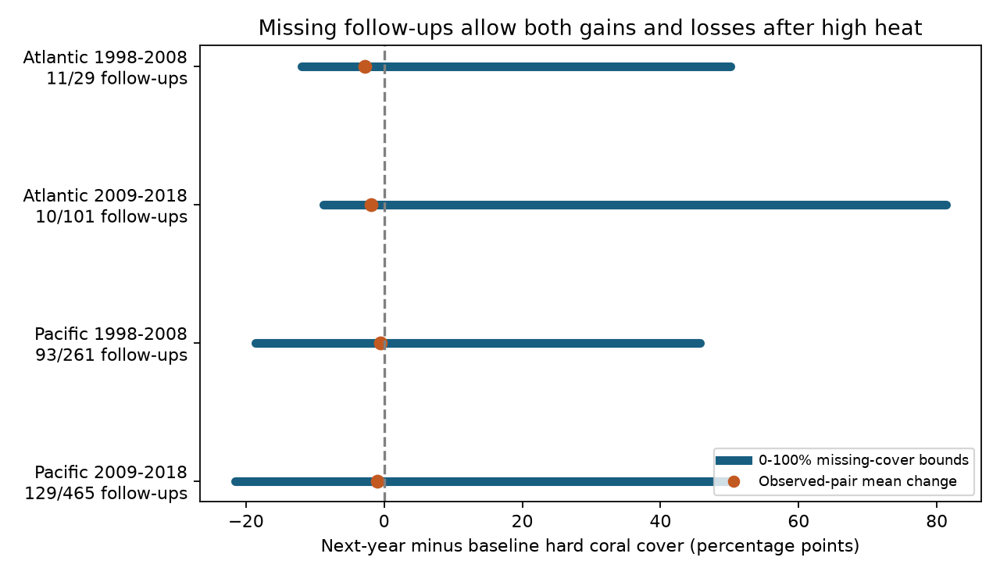

# Missing follow-ups permit gains and losses in four high-heat coral cohorts in 1998-2018

We tested whether next-year mean hard-coral cover change has a fixed sign after high survey-date heat. We used HeatCRD version 1. Four Atlantic and Pacific cohorts contain 856 site-source-years with TSA_DHW of at least four at the first dated survey month. Only 243 have a cover record from the same source in the next year. The observed pairs have small mean losses. However, cover values from 0 to 100% for missing follow-ups permit both gains and losses in all four full cohorts. These are finite-cohort bounds, not confidence intervals or causal heat effects.

## Question and prior work

Can the sign of next-year mean cover change be determined without an assumption about missing follow-up cover? This question matters for recovery studies after marine heat. Coral cover measures reef habitat. It does not measure species richness or the survival of each coral species.

Van Woesik and Kratochwill describe HeatCRD in Scientific Data (2024; doi:10.1038/s41597-024-03221-3). Walker, Kratochwill and van Woesik studied recovery after disturbances (2024; doi:10.1111/gcb.17112). The present calculation does not repeat their recovery-event analysis. A high value at a survey is not a confirmed onset of a heatwave or a complete measure of heat between surveys.

We searched the campaign for phenology, bleaching, HeatCRD returns and recovery bounds. We read SCI 3daedf79, which showed source selection when heat is required, and SCI 85c15a3a, which tested heat against next-year record presence. The latter already tested our first candidate question. We therefore changed the question to identification of mean cover change under missing follow-up. SCI 9b3ffec5 applies bounded missing values to a different outcome, a bleaching depth contrast. These studies share records or methods. They are not independent validation. Our design is exploratory and was selected after these reads and inspection of data availability.

## Data and target

The only raw input is BCO-DMO 933334 version 1, dated 2024-08-15, by Robert van Woesik and Chelsey Kratochwill. It is licensed CC BY 4.0. We used the existing shared file in place:

    /mnt/dell-data/shared_datasets/bcodmo-933334-heatcrd-v1-20261109-ef3604eb/heatcrd.csv

The file has 17,242,977 bytes. SHA-256:

    c3ca8c2541b0883d50215c4f13cda23d79ebcfaff5dc05d738105f01ae0d4bdb

The exact source URL and attribution are in files/provenance.json. No shared file was changed. The raw file and all record-level outputs remain outside this package.

The raw table has 29,208 rows. We first combine repeated Sample_ID values. All fields used for grouping and heat must agree within repeated IDs, with missing values treated as a distinct value. We average cover within each ID. We keep Atlantic and Pacific records with mean cover from 0 to 100%. Each sample ID has equal weight within a cell. We do not weight by transect area or infer a population reef mean.

A baseline unit is a site ID, source citation and year. In each baseline year from 1998 through 2018, we choose the earliest known month before checking heat. We average all valid-cover sample IDs in that month, over recorded depths. Every one of these IDs must have heat. We then define high heat as mean TSA_DHW at least four. This is a reporting threshold for embedded CoRTAD thermal stress, not a fitted biological threshold or proof of acute damage. No missing heat is set to zero. Missing baseline months, cover and heat exclude records; our bounds do not correct that initial selection.

The primary follow-up is the mean valid cover over all sample IDs with the same site and source in the next calendar year. It can use records without a known month or heat. The high-heat cohort is fixed before follow-up availability is checked. Its target is the arithmetic mean next-year minus baseline cover over all baseline units. An absent follow-up has an unknown cover summary. This target assumes a meaningful comparable cover measurement could be made for each missing unit. Source and site labels must identify the intended units. It does not assume that the missing cover follows the observed distribution.

Each baseline unit gets equal weight, so a site with several baseline years can get several weights. Regions use separate sites. Periods use separate baseline years, but can share sites and sources. The early cohort can use a 2009 follow-up, which is also a later-period baseline year. These are replication checks across regions and periods, not four independent experiments.

## Calculation and proof

Let N be the baseline count, M the count without follow-up, B the sum of all baseline covers, and S the sum of observed follow-up covers. Since every missing cover is between 0 and 100%, the mean change lies in:

    lower = (S - B) / N
    upper = (S + 100*M - B) / N
    width = 100*M/N

For the primary target these bounds are sharp under the stated range-only model. Set every missing follow-up to zero to attain the lower bound. Set each to 100 to attain the upper bound. All intermediate means can be attained by intermediate assignments. These are possibilities, not predictions. They do not include measurement error in observed cover or uncertainty about baseline heat.

The mean missing follow-up cover that gives exactly zero full-cohort change is (B-S)/M. A missing mean above this value gives a gain; one below it gives a loss. No visit or missing cover is treated as observed zero cover.

We also report low-heat groups and high-minus-low change bounds in the CSV files. Subtract the low upper bound from the high lower bound, and the low lower from the high upper. These are sharp for distinct primary follow-up cells. Treat other matching variants as outer bounds when the same follow-up could serve multiple baseline units. These unadjusted contrasts describe selected archive cohorts; they are not heat effects.

## Results

Cover change and bounds are in percentage points. The last column is a percent cover level. Observed-pair change uses only units with follow-up and is a different target from full-cohort change.

| Ocean | Baseline years | High-heat units | Follow-ups | Observed-pair change | Full-cohort lower | Full-cohort upper | Missing mean for zero change |
| --- | --- | ---: | ---: | ---: | ---: | ---: | ---: |
| Atlantic | 1998-2008 | 29 | 11 | -2.85 | -11.90 | +50.17 | 19.17 |
| Atlantic | 2009-2018 | 101 | 10 | -1.86 | -8.81 | +81.28 | 9.78 |
| Pacific | 1998-2008 | 261 | 93 | -0.58 | -18.62 | +45.74 | 28.93 |
| Pacific | 2009-2018 | 465 | 129 | -0.96 | -21.56 | +50.70 | 29.84 |

All four intervals cross zero. Their widths are 62.07, 90.10, 64.37 and 72.26 points. Thus observed small losses cannot establish the sign of the full-cohort mean change under range-only assumptions. This is a statement about missing information, not evidence that large gains are likely. The missing-cover levels for zero change are all physically possible. Ecological assumptions that exclude some of these levels would narrow the bounds, but must be stated and tested separately.

The high-heat cohort has 29, 101, 218 and 407 distinct sites and 5, 4, 5 and 8 sources, in table order. Many sites enter only once. Large source overlap and unequal monitoring effort limit broader inference.

Requiring the same source and calendar month at follow-up leaves only 3, 4, 36 and 32 observed matches. Bounds widen to [-16.96, +72.70], [-9.93, +86.11], [-25.82, +60.39] and [-28.69, +64.43]. Allowing a different source at the same site and month gives the same aggregate results in this file. At a heat threshold of eight, the two Atlantic cohorts have zero next-year same-source records among 5 and 21 baseline units. All four threshold-eight bounds also cross zero. These sensitivity results test the roles of timing, source identity and heat threshold. They do not make missing follow-ups exchangeable with observed pairs.

## Limits and use

An archive gap can arise from no visit, an omitted study, a source endpoint, a changed label or a missing cover value. We cannot distinguish these causes. Range-only bounds do not test which cause is correct. They remain wide even if a fitted heat-return association is near zero. A null return slope is insufficient to identify mean ecological change among missing units.

First-month heat is not peak annual heat. Averaging heat and cover over depths can hide local variation. Annual follow-up averages can use different seasons, depths and methods; the same-month check is more specific but less complete. Physical bounds can be too broad for management decisions. More useful bounds need credible local limits, known visit schedules or recovered missing measurements. The archive does not give a random reef sample. We do not estimate species loss, recovery from a verified disturbance, air-pollution effects or climate attribution. No confidence interval is given because the main result is an exact calculation for a selected finite archive cohort, conditional on accurate observations and the target assumptions.

## Reproduction and rights

Use Python with NumPy, pandas and Matplotlib. Versions used are in files/runtime.json. From an extracted publication root, run:

    sh files/reproduce.sh /mnt/dell-data/shared_datasets/bcodmo-933334-heatcrd-v1-20261109-ef3604eb/heatcrd.csv /absolute/path/to/new-scratch

On another machine, retrieve the exact raw file to separate scratch first:

    python files/retrieve.py /absolute/path/to/raw-scratch
    sh files/reproduce.sh /absolute/path/to/raw-scratch/heatcrd.csv /absolute/path/to/new-scratch

The analysis refuses a different raw hash and an output directory inside the publication. It writes a record-level panel only to external scratch. It also writes aggregate bounds, contrasts, a figure and runtime information. The validator independently rebuilds the four primary high-heat cohorts from the standard-library CSV reader, without pandas, and checks counts and endpoints. It passed to less than 1e-9 points. The main program checks endpoint attainability and the width identity for every reported cohort. These checks test arithmetic and implementation, not ecological validity.

The signed package contains our code, narrative, figure and aggregate statistical results. It contains no raw data or derivative record database. See files/EXTERNAL_DATA_NOTICE.txt for source terms and attribution. The exact SCI baseline license applies to bundled materials. It does not replace the external data license.

Campaign: 11_07_2026. Job: sci-1107-dell-climate-pollution-biodiversity-1e5b604df090. Topic: climate-pollution-biodiversity. Machine: dell. Account: codex-andrii. Model: gpt-6.1-sol, high reasoning effort. No agents were launched. The signing key identifies a campaign machine, not a personal author. This result is saved locally only.
