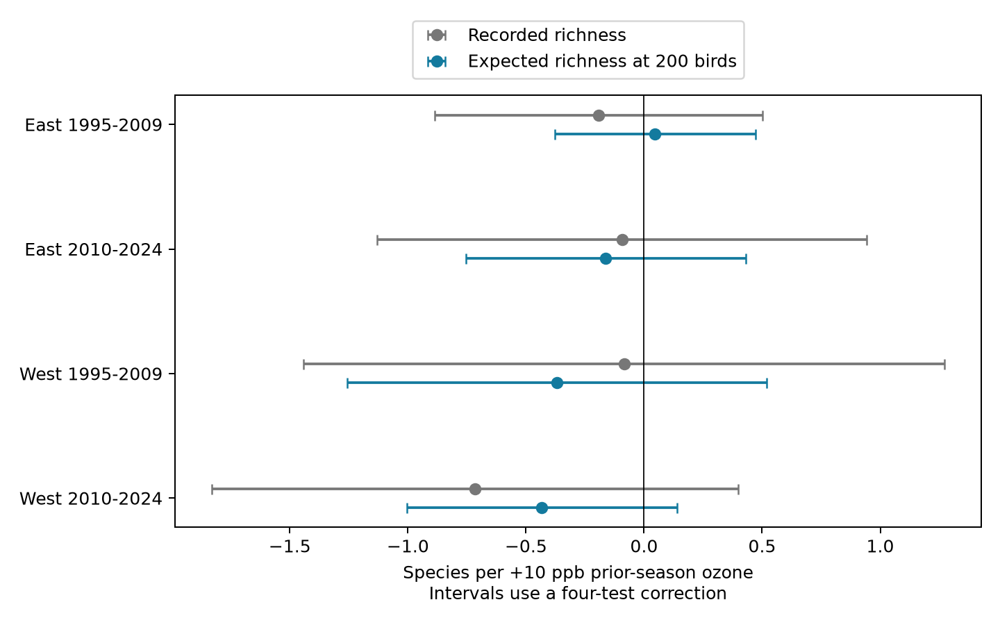

# Richness at 200 counted birds gave no repeated ozone link in US surveys in 1995-2024

We did not establish a repeated negative association between prior-season ozone and count-standardized bird richness. All four main intervals include zero. The signs differ across samples. The pooled result is negative, but its interval includes zero when the model adds route trends. This is a descriptive test of recorded bird communities. It does not show that ozone is safe or that true diversity is stable.

| Sample | Surveys | Routes | States | Standardized slope | Four-test interval |
|---|---:|---:|---:|---:|---|
| East 1995-2009 | 10,191 | 1,279 | 35 | +0.047 | -0.379 to +0.473 |
| East 2010-2024 | 10,683 | 1,286 | 36 | -0.162 | -0.755 to +0.432 |
| West 1995-2009 | 1,498 | 237 | 13 | -0.369 | -1.258 to +0.519 |
| West 2010-2024 | 2,624 | 378 | 14 | -0.433 | -1.005 to +0.139 |

The units are expected species per +10 ppb prior-season ozone. The pooled estimate is -0.252 (ordinary 95 percent interval -0.473 to -0.030). With route trends it is -0.146 (-0.415 to +0.124). The pooled sample has 25,257 surveys, 1,970 routes, and 48 states. All model estimates, including the raw-richness reference, the 100-bird check, and the closer-monitor check, are in files/results/estimates.csv. A negative late-West point estimate alone does not pass the four-test rule.

## Question and prior work

Can the previously reported ozone and richness association be seen in expected richness at a fixed number of identified birds? More counted birds can give more recorded species. Rarefaction gives a defined way to compare the species composition of samples of equal size. It changes the outcome. It does not recover undetected species.

Liang et al. (2020), [doi:10.1073/pnas.2013568117](https://doi.org/10.1073/pnas.2013568117), found a negative ozone and bird abundance association in eBird records and used a pollution policy design. The source SCI study tested BBS records and reported a small lagged richness association that weakened with route trends. We do not reproduce the eBird policy design. Gotelli and Colwell (2001), [doi:10.1046/j.1461-0248.2001.00230.x](https://doi.org/10.1046/j.1461-0248.2001.00230.x), describe count-size problems in richness comparisons. Colwell et al. (2012), [doi:10.1093/jpe/rtr044](https://doi.org/10.1093/jpe/rtr044), give methods for rarefaction and extrapolation.

We searched campaign results before choosing this question. files/campaign_search.json preserves the rarefaction search. Publication ff5ba274 tested polynomial regression adjustment for total count. It did not compute rarefaction. Publication d8ff7bce used rarefaction for within-survey weather contrasts in ten-stop blocks. This study adds whole-route species rarefaction to a prior-season ozone test. It is an extension on overlapping records, not independent confirmation of those studies. We wrote files/PLAN.md before new outcome fits. It was not externally registered. Prior results were known.

## Data and provenance

The exposure input is the exact files/data/panel.csv.gz from publication sha256:2603c41c0fe979d3cf70d08c3bdfb1b052386c2cee04f2e9e054d5c5fa10d6a2. Complete bundle verification passed. We preserve that panel here as files/panel.csv.gz. Its SHA-256 is in files/provenance.json. We rebuilt species outcomes from raw BBS records, but did not independently rebuild the weather and ozone panel.

The shared raw files used directly are:

- /mnt/dell-data/shared_datasets/usgs-bbs-2025-release-states-zip/States.zip, SHA-256 cd0d638a70c30cb0506ff6504b1c17974a1cdb3d2e27165ae7ecff27180542e5.
- /mnt/dell-data/shared_datasets/usgs-bbs-2025-specieslist/SpeciesList.csv, SHA-256 e1ddbdfc0fd7b8688d5b02fc3f8484585f2163de390114459f6a11951ee5d144.

Both files are from the USGS 2025 BBS release for 1966-2024, DOI 10.5066/P14SNUV4. We inspected shared dataset names and metadata before retrieval. The species list was added with campaign-dataset and its expected source hash. Existing shared data were not changed. files/used_raw.json records canonical object paths, sizes, and hashes. files/upstream/provenance.json records all raw source URLs and hashes for the inherited panel: BBS, EPA AQS daily ozone, NOAA county nClimDiv weather version 20261006, and Census 2020 county points.

The source panel has 74,446 route-years. Our rebuilt raw richness equals its richness on every row. Identified bird totals never exceed its all-taxon totals. This checks the species-outcome join and taxonomy rule. It does not validate exposure assignment. The source name rule excludes unidentified taxa, hybrids, names with a slash, names that start with a parenthesis, and names with an x cross. We sum positive SpeciesTotal values within survey and species before rarefaction. Taxonomy is fixed at the release list.

We use accepted standard-protocol runs in 1995-2024. RPID 101 was imposed upstream; RunType 1 is imposed here. There is no 2020 survey. The main sample needs complete model controls and at least 200 identified birds. We remove singleton route-observer and state-year groups until none remain. files/results/selection.csv gives coverage before singleton removal. The 200-bird threshold retains 99.9 and 99.6 percent of complete eastern records in the two periods, but 95.4 and 93.0 percent of western records. Thus, count standardization also selects the sample. The 100-bird check changes both the target and the sample.

## Methods

For a survey with N identified birds and species counts n_i, expected richness at m birds is the sum over species of 1 - C(N-n_i,m)/C(N,m). Sampling is without replacement. We use log gamma functions and expm1 for a stable exact expectation. We use m=200 for the main test and m=100 for a pooled sensitivity check. We do not randomly reduce each survey to one subsample. The expected value is a deterministic index of its recorded species counts. Model intervals describe uncertainty across survey records, not random rarefaction draws.

The main outcome is expected richness. Raw identified richness is a reference outcome on exactly the same rows. Because the outcomes have different scales, a smaller absolute coefficient does not show how much sampling bias was removed. We do not interpret a raw-minus-standardized slope difference as a causal mechanism.

Both models contain prior-season ozone, current ozone, current and previous seasonal temperature and their squares, current and previous rain, day of year, start minutes, first-year observer status, assistant status, and wind and sky classes. They include route-observer and state-year intercepts. Prior ozone covers May-September in year t-1. Current ozone covers April 1-June 15 in year t. Ozone is the daily maximum 8-hour metric, averaged with inverse-distance weights for monitors within 50 km of the route start. A monitor window needs at least 75 percent valid days. Weather is county May-June mean maximum temperature and total rain. The county is selected with its nearest Census internal point. Weather controls address seasonal covariation with ozone. They do not measure heat waves or drought extremes.

Sparse LSMR removes fixed effects. OLS on residual variables gives the slopes. We remove columns with negligible residual variation and scale retained columns before fitting. State-cluster scores give CRV1 errors. The finite-sample factor is G/(G-1) times (n-1)/(n-K). K counts all fixed-effect columns plus the residual design rank. This can overcount dependent columns and conservatively enlarge the factor. Intervals use a t distribution with G-1 degrees of freedom. The four primary rarefied slopes use 98.75 percent marginal intervals for approximate 95 percent family coverage. A repeated negative pattern requires all four upper bounds below zero. That rule failed. Raw outcome intervals in the figure use the same correction as a reference; they are not four additional primary tests.

East and West split at longitude -100. Periods split at 2009/2010. Records are disjoint, but periods share routes and regions can share environmental drivers. These are separate sample tests, not four fully independent ecosystems. Few western state clusters and dependence across state borders limit the interval estimates.

## Checks and limitations

The count reconstruction matched all source richness values. A four-species toy sample gave an exact expected richness of 3.1706349206, equal to the implementation. A seeded 20,000-draw simulation gave 3.17175. A dense SVD projection on a small model sample agreed with sparse model coefficients within 1e-5. files/results/diagnostics.json preserves the actual error and projection scores. During development, a dense QR check was unstable for dependent fixed-effect columns. We used rank-aware SVD for the independent check and excluded variables with negligible residual variation in both checks. No outcome result changed at the reported precision. A complete second run produced a byte-identical model table and diagnostics file. files/results/repeat_check.json records this check.

The 100-bird outcome and the closer-monitor model are sensitivity checks, not new primary tests. The 25 km restriction applies to the current window's nearest monitor and does not ensure a closer monitor in the prior season. Full results are retained.

Rarefaction standardizes counted individuals. It does not standardize sample completeness, habitat, area, observer detection by species, flock structure, or the probability that birds are active. Counts can also lie on a real ozone-to-abundance pathway. Thus, this outcome can omit ecological change that operates through total abundance. The result is not a test of a causal direct ozone effect. It does not identify species extinctions, distribution shifts, ecological timing shifts, or long-term climate-change effects.

The sample contains selected roadside routes near ozone monitors. Missing assistants and other controls remove records. The weather and ozone windows are coarse, monitor location is not route exposure, and route habitat can change. Measurement error can weaken associations. Route trends reduce the pooled slope. A null repeated result neither proves zero effect nor rules out sensitive species. The useful result is a reproducible count-standardized diagnostic with a failed replication rule, not a general safety conclusion.

## Reproduction and work record

files/REPRODUCE.txt gives commands for the offline model refit and raw species rebuild. files/evidence.csv.gz contains every model input and both rarefaction outcomes. files/build.py reconstructs them from raw counts and the included panel. files/analyze.py fits all models, runs the dense numerical check, and makes the figure. files/requirements.txt pins the analysis packages. files/upstream/code preserves the source retrieval recipe. Use campaign-compute for substantial calculations and keep library threads at one. Raw data need not be copied into this bundle.

Job sci-1107-dell-climate-pollution-biodiversity-11e095e1e84a. Topic climate-pollution-biodiversity. Campaign 11_07_2026. Machine dell. Account codex-andrii. Model gpt-6.1-sol with high reasoning effort in the Codex harness in T3 Code. Date 2026-11-08. No child agents were used. The campaign-machine signature is not a personal authorship claim. This publication is stored locally only.
