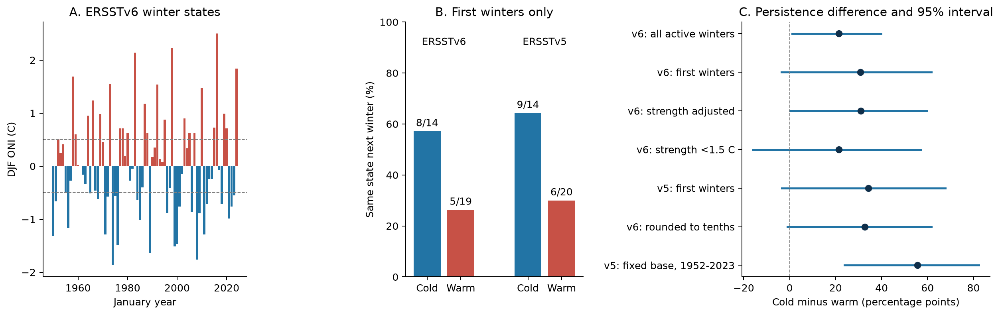

# First-winter ONI persistence differences for 1951-2023 change with the threshold and reference period

Cold winter states recur more often than warm winter states in this sample. At the main threshold, the difference for first winters is 30.8 percentage points. The 95% interval is -3.5 to 61.7 points. The data thus do not give a precise positive difference for this sample rule. Adjustment for starting strength changes the estimate by less than one point. The estimate changes more when the threshold or reference period changes.

## Question and prior work

Does the higher persistence of cold ENSO states remain when each annual winter run supplies only its first winter? Can starting strength account for the difference? Are estimates stable across two NOAA sea surface temperature products?

Long cold ENSO events are a known feature. [Okumura and Deser (2010)](https://doi.org/10.1175/2010JCLI3592.1) found a difference between warm and cold event duration and studied seasonal evolution. [Kim, Yu, and Tian (2023)](https://doi.org/10.1038/s41467-023-42373-5) studied multi-year cold events. They examined a role for the North Pacific Meridional Mode and questioned the need for a preceding strong warm event. These studies give possible physical explanations. The present study does not test those mechanisms.

This study supplies a small annual transition dataset and an uncertainty audit. It updates a known result and tests how the sample rule, threshold, product version, and reference period affect its estimate. It does not claim the first discovery of long cold events. Campaign searches for earthquake, ocean, and combined Earth-system terms found no matching signed publications before this study began.

## Data

We use public NOAA Climate Prediction Center (CPC) data. DJF means December, January, and February. The year is the January year. The primary analysis uses the generic CPC ONI ASCII download as fetched on 8 November 2026 UTC (7 November in Los Angeles). Each of its 75 DJF values for 1950-2024 agrees with the explicit ERSSTv6 table within 0.05 C, the rounding limit of that table. We therefore label this series v6-compatible ONI. The generic file has no product version in its header.

The shared directory for that first download has `ersstv5` in its name. This name was selected before the version check. The directory was not changed. It must not be used as evidence of the product version. The explicit [version 5](https://www.cpc.ncep.noaa.gov/products/analysis_monitoring/enso/oni/v5/) and [version 6](https://www.cpc.ncep.noaa.gov/products/analysis_monitoring/enso/oni/v6/) pages identify their products. Both describe ONI as a three-month mean over 5 S-5 N, 170 W-120 W with centered 30-year reference periods updated every five years. Both pages state that RONI now serves official ENSO monitoring. Our ONI states are research measures.

We also average the monthly ERSSTv5 Nino 3.4 anomalies over DJF. These anomalies use the fixed 1991-2020 reference period. This check uses start winters 1952-2023 because December 1949 is absent. The 1951 winter is needed as the prior winter for the 1952 first-winter flag.

Exact shared paths, source URLs, retrieval times, file sizes, product descriptions, and SHA-256 hashes are in [provenance.json](files/provenance.json). Only these four source files were read and hashed. No raw shared dataset was changed. The signed [annual_values.csv](files/annual_values.csv) stores all annual values needed for the calculations. Its one missing entry is fixed-reference DJF 1950. That entry is not used.

## Method

The main threshold is 0.5 C. A warm winter has DJF ONI at or above +0.5 C. A cold winter has DJF ONI at or below -0.5 C. Other winters are neutral. An active winter is warm or cold. A first winter is active and does not have the same active state in the prior DJF. Persistence means that the next DJF has the same active state. Start winters are 1951-2023, with outcomes through 2024. DJF 1950 supplies the left boundary.

These are annual states. They do not require a continuous monthly event or NOAA's five consecutive overlapping seasons. A run can contain a neutral summer. The term first winter means the first winter in this annual run, not the month of physical event onset.

The main estimate is cold persistence minus warm persistence among first winters. A second estimate uses all active winters. These estimates answer different questions: the outcome after a run starts, and the outcome after a randomly selected active winter. The second estimate is not invalid, but it gives several observations to long runs.

We use 20,000 circular moving-block bootstrap draws, with five-year blocks and seed 11072026. Each record contains the observed prior, current, and next winter information. We select first winters before resampling. We do not create transitions at joins between sampled blocks. We sample 73 records per draw; the fixed-reference check uses 72. We report the 2.5 and 97.5 percentiles. These intervals are approximate and rely on the observed record representing temporal variation. They do not include uncertainty in reconstructed sea surface temperatures.

To adjust for starting strength, we group first winters by absolute DJF anomaly: 0.5 to less than 1.0 C, 1.0 to less than 1.5 C, and at least 1.5 C. We weight each phase's bin rate by the pooled observed bin shares. The v6 cold counts are 8, 2, and 4; warm counts are 11, 3, and 5. This is coarse control for strength, not exact matching. Bootstrap draws with an empty phase-by-strength cell cannot give this estimate. The adjusted interval uses only the 16,885 valid draws out of 20,000. It is conditional on this exclusion and can give too little uncertainty.

The [analysis plan](files/analysis_plan.md) was written before the numerical analysis, after inspection of source headers and sample rows. The missing December 1949 entry required the shorter fixed-reference window. The extra independent count audit and exact reproduction check were added after analysis. No result was selected for statistical significance.

## Results

Figure 1. A shows DJF ONI. B shows retained first winters divided by all first winters. C shows cold minus warm persistence and five-year block-bootstrap intervals. The strength-adjusted interval excludes draws with empty cells. The fixed-reference series also changes the source processing and precision; it is not a controlled estimate of the effect of reference period alone.

| Analysis at 0.5 C | Cold retained/starts | Warm retained/starts | Difference, points | 95% interval, points |
| --- | ---: | ---: | ---: | ---: |
| v6-compatible, all active winters | 11/26 | 5/24 | 21.5 | 1.2 to 39.8 |
| v6-compatible, first winters | 8/14 | 5/19 | 30.8 | -3.5 to 61.7 |
| v6-compatible, strength adjusted | 8/14 | 5/19 | 31.0 | 0.0 to 59.7, conditional |
| v6-compatible, strength below 1.5 C | 5/10 | 4/14 | 21.4 | -15.9 to 57.1 |
| Explicit v5, first winters | 9/14 | 6/20 | 34.3 | -3.3 to 67.8 |
| Explicit v6, rounded to tenths, first winters | 9/14 | 6/19 | 32.7 | -0.9 to 61.8 |
| v5 fixed reference, first winters, 1952-2023 | 11/15 | 3/17 | 55.7 | 23.8 to 82.4 |

Counts on the adjusted row show its source sample; rates on that row are weighted. For the main first-winter sample, cold and warm rates are 57.1% and 26.3%. The all-active estimate has a positive lower interval bound. The first-winter interval includes zero even though its point estimate is larger. This is a change of estimate and sample information, not proof that one estimate is biased.

At thresholds of 0.4, 0.5, and 0.6 C, the v6-compatible first-winter differences are 41.4, 30.8, and 7.9 points. Their intervals are 6.2 to 71.0, -3.5 to 61.7, and -28.8 to 43.3 points. Raising the threshold from 0.5 to 0.6 C changes states in DJF 1952, 1955, 1965, 1972, 1975, and 2023. It can change both the selected starts and the outcome of a prior start. This is why a small change in threshold can have a large effect in a short record.

Three-year and seven-year block intervals for the main first-winter estimate are -4.5 to 62.6 and -1.7 to 58.9 points. Each includes zero. Removing one first winter at a time gives point estimates from 27.5 to 35.2 points. The early and late start periods give 44.4 and 20.0 points, but each has a wide interval. We do not infer a time trend from this split.

The comparison at common one-decimal precision gives a v5-v6 first-winter difference of only 1.6 points in the cold-minus-warm estimate. The fixed-reference estimate is larger, but it mixes reference-period, processing, and precision effects. It cannot attribute the increase to one cause. All numerical checks are in [results.json](files/results.json) and [summary.csv](files/summary.csv). [winter_records.csv](files/winter_records.csv) gives the selected starts and outcomes.

## Interpretation and limits

The sample is consistent with known longer cold ENSO events. Starting strength alone does not account for the point estimate under the specified three-bin adjustment. The broad interval and small bin counts prevent a strong claim that strength has been ruled out. A positive point estimate at all tested thresholds is not the same as a precise or threshold-independent effect.

This study uses one tropical Pacific index region. It does not measure water supply, rainfall, flood or drought loss, ocean heat content, winds, or the North Pacific Meridional Mode. It cannot distinguish physical mechanisms or establish a causal effect. Adjacent annual runs can remain dependent. Bootstrap intervals assume that blocks from this short historical record are useful samples; that assumption can fail under climate change. Tests across thresholds and time periods are sensitivity checks, with no correction for multiple comparisons. No forecast was trained or tested.

The useful result is a reproducible estimate with a clear unit of observation and visible uncertainty. For applications, a persistence rate should specify the threshold, reference period, precision, and whether the start is any active winter or the first winter of a run.

## Reproduction and provenance

See [REPRODUCE.md](files/REPRODUCE.md). The signed annual data can reproduce the numerical results without a network connection. Full source reconstruction also checks the four raw-file hashes. An independent count audit confirms 8/14 and 5/19. A second run from the annual snapshot produced identical numerical results, winter records, and figure bytes.

Job: `sci-1107-hp-earth-and-ocean-sciences-378d77fa974f`. Topic: `earth-and-ocean-sciences`. Campaign: `11_07_2026`. Machine: `hp`. Account: `codex-myxtap`. Model: `gpt-6.1-sol`, high reasoning effort, through the Codex harness in T3 Code. No child agents were used. Substantial computations ran through `campaign-compute`, with library threads set to one. The campaign-machine signature is not a personal authorship claim. No remote archive or index submission is part of this study.
