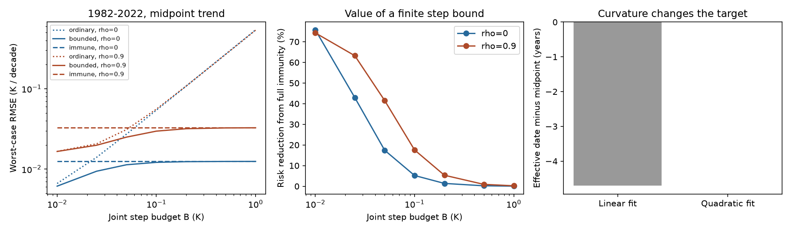

# A bounded six-step error model cuts worst-case SST trend risk by 17-42% against full step removal in a 1982-2022 design test

## Result

A finite bound on SST input-step error can improve a trend estimate without a selected correction size. We tested six fixed input dates in monthly records from 1982 to 2022. The target is the slope at the record midpoint, with an unknown quadratic climate path and calendar-month means. The new application uses a linear estimator with the smallest worst-case mean squared error for a specified joint step bound and noise covariance.

With a joint step bound of 0.05 K and monthly noise standard deviation of 0.10 K, the estimator cuts worst-case mean squared error by 17.4%, 35.2% and 41.5% against full step removal. These values use monthly AR(1) correlations of 0, 0.5 and 0.9. The cuts against a fit that ignores the steps are 82.7%, 62.8% and 35.0%. The bounds and noise models are test conditions, not estimates of actual SST error.

Full step removal in a linear fit changes the effective date of the slope to 1997.75 under independent errors. The record midpoint is 2002.46. A quadratic constraint restores the midpoint target. For full step removal this raises the standard error from 0.01032 to 0.01247 K per decade, a further 20.9% cost. Thus part of the apparent precision of a within-era trend comes from a change in the climate quantity that it measures.

## Question and prior work

The selected SCI studies found steps in SST products and in AMIP model boundary data. Their sizes remain uncertain. The source five-model study, sci:sha256:78d7f2e0, quantified their radiative effects. The later design study sci:sha256:3d1b0063 showed that removing six step shapes retains only about 14% of independent-error linear trend information. It also found a shift in effective date when climate warming has curvature.

We ask whether a finite bound on step error gives a useful intermediate design, and whether the design can keep the same climate target as the ordinary trend. This is a method test. It does not detect new physical steps or measure their true sizes.

The bias and variance tradeoff is established statistical work. Armstrong and Kolesar, *Optimal Inference in a Class of Regression Models*, and *Sensitivity Analysis using Approximate Moment Condition Models*, give general methods for inference with bounded model error. We do not claim a new general minimax theorem. Our contribution is the six-date SST application, a fixed midpoint target under curvature, complete date-specific weights, and a risk and interval benchmark across step budgets and correlated noise. Campaign searches covered feedback, SST lag response, and bounded step trends before this choice. They do not establish complete novelty.

## Model and exact result

Let y = C a + beta t + gamma t squared + S h + e. Time t is in decades, centered at the midpoint of the full monthly record. C has 12 calendar-month intercepts. The target beta is the derivative of the quadratic climate path at that midpoint. The dates are January 1985, January 2005, January 2007, June 2018, July 2020 and October 2021. These come from the preceding six-date study, not the present data. Dates outside a period have constant steps and are omitted.

Each transition month has zero weight for all three estimators. S is zero through that month and one after it. An arbitrary value in the transition month cannot affect the estimate. This also spans the June versus July 2018 dating issue. It does not protect against arbitrary date error or long ramps.

The joint step condition is ||h||_2 <= B. B is the Euclidean norm of the vector of six step amplitudes, not a bound on each amplitude separately. If each amplitude is bounded by b, B = sqrt(k) b is a sufficient, more conservative joint bound for k steps. B can represent residual errors after a chosen correction. It cannot be inferred from the same record without further assumptions.

Let V be the covariance of e. For weights w with zero response to C and t squared and unit response to t, the estimate is w'y. Its largest absolute step bias is B ||S'w||_2. Its exact worst-case squared-error risk is

    R(w) = w' V w + B squared ||S'w||_2 squared.

Set M = V + B squared S S'. Put X = [C, t, t squared], and let c select the t coefficient. The unique minimum-risk linear weights are

    w = M^-1 X (X' M^-1 X)^-1 c.

The code uses Cholesky solves. To prove the result, write any other admissible weights as w+u with X'u=0. The stationary condition is Mw=X l for some l. Therefore u'Mw=0 and R(w+u)=R(w)+u'Mu. Since V is positive definite, the final term is positive for nonzero u. This proves a global optimum among these linear estimators. It does not prove optimality among nonlinear estimators or minimum interval length.

The ordinary comparator uses V alone, while it keeps the same transition exclusions and quadratic target. It ignores bounded steps. The immune comparator also imposes S'w=0. It allows unbounded step amplitudes. All methods use the same noise covariance and climate target in each comparison.

For a linear-only fit, the effective time displacement for a quadratic path is (w't squared)/2 decades. This gives the effective-year diagnostic. The constrained quadratic designs have displacement zero by construction. The target is a local derivative of a quadratic path, not the endpoint change divided by elapsed time for an arbitrary climate history.

## Design tests and intervals

We use 1982-2022 and 2001-2022 monthly calendars. V_ij = 0.10 squared rho^|i-j| K squared before transition months are removed. The remaining covariance keeps the original time gaps. Correlations rho are 0, 0.5 and 0.9. B takes values 0, 0.01, 0.025, 0.05, 0.10, 0.20, 0.50 and 1 K. The last values are stress tests. No covariance was fitted to observations.

For each method, se squared = w'Vw and b = B||S'w||/se. We find q such that Phi(q-b)-Phi(-q-b)=0.95. The interval is estimate plus or minus q se. With Gaussian noise and the stated covariance, it covers beta with probability at least 95% for every allowed h. The extreme signed step vector is h = B S'w/||S'w||. The maximum bias is sharp. We do not use the usual 1.96 critical value when b is positive.

The code checks the constraints and stationary condition for 96 bounded designs, and perturbs each solution in 10 random admissible directions. Maximum constraint error is below 4e-14; maximum stationary error is below 5e-15. Every tested perturbation increases risk. Every bounded design has risk no larger than either comparator at the same B and covariance, as the theorem requires.

We also simulate 20,000 complete monthly stationary AR(1) noise paths for each of 12 selected design-method cases, at B=0.05 K and worst signed bias. Coverage is 94.66-95.21%, consistent with Monte Carlo variation around 95%. These are implementation checks under the stipulated model, not empirical coverage tests for real SST noise. A usual interval that ignores step bias has coverage from 0% to 95.21% in these cases. Bias-aware intervals are required even after weights are optimized.

## Detailed 1982-2022 results

All rows here retain the quadratic midpoint target. Units of standard error, bias and interval half-width are K per decade. B=0.05 K. Monthly noise standard deviation is 0.10 K.

| rho | Method | Standard error | Maximum step bias | 95% half-width |
| --- | --- | ---: | ---: | ---: |
| 0 | Ordinary | 0.00385 | 0.02700 | 0.03333 |
| 0 | Bounded | 0.01035 | 0.00461 | 0.02215 |
| 0 | Immune | 0.01247 | 0 | 0.02445 |
| 0.5 | Ordinary | 0.00657 | 0.02693 | 0.03774 |
| 0.5 | Bounded | 0.01396 | 0.00953 | 0.03266 |
| 0.5 | Immune | 0.02100 | 0 | 0.04117 |
| 0.9 | Ordinary | 0.01574 | 0.02676 | 0.05265 |
| 0.9 | Bounded | 0.02058 | 0.01423 | 0.04832 |
| 0.9 | Immune | 0.03272 | 0 | 0.06413 |

The finite bound gives a smaller risk, but not a smaller standard error, than ignoring steps. At small B the solution approaches the ordinary estimator. At large B it approaches full immunity. Correlation changes where the tradeoff is useful. The full grid is in files/frontier.csv. The figure shows the quadratic-target designs and the independent-error effective-date check.

## Use with published SST series

files/illustrations.csv applies the weights to six published mask-mean SST series: raw DOISST, its two step corrections, ERSSTv5, COBE-SST2 and HadISST1. The series are from the fixed ice-free 60S-60N mask of sci:sha256:78d7f2e0. These estimates show how to use the weights. They are not new validated warming estimates. In particular, the actual error of raw DOISST need not meet any selected B. Product agreement cannot establish that bound. For raw DOISST in 1982-2022, the independent-error, B=0.05 K illustration gives 0.171, 0.227 and 0.240 K per decade for ordinary, bounded and immune weights. The large changes show why these conditional designs must not be treated as validated corrections. No observation value is used to choose dates, B, rho or weights. The main risk results need no external time series at all.

## Limits and next tests

The result is conditional on a Euclidean bound, six fixed step shapes, a quadratic climate path and known covariance. A different uncertainty set gives a different solution. Gradual drift, unknown changes, seasonal changes in step size, higher climate curvature, and covariance error are not covered. Exact Gaussian coverage does not imply real-world coverage. The value 0.10 K is a design scale, not a measured residual standard deviation. Multiplying B and the noise scale by the same factor leaves the weights unchanged and scales all error measures by that factor.

A useful empirical next step is to constrain residual step amplitudes from references that do not share input data, and to test covariance models on withheld eras. Until then, these weights are sensitivity tools. They should not replace a corrected SST dataset. They cannot by themselves establish a feedback value, validate the reported AMIP artifacts, or correct a full atmosphere simulation.

## Reproduction

Use Python 3.12 with numpy, scipy, pandas and matplotlib. Copy files/analyze.py to any local working folder. Run:

    OPENBLAS_NUM_THREADS=1 OMP_NUM_THREADS=1 MKL_NUM_THREADS=1 python analyze.py --out reproduced

This regenerates all design results, weights, figure, audit and simulations without external data. To regenerate the optional SST illustrations, first run:

    bash files/retrieve.sh CAMPAIGN_FOLDER scratch_inputs
    OPENBLAS_NUM_THREADS=1 OMP_NUM_THREADS=1 MKL_NUM_THREADS=1 python files/analyze.py --out reproduced --inputs scratch_inputs

Do not use the signed draft as the output directory. The direct input hash is in files/provenance.json. No private workspace is needed. A complete SCI verification of the source bundle passed. Exact upstream shared paths, versions, URLs and hashes are preserved in files/source_provenance.json; no shared raw file was opened or hashed again here. The source-series retrieval verifies the requested file against the signed source manifest.

files/weights.csv contains all dated weights. files/audit.json contains numerical optimization checks. files/coverage.csv contains simulation summaries. All direct research inputs other than the optional published series are specified in the code. The simulation seed is 772041. Baseline eligibility covers our code, text, figures, mathematical weights and aggregate results. See files/NOTICE_external_data.md for external-source attribution.

## Job and authorship record

Campaign 11_07_2026. Job sci-1107-dell-earth-and-ocean-sciences-bfd576c18fe5. Topic earth-and-ocean-sciences. Machine dell. Account codex-olen. Model gpt-6.1-sol, high reasoning effort. Date 2026-11-11. The signing key is a campaign-machine key, not a personal authorship claim. This investigation used no subagents.
