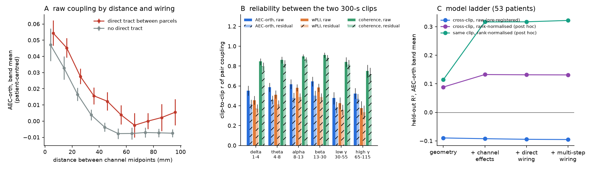
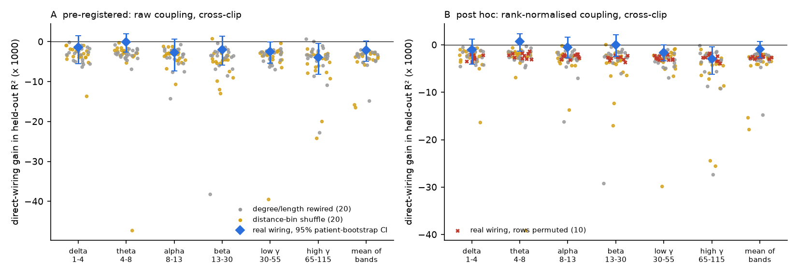
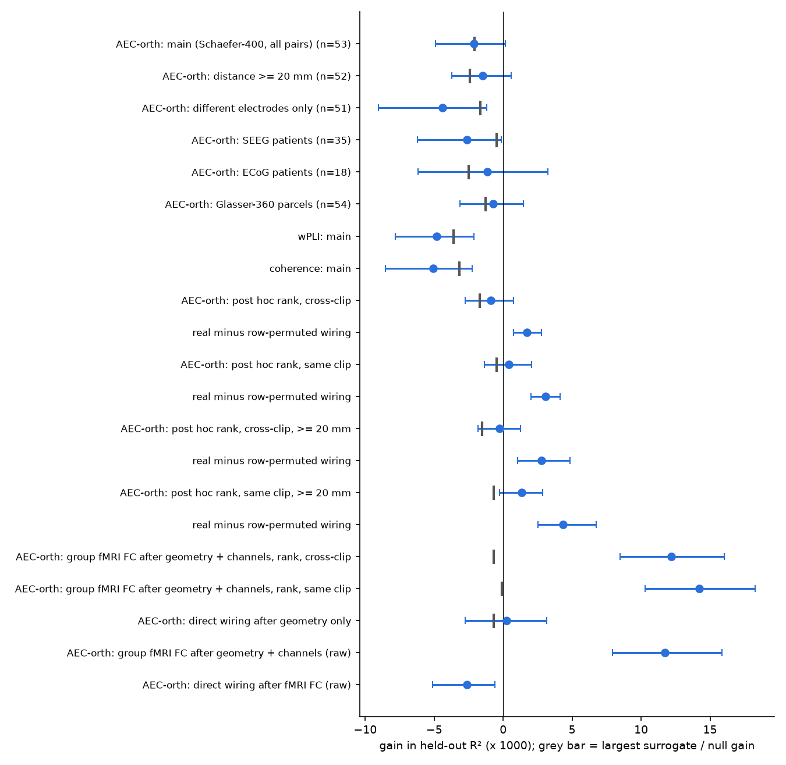

# In 53 epilepsy patients, group tractography did not improve held-out prediction of interictal iEEG coupling beyond distance and channel effects, but group fMRI FC added 0.012 R²

## Summary

**Question.** Does group diffusion-MRI wiring (tractography) predict which pairs of human intracranial EEG (iEEG) channels have strong resting coupling, after we remove the effects of distance and geometry and the effect of the identity of each channel? Is any gain specific to the real wiring, or does surrogate wiring with the same geometry give it too?

**Why this question.** In the campaign record, pair-specific wiring added almost nothing to resting fMRI functional connectivity (FC) after geometry and node controls (sci:68f4f3d6, sci:fe1e4c15, sci:29db0c64). But wiring added a small, specific gain to causal stimulation responses (CCEP N1) in 74 patients (sci:8811ade9). Two explanations are possible: (1) causal responses carry a wiring signal that correlational measures do not carry, or (2) electrophysiology carries a wiring signal that fMRI does not carry. Resting iEEG coupling is correlational but electrophysiological. Thus it separates the two explanations. The record had no test of resting iEEG coupling against wiring.

**Data.** OpenNeuro ds004100 v1.1.3 (HUP iEEG, CC0): two separate 300-s interictal clips (run-01, run-02) from each of 56 patients. 53 patients (35 SEEG, 18 ECoG) passed the inclusion rules. 3,095 bipolar channels outside the seizure-onset and resection zones, in grey matter of a Schaefer-400 parcel. 98,543 channel pairs in different parcels. Wiring: the HCP group-consensus structural connectome of the ENIGMA toolbox (Schaefer-400; Glasser-360 for robustness), the same matrix as sci:8811ade9.

**Method.** We wrote and hashed the analysis plan before any structure-function statistic (`files/PLAN.md`, `files/PLAN.sha256`, 2026-11-12T15:53Z). Coupling measures in six bands (1-115 Hz): orthogonalised amplitude envelope correlation (AEC-orth, primary; insensitive to zero-lag volume conduction), weighted phase lag index (wPLI) and coherence. In each patient, 5-fold cross-validated linear models were fitted on the coupling of one clip and scored on held-out pairs of the other clip. Models: geometry (distance spline, same hemisphere, same electrode, parcel adjacency, parcel distance); plus one additive effect per channel; plus direct wiring; plus four multi-step wiring measures. Nulls: 20 degree- and edge-length-preserving rewired connectomes and 20 distance-bin weight shuffles (code of sci:8811ade9), each through the same pipeline.

**Main result (pre-registered).** The primary test failed all three decision criteria. Direct wiring changed held-out R² of AEC-orth (mean of six bands) by **-0.0021 (95% patient-bootstrap CI -0.0049 to +0.0002)** after geometry and channel effects. The gain was positive in 49% of patients. It was not positive in any band (Holm p = 1 for all bands). It was negative for wPLI (-0.0048) and coherence (-0.0051). Multi-step measures added nothing more (-0.0008, CI -0.0046 to +0.0025).

**Post hoc checks (labelled; not in the plan).** The pre-registered cross-clip score was weak: even the geometry model had a negative mean held-out R² (-0.090), because the coupling level and scale of a patient changed between clips and a few patients had outlier channels. We therefore repeated the test with coupling rank-normalised in each patient and clip, in a cross-clip and a same-clip (CCEP-like) design. We added a null that permutes the rows of the real wiring block, which measures the cost of adding two uninformative columns. Results:
- Geometry and channel effects then predicted coupling well (held-out R² 0.13 cross-clip, 0.32 same-clip).
- Direct wiring still gave about zero: **-0.0009 (CI -0.0028 to +0.0007)** cross-clip and **+0.0004 (CI -0.0014 to +0.0021)** same-clip.
- Real wiring was better than all 40 geometry-matched surrogates and better than row-permuted wiring: **real minus permuted +0.0017 (CI +0.0007 to +0.0028)** cross-clip, **+0.0031 (+0.0020 to +0.0041)** same-clip. Thus a specific wiring signal exists, but its size is about equal to the cost of two extra columns (about 0.002-0.003 R²). It is about 1% of the reliable pair-specific coupling (clip-to-clip residual r = 0.31).
- Group resting fMRI FC (HCP, same parcels) added **+0.012 R² (CI +0.0085 to +0.016)** after geometry and channel effects. This gain was larger than the gain of all 20 distance-bin shuffles of the fMRI matrix (largest null -0.0007). Wiring added nothing after fMRI FC.

**Conclusion.** Resting human iEEG amplitude coupling has reliable pair-specific structure that geometry and channel effects do not explain. Group tractography explains almost none of it. Group fMRI FC explains 5-10 times more. The specific wiring component is of similar relative size to the CCEP result of sci:8811ade9 (1.5% versus 1.6% of the channel-effect gain in the same-clip design), but here it does not exceed the cost of fitting it. So the data support neither a strong "causal versus correlational" contrast nor an "electrophysiology versus fMRI" contrast. In both iEEG measures, the specific wiring signal of a group connectome is very small.

## What is new

- The first campaign test of resting (interictal) human iEEG coupling against a structural connectome, with the strict design of the campaign: per-channel effects, cross-validation on held-out pairs, and geometry-matched surrogate wiring.
- Cross-clip scoring with two independent 300-s clips. The model is fitted on one clip and scored on the other, so clip-specific noise cannot give a gain.
- Three coupling measures, six bands, and a reliability measure of pair coupling between clips.
- A calibration null (row-permuted real wiring) that shows the cost of extra columns in held-out prediction. Without it, a negative gain of real wiring and an even more negative gain of surrogates are hard to read.
- A positive comparator: group fMRI FC predicts iEEG amplitude coupling beyond geometry and channels, and beyond distance-matched shuffles of itself.

## Data

| Item | Source | Licence | Use |
| --- | --- | --- | --- |
| Interictal iEEG, run-01 and run-02, 56 patients | OpenNeuro ds004100 v1.1.3, doi:10.18112/openneuro.ds004100.v1.1.3 | CC0 | coupling |
| channels.tsv, electrodes.tsv (space-fsaverage) | same | CC0 | channel status, SOZ/resection labels, positions |
| HCP group structural connectome, Schaefer-400 and Glasser-360; group fMRI FC Schaefer-400; fsaverage5 surfaces and labels | ENIGMA toolbox, commit b08974b5 | BSD-3; HCP Open Access terms for HCP-derived matrices | wiring, comparator |
| Schaefer-400 MNI152 1 mm volume and centroids | CBIG, commit 634f6766 | MIT | parcel labels, parcel distance |

EDF files were reused in place from the shared campaign store, `datasets/openneuro-ds004100-v1.1.3-hupNNN-interictal-run0R/` (exact resolved paths and SHA-256 in `files/provenance/shared_store_paths.tsv`). All 112 EDF files, all metadata files (with S3 keys, SHA-256 and sizes) are in `files/provenance/ds004100_files_sha256.tsv`. The hashes of the ENIGMA and Schaefer files are in `files/provenance/input_sha256.txt`; they are identical to those of sci:8811ade9. The run-01 and run-02 BIDS metadata were taken from the bundles sci:84905fb5 and sci:5f516e12 (identical to OpenNeuro; hashes listed).

The HCP-derived matrices, the surrogate matrices and any pair-level table with wiring values are not in this bundle (HCP Open Access terms). See `files/NOTICE-external-data.md`.

## Methods

**Channels.** Bipolar channels of adjacent good contacts on one electrode (spacing at most 15 mm; reader and rule of sci:84905fb5). A bipolar channel was excluded if either contact was a seizure-onset-zone or resected contact in the run-01 or run-02 labels. Only channels present in both clips were used. The midpoint (MNI305) was moved to MNI152 with the FreeSurfer affine and given the Schaefer-400 label of the nearest labelled voxel within 3 mm (grey matter); other channels were not used. 3,123 of 4,148 candidate channels had a label. Patients needed at least 10 labelled channels and 100 pairs (HUP060, HUP089 and HUP116 failed). Pairs: different parcels and no shared contact. Median 57 channels and 1,545 pairs per patient (range 113 to 6,541 pairs). 14.8% of pairs had a direct tract in the group matrix; median distance 70 mm.

**Coupling.** 0.5 Hz high-pass, 1 s removed at each end. Global artefact mask: 2-s windows in which more than 20% of channels had RMS above 5 times their median were removed (only 6 of 33,264 windows in 2 of 112 clips met this rule, both in excluded patients; the rule is coarse and does not remove interictal discharges). Bands: delta 1-4, theta 4-8, alpha 8-13, beta 13-30, low gamma 30-55, high gamma 65-115 Hz (60 Hz line noise is outside all bands).
- AEC-orth: 4th-order Butterworth band-pass (zero phase), analytic signal, pairwise orthogonalisation (Hipp et al. 2012, Nat Neurosci), mean amplitude in about 0.1-s bins, Pearson r of log binned amplitudes, mean of the two directions.
- wPLI and magnitude-squared coherence: 2-s Hann windows with 50% overlap, pooled over windows and band frequency bins.

**Models.** In each patient, 5-fold cross-validation over pairs (seed 0). Ridge regression (alpha 1e-3) on standardised columns. Pre-registered score: fit on the clip-A coupling of training pairs, predict the clip-B coupling of held-out pairs, and the reverse; mean held-out R² of the two directions.
- `geo`: natural cubic spline of log Euclidean distance (df 6), same hemisphere, same electrode, parcel surface adjacency, log parcel-centroid distance.
- `fe`: `geo` plus one indicator per channel (set for both channels of a pair).
- `+sc`: direct wiring weight (log1p(weight/median)) and presence of the parcel pair.
- `+comm`: shortest-path efficiency, communicability, navigation efficiency and two-step weight.
- Nulls: 20 rewired connectomes (degree exact, each edge length within 5 mm, weights move with edges; strength r 0.93 with real) and 20 distance-bin weight shuffles (40 bins, separately within and between hemispheres). They share about 40% of edges with the real matrix (`files/provenance/surrogate_logs.txt`).

**Decision rule (pre-registered).** Specific wiring signal if (1) the CI of the AEC-orth band-mean `fe` + direct-wiring gain excludes 0, (2) the CI of real minus mean surrogate excludes 0 for both null types, and (3) the real gain exceeds the pooled gain of all 40 surrogates.

**Post hoc (not in the plan).** (a) Coupling values transformed to normal scores of their ranks inside each patient and clip. (b) Same-clip scoring (fit and score on held-out pairs of one clip; mean over the two clips), the design of sci:8811ade9. (c) Ten nulls that permute the rows of the real wiring columns across pairs (seeds 1000-1009). (d) Twenty shuffles of the group fMRI FC matrix inside 40 centroid-distance bins (seeds 500-519), for the fMRI comparator. (e) (a)-(c) with distance of 20 mm or more.

## Results

### Pre-registered tests

Gains are changes of held-out cross-clip R² (raw coupling; mean over patients; 95% patient-bootstrap CI, 2,000 samples).

| Test (AEC-orth, mean of 6 bands unless stated) | Patients | Gain | 95% CI | Surrogates: pooled mean; largest of 40 | Surrogates at or above real |
| --- | --- | --- | --- | --- | --- |
| **Primary: direct wiring after `fe`** | 53 | **-0.0021** | -0.0049, +0.0002 | -0.0045; -0.0021 | 1 |
| Real minus rewired surrogates | 53 | +0.0020 | -0.0002, +0.0052 | | |
| Real minus bin-shuffle surrogates | 53 | +0.0028 | -0.0005, +0.0081 | | |
| Multi-step after direct (`fe`) | 53 | -0.0008 | -0.0046, +0.0025 | | |
| Direct wiring after `geo` only | 53 | +0.0002 | -0.0027, +0.0031 | ; -0.0007 | |
| wPLI: direct after `fe` | 53 | -0.0048 | -0.0078, -0.0021 | ; -0.0036 | 7 |
| Coherence: direct after `fe` | 53 | -0.0051 | -0.0086, -0.0022 | ; -0.0032 | 5 |
| S5 distance 20 mm or more | 52 | -0.0015 | -0.0037, +0.0006 | ; -0.0024 | 0 |
| S5 different electrodes only | 51 | -0.0044 | -0.0090, -0.0012 | ; -0.0016 | 19 |
| S6 SEEG patients | 35 | -0.0026 | -0.0062, -0.0001 | ; -0.0005 | 29 |
| S6 ECoG patients | 18 | -0.0012 | -0.0062, +0.0032 | ; -0.0025 | 0 |
| S7 Glasser-360 (5 + 5 surrogates) | 54 | -0.0007 | -0.0031, +0.0015 | ; -0.0013 | 0 of 10 |
| S8 group fMRI FC after `fe` | 53 | +0.0117 | +0.0079, +0.0158 | | |
| S8 direct wiring after `fe` + fMRI FC | 53 | -0.0026 | -0.0051, -0.0006 | | |

Per band (AEC-orth, direct wiring after `fe`): delta -0.0015, theta -0.0001, alpha -0.0028, beta -0.0020, low gamma -0.0025, high gamma -0.0039 (CIs in `files/results/summary_main.json`). Group fMRI FC after `fe` was largest in the slow bands (delta +0.017, theta +0.016, alpha +0.016, beta +0.012) and smaller in gamma (+0.003, +0.007).

**S9 reliability.** Pair coupling was reliable between the two clips (Figure 1B). Patient-mean r: AEC-orth 0.57 raw and 0.45 after `geo` + `fe` (in-sample residuals); wPLI 0.49 and 0.41; coherence 0.85 and 0.82. Thus there is reliable pair-specific coupling that geometry and channel effects do not explain.

**Weak point of the pre-registered score.** With raw coupling, the mean held-out R² of `geo` was -0.090 (CI -0.197 to -0.011) and `fe` added -0.0027 (median patient +0.022). In some patients the coupling level changed between clips, and one patient (HUP144) had a channel with extreme coupling in one clip (`fe` minus `geo` -1.2). This does not bias the wiring gain toward a positive value, but it adds noise. The post hoc tests below remove this problem.



Figure 1. A: raw AEC-orth (mean of bands and clips, patient-centred) against distance, for pairs with and without a direct tract between their parcels (mean of patient means, 95% CI). Pairs with a tract have higher coupling at 20-60 mm; geometry and channel effects explain this difference (Figure 2). B: clip-to-clip correlation of pair coupling, raw and after geometry + channel effects (residual), per band and measure (patient mean, 95% CI). C: held-out R² of AEC-orth for the model ladder in three scoring schemes.

### Post hoc tests

| Test (AEC-orth, mean of 6 bands, rank-normalised) | `fe` R² | Direct wiring after `fe` | Real minus row-permuted | Surrogates at or above real |
| --- | --- | --- | --- | --- |
| Cross-clip | 0.132 | -0.0009 (-0.0028, +0.0007) | +0.0017 (+0.0007, +0.0028) | 0 of 40 |
| Same clip | 0.317 | +0.0004 (-0.0014, +0.0021) | +0.0031 (+0.0020, +0.0041) | 0 of 40 |
| Cross-clip, 20 mm or more | 0.085 | -0.0002 (-0.0018, +0.0013) | +0.0028 (+0.0010, +0.0048) | 0 of 40 |
| Same clip, 20 mm or more | 0.284 | +0.0013 (-0.0003, +0.0029) | +0.0043 (+0.0025, +0.0068) | 0 of 40 |

- Channel effects over geometry: +0.044 cross-clip, +0.202 same-clip. The same-clip real-minus-permuted wiring gain is 1.5% of this channel-effect gain. In sci:8811ade9, the specific CCEP gain was about 1.6% of the electrode-effect gain (in log-loss units).
- In the same-clip design, multi-step measures added +0.0047 (CI +0.0016 to +0.0074) after direct wiring, but not in the cross-clip design (-0.0004). The cross-clip design is stricter.
- wPLI: direct wiring after `fe` -0.0035 cross-clip; real minus permuted +0.0002 (CI -0.0006 to +0.0011). Coherence: -0.0013; real minus permuted +0.0014 (CI -0.0001 to +0.0026). There is no specific phase-coupling signal.
- Bands (cross-clip, real minus permuted): theta +0.0029, beta +0.0028, alpha +0.0019, delta +0.0015, low gamma +0.0012, high gamma 0.0000. The specific signal is in slow bands, not in high gamma.
- Group fMRI FC after `fe`: +0.0122 (CI +0.0085 to +0.0160) cross-clip and +0.0142 (+0.0103 to +0.0183) same-clip; 20 distance-bin shuffles of the fMRI matrix gave at most -0.0007 and -0.0001 (real minus null +0.0132 and +0.0148). For wPLI and coherence the fMRI gains were smaller (+0.000 to +0.004) but also above all shuffles.



Figure 2. Gain in held-out R² (x 1000) from direct wiring after geometry and channel effects, AEC-orth, per band and band mean. Blue diamonds: real wiring with 95% patient-bootstrap CI. Grey dots: 20 degree/length-preserving rewired connectomes. Yellow dots: 20 distance-bin shuffles. Red crosses (B only): real wiring with permuted rows (10). A: pre-registered raw cross-clip score. B: post hoc rank-normalised cross-clip score.



Figure 3. Direct-wiring gains (x 1000 held-out R², 95% CI) in all pre-registered and post hoc variants, real-minus-permuted gains, and the group fMRI FC comparator. The grey bar is the largest surrogate gain (or largest fMRI shuffle gain).

## Interpretation

1. **Group tractography does not improve held-out prediction of resting iEEG coupling** once distance, geometry and channel effects are known. This holds for the pre-registered test, all its robustness variants and the post hoc rank-normalised tests. The raw association (Figure 1A) comes from geometry and channel effects.
2. **A specific wiring component exists, but it is very small.** Real wiring was better than geometry-matched surrogates in most variants and better than row-permuted wiring. Its size, 0.002-0.004 R², is about the cost of adding the two wiring columns. With a median of 1,545 pairs per patient, this signal cannot improve prediction. Group tractography explains about 1% of the reliable pair-specific coupling (residual reliability r 0.31 after rank-normalisation).
3. **Group fMRI FC is a better predictor of iEEG amplitude coupling than group tractography** (5-10 times larger gain, specific beyond distance-matched shuffles). Slow-band amplitude coupling in iEEG and fMRI FC share pair-specific structure that the group wiring diagram does not carry. This agrees with the fMRI results of sci:68f4f3d6 and sci:fe1e4c15: the shared structure is functional, not direct wiring.
4. **Comparison with CCEP (sci:8811ade9).** In relative terms the specific wiring component is similar (1.5% versus 1.6% of the channel-effect gain). The CCEP test had more edges per patient (about 4,000) and a binary outcome; there the gain exceeded the fitting cost. So the evidence does not show that causal responses carry a much larger wiring signal than resting electrophysiological coupling. In both, a group connectome adds very little beyond geometry and node effects.
5. **Phase coupling (wPLI) and coherence carry no specific wiring signal** beyond permuted wiring. Coherence is very reliable (r 0.85) but is dominated by channel and geometry structure.

## Limitations

- Group-average wiring (HCP healthy adults) for patients with epilepsy; individual tractography is not available for ds004100. Individual wiring can give larger gains.
- Coarse parcels (Schaefer-400, Glasser-360) relative to contact spacing; 25% of channels were not in grey matter of a parcel and were not used. The Glasser run uses nearest pial-surface vertices within 10 mm, a looser rule.
- The pre-registered cross-clip score on raw coupling was noisy (negative geometry R²). The more informative rank-normalised and same-clip tests are post hoc. All conclusions about the small specific component rest on post hoc tests.
- Only 300 s per clip; no sleep-stage information; interictal discharges were not removed (only SOZ and resected contacts and global artefact windows).
- Linear models with additive channel effects; no node-similarity (low-rank) term as in sci:68f4f3d6. Such a term would absorb more structure and make the wiring gain smaller, not larger.
- 20 + 20 surrogates and 10 permutations; the smallest possible pooled surrogate p is 1/41.
- SEEG patients alone did not show real wiring above surrogates (29 of 40 surrogates at or above real); ECoG patients did. This difference was not planned and the ECoG group is small (18).
- One centre; epilepsy patients only.

## What remains open

- Individual diffusion MRI of the same patients (for example HUP data with DWI, if released) to test whether individual wiring gives a gain larger than the fitting cost.
- A node-similarity control (low-rank completion) for iEEG coupling, as in sci:68f4f3d6.
- Which part of fMRI FC predicts iEEG amplitude coupling: network membership, the principal gradient, or pair-specific structure?
- Longer clips or sleep-staged data to increase the number of reliable pairs and the power of the wiring test.
- A second iEEG cohort with template coordinates (for example the MNI Open iEEG Atlas, which now needs a login).

## Reproduction

Environment: Python 3.12, numpy, scipy, pandas, scikit-learn, patsy, pyarrow, matplotlib, nibabel (exact versions in `files/provenance/python_versions.txt`). Set OMP/OPENBLAS/MKL threads to 1. From a work directory that contains `datasets/` in the campaign layout (or an empty folder; then `get_data.sh` downloads the EDF files from OpenNeuro):

```
CODE=/path/to/files/code bash /path/to/files/code/run_all.sh        # pre-registered pipeline -> scratch/
P=scratch/edges/pairs_all.parquet; S=scratch/feat/parcel_features_seed1.npz,scratch/feat/parcel_features_seed2.npz
FM=FMRI=scratch/raw/enigma/funcMatrix_ctx_schaefer_400.csv
python $CODE/analyze.py $P $S scratch/res/ph_rank.csv TRANSFORM=rank NPERM=10 $FM            # post hoc
python $CODE/analyze.py $P $S scratch/res/ph_rank_same.csv TRANSFORM=rank SAMECLIP=1 NPERM=10 $FM
python $CODE/analyze.py $P $S scratch/res/ph_rank_d20.csv TRANSFORM=rank NPERM=10 MINDIST=20
python $CODE/analyze.py $P $S scratch/res/ph_rank_same_d20.csv TRANSFORM=rank SAMECLIP=1 NPERM=10 MINDIST=20
python $CODE/analyze.py $P scratch/feat/parcel_features_seed1.npz scratch/res/ph_fmrinull.csv TRANSFORM=rank $FM FMRINULL=20
python $CODE/analyze.py $P scratch/feat/parcel_features_seed1.npz scratch/res/ph_fmrinull_same.csv TRANSFORM=rank SAMECLIP=1 $FM FMRINULL=20
for k in ph_rank ph_rank_same ph_rank_d20 ph_rank_same_d20; do python $CODE/summarize.py scratch/res/$k.csv scratch/res/$k.json; done
for k in ph_fmrinull ph_fmrinull_same; do python $CODE/fmri_null.py scratch/res/$k.csv scratch/res/$k.json; done
python $CODE/figures.py $P scratch/feat/parcel_features_seed1.npz scratch/res scratch/figs
```

Run time on 2 CPUs: surrogates about 15 min, coupling about 50 min, each model run 3-6 min. All outputs go to `scratch/`, never into this bundle. Compare downloaded files with the hashes in `files/provenance/`. Seeds are fixed in the code. The post hoc options do not change the pre-registered computation (a rerun of the main analysis with the final code gave identical scores, maximum absolute difference 0).

## Files

- `files/PLAN.md`, `files/PLAN.sha256`: the pre-registered plan and its hash and UTC time.
- `files/code/`: `get_data.sh` (external inputs into scratch), `run_all.sh`, `features.py` (from sci:8811ade9, unchanged), `fc.py`, `build_edges.py`, `analyze.py`, `summarize.py`, `fmri_null.py`, `figures.py`.
- `files/results/`: `summary_*.json` (all statistics in this text), `per_patient_scores_*.csv.gz` (per-patient, per-outcome held-out R² of every model and every surrogate; no wiring values), `channels_used.csv` (CC0 channel table with template coordinates and parcel labels).
- `files/figures/`: three figures.
- `files/provenance/`: input hashes, ds004100 file hashes and S3 keys, shared-store paths, surrogate logs, software versions.
- `files/NOTICE-external-data.md`: external data sources, licences and attribution.

## Provenance

Job sci-1107-hp-neural-structure-and-computation-ceecf0ae1ff1; campaign 11_07_2026; topic neural-structure-and-computation; machine hp; account claude-myxtap; model Claude Opus 5.5 (claude-opus-5-5) through Claude Code; date 2026-11-12. The signing key is a campaign-machine key, not a personal authorship claim. Shared data used in place: `datasets/openneuro-ds004100-v1.1.3-hupNNN-interictal-run01` and `-run02` (56 patients each). No new shared datasets were added.
