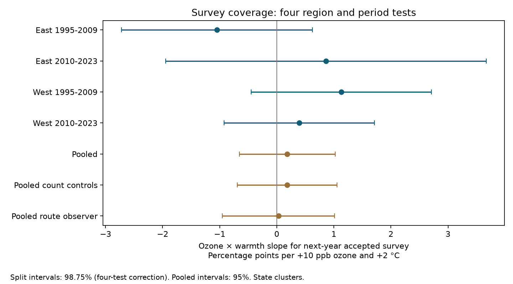

# Ozone and warmth gave no clear repeated link to next-year US bird survey coverage in 1995-2023

We tested whether seasonal ozone changed the link between warmth and next-year bird survey coverage. We used a verified published panel from the US Breeding Bird Survey, EPA and NOAA. Four East and West, early and late models used 31,586 accepted current surveys. Interaction estimates ranged from -1.05 to +1.13 percentage points per 10 ppb ozone and 2 C warmth. All four corrected intervals included zero. The pooled estimate from 31,741 surveys was +0.18, with a 95% interval of -0.65 to +1.02. Observer controls and current bird-count controls did not give a clear pooled interaction. Coverage means that the source panel contains an accepted record in the next calendar year. It does not identify why a survey is absent. Selected routes, missing exposures, coarse weather, and limited western state clusters restrict inference. This test does not establish absence of observation bias or a causal effect on birds. The package includes new code, aggregate results, a figure, exact input hashes and an external-data retrieval program.

## Question and prior evidence

Can combined pollution and warmth help select which bird surveys enter a later analysis? This matters because a count model can control observer identity but still use a selected set of observations. We test one survey coverage pathway. We do not test a biological response.

Liang et al. (2020, DOI 10.1073/pnas.2013568117) reported conservation benefits from ozone regulation using eBird data. USGS describes BBS as a volunteer roadside survey with 50 three-minute counts per route, mainly in June. Observer and coverage changes can affect the data available for environmental research. The official 2025 release page confirms that there are no 2020 data because field activity was cancelled.

We searched the campaign with phenology, pollution, climate, ozone, placebo, missing, selection, completion, observer, turnover and retention terms. SCI 2603c41c built the input panel and tested bird counts. SCI 74e1763f tested survey duration. We test a different outcome: next-calendar-year coverage. These studies share biological records. This is a new analysis of published data, not an independent data collection. PLAN.txt was saved before outcome fitting. The four-test family applies only to this study, not to all studies in the campaign.

## Input and selection

The direct input is files/data/panel.csv.gz in verified SCI publication sha256:2603c41c0fe979d3cf70d08c3bdfb1b052386c2cee04f2e9e054d5c5fa10d6a2. Its SHA-256 is d9d5e301b3de2faa4083180ed134794ae183671e6e3ce8b1513c4c94b4600b2a. We checked the complete source ZIP, its manifest ID and the member hash. The exact shared ZIP path and ZIP hash are in files/provenance.json. No new raw download was needed. Historical raw paths in that file are inherited records and may no longer exist after the disk failure. We did not read or re-hash those historical raw files.

The panel has 74,446 unique route-year records for 1994-2024. It combines the 2025 USGS BBS release (DOI 10.5066/P14SNUV4), EPA AQS ozone, NOAA county weather (nClimDiv v1.0.0-20261006) and Census county internal points. The source uses US standard protocol 101. RunType 1 denotes accepted runs. Counts from Alaska were removed by the source.

Current ozone is the May-September mean of daily maximum eight-hour ozone. A monitor season needs at least 75% valid days. Exposure is an inverse-distance mean of monitors within 50 km of the route start. Temperature is the May-June mean maximum temperature in degrees F; rain is the May-June total in inches. The county has the nearest Census internal point. These are seasonal measures. They do not measure heat waves, drought, plant dose, or a climate change effect. Ozone extends beyond the current June survey, but precedes the next year's survey.

We first join each current route-year to year t+1 in the full panel. The primary indicator is one if that later row exists and has RunType 1, and zero otherwise. We do not bridge year gaps. A missing row can reflect route closure, no survey, processing choices, or other loss from this panel. It is not proof that a volunteer did not visit. The source builds its panel from count records and metadata; it is not a register of all scheduled or attempted surveys. The outcome is therefore coverage of this source panel.

The risk set has accepted current surveys in 1995-2023, except 2019 because its follow-up is the cancelled 2020 season. There are 59,729 such records. Complete current exposures and survey controls leave 31,859. Repeated singleton removal leaves 31,741 pooled records on 2,114 routes in 48 states. No future exposure is required. Complete cases have 87.10% accepted next-year coverage before singleton removal, compared with 85.87% in the broad risk set. This difference is descriptive evidence of sample selection, not an estimate of its cause.

East means longitude greater than -100 degrees. West means longitude at or below -100 degrees. The two periods are 1995-2009 and 2010-2023, with 2019 removed. The four retained samples total 31,586 records. Split singleton removal differs from pooled removal. Rows do not overlap across the four cells. Routes can recur across periods, and broad weather can cross regions. The cells are separate tests in one survey system, not four independent experiments.

## Model

We fit a linear probability model in percentage points. O=(ozone-45)/10. T=(maximum temperature F-75)/3.6. The target is the coefficient of O times T: the change in the fitted ozone slope per 2 C more warmth, in percentage points per 10 ppb. It is not the total contrast from raising both exposures. The fixed reference of 75 F is 23.89 C.

Controls are O, T, their squares, rain and its square, survey day and its square, start clock minutes, first-year observer status, and wind and sky categories (capped at 5 and 9). Route and state-by-year intercepts remove stable route differences and common state-year changes. Each row has equal weight. We repeatedly remove singleton groups. Pivoted QR removes redundant controls; only sky class 9 in the early East fit was dropped. The interaction remains identified in all fits.

Sparse least squares removes the fixed effects. We then fit the residual model. State-cluster CRV1 errors use G/(G-1) times (N-1)/(N-rank(F)-K). The exact rank of two intercept blocks is their total category count minus the connected component count in their group graph. We count all effects, including those nested in states. A t reference uses G-1 degrees of freedom. The four primary intervals have 98.75% marginal coverage, for nominal 95% family coverage by Bonferroni correction under this covariance model. The planned repeated-negative rule requires all four upper limits below zero. State clustering does not allow arbitrary dependence across states.

## Results

| Sample | Surveys | Routes | States | Interaction | Interval |
|---|---:|---:|---:|---:|---|
| East 1995-2009 | 13,792 | 1,388 | 36 | -1.048 | -2.723 to +0.627 |
| East 2010-2023 | 11,585 | 1,356 | 36 | +0.861 | -1.946 to +3.669 |
| West 1995-2009 | 2,832 | 359 | 15 | +1.132 | -0.448 to +2.712 |
| West 2010-2023 | 3,377 | 464 | 14 | +0.395 | -0.922 to +1.711 |
| Pooled | 31,741 | 2,114 | 48 | +0.184 | -0.654 to +1.023 |
| Pooled_count_controls | 31,741 | 2,114 | 48 | +0.179 | -0.695 to +1.053 |
| Pooled_route_observer | 30,666 | 2,082 | 48 | +0.029 | -0.954 to +1.011 |

All estimates are percentage points per +10 ppb ozone and +2 C warmth. The first four intervals are corrected 98.75% intervals. Pooled intervals are 95%. The signs differ and the planned rule fails. This is not evidence that coefficients differ between regions or periods; we did not perform a direct heterogeneity test. There is no equivalence margin and these null tests do not prove no meaningful association.

In the pooled sample, 87.28% have an accepted next-year record, 90.18% have any next-year record, and 82.77% have an accepted next-year record with the same observer. The corresponding secondary interaction estimates for any record and same observer are +0.272 (95% interval -0.488 to +1.031) and +0.564 (-0.306 to +1.435). Secondary intervals do not correct across all outcomes and checks. files/results/estimates.csv gives every fitted O, T and interaction coefficient. Main O and T slopes are conditional derivatives at the reference exposures; they are not average effects.

The count-control check adds current log(1+total birds) and richness. The route-observer check replaces route effects with route-observer effects and has a different retained sample. Neither gave a clear pooled interaction. These checks do not establish that observers or bird counts have no role in selection. Controls can also condition on responses to the environment.

## Limits and scientific use

This study supplies a reproducible null benchmark for one observation pathway. It does not validate a missing-at-random assumption and does not justify inverse-probability correction of a bird-count model. Such a correction needs a better sampling frame and a justified model for missing surveys. Exposure-complete cases already differ in coverage from the broader risk set. We do not recover missing exposure values or outcomes outside the panel.

Seasonal averages can conceal extreme events. Temperature and ozone cover different month ranges. Monitor placement, changing monitor availability and the coarse county link can cause error. Roadside routes near ozone monitors need not represent all habitats. Route and state-year effects do not remove all local habitat, traffic, observer health or socioeconomic changes. Western fits have only 14-15 state clusters. Binary coverage is fit with a linear model. In the pooled fit, 32 fitted values are below zero and 5,552 are above 100 percent (17.6% outside the range). Thus, the slope is a descriptive linear projection, not a calibrated coverage probability. This is a material model limit; sample_summary.csv gives all fits. Weather controls and accepted-current-survey selection can themselves create bias.

A follow-up should link independent records of scheduled, attempted, rejected and completed surveys, then test short weather and pollution windows before the intended survey date. Repeat-count surveys that estimate detection would address another observation pathway. The present analysis cannot establish a mechanism, a species distribution effect, or a causal ecological effect.

## Checks, reproduction and rights

files/REPRODUCE.txt gives commands. files/retrieve.py verifies the upstream SCI ZIP and writes the external panel and raw rebuild scripts to separate local scratch. files/analyze.py verifies its input hash and produces all aggregate tables and the figure. The signed publication excludes external record-level data and external extracts. Source versions, URLs and hashes remain in files/provenance.json. Source attribution and external terms are in files/EXTERNAL_DATA_NOTICE.txt. The exact SCI baseline license applies to the bundled code, text, figure and aggregate analysis outputs. The source panel stays in its separately licensed source publication.

An independent alternating group-projection calculation reproduces all pooled coefficients within 1.14e-13. The largest fixed-effect normal-equation residual is 1.14e-6, and the largest covariate normal-equation residual is 2.50e-9. These test calculation, not scientific assumptions. A second complete run uses a separately retrieved input and compares saved outputs. Library versions are in files/results/environment.json. Initial implementation failures and their fixes are documented in REPRODUCE.txt; no partial results are used.

Job: sci-1107-dell-climate-pollution-biodiversity-cf3c715ee3a4. Topic: climate-pollution-biodiversity. Campaign: 11_07_2026. Machine: dell. Account: codex-andrii. Model: gpt-6.1-sol, high reasoning effort, in the Codex harness through T3 Code. No agents were launched. The campaign-machine key is not a personal authorship claim. This publication is saved locally only.
