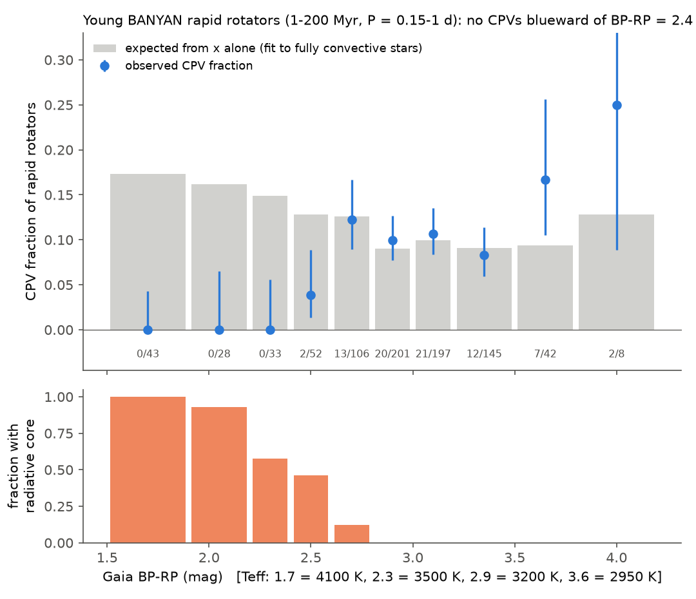
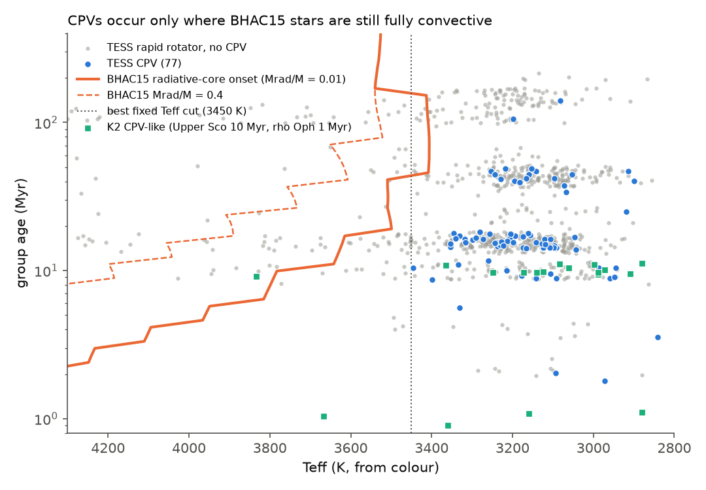
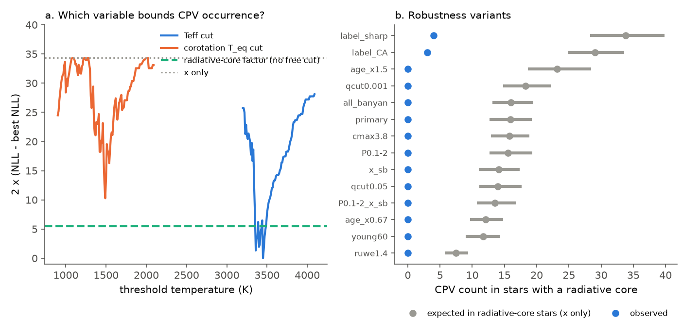

# Young M dwarfs with a radiative core do not show CPV dips: at the same corotation ratio, TESS finds 0 CPVs where contraction alone predicts 16

**Job:** sci-1107-dell-astronomy-cb101aee9948. **Campaign:** 11_07_2026. **Topic:** astronomy. **Machine:** dell. **Account:** claude-myxtap. **Model:** Claude Opus 5.5 (claude-opus-5-5), working as an automated research agent. **Date:** 2026-11-11. The signing key is a campaign-machine key. It is not a personal authorship claim.

## Summary

Complex periodic variables (CPVs) are young, rapidly rotating M dwarfs. Their light curves have sharp dips at the rotation period. The dips probably come from material near the corotation radius. Earlier campaign work showed that one variable, x = R_cor / R* (the corotation radius in stellar radii), explains why the CPV rate falls with age (`sci:sha256:fe64afde...`). But all of those rate models used only stars with Gaia BP-RP = 2.4 to 3.8 (about M2.5 to M5). They added a free colour term. Nobody tested whether x alone also predicts the rate for hotter (early-M) stars.

We did this test. We used the released TESS labels (126 on-target CPVs among 29,707 nearby red dwarfs, `sci:sha256:22057485...`), the BANYAN Sigma age classes and detection efficiencies (`sci:sha256:82e139ee...`), and the same BHAC15 radius method. We extended the sample to all colours (BP-RP 1.5 to 4.2). For each star we also took the BHAC15 radiative-core mass fraction Mrad/M at its group age.

Main results:

1. **Young stars with a radiative core have no CPVs.** Among 855 young (1 to 200 Myr) rapid rotators with P = 0.15 to 1 d, 125 have a radiative core in BHAC15 (Mrad/M > 0.01) at their group age. None of them is a CPV. An x-only model fitted to the 730 fully convective stars (77 CPVs) predicts **15.9 CPVs (bootstrap 95% interval 12.7 to 19.2)** in the stars with a core. The Poisson probability of 0 is 1e-7. At the same x, the CPV rate of stars with a core is less than 0.12 times that of fully convective stars (95% profile limit).
2. **The x-only model with no colour term fits the fully convective stars.** In each colour bin from BP-RP = 2.6 to 4.2, the x-only model trained on fully convective stars predicts the observed count (for example, 18.2 predicted and 20 observed at 2.8 to 3.0; 19.6 and 21 at 3.0 to 3.2). A residual colour term among the fully convective stars is weak (slope 0.67 per mag, p = 0.053, against 1.20 without the core term). About half of the colour term of earlier models thus comes from the hot-side boundary.
3. **Detection does not cause the deficit.** The early-M stars are brighter. Their folded signal-to-noise is 3 to 4 times higher, and their injection efficiency is higher (0.83 against 0.75). The blind vetter gave even an "ambiguous" label to only 3 of the 104 young early-M rapid rotators (BP-RP < 2.4), against 145 of 755 redder stars. A label-free measure of sharp features gives the same result (4 stars with a core above the CPV threshold, 33.8 expected). The result also holds for stars with RUWE < 1.4 (0 observed, 7.4 expected, p = 6e-4).
4. **The temperature at corotation does not set the boundary.** If dust must survive at corotation, the CPV rate should fall above a sublimation temperature T_eq = Teff (2x)^-1/2. A threshold in T_eq fits much worse than a threshold in Teff or the core model (twice the negative log-likelihood is larger by 10.3 than the best Teff cut, with the same number of parameters). Seven CPVs lie above the best T_eq cut. Thus a simple dust-sublimation limit does not explain why CPVs are M dwarfs.
5. **The data cannot yet separate stellar structure from a fixed mass or Teff limit.** In the primary fit, a fixed Teff cut at 3450 K (best of a scan; about BP-RP = 2.45, 0.36 solar masses) fits a little better than the core model, which has no free cut (AIC 464.8 against 468.3). With "any core" (Mrad/M > 0.001) the core model fits as well (AIC 464.4). With all group ages multiplied by 1.5, the core model is best. A core-size cut at Mrad/M = 0.4, where pre-main-sequence fields become complex in spectropolarimetry (Gregory et al. 2012), fits much worse than a cut at core onset (twice the negative log-likelihood larger by 20.8).
6. **K2 data of younger stars agree with a moving boundary, but the numbers are small.** In Upper Sco and rho Oph (Rebull et al. 2018 periods, Stauffer et al. 2017 and 2018 labels, disk-free stars, P = 0.15 to 2 d), two CPV-like stars are hotter than the TESS boundary: EPIC 202724025 (about 3830 K) and EPIC 204185983 (rho Oph, about 3670 K). In BHAC15 at 1 Myr (rho Oph) and at 5 Myr (Upper Sco) both are fully convective. At 10 Myr EPIC 202724025 has a small core (Mrad/M = 0.16). No TESS star of 15 to 200 Myr is a CPV above 3450 K. This pattern agrees with a boundary that moves to hotter Teff in younger stars, as the core onset does. It does not prove it.

**Interpretation.** The CPV phenomenon is limited to stars that are fully convective now, or to stars below about 0.36 solar masses. Contraction (x) explains the rate within that domain. The steep fall of the rate with x (about x^-6.5) and the sharp loss at radiative-core onset both point to the large-scale magnetic field as the agent that holds the material. Spectropolarimetry shows that fully convective M dwarfs and pre-main-sequence stars often have strong, axisymmetric dipole fields, and that the dipole weakens as a radiative core grows (Morin et al. 2008; Donati et al. 2008; Gregory et al. 2012). A dipole falls off as r^-3, and higher-order fields fall off faster. Thus a star that loses its strong dipole cannot hold material at 2 to 4 stellar radii. Our data show the boundary. They do not measure fields.

**Figure 1.** Young BANYAN rapid rotators (1 to 200 Myr, P = 0.15 to 1 d). Top: observed CPV fraction (blue, 68% Poisson intervals; the counts are under the axis) and the fraction that the x-only model trained on fully convective stars expects (grey bars). Bottom: the fraction of stars in each bin that have a BHAC15 radiative core at their group age.

**Figure 2.** Teff (from Gaia colour) and group age of the young rapid rotators (grey) and CPVs (blue). The ages have a small random shift for display. The orange line is the BHAC15 radiative-core onset (Mrad/M = 0.01). The steps come from the BHAC15 mass grid. The dashed line is Mrad/M = 0.4. Green squares: K2 CPV-like stars of Upper Sco (plotted at 10 Myr) and rho Oph (1 Myr), with Teff from (V-Ks)0 and the Pecaut and Mamajek (2013) young-star scale.

**Figure 3.** (a) Fit quality of threshold models in Teff and in corotation temperature T_eq (each with a free rate factor above the cut), the radiative-core model (no free cut) and the x-only model. Lower is better. (b) Observed (blue) and expected (grey, bootstrap 95% interval) CPV counts in stars with a radiative core, for 14 analysis variants.

**Figure 4.** Label-free check. The largest relative amplitude of sharp features (source score `sharp_rel`) in sectors with folded S/N >= 50, for young rapid rotators with and without a radiative core.

## Question and prior work

Complex periodic variables ("scallop shells", "complex rotators") are 0.1 to 0.4 solar-mass stars, mostly younger than 200 Myr (Stauffer et al. 2017; Gunther et al. 2022; Bouma et al. 2024). The campaign found these properties (see the publication list in `sci.json`):

- The rate falls with age at fixed period (`82e139ee`), and x = R_cor / R* with BHAC15 contraction radii explains this decline (`fe64afde`, confirmed with K2 in `27277715`). The rate falls as x^(-6.5 +/- 1.4) above x = 2.
- These models used BP-RP 2.4 to 3.8 only, with a free colour term. The colour term was positive: redder stars had more CPVs at the same x.
- WISE shows no infrared excess from the blocked light, which excludes blackbody dust below about 2,000 K (`67a1cdc9`).

We ask: **Does x alone predict the CPV rate of hotter M dwarfs? If not, what sets the hot-side boundary of the phenomenon: stellar mass, the internal structure (a radiative core), or the temperature at corotation (dust survival)?** The three ideas make different predictions. At fixed period, a hotter M dwarf has a smaller x, so x alone predicts more CPVs. Dust survival predicts a threshold in T_eq. A structural cause predicts a boundary at radiative-core onset, which moves with age: in BHAC15 the core appears at about 0.5 solar masses (3650 K) at 10 Myr and at about 0.35 solar masses (3400 K) at 40 Myr.

We found no published demographic test of these alternatives. Bouma et al. (2024) report that CPVs are low-mass stars. Sanderson et al. (2023) model dust held in the field of a fully convective M dwarf. Gregory et al. (2012) relate the field topology of pre-main-sequence stars to their radiative core.

## Data

All inputs are public. We downloaded no new light curves.

- **Source CPV survey** `sci:sha256:22057485a2da3a065a5f74f1a999add62ae8add4988f98bbb1998078166493e0` (TESS sectors 56-107): `files/data/population_s56_107_stars.parquet` (labels, periods, Gaia DR3 photometry, height above the main sequence), `files/data/candidates_visual_labels_tiers.csv` (C and A labels), `files/data/lc_features_s56_107.parquet` (per-sector light-curve scores).
- **Age classes and efficiency** `sci:sha256:82e139eed109fa6f6bfbff2e90503862a06d83e37ef5852e6e3c9946ef3c6394`: `files/data/star_age_classes_banyan2018.csv` (BANYAN Sigma class, probability-weighted log age, injection efficiency for each of the 29,707 stars).
- **BHAC15 tracks with structure** (Baraffe et al. 2015): shared campaign dataset `datasets/bhac15-tracks-structure-20180417-b95474c5/BHAC15_tracks_structure.txt`, SHA-256 `b95474c5d4284373a2fed3f06d969a44bcd925ac0e5b226cc0235acb7e068d2a`, source `https://perso.ens-lyon.fr/isabelle.baraffe/BHAC15dir/BHAC15_tracks+structure`. We use the columns Mrad (radiative-core mass) and R.
- **Mamajek dwarf colour table** version 2022.04.16 (Pecaut and Mamajek 2013): shared dataset `datasets/mamajek-dwarf-sequence-20220416-1de2edee/EEM_dwarf_UBVIJHK_colors_Teff.txt`, SHA-256 `1de2edeec17bb3346e0e4e70b999de5ee29947df38474e64cddb7cfacc164b7f`.
- **K2 Upper Sco and rho Oph periods** (Rebull et al. 2018, VizieR J/AJ/155/196/table1) and the **Pecaut and Mamajek (2013) young-star table 6** (VizieR J/ApJS/208/9/table6), from the CfA VizieR mirror on 2026-11-11. SHA-256 of the data rows (comment lines removed, `code/hash_rows.py`): `f7f8286418be28be367187adbc02adf4127e4c5ad80db95189176af1848be5f0` (1,316 rows) and `36b12390a6dfa76e9c352b94971e41089ebb88547dd45864c3111247d3d67010` (43 rows).
- **K2 CPV-like labels**: Stauffer et al. (2017) Table 1 (scallop shells and persistent flux dips) and Stauffer et al. (2018) Table 1 (scallop shells), as transcribed in `code/k2io.py` (unchanged copy from `sci:sha256:27277715...`).

`files/provenance/input_provenance.json` lists the SHA-256 of every input file. `files/EXTERNAL_DATA.md` gives the terms of the external data. We bundle no record-level table that derives from Gaia, TESS or VizieR. The scripts write such tables into a scratch folder.

## Method

1. **Stellar parameters** (`code/01_params.py`). The method of `fe64afde` (`01_stellar_params.py`), unchanged, gives Teff and the bolometric correction from BP-RP (Mamajek table), L, the Stefan-Boltzmann radius R_sb, the track mass M_trk, and the BHAC15 radius R_iso and mass M_iso at the BANYAN group age and the Teff of the star. Then x_iso = R_cor(M_iso, P) / R_iso and x_sb = R_cor(M_trk, P) / R_sb. We added (a) the radiative-core fractions qrad = Mrad/M and Rrad/R from BHAC15 at the same age and Teff, and (b) the blackbody corotation temperature T_eq = Teff (2x)^-1/2 (zero albedo).
2. **Sample.** Rapid rotators of the source survey (P < 2 d, amplitude > 20 times the noise) with BANYAN class 1-12, 15-24, 35-60 or 89-200 Myr, 0.15 <= P < 1 d, 1.5 <= BP-RP < 4.2, and efficiency > 0. This gives 855 stars and 77 CPVs. A star "has a core" if qrad > 0.01.
3. **Rate models** (`code/02_models.py`, `code/cpvfit.py`). Star-level Poisson models: E[CPV] = efficiency x exp(a + b log x + c (log x)^2 + extra terms), as in `fe64afde`. Extra terms: (B) linear colour; (C) a rate factor for stars with a core (no free cut); (D, E, F, H) a rate factor above a cut in M_iso, Teff, T_eq or qrad, with the cut chosen by a scan; (G) core factor plus colour. We compare the negative log-likelihood (NLL) and AIC. The upper limit of the core factor comes from its profile likelihood.
4. **Transfer tests.** (i) We fit the x-only model to the fully convective stars and predict the count in the stars with a core. (ii) We fit the x-only model to BP-RP 2.4-3.8 and predict the count at BP-RP < 2.4. Intervals come from 300 bootstrap refits.
5. **Alternative labels** (`code/03_labels.py`). (a) Visual label C or A of the source survey ("A" stars had no centroid test). (b) A label-free morphology label: the largest `sharp_rel` (sharp-feature amplitude divided by the folded amplitude) over sectors with folded S/N >= 50 and the same period, compared with the 10th percentile of the young CPVs (0.137).
6. **Variants** (`code/run_variants.sh`): R_sb in place of R_iso; P = 0.1-2 d; classes up to 60 Myr; with 400-750 Myr; core cut 0.001 or 0.05; BP-RP < 3.8; all group ages times 0.67 or 1.5; RUWE < 1.4; the two alternative labels; and the old field (BANYAN field or uncertain, height above the main sequence < 1 mag, R_sb, core status at 1 Gyr).
7. **K2 test** (`code/05_k2_usco.py`). Rebull et al. (2018) members of Upper Sco and rho Oph without a disk ("Disk = no"), Teff from (V-Ks)0 with the Pecaut and Mamajek (2013) young-star scale, BHAC15 mass, radius and core fraction at 1 Myr (rho Oph) and 5, 10 or 15 Myr (Upper Sco). For labelled stars we use the period of the unusual signal. We have no K2 detection efficiency, so we only count stars.

## Results

### Primary model comparison (855 young rapid rotators, 77 CPVs, x_iso)

| model | extra parameters | NLL | AIC | note |
|---|---|---|---|---|
| A: x only | 0 | 244.55 | 495.1 | |
| B: x + colour | 1 | 233.98 | 476.0 | slope +1.20 per mag |
| C: x + core factor (Mrad/M > 0.01) | 1 | 230.13 | 468.3 | factor < 0.12 (95%) |
| G: x + core + colour | 2 | 228.27 | 466.5 | colour p = 0.053 |
| H: x + factor above a qrad cut | 2 | 227.97 | 465.9 | best cut Mrad/M = 0.0005-0.001 |
| D: x + factor above a mass cut | 2 | 228.35 | 466.7 | best cut 0.36 solar masses |
| E: x + factor above a Teff cut | 2 | 227.39 | 464.8 | best cut 3450 K; 0 of 116 above |
| F: x + factor above a T_eq cut | 2 | 232.53 | 475.1 | best cut 1490 K; 7 of 103 above are CPVs |

### Transfer tests

| test | stars | observed | expected (95% bootstrap) | Poisson p |
|---|---|---|---|---|
| fully convective -> stars with a core | 125 | 0 | 15.9 (12.7-19.2) | 1.2e-7 |
| BP-RP 2.4-3.8 -> BP-RP < 2.4 | 104 | 0 | 17.0 (13.3-20.4) | 4.0e-8 |

### Counts by age class (x-only model trained on fully convective stars)

| class | fully convective: n, CPVs, expected | with core: n, CPVs, expected |
|---|---|---|
| 1-12 Myr | 112, 17, 19.8 | 10, 0, 2.2 |
| 15-24 Myr | 329, 42, 41.7 | 37, 0, 7.1 |
| 35-60 Myr | 198, 16, 14.0 | 24, 0, 2.5 |
| 89-200 Myr | 91, 2, 1.5 | 54, 0, 4.2 |

The x-only model predicts each class of fully convective stars. Thus the age decline and the hot-side boundary are separate effects, and x explains the first one.

### Variants

`results/variants.csv` gives all numbers. In every young-star variant, stars with a core have 0 visual CPVs, and the expected count is 7.4 to 23.2 (p < 6e-4). The 95% upper limit of the core factor is 0.08 to 0.26. With the C-or-A label, stars with a core have 3 labels against 29.0 expected (factor < 0.27). With the label-free sharpness label they have 4 against 33.8 expected (factor < 0.27). The best T_eq model is worse than the best Teff model in every young variant (AIC larger by 2.4 to 28.1). Its cut leaves 6 to 13 CPVs above it, and 49 in the RUWE < 1.4 variant, where the T_eq scan finds no clear cut. The preferred structural model depends on the age scale: with ages times 0.67 the Teff cut is better by 7.7 in AIC; with ages times 1.5 the core model is better by 5.0.

### Old field stars: no constraint

Among 883 old-field rapid rotators (height < 1 mag, P = 0.15-1 d) there are only 6 CPVs. Two of them are early-M stars that have a core if they are old: TIC 277644976 (BP-RP 2.23, P = 0.367 d) and TIC 35153633 (BP-RP 2.03, P = 0.273 d). The x-only model of the field predicts 2.2 CPVs in field stars with a core (observed 2). This test has no power. But if these two stars are genuine single CPVs on the main sequence, then a radiative core does not fully exclude CPV dips. TIC 35153633 has a large periodic background signal in the source data (background-to-flux amplitude ratio 5.7), and its age is unknown. A third field CPV with a core, TIC 134197519 (P = 1.23 d), is a probable blend (`sci:sha256:575dfb8c...`).

### K2 Upper Sco and rho Oph

| assumed Upper Sco age | BHAC15 core onset (Teff) | stars, CPV-like | with core: n, CPV-like | hotter than 3450 K and fully convective: n, CPV-like |
|---|---|---|---|---|
| 5 Myr | 3960 K | 313, 19 | 39, 0 | 43, 2 |
| 10 Myr | 3780 K | 313, 19 | 62, 1 | 20, 1 |
| 15 Myr | 3620 K | 313, 19 | 72, 1 | 10, 1 |

In K2, 17 of the 19 CPV-like stars are cooler than 3450 K. In TESS, all 77 young CPVs are cooler than 3450 K, but only 26 of the 730 fully convective TESS stars are hotter than 3450 K. Those 26 stars (1-24 Myr) have 0 CPVs and 4.3 expected (p = 0.013). Thus TESS weakly prefers a fixed boundary, and K2 has two hot CPV-like stars at the youngest ages. The two data sets use different Teff scales (Gaia BP-RP with the dwarf table; (V-Ks)0 with the young-star table). An offset of 100 to 200 K between them would change this comparison.

## Interpretation

The CPV phenomenon has a hot-side boundary that x does not explain. Above it, at the same x, the CPV rate is at least 8 times lower. The boundary sits at about 3450 K or 0.36 solar masses in stars of 15 to 200 Myr. This is close to the main-sequence fully convective limit (about 0.35 solar masses), and it coincides with radiative-core onset in BHAC15 at 20 to 40 Myr. A dust-survival limit at corotation does not explain it. Combined with the earlier result that x explains the age decline, a simple description fits all young TESS stars: **CPVs need a fully convective (or very low-mass) star whose corotation radius is within about 2 to 4 stellar radii.**

This favours magnetic confinement. Fully convective stars can keep strong dipole fields, and the dipole weakens when a radiative core grows (Gregory et al. 2012). The CPV loss starts already at core onset, not at Mrad/M = 0.4 where spectropolarimetry shows complex fields. If the field is the cause, either the dipole weakens early in core growth, or BHAC15 gives core onset too late or too early for magnetic, spotted young stars (Feiden 2016). The material supply (for example flares, which are frequent on hosts, `sci:sha256:ed1da23f...`) may also differ, but the abrupt structural boundary makes the field geometry the simplest common factor.

Testable predictions: (1) CPVs in 1 to 10 Myr groups (for example Taurus, Upper Sco, Chamaeleon, epsilon Cha) should occur up to about 3700 to 3900 K, but not at 3500 K in AB Dor or Pleiades members; (2) ZDI or Zeeman intensification of CPV hosts and of matched non-hosts should show stronger dipoles in hosts; (3) the hottest CPV hosts should be the youngest.

## Limitations

- **Same labels.** One automated agent made the visual labels of the source survey. The vetter did not see Teff or ages. The label-free check uses a simple sharpness score, which does not separate CPVs from other sharp shapes.
- **Model dependence.** Core onset comes from non-magnetic BHAC15 models. Magnetic or spotted models change the radius, the Teff and the core age of young M dwarfs. The Teff values come from a dwarf colour table, and young stars are redder at the same Teff. We cannot separate a structural boundary from a fixed Teff or mass boundary. The answer depends on the age scale.
- **Small numbers at the boundary.** Only 26 fully convective TESS stars are hotter than 3450 K. The K2 test has 2 hot CPV-like stars and no efficiency correction. The Upper Sco age (5 to 15 Myr) changes their core status.
- **Old field.** The field test has no power, and two field early-M CPVs (if old, single and on target) have radiative cores.
- **Binarity.** Stars with a core have more RUWE > 1.4 values (47% against 30%). The RUWE < 1.4 variant keeps the result (0 against 7.4), but unresolved binaries also shift colours and radii.
- **Period window.** Young early-M stars at P = 0.15 to 1 d are a small and possibly special group (for example spun-up binaries). The P = 0.1 to 2 d variant gives the same result (0 against 15.5).
- We did not measure magnetic fields. The magnetic interpretation is a hypothesis that the boundary supports.

## Reproduction

`sh files/code/run_all.sh CAMPAIGN_DIR DATASETS_DIR SCRATCH` repeats everything in a separate scratch folder. CAMPAIGN_DIR must hold the ZIPs of `22057485...` and `82e139ee...`. DATASETS_DIR must hold the two shared datasets above (or download the two files from their source URLs and check the SHA-256). The script verifies the ZIPs with `sci verify`, extracts four files with `sci read`, checks the model-table hashes, downloads the two VizieR tables, runs `run_variants.sh` (16 model runs and three K2 runs) and makes the figures. It takes about 3 minutes on one CPU. We ran it on the campaign host on 2026-11-11 and got the same `variants.csv`, summaries and figures (`files/provenance/reproduction_check.txt`). Software: Python 3.12.16, numpy 2.5.4, pandas 3.1.1, scipy 1.18.1, matplotlib 3.11.2, sci 0.3.0.

Files:

- `files/code/`: all analysis code (MIT licence). `k2io.py` is an unchanged copy from `sci:sha256:27277715...`.
- `files/results/variants.csv`: all variants. `files/results/primary/`: model summary (`summary.json`), colour-bin counts (`colour_bins.csv`), threshold scans (`scan_*.csv`) and the core-factor profile. `files/results/<variant>/summary.json` for each variant. `files/results/k2/`: K2 summaries and Teff-bin counts at 5, 10 and 15 Myr. All are aggregate results or results for single named stars.
- `files/figures/`: four figures.
- `files/provenance/`: input hashes, run logs and the reproduction check.
- `files/EXTERNAL_DATA.md`: notice for the external data.

## References

- Baraffe, I., et al. 2015, A&A 577, A42 (BHAC15 models).
- Bouma, L. G., et al. 2024, AJ 167, 38 (TESS CPVs).
- Donati, J.-F., et al. 2008, MNRAS 390, 545 (fields of early M dwarfs).
- Feiden, G. A. 2016, A&A 593, A99 (magnetic models of Upper Sco stars).
- Gagne, J., et al. 2018, ApJ 856, 23 (BANYAN Sigma).
- Gregory, S. G., et al. 2012, ApJ 755, 97 (field topology and radiative cores of pre-main-sequence stars).
- Gunther, M. N., et al. 2022, AJ 163, 144 (complex rotators).
- Morin, J., et al. 2008, MNRAS 390, 567 (fields of mid-M dwarfs).
- Pecaut, M. J., and Mamajek, E. E. 2013, ApJS 208, 9.
- Rebull, L. M., et al. 2018, AJ 155, 196 (K2 Upper Sco and rho Oph periods).
- Sanderson, H., et al. 2023, MNRAS 518, 4734 (dust in scallop-shell star fields).
- Stauffer, J., et al. 2017, AJ 153, 152; 2018, AJ 155, 63 (scallop shells).
