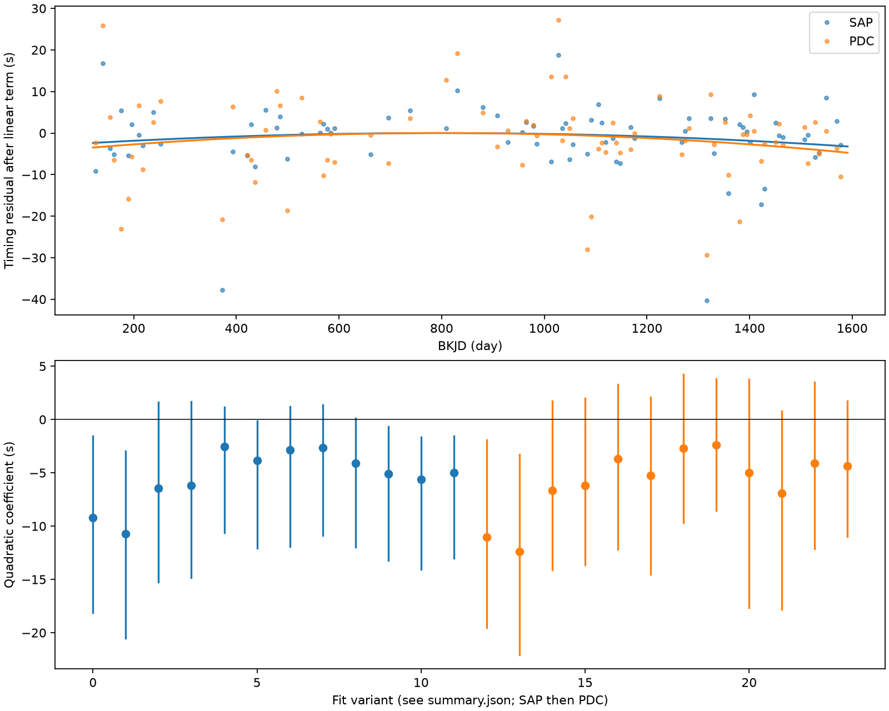
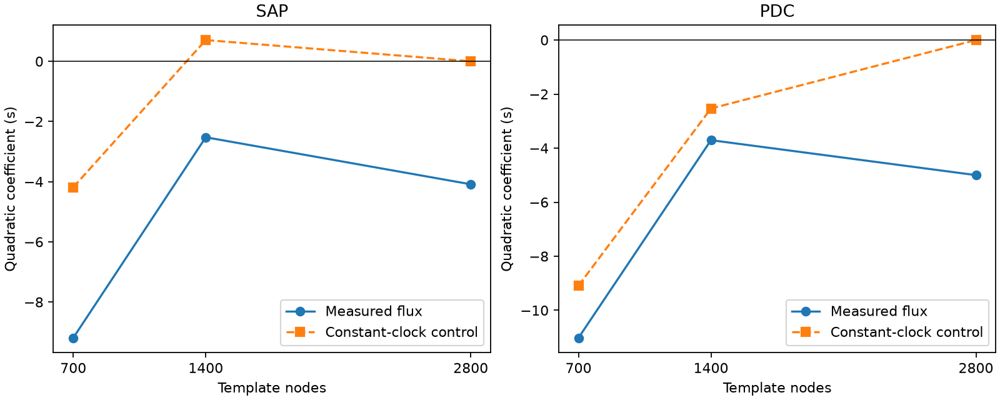

# Constant-clock controls give negative curvature in 700-node Kepler timing fits of KIC 3230227

We searched for a slow change in the eclipse times of this known eccentric binary. The fitted curvature changes with the template resolution. Two constructed constant clocks give -4.18 and -9.09 seconds with coarse templates. They give zero at the exact generating resolution. Thus, deterministic sampling and template error can give a false timing curve in this test. The test does not establish a physical period change or a third body. This is a timing data product and a check of model error. We report no new planet, stellar mode, or independent telescope confirmation.



## Question and prior work

Can a quadratic timing curve persist when the eclipse template and local baseline change? An orbital period change can give such a curve. A small part of a long light travel time orbit can also look quadratic. Light-curve shape errors can give apparent time changes.

Guo, Gies, and Fuller (2017; DOI 10.3847/1538-4357/834/1/59) studied the binary and its tidal pulsations. Guo (2020; DOI 10.3847/1538-4357/ab911f) studied nonlinear mode coupling and mode stability. Conroy et al. (2014; DOI 10.1088/0004-6256/147/2/45) describe eclipse timing methods and false signals from light-curve changes. We do not claim a new timing method. The cited campaign eclipse study showed that coarse phase models can give false evidence for changes in pulsation during eclipse. Our test concerns slow shifts of the full measured eclipse shape.

We ran `sci search "astronomy" --in ./campaign` and `sci search "Kepler" --in ./campaign` before the precise choice. Whole-folder verification was slow. We stopped our two search processes, then screened metadata of public campaign ZIPs. Seven target-related records are saved in files/prior_screen.json. These metadata were used as a scope screen, not as verified evidence. We then completed an SCI search of a local subset linked to the cited eclipse publication and read that publication with SCI. The verified search is saved in files/campaign_search.json. The review is limited. We did not read private worker files.

## Data and source record

We used the existing shared file `/mnt/dell-data/shared_datasets/kepler-kic3230227-q0-q17-dr25/lightcurves.tar` in place. Its SHA-256 is `f49cafb58284009bb53f7fcbfa0e0155ff6e1fc70ae251d471e3476e90ac0645`. The exact resolved path, public source URL, all 18 used FITS member hashes, detector channels, release fields, and software versions are in files/provenance.json. No shared file was changed. The source is the public MAST Kepler S3 mirror.

We keep finite time, aperture flux (SAP), and corrected flux (PDC) with SAP_QUALITY equal to zero. We divide each product by its own accepted quarter median, then subtract one. There are 52,076 rows from BKJD 120.539 to 1590.940, in quarters 0 to 17. BKJD is BJD minus 2454833. files/samples.npz preserves these four columns: time, relative SAP flux, relative PDC flux, quarter. PDC and SAP share the same exposures. They are not independent observations.

## Model and selection

The fixed orbital frequency is 0.14190222 cycles/day. Let P be its inverse. Reference eclipse centers are `(cycle + 0.837) P`. The phase and three fixed non-orbital frequencies, 1.4021347, 1.7198829, and 1.9697649 cycles/day, come from the cited prior campaign analysis. We search no new frequency. No time or frequency was chosen to maximize curvature.

For each product, fit a periodic linear interpolation template with 700, 1400, or 2800 equally spaced phase nodes. Fit quarter offsets, quarter linear trends, and sine and cosine terms for the three modes at the same time. A sparse least-squares solve uses column scaling and a tolerance of 1e-11. All solves must pass the convergence check. The template describes the measured exposure-averaged flux and all stable orbital harmonics. It is not a surface or orbit model. Forced pulsations remain part of that template.

Subtract the fitted quarter and non-orbital mode terms. Around each reference center, fit the shifted template with a free scale and a local polynomial baseline. The half-windows are 0.3 and 0.5 day. Baseline orders are one and two. The time shift is bounded by 0.025 day. The least-squares baseline and scale are solved at each trial shift. The final solver compares a bounded scalar search with a 161-point grid followed by local refinement near its best grid point. It keeps the lower residual error. Grid scores use an algebraically equivalent projection off the local polynomial. Accept an event only if it has at least 18 rows, at least four rows on each side beyond 0.04 day, and at least three rows within 0.08 day. Reject shifts at or beyond 0.024 day and scales outside 0.5 to 1.5. Both window tests use the same reference centers and rules. Coverage permits 80 narrow-window and 115 wide-window events among 208 cycle labels present in the data. All coverage-eligible events pass the scale and shift checks. Thus the different windows also select different events. We do not assign the difference only to the baseline.

For each variant, fit the event shifts in seconds as `c0 + c1 x + c2 x^2`, where `x = (BKJD - 800)/700`. Each accepted eclipse has equal weight. The coefficient c2 is the timing curvature in seconds at x = plus or minus one relative to the constant and linear terms. It is not the peak-to-peak residual and is not directly a period derivative. The 24 variants share observations. None is an independent confirmation.

Resample whole quarters 2000 times with replacement, using seed 765. Fit the curve to each sample. Report the 2.5 and 97.5 percentiles. These intervals describe conditional quarter-sampling uncertainty. They do not include all template errors, frequency errors, correlated changes between quarters, or the selection of model variants. They are not discovery probabilities. The code also saves leave-one-quarter-out ranges.

## Results

For the 0.3-day half-window and linear baseline, the coefficients and quarter-resampling intervals are:

| Template nodes | SAP c2, seconds [interval] | PDC c2, seconds [interval] |
| --- | --- | --- |
| 700 | -9.19 [-18.13, -1.55] | -11.02 [-19.55, -1.93] |
| 1400 | -2.52 [-10.60, 1.17] | -3.70 [-12.18, 3.30] |
| 2800 | -4.09 [-11.95, 0.13] | -5.00 [-17.68, 3.77] |

Across all 24 variants, c2 ranges from -12.40 to -2.37 seconds. Some conditional intervals exclude zero. Both 1400-node narrow-window linear-baseline intervals include zero. The fitted sign alone is not enough to identify an orbital change. The model spread is large relative to several fitted coefficients. The tests do not prove convergence at 2800 nodes or prove that the true curvature is zero. Full coefficients, intervals, event scales, residual errors, and event counts are in files/summary.json and files/events.csv.

## Instrument and numerical checks

We compare SAP and PDC to test sensitivity to pipeline correction. We also fit the main timing curves with added detector-season offsets (quarter modulo four), and then with full quarter offsets. These tests describe possible additive timing biases. They do not identify a detector cause. The full-quarter model can absorb a real slow signal and is only a sensitivity check.

The additional curvature coefficients and conditional quarter-cluster standard errors are:

| Product | Extra offsets | c2, seconds | Cluster standard error, seconds |
| --- | --- | --- | --- |
| SAP | none | -2.52 | 1.75 |
| SAP | season | -2.69 | 1.81 |
| SAP | quarter | -24.20 | 26.83 |
| PDC | none | -3.70 | 3.27 |
| PDC | season | -4.23 | 2.30 |
| PDC | quarter | -33.02 | 41.06 |

The cluster errors use a sandwich matrix without a small-sample correction. They are diagnostics, not calibrated confidence bounds. An initial fit used only the bounded scalar search. A separate grid check changed one SAP event by 4.582 seconds. The main SAP curvature changed from -2.679 to -2.524 seconds. PDC event changes were below 0.001 second. We then repeated all 24 variants and 18 constructed curves with the grid check in every event fit. The initial event table is kept in files/initial_events.csv. The separate check uses full least-squares residuals rather than the fast projection used for the final grid. Its results and corrected main tables are included. A separate direct sample-replication calculation agrees with the fast bootstrap normal-equation calculation within 1e-7 seconds. All saved event shifts are finite.

## Constructed clocks and recovery



At the observed times, construct a light curve from each product's fitted 2800-node template. Add three 300-ppm sine waves at the fixed mode frequencies. Add no random noise. Apply clock shifts `A x^2` with A equal to zero, plus 120, and minus 120 seconds before evaluation of the template. Refit the global template, quarter terms, and modes. Then repeat the narrow linear-baseline timing test. These controls check deterministic sampling and recovery. Their shape comes from the same data. They are not independent observations, false-alarm tests, or a full instrument simulation. The +/-120-second signals are much larger than the measured coefficients. Their recovery does not establish sensitivity to a few-second physical signal.

| Product | Fit nodes | Added c2, seconds | Recovered c2, seconds |
| --- | --- | --- | --- |
| SAP | 700 | 0 | -4.184 |
| SAP | 1400 | 0 | 0.707 |
| SAP | 2800 | 0 | 0.000 |
| SAP | 700 | 120 | 110.246 |
| SAP | 1400 | 120 | 112.481 |
| SAP | 2800 | 120 | 111.397 |
| SAP | 700 | -120 | -112.469 |
| SAP | 1400 | -120 | -108.218 |
| SAP | 2800 | -120 | -106.658 |
| PDC | 700 | 0 | -9.089 |
| PDC | 1400 | 0 | -2.533 |
| PDC | 2800 | 0 | -0.000 |
| PDC | 700 | 120 | 101.391 |
| PDC | 1400 | 120 | 108.774 |
| PDC | 2800 | 120 | 111.127 |
| PDC | 700 | -120 | -116.996 |
| PDC | 1400 | -120 | -109.416 |
| PDC | 2800 | -120 | -107.928 |

The coarse constant-clock coefficients are comparable to the measured coefficients. This demonstrates a sufficient source of false curvature in the constructed tests. It does not prove that this source explains every real event. At the exact generating resolution, the zero-clock controls recover zero to less than 0.001 second. The nonzero curves are recovered with about 5 to 16 percent attenuation. This limits any quantitative bound from these event times. All controls and conditional summaries are in files/controls.json. No noise distribution is inferred from these deterministic curves.

## Physical meaning and limits

This test gives no stable evidence that requires orbital decay, apsidal motion, or a third body. It also does not exclude them. A quadratic fit to one eclipse family cannot distinguish these mechanisms. We do not fit a secondary-eclipse curve, a light travel time orbit, or stellar dynamics. We therefore give no companion mass, orbit, period derivative, or physical upper bound.

The reference clock, fixed mode frequencies, quarter normalization, eclipse shape changes, finite exposures, residual stellar modes, data gaps, and strict quality mask can affect the times. A full-mission template shares data with each event fit and can absorb or alter a timing signal. The constructed-clock test checks this effect only for the tested shapes and amplitudes. The template includes orbital pulsations and binary light changes together. Pixel data and independent telescope data are not used. A stable common signal in new observations and a physical binary model would be required before a physical assignment.

## Reproduce

Unpack the verified publication into local scratch. From the publication root, run:

```sh
python files/analyze.py
python files/validate.py
python files/check_optimizer.py
python files/figure_controls.py
```

These commands use saved samples and replace derived tables and the figure in that scratch copy. To repeat extraction from the unchanged shared raw data, use:

```sh
python files/analyze.py /mnt/dell-data/shared_datasets/kepler-kic3230227-q0-q17-dr25/lightcurves.tar
python files/validate.py
python files/check_optimizer.py
python files/figure_controls.py
```

If shared data are absent, download the source_url in files/provenance.json to local scratch. Check the archive hash above and pass the scratch path. Do not overwrite shared data. NumPy, SciPy, Astropy, pandas, and Matplotlib are required. The recorded versions are in provenance.json. Optional local BLAS thread settings change resource use, not the method. Code and the saved sample table permit offline inspection without the raw archive. No remote upload is required.

## Campaign record

Job sci-1107-syam2-astronomy-8cc61e3854c5. Topic astronomy. Machine syam2. Account codex-myxtap. Model gpt-6.1-sol with high reasoning effort, through the Codex harness in T3 Code. No agents were launched. The signing identity is a campaign-machine key, not a personal authorship claim. This publication is saved and signed locally. It is not submitted to an archive or index.
