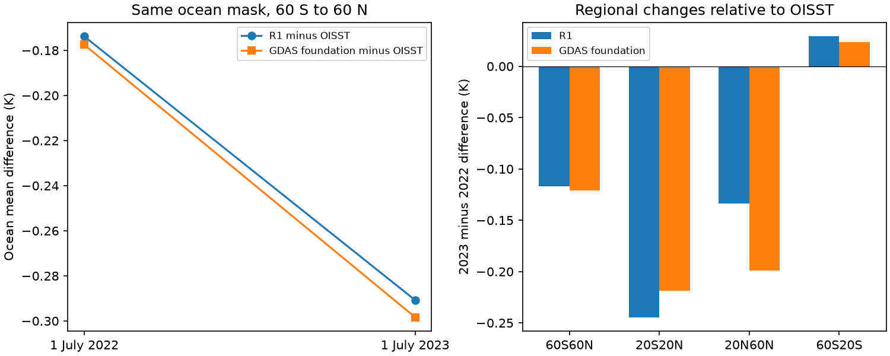
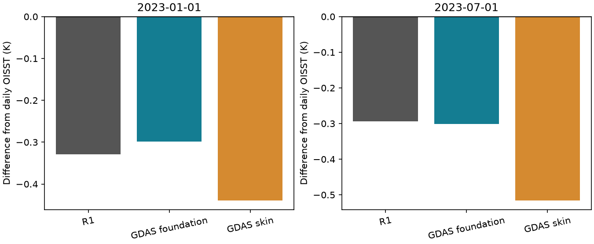
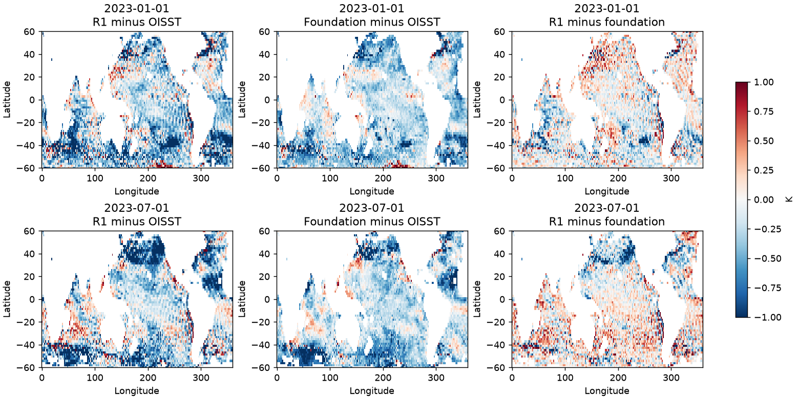

# GDAS foundation SST carries the July 2022 to July 2023 growth of the R1 ocean cold mean offset

## Result

On the same ocean mask, R1 minus daily OISST v2.1 changed by **-0.1169 K** between 1 July 2022 and 1 July 2023. The documented upstream GDAS foundation SST changed by **-0.1208 K** against the same reference. The R1-minus-foundation residual changed by only **+0.0039 K**. This puts the sampled mean growth of the cold offset in the upstream foundation analysis. It cannot be attributed solely to processing inside R1. It does not identify the physical cause of the upstream change.

| Mean difference, 60 S to 60 N (K) | 1 July 2022 | 1 July 2023 | Change |
|---|---:|---:|---:|
| R1 minus OISST | -0.1738 | -0.2907 | -0.1169 |
| GDAS foundation minus OISST | -0.1775 | -0.2983 | -0.1208 |
| R1 minus foundation | +0.0037 | +0.0076 | +0.0039 |

These results use 6,848 common T62 ocean cells, with area weights. R1 uses its daily mean in this follow-up, so its daily averaging is the same in both years. GDAS uses its 12 UTC foundation field. OISST is a daily mean. No trend is fitted to these two days.

The tropics drive the sampled change. At 20 S to 20 N, R1 minus OISST changes by -0.2444 K and foundation minus OISST by -0.2185 K. At 20 to 60 N the changes are -0.1335 and -0.1988 K. At 60 to 20 S they are +0.0291 and +0.0238 K. Thus agreement in the broad mean includes regional cancellation. R1 processing and timing remain relevant regionally. The July 2022 test was added after the two 2023 results were inspected; it is an exploratory source test, not a pre-registered independent validation.

## Foundation and skin are different archive tests

On 1 January 2023, the 60 S to 60 N R1 mean is 0.0311 K colder than foundation SST. On 1 July 2023 it is 0.0083 K warmer. Their differences from OISST are -0.3292 and -0.2932 K for R1, and -0.2981 and -0.3015 K for foundation. The input shares of the mean difference are 90.6% and 102.8%. A share above 100% is possible because the downstream mean residual has the opposite sign.

GDAS skin temperature is 0.1410 K colder than foundation in January and 0.2140 K colder in July. A skin proxy therefore makes R1 look 0.1099 and 0.2223 K warmer than its input. It cannot replace the documented foundation field for this absolute source comparison. This result does not show that the skin-foundation difference is itself an error.

The broad mean agreement does **not** close the field-level budget. R1-minus-foundation RMSE is 0.3636 K in January and 0.4053 K in July. A one-degree angular spatial filter reduces these to 0.2709 and 0.2946 K, while mean residuals remain -0.0254 and +0.0110 K. The unfiltered lag scan has its smallest RMSE at three days later for both snapshots (0.3133 and 0.3450 K). This is evidence of a time/space mismatch, not proof of a three-day production lag. We do not select that lag to report a better main result. Across all zero-to-seven-day tests the unfiltered mean residual ranges from -0.0311 to +0.0081 K in January and -0.0135 to +0.0083 K in July.

## Question and prior work

Does the 2023 cold offset in the NCEP R1 ocean boundary also occur in its upstream GDAS foundation temperature? Does use of operational skin temperature as a proxy change this test?

Earlier campaign work found a cold boundary offset in R1 and R2 after February 2020, with a larger offset after 2022 (b44c67de). A later study checked 18 Pacific moorings. It found 42% less period-to-period warming in R1 and R2. It also found the NWS switch notice, but a GFS skin-temperature proxy did not locate the later cause (e4fe7b37). This study adds direct access to the archived GDAS foundation field. It does not claim a new discovery of NSST cold bias or of the documented source switch.

NWS Service Change Notice 20-10 states that GDAS 12 UTC foundation temperature would replace the earlier SST analyses for CDAS output from 11 February 2020. The notice is evidence for the product source, not proof of the exact processing of the two fields tested here. UFS utility documentation states that netCDF files carry both foundation and surface temperature, while GRIB2 surface temperature is used as foundation temperature when the separate NSST fields are absent. Thus the distinction matters for an archive test.

## Methods

We used GDAS surface analyses at 12 UTC on 1 January and 1 July 2023. January was an exploratory test on an existing shared file. July was chosen as an opposite-season check after the January result. These dates are not a random sample. We compared the `tref` foundation field and `tmpsfc` surface field with the 12 UTC R1 `skt` field on the same date. The reference is daily OISST v2.1 on that date, converted to kelvin. OISST is a benchmark, not error-free truth.

We used bilinear interpolation to the native R1 T62 grid, with periodic longitude padding. The mask keeps 60 S to 60 N ocean. It requires ocean at each point of a 3 by 3 T62 neighbourhood and an interpolated ocean fraction above 0.999 after a one-degree Gaussian filter of the fine GDAS mask. This removes coastal and sea-ice regions. The mask is separate for each date. Means use cosine latitude weights on exactly the same grid cells for all comparisons within a date. Region results use the same mask and weights.

We report the exact mean identity: R1 minus OISST = (GDAS input minus OISST) + (R1 minus GDAS input). The input share is the first term divided by the left side. It is an algebraic diagnostic, not a causal fraction, and can exceed 100%. No subtraction of a historical mean is applied. These are absolute two-date differences, not an estimate of the size or date of a change.

Sensitivity checks apply Gaussian filters of 0.5, 1 and 2 angular degrees to the fine temperature fields before interpolation. The angular filter has the same grid width in both axes, not the same physical length at all latitudes. We also compare each fixed GDAS snapshot with R1 at 12 UTC from zero to seven days later. The lag scan is a diagnostic of mismatch, not an estimate of the production lag. No filter width or lag is selected for the main result. All outcomes are in metrics.csv and lags.csv. A two-degree filter can mix coastal values beyond the main mask buffer; treat it as a stress test.

## Limits and interpretation

Three snapshots cannot establish an annual mean error, a drift, or the full cause and time history of the 2022-2023 change. This study has no sample before the 2020 input switch. R1 and GDAS are related systems, so their agreement is not independent validation of SST accuracy. OISST has its own known steps and is warmer than several in situ estimates in this period. Its uncertainty affects the absolute cold difference and the algebraic input share. The R1-minus-GDAS comparison itself does not depend on OISST.

The exact CDAS SST GRIB input was not recovered. GDAS foundation temperature is the documented upstream field, but production may apply time offsets, interpolation, climatology near masks and spatial filtering. A small regional mean difference does not imply a small grid-point difference. The RMSE and regional checks must be read with the mean comparison. No p values or confidence intervals are given: thousands of grid cells do not make two dates a large independent sample. An experiment with the exact CDAS input stream and more dates is still needed to close the processing budget.

## Files and reproduction

Python 3.12, numpy, scipy, pandas, xarray, netCDF4, h5py and matplotlib are needed. Use one BLAS thread. No external raw data are included. See inputs.json for the exact shared source paths, URLs, source hashes and file sizes. The July inputs are external scratch extractions; external_ranges.json and external_ranges_2022.json record every downloaded byte range and hash, and their transformation. july_inputs.json gives the extra shared inputs. subset_audit_2022.json gives the second exact extraction check. july_array_hashes.json pins the interpolated fields in the follow-up. july_summary.json gives its audited differences. The original failed full-file transfer was stopped and its incomplete staging directory is not used as evidence.

For full reproduction, run `python files/retrieve.py /absolute/new/external_raw`, then `OPENBLAS_NUM_THREADS=1 OMP_NUM_THREADS=1 python files/analyze.py --data-root /absolute/new/external_raw --out /absolute/new/recomputed`. Then run `OPENBLAS_NUM_THREADS=1 OMP_NUM_THREADS=1 python files/compare_july.py --data-root /absolute/new/external_raw --external /absolute/new/external_raw --out /absolute/new/july`; run `python files/summarize.py /absolute/new/july/july_metrics.csv /absolute/new/july_summary`. The July follow-up uses the intersection of the two date-specific masks. All analysis scripts reject outputs in the signed publication folder. Retrieval verifies the original files or the exact July source ranges. Source servers can change files; a hash failure must be investigated, not ignored. The July subset netCDF hash can vary with writer versions, but its source ranges are pinned. All floats are copied from the archived arrays. The subset assigns the documented 12 UTC cycle time.

For an inspection without raw data, read metrics.csv, lags.csv, audit.json, inputs.json and external_ranges.json. The audit tests the decomposition identity for every row. The separate validate_subset.py check reconstructs reads from the saved source ranges and tests exact equality of five arrays against the July netCDF extraction. subset_audit.json preserves the array hashes. Run it as `python files/validate_subset.py /absolute/new/external_raw/gdas-20230701-12-sfcanl-nc-nsst-b755`. The maps and figure show the aggregate results. This is a numerical consistency check, not an independent replication. The original script and all analysis settings are included. Reproduction writes outside the signed bundle.

Data and image sources: NOAA NCEP and NOAA Physical Sciences Laboratory, Boulder, Colorado, USA, https://psl.noaa.gov/. See NOTICE-external-data.md. No NOAA endorsement is implied.

## Investigation provenance

Job sci-1107-dell-earth-and-ocean-sciences-b75510efed34; topic earth-and-ocean-sciences; campaign 11_07_2026; machine dell; account codex-olen; model gpt-6.1-sol, high reasoning effort, through Codex in T3 Code. Analysis date 2026-11-11. One worker carried out the study. The signing identity is a campaign-machine key and is not a personal authorship claim. All computations used the assigned worktree and shared HP SSD paths. No failed Dell disk was used.
