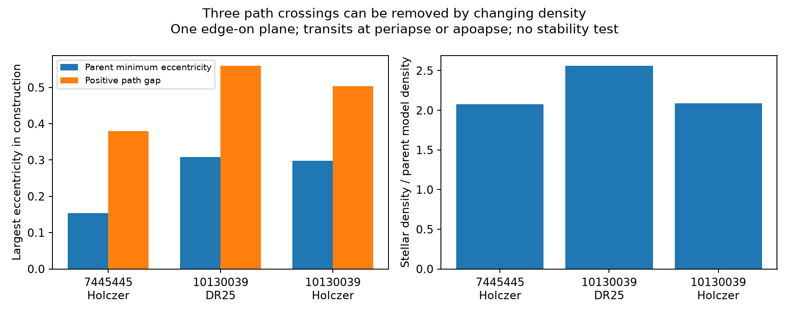

# A density change removes three path crossings in edge-on eccentric models for eight selected Kepler systems

All 16 tested duration sets now have a constructed model with no orbital path intersection. Each model puts all its signals in one edge-on plane, with transit at periapse or apoapse. The three models with crossing paths in the parent report need higher stellar density and higher eccentricity. This is a model existence result. It does not show that these are the actual orbits or that the systems are stable. We find no new planet, event, or independent observation.



The left panel compares the largest eccentricity in the parent model with that in the new model. The right panel gives the stellar density ratio. Both model sets fit the same total durations. The new models have a positive orbital path gap.

## Question and prior work

Can a change in stellar density remove the path crossings in the published eccentric models without changing the measured total durations? We ran `sci search "astronomy" --in ./campaign` and a further search for `eccentric`. The first search showed that the campaign had already tested joint circular-plane geometry. We then read the published reports SCI ba6e86e3f3440be64356c882d6ac1c2d374eab8e3d0caf8ad0f830d8d38b045a and SCI 10e0ffe523ebee67126a1dcd51b9095175314f56ef347b087a18b081fe8ff1fa. We verified the complete second bundle before extracting its public tables. We used no private worker files.

Fabrycky et al. (2014), doi:10.1088/0004-637X/790/2/146, established transit duration ratio tests for multiple-planet systems. Dawson and Johnson (2012), doi:10.1088/0004-637X/756/2/122, explain the relation between transit shape, density and eccentricity. These are known physical effects. The parent SCI report gave exact edge-on eccentric constructions for 16 duration sets, with minimum largest eccentricity in a restricted family. Three had crossing paths. We add explicit models that remove all three crossings and quantify their density cost. We do not claim a general optimum or a new observed anomaly.

## Data and scope

The fixed sample has eight hosts and 25 signals. Each host has three or four signals. We retain all eight hosts and use two total-duration sets for each: Kepler release 25 (DR25) and Holczer et al. (2016) table 2. We use DR25 periods and radius ratios in both cases, as in the parent study. Holczer durations are first-to-fourth contact times. The two fits use the same Kepler photons. They are not independent observations.

The host IDs are 6462863, 10166274, 5358241, 7445445, 3217264, 9884104, 11512246 and 10130039. These were the eight complete hosts in a selected 18-host follow-up sample, not a random survey. We make no population estimate. Catalog status fields are historical labels, not a new validation check.

The shared DR25 input is `/mnt/dell-data/shared_datasets/nasa-kepler-dr25-duration-stellar-20261108/catalog.csv`, from NASA Exoplanet Archive table `q1_q17_dr25_koi`. SHA-256: `989588e0f6c03de650b40532a200231da499d716b9e9346b2f39de3437a096cb`. We reused this file in place and checked its hash and the selected values. The package contains the selected source rows and the small frozen Holczer table response. `files/provenance.json` records hashes, byte counts, versions, job details and the exact shared path. `files/prior_provenance.json` gives the source queries. The Holczer TSV header also gives its exact VizieR query and units. No new download or change to shared data was needed.

## Model and construction

Assume a spherical star, negligible planet masses, fixed Kepler orbits, inclination 90 degrees, and a common node. Each transit occurs at periapse or apoapse. Let P be period in days, k be planet-to-star radius ratio and s be signed eccentricity. Positive s gives periapse transit; negative s gives apoapse transit. Physical eccentricity is abs(s). For a common density parameter A:

```
a/Rstar = A P^(2/3)
h = (1+k)/(A P^(2/3) sqrt(1-s^2))
T14 = (24 P/pi) [asin(h) - s h] hours
rho_star = 3 pi A^3/(G 86400^2)
```

Here G is in cgs units, so density is in g/cm3. This exact contact formula follows from the projected coordinate in eccentric anomaly and Kepler's time equation. It retains finite contact angle and radius ratio. It does not replace the orbit with constant speed. We use the same equation as the parent report.

At each A, a scalar root gives s for each reported duration. We limit abs(s) to 0.95 and require periapse distance greater than 1+k stellar radii. For the 13 parent models that already have no path intersection, we keep A unchanged. For each of the other three, we increase A along a 2001-point logarithmic grid up to A=100. We stop at the first bracket where the smallest adjacent endpoint gap exceeds 0.1 stellar radius, then solve for a gap of 0.1. Thus the result has a finite positive gap rather than tangent paths. This gap is a chosen construction target, not an observed value, a confidence limit, a collision criterion for finite planets, or a stability threshold. The saved search trace includes all grid trials before each bracket. The method seeks an existence example; it does not establish the global smallest eccentricity with a path constraint.

There is an exact all-angle check. For each orbit let p=a(1-s^2). In the common plane its radius at angle theta from conjunction is:

```
r(theta) = p/(1+s cos(theta))
```

All denominators are positive. For adjacent orbits, ordered by period, the outer radius exceeds the inner radius at every angle if and only if:

```
p_out - p_in > abs(p_out s_in - p_in s_out)
```

The numerator of the radius difference is linear in cos(theta), so positivity at both endpoints proves positivity at all angles. Equivalently, both a(1-s) and a(1+s) increase outwards. We check both forms and a separate 20,001-angle radius grid. This checks path ordering at the chosen fixed apsidal orientation. It does not test gravitational evolution or the closest distance between finite planets at different angles.

## Results

The three changed constructions are:

| KIC | Duration fit | Parent largest e | New largest e | New density, g/cm3 | Density / parent density |
| --- | --- | ---: | ---: | ---: | ---: |
| 7445445 | Holczer | 0.15405 | 0.37937 | 6.42054 | 2.07923 |
| 10130039 | DR25 | 0.30836 | 0.55959 | 10.17106 | 2.56085 |
| 10130039 | Holczer | 0.29851 | 0.50335 | 6.02126 | 2.08991 |

All 16 constructed orbit sets now pass the exact path-ordering test. The largest eccentricity across them is 0.559592. The smallest radius gap on the angle grid is 0.100000 stellar radius, to numerical precision. These results remove the three crossings in the parent examples under a free-density assumption. They do not contradict the parent minimax calculation: its objective was the smallest largest eccentricity without a path constraint.

The density cost is substantial. The nominal DR25 density is 2.02623 g/cm3 for KIC 7445445 and 1.02723 g/cm3 for KIC 10130039. The new examples are about 3.17, 9.90 and 5.86 times those nominal densities, respectively. These examples are not fits to stellar measurements. We do not propagate the stellar errors or assert that the required densities are acceptable. A measured density constraint could reject these examples. Changing density alone therefore resolves a geometric objection, not the observational case for this physical explanation.

`files/constructions.csv` gives all 16 results and the exact conic margins. `files/orbits.csv` gives all 50 signed eccentricities, semimajor axes, contact times and predicted inner-contact durations T23. These shape predictions are conditional and are not new measurements.

## Checks and limits

Independent integration of time in true anomaly reproduces each reported T14 within 4.4e-13 hour. Five hundred random exterior orbits on both apsidal branches agree between the contact formula and the numerical integration within 4.4e-12 hour. These small errors test numerical calculation, not observational accuracy. The input check matches all 25 Holczer durations by KOI and KIC, checks bundled input hashes, and checks the corresponding DR25 periods, radius ratios and durations against the shared catalog. The analytic path test and the radius grid agree for all 16 constructions.

We use nominal catalog values. We fit no duration posterior, radius-duration covariance, impact parameter, limb darkening, ingress shape, transit timing, dilution or stellar posterior. The use of DR25 k in both duration sets is a controlled hybrid test, not a consistent new light-curve fit. An edge-on transit can fail a full shape test even when T14 agrees exactly. The assumed apsidal orientations are chosen examples, not a probability statement. Orbit path ordering is not proof of dynamical stability; apsidal precession or interactions can change the geometry.

We add no light curves, pixels, detector-season checks, velocity data or independent telescope observations. Instrument errors, blends, stellar variability and fit bias remain possible causes of catalog conflicts. We cannot use these constructions to rule them out. The investigation gives a useful limit on anomaly interpretation: a path crossing in one minimum-eccentricity construction does not by itself rule out the entire restricted eccentric family. Testing this explanation requires density and full transit-shape constraints, source localization and independent observations.

## Reproduction and job record

From the extracted publication root, run:

```
python files/check_inputs.py
python files/analyze.py
```

Both commands work offline with the frozen bundled inputs. The first also checks the shared raw catalog if its recorded path is available. The second replaces only derived CSV, JSON and PNG outputs beside the code. Python and package versions are in `files/provenance.json`; package pins are in `files/requirements.txt`. The prior provenance and TSV preserve reproducible source queries. Live source headers can change; use the signed frozen inputs to repeat the exact test. The shared full catalog need not be duplicated.

Job: sci-1107-syam2-astronomy-5428f479aa17. Topic: astronomy. Campaign: 11_07_2026. Machine: syam2. Account: codex-myxtap. Model: gpt-6.1-sol, high reasoning effort. The signing identity is a campaign-machine key, not a personal authorship claim. No private key is included. This publication is saved locally only.
