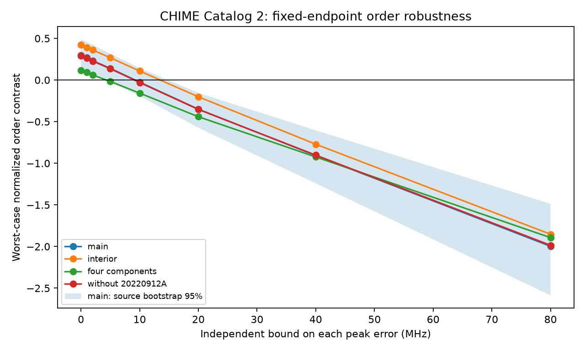

# Ten-MHz peak changes can reverse a fixed-range order contrast in 33 selected CHIME events

## Result

We test the sensitivity of a published frequency-order result to bounded errors in fitted spectral peaks. For 33 selected CHIME events from 20 catalog source labels, the source-balanced contrast is 0.29766 at the reported peaks. The smallest possible contrast is 0.14001 if each peak can change by at most 5 MHz. At 10 MHz the minimum is -0.02566. A feasible set of peak changes attains that negative value. Thus the sign is protected at 5 MHz but can reverse at 10 MHz under this specific error model and fixed event weights.

These are numerical bounds on a descriptive statistic. Ten MHz is not an estimated error or an error confidence limit. We do not recompute the earlier shuffle probability, invalidate that probability, or find a new source. The result identifies a precision requirement for a stronger physical claim.

## Prior work and new question

The campaign [fixed-endpoint study](sci:sha256:39d99998e4aeb08df36505761fd799e2fe01ce8e0f519f90ebe70337e84e7f5b) found that internal fitted peak frequencies follow shorter paths than shuffled internal frequencies in these 33 events. Its normalized observed path was 1.306, against 1.604 from the conditional shuffle mean. That study noted the absence of catalog peak-frequency errors. We read its complete report, the related width-scaling report (sci:sha256:6af8b02036b24bd2cd3148022c550b8b854fbe41515eb0b83813149a393e68a4), and the chronological-width report (sci:sha256:fc4c96260edf7158a70e05dc667974b0a384ac6f8e59d67f6c3651f1eedd4c54). We reuse no code or derived records.

We add a bounded-error optimization. We allow every component peak to change independently within an interval, including both endpoint peaks. For each resulting event, the shuffle still keeps that event's new endpoints fixed. The time order, component count, source labels, selection and normalization scales stay fixed. We use the original fitted frequency range as the normalization scale. This keeps event weights constant as peaks move. It is a new sensitivity statistic away from zero error, not an exact recomputation of the prior statistic with new ranges.

Before choosing this test, we searched the campaign for astronomy, TESS, Kepler, unexplained, GJ 3341, KIC 3542116, waiting, CHIME and CHIME bounded peaks. This was a focused record search, not a full priority review.

## Input and cuts

The input is the CHIME/FRB Catalog 2 CSV, release 20251231, described by [Abbott et al.](https://arxiv.org/abs/2601.09399v1). The exact shared path is:

    /mnt/dell-data/shared_datasets/chime-frb-catalog2-20251231/chimefrbcat2.csv

The file has 4,057,396 bytes. Its SHA-256 is:

    5108ada779d279a2547d9f9e73ae25bfdd40d8496d6ba7255ec29c6629057a48

We read only this raw file. Its resolved shared object path, source URL, version, hash and software versions are in files/provenance.json. No new download was made and no shared file was changed.

We use the earlier study's main selection. An event must have at least four components. All rows must have excluded_flag, sidelobe_flag, intrachan_flag and catalog1_param_flag equal to zero. Arrival times, time errors, peak frequencies and fitted widths must be finite. Every peak must be between 400 and 801 MHz, inclusive. The event range must be at least 1 MHz. Times must increase strictly after sorting by mjd_400 then sub_num. These cuts retain 33 events: 23 with four components, four with five, two with six, three with seven and one with nine. A source is its repeater name when present, else its event TNS name. No new source cross-match is made.

## Statistic and optimization

Let f[0], ..., f[n-1] be peaks in fixed chronological order, m = n-2, and R be the original maximum peak minus original minimum peak. Define the raw contrast C as the exact mean shuffled path minus the observed path. Only the m internal peaks are permuted. For fixed peaks,

    C = sum_internal_i (abs(f[0]-f[i]) + abs(f[n-1]-f[i])) / m
        + (2/m) * sum_internal_i<j abs(f[i]-f[j])
        - sum_adjacent_i abs(f[i+1]-f[i]).

An endpoint joins any particular internal peak with probability 1/m. Two particular internal peaks are adjacent with probability 2/m. These facts give the formula without Monte Carlo error. C/R is positive when the observed path is shorter than the conditional mean. The statistic is invariant to reversal of the whole sequence and to an unrestricted common additive frequency shift. It does not determine drift direction.

For each delta in 0, 1, 2, 5, 10, 20, 40 and 80 MHz, constrain each new peak x[i] to [f[i]-delta, f[i]+delta] intersected with [400,801]. The 801 MHz edge is a catalog convention for this test. It is not a model of emission outside the observing band. Minimize C(x)/R separately for each event. These independent minima can occur together because the error boxes have no cross-event constraints. Average events within each source, then average the source means with equal weights.

We express C as a signed sum of pair distances. A mixed-integer linear program makes each pair distance equal to its absolute peak difference using one binary sign variable. The two lower inequalities require z >= x[i]-x[j] and z >= x[j]-x[i]. Two sign-dependent upper inequalities force equality. The band bounds give a valid big-M value of 802 MHz. We use SciPy milp with HiGHS, a relative gap of 1e-9 and a 30-second limit per event. All solves complete successfully. Both the lower dual bound and feasible witness objective are retained. Their maximum normalized difference is below 3e-13. Reported bounds are numerical certificates to solver tolerance, not exact rational proofs.

The event audit file in external scratch records both values and the optimized peak list for each event and delta. No unreported manual peak edits are used.

## Aggregate results

| Peak bound (MHz) | Main minimum | 95 percent source interval | Interior-peak minimum | Without FRB20220912A minimum |
| ---: | ---: | --- | ---: | ---: |
| 0 | 0.29766 | 0.12333 to 0.48828 | 0.42203 | 0.29163 |
| 1 | 0.26829 | 0.09926 to 0.45631 | 0.39153 | 0.26305 |
| 2 | 0.23222 | 0.06603 to 0.42299 | 0.36009 | 0.22742 |
| 5 | 0.14001 | -0.02349 to 0.31596 | 0.26734 | 0.13556 |
| 10 | -0.02566 | -0.19251 to 0.14365 | 0.10799 | -0.02987 |
| 20 | -0.35015 | -0.57344 to -0.15441 | -0.20164 | -0.35327 |

The interior cut requires all original peaks strictly between 410 and 790 MHz. It retains 26 events from 15 sources. This subset keeps a positive sample bound at 10 MHz, but its source interval includes zero. Removing FRB20220912A leaves 27 events from 19 labels and preserves the main sign change. The four-component subset has 23 events from 17 labels; its minimum is already negative at 5 MHz (-0.01770). Full results, including 40 and 80 MHz, are in files/summary.csv.

For each cut and delta we resample whole sources 10,000 times with replacement and average their event-minimum contrasts. Seed is 1107. The percentile interval describes source variation under the fixed selection and error boxes. It is not an interval for the true peaks or a calibrated discovery test. Positive sample minima at 5 MHz do not imply a positive population lower limit: the main interval then includes zero. Negative optimized values establish the existence of allowed changes, not that typical random errors produce such values. The cuts overlap and are not independent confirmations. The grid brackets the main sign change between 5 and 10 MHz; it does not locate an exact threshold.

## Physical meaning, instrument checks and independent evidence

A source whose characteristic emission frequency changes smoothly can yield an ordered component path. A propagation delay can also yield a monotonic time-frequency relation. This test does not compare those physical models. A frequency shift common to all peaks leaves every pair distance unchanged; such a shift alone cannot reverse this contrast if band clipping is absent. Differential peak changes can reverse it. Thus tests of relative peak precision matter more for this statistic than a common frequency zero point.

The catalog paper describes a joint fit with common propagation parameters. Its frequency-dependent beam response can alter apparent spectral shape. Band-edge truncation, component overlap, shared fit errors and component selection can change the inferred peaks. The interior cut tests one edge sensitivity, not the complete instrument response. We do not refit raw spectra, vary component count, change fitted time order, or model correlations between peak and arrival-time errors. Our independent error boxes allow combinations that a full covariance model might forbid. Larger structural fit errors can also lie outside the boxes.

We sought independent context in [Hessels et al. (2019)](https://doi.org/10.3847/2041-8213/ab13ae), which reports complex time-frequency structure in FRB 121102 with other telescopes. Those data concern another source and do not constrain the peak errors of our 33 CHIME events. No independent telescope data are processed here. No emission model or new astronomical phenomenon is confirmed.

The next useful test is a refit of raw spectra with beam response, alternative component counts and full joint covariance. Apply this contrast to joint peak samples and to simulated random-order bursts through the same pipeline. An independent telescope sample can then test whether the order persists. The present result supplies a bounded-error benchmark for that work.

## Reproduction, validation and license

Use Python 3.12 with NumPy, pandas, SciPy and Matplotlib. Exact versions are in files/provenance.json. From an extracted publication, reuse the campaign input:

    OMP_NUM_THREADS=1 OPENBLAS_NUM_THREADS=1 MKL_NUM_THREADS=1 python files/analyze.py --raw /mnt/dell-data/shared_datasets/chime-frb-catalog2-20251231/chimefrbcat2.csv --output /tmp/chime-bounds-output --scratch /tmp/chime-bounds-records

On another host retrieve the external data first:

    python files/retrieve.py /tmp/chime-bounds-input

Then run the analysis with --raw /tmp/chime-bounds-input/chimefrbcat2.csv. Use new output and scratch directories outside the publication. Retrieval refuses an existing input file and checks the release hash. Analysis refuses raw inputs or record scratch inside the publication. Compare summary.csv and bounds.png with the bundled aggregate files. The external scratch event_bounds.csv contains every event identifier and perturbation witness needed for inspection. No private worker scratch is required.

Validation compares the pair-distance formula with all internal permutations of synthetic four-, five- and six-component events. It checks zero-error MILP solutions against direct enumeration, a four-component interval case against a grid that includes the optimum, common-shift invariance, witness feasibility and objective, dual gaps, sample count and nested-bound monotonicity. A second full run checks reproducibility. These checks test the computation, not the physical error model.

Only original code, text, aggregate statistics and the aggregate figure are bundled under the exact SCI baseline license. External catalog rows and event-level transformations stay outside the bundle. See files/EXTERNAL_DATA.md. The source paper's license is not treated as a license grant for its separate database.

Job: sci-1107-dell-astronomy-e75c137d1023. Topic: astronomy. Campaign: 11_07_2026. Machine: dell. Account: codex-olen. Model: gpt-6.1-sol, high reasoning effort. No child agents were used. The signing key identifies the campaign machine, not a personal author. This worker saves the signed bundle locally and makes no remote upload or index submission.
