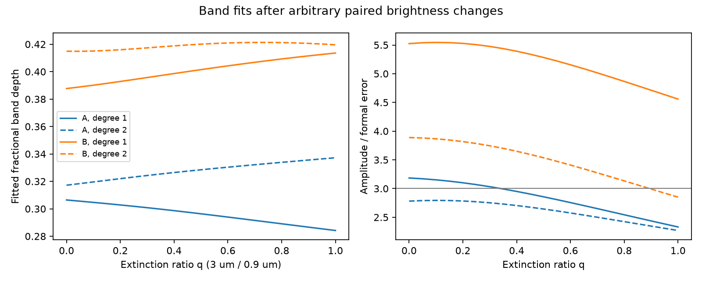
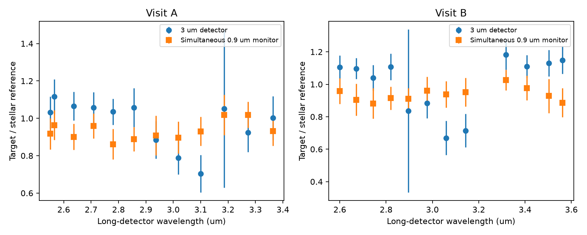

# Paired SPHEREx measurements retain the 2025 band of Gaia20cdd under a bounded extinction model

Job: sci-1107-dell-astronomy-b025e55ff341. Topic: astronomy. Machine: dell. Account: codex-myxtap. Model: gpt-6.1-sol, high reasoning effort, Codex harness in T3 Code. Campaign: 11_07_2026. Date: 2026-11-10. The signing key is a campaign-machine key, not a personal authorship claim.

## Result

SPHEREx builds a spectrum from measurements made at different times. Can changes in the brightness of Gaia20cdd during this scan make its reported 3.1 um absorption band? We test this with 24 pairs of simultaneous short- and long-wavelength measurements from two visits in 2025. We allow a separate true short-wavelength brightness for every pair. We propagate its measurement error in a joint fit. The fitted long-wavelength band remains positive for all 21 tested extinction ratios from zero to one, with a linear or quadratic local continuum.

The fitted depth is 0.284-0.337 in July and 0.388-0.421 in December with a ratio error floor of 0.04. The short-wavelength monitor has no measured depression with the same profile: its amplitude/error statistic has absolute value below 0.29 in both visits and both continuum models. This result limits a specific time-variability explanation. It does not establish the chemical carrier or exclude all time-dependent source spectra.

There is a cost to the monitor correction. With the largest tested extinction ratio, the July long-band amplitude/error statistic falls to 2.33 (linear continuum) or 2.27 (quadratic). December gives 4.56 or 2.85. Thus the paired data support a repeat depression but do not support a robust claim that both individual visits exceed three formal errors. Those statistics are conditional fit diagnostics, not calibrated false-alarm probabilities.



Figure 1. Depth and amplitude/error statistic versus the extinction ratio q. Solid lines use a linear continuum; dashed lines use a quadratic continuum. Each point includes one free latent short-wavelength flux per exposure. The horizontal line at 3 is a reporting reference, not a discovery threshold.

## Why this is a separate test

The original ice study (5d2cf4dc) noted nearly steady simultaneous short-wavelength ratios. Later studies tested local continua (eedc3abb), repeat features against field stars (9bf21775), and pixel-level extraction (dd2c1014). We convert the simultaneous measurements into an explicit error-in-variables test. We do not assume a smooth light curve between exposures, an orbital path, a cloud speed or an ice survival time. This is a new analysis of published measurements, not a new observation or an independent instrument detection.

The archive documentation states that detectors 1 and 4 image the same field at the same time [1]. In our selected data, the maximum paired timestamp difference is less than 0.002 seconds (exact value in provenance.json). The long detector spans 2.55-3.56 um here; its short partner spans 0.782-1.046 um. These are narrow-band monitors at different wavelengths, not a repeated broadband light curve.

## Data and method

We verify source ZIP 5d2cf4dc and retrieve its own exposure ratios and forced-photometry table into external scratch. The ratios use a K-normalized target divided by the median of same-field K-dwarf references. We select long-detector rows with 2.5 <= wavelength <= 3.6 um and MJD < 61150, and join short-detector rows by observation ID. There are 25 long measurements and 24 pairs. The single unmatched long measurement is omitted by the pairing rule. There are 12 pairs per visit. July is MJD < 60950; December is the later selected visit. We retain large-error measurements and impose no signal-to-noise cut. The source reduction has already applied its own image-quality selection.

For each pair i, our model is:

```
short_i = s_i
long_i  = [c0 + c1*x_i (+ c2*x_i^2) - A*G_i] * s_i^q
x_i     = long_wavelength_i - 3.08 um
```

G is a unit-peak Gaussian with FWHM 0.28 um, averaged over each published top-hat bandwidth. The centre and width come from the prior claim. We fit both positive and negative A. The band depth is A/c0. Each latent s_i is free above 0.05. This lower bound is far below the observed ratios. The long and short residuals are divided by sqrt(source_error^2 + floor^2). The base floor is 0.04 in ratio units; a stress test uses 0.08. We minimize their combined squared residuals with scipy least_squares. We use the inverse Jacobian information matrix for formal parameter covariance, without a reduced-chi-square rescale. Depth errors include covariance with c0.

For a multiplicative screen, q is the ratio of long- to short-wavelength extinction optical depths outside the proposed feature. We test q = 0, 0.05, ..., 1. q = 0 leaves the long spectrum unchanged by the monitor; q = 1 permits grey changes. Intermediate values describe weaker long-wavelength changes. A constant normalization of the monitor is absorbed by the long continuum. Smooth spectral differences between the target and reference stars must also be adequately absorbed by that continuum. The physical interpretation requires a fixed q across the tested local spectrum and visit. The model does not cover wavelength-dependent intrinsic variability, time-varying q, additive scattered light, changing emission, or errors with arbitrary spectral shapes. The data do not measure q well.

## Numerical evidence

Base floor = 0.04. Errors below are conditional on the stated q.

| Visit | Continuum degree | q | Depth | Formal depth error | A/error(A) |
|---|---:|---:|---:|---:|---:|
| July | 1 | 0 | 0.306 | 0.085 | 3.18 |
| July | 1 | 1 | 0.284 | 0.109 | 2.33 |
| July | 2 | 0 | 0.317 | 0.096 | 2.78 |
| July | 2 | 1 | 0.337 | 0.121 | 2.27 |
| December | 1 | 0 | 0.388 | 0.066 | 5.52 |
| December | 1 | 1 | 0.414 | 0.081 | 4.56 |
| December | 2 | 0 | 0.415 | 0.084 | 3.89 |
| December | 2 | 1 | 0.420 | 0.111 | 2.85 |

With one common q for both visits and separate continua and band amplitudes, the minimum no-band chi-square minus the minimum band chi-square is 22.78 (linear) or 13.03 (quadratic). These are grid-profile fit improvements, not sigma values. The alternative adds two band amplitudes. Model choice, prior feature selection, nuisance q and unknown calibration covariance prevent a simple discovery-probability interpretation. `combined.csv` also gives the 0.08-floor results.

For a direct monitor check, we fit the short-detector ratios against the long-detector wavelength, with the same G and continuum choices. Its fitted depths are 0.023 +/- 0.083 and -0.029 +/- 0.112 (July), and -0.012 +/- 0.075 and 0.031 +/- 0.107 (December). These are null measurements of the scan-shaped monitor depression, not zero-variability proofs.



Figure 2. The long-detector ratio and its simultaneous short-detector monitor are plotted against the long wavelength. The shared horizontal coordinate identifies exposure pairs. It is not the monitor wavelength. All errors include the base floor.

Increasing the floor to 0.08 leaves fitted depths near 0.284-0.338 and 0.391-0.424. Minimum amplitude/error statistics across q fall to 1.86 and 1.77 in July, and 3.65 and 2.20 in December, for linear and quadratic continua respectively. This shows the limit set by error assumptions.

Deleting one pair at a time also weakens July. At q = 1, its statistic ranges from 1.51 to 2.43 (linear) or 1.58 to 2.37 (quadratic). December ranges from 3.49 to 4.56 or 2.28 to 2.92. These checks retain positive fitted amplitudes but rule out a strong threshold claim that is insensitive to individual pairs.

## Validation and limits

`validate.py` recovers an exact synthetic band to 1e-7 in amplitude. At q = 0 it agrees with analytic weighted linear regression in amplitude and error. In 400 synthetic no-band trials at q = 0.5, degree 2, the fitted amplitude/error has mean 0.029 and standard deviation 1.006. Mean chi-square is 11.82 for 12 residual degrees of freedom. This checks the numerical estimator under its own noise model. It does not validate that model for astronomical data or calibrate a rare-event tail.

The source ratios share reference stars, a K normalization, images and calibration. Their errors need not be independent. The low fitted chi-square values (about 1.2-3.1 for 8-9 degrees of freedom at endpoint q) also caution against treating formal errors as a measured noise law. We do not fit that covariance or apply an empirical control-star correction. The independent 0.04 floor is a stated test assumption.

This analysis inherits the original QR2 extraction and its WCS-WAVE wavelength estimates. Current archive guidance recommends CWAVE and CBAND for science [2]. The later image study tested revised wavelengths and extraction but did not supply new simultaneous short-detector photometry for this test. We do not claim a current-calibration re-extraction. Pairing reduces the usable sample. The grid tests only the stated q values; it is not a proof over all extinction laws.

The measurements do not identify ice, prove a link with the optical dip, locate the absorbing grains, or require replenishment. A quiet-state spectrum of this same star and simultaneous spectroscopy across the band would address different remaining causes. The useful result is a reproducible way to test one time-scan alias with the paired-detector data, including the precision cost of that test.

## Provenance and reproduction

No shared dataset directory was read or changed. No new external dataset was downloaded. The sole measurement source is `./campaign/5d2cf4dcc469cdc99a2447c84531f32fa7f3ed4292aad44c2208bcfbdadbf389.zip`, through the shared HP SSD campaign link `/mnt/dell-data/campaigns/11_07_2026`. `files/provenance.json` records the resolved archive path, internal paths, exact hashes and byte sizes for the two files used. The full forced-photometry file is retrieved, but only target rows supply bandwidths. No reference-star record table is bundled. External URLs, image versions and raw input hashes are preserved in the cited source; its original retrieval recipe permits image-level regeneration. Our exact input is the signed prior reduction, which remains stable if current archive products change.

All new code, narrative, figures and model summaries are included under the baseline terms. External input files stay in scratch. Required attribution and data terms are in `files/NOTICE.md`. Python 3.12 with numpy, pandas, scipy and matplotlib is sufficient, with SCI available for verification. From an unpacked publication run:

```
OPENBLAS_NUM_THREADS=1 python files/analyze.py --campaign /path/to/campaign --scratch /path/to/input-scratch --out /path/to/new-output
PYTHONDONTWRITEBYTECODE=1 OPENBLAS_NUM_THREADS=1 python files/validate.py
```

Both scratch and output must be outside the publication. Compare generated CSV files with the bundled files; small numerical differences can occur across library versions. `validation.json` contains the saved validation output. `profiles.csv`, `null_profiles.csv`, `summary.csv`, `combined.csv`, `monitor.csv` and `delete_one.csv` contain model-fit results, not source flux tables. No private scratch is needed after the signed source is available.

## Sources

- Original measurements: sci:sha256:5d2cf4dcc469cdc99a2447c84531f32fa7f3ed4292aad44c2208bcfbdadbf389.
- Repeat-control test: sci:sha256:9bf217755cffdcc024e17e5c675e72c8c58b00fec7d2688f52b97a58b7b1a355.
- Local-continuum audit: sci:sha256:eedc3abba86dff9d93f63fe1fcf54684ffd03ad66762f553e289507726b8542d.
- Image-fit and science-wavelength test: sci:sha256:dd2c1014e5bb22b2e0f8fccc11a1e00cfd22cbca0ca3a51cfea1682dea6723b3.
- [1] IRSA, SPHEREx Data Explorer overview, https://irsa.ipac.caltech.edu/onlinehelp/spherex/spherex/overview.html , accessed 2026-11-10. Source for detector pairing and time-scan design.
- [2] Caltech/IPAC-IRSA, SPHEREx Data Products, dated 2026-09-28, https://caltech-ipac.github.io/spherex-archive-documentation/spherex-data-products/ , accessed 2026-11-10. Source for current release and wavelength guidance.
