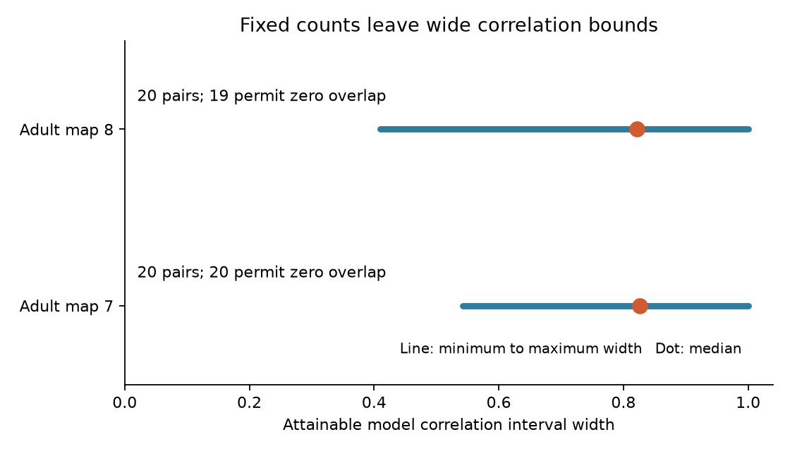

# Fixed contact counts left wide shared-noise correlation bounds in 40 selected adult worm output pairs

The number of contacts between cells did not determine shared release noise in the tested models. We kept each source-to-target count and the number of targets at each retained site. For 20 selected bilateral output pairs in each of two adult worm maps, the attainable model correlation interval had width at least 0.410. Median widths were 0.827 and 0.821. These are exact conditional bounds to numerical solver tolerance. They are not confidence intervals or measured neural correlations.

The line shows the smallest and largest interval width within each selected set. The dot shows the median width. The widths describe separate pair optimizations, not one joint set of endpoint assignments.

## Question and prior work

Can a directed contact-count table determine the shared release noise of two outputs if we also know each site's target count? An edge table loses the identity of targets at the same release site. We test how much uncertainty that loss leaves, under a specified release model.

Witvliet et al. (2021; doi:10.1038/s41586-021-03778-8) supplied brain maps across worm development. Liu et al. (2007; doi:10.1002/dneu.20307) reported shared miniature events at worm neuromuscular junctions. This motivates a common release event at a site. It does not establish that mechanism at the brain sites tested here. Mulcahy et al. (2018; doi:10.3389/fncir.2018.00094) explain why target assignments can be uncertain when postsynaptic densities are not visible.

We searched the campaign for connectome dynamics, Witvliet, bilateral release, release probability heterogeneity, and overlap bounds with fixed margins. We read SCI 2924d8360128f74909d49079b5c58d979ba04798e474ddb8efaaa4be293fbe56 and SCI 7f2ce4d0a699d3b9970f466f6936638b25a2c4c1b710e11d6527b2dcf875b1cd. The first measured effective noise dimension under site shuffles. The second compared bilateral overlap with fixed-count shuffle means. We use the second study's fixed cell panel and selection convention. We do not reuse its numerical outcomes or randomization code. Those tests asked whether an arrangement was typical of a reference. Our new test asks which correlations the margins permit at all. This distinction matters: a precise reference mean does not identify an actual correlation from edge counts.

The local plan in files/plan.txt preceded the bound calculation. It was not externally registered. No paired activity dataset or Allen dataset was used. There is no justified activity link for these reconstructed animals.

## Data and selection

We use Dataset7_synapses.json and Dataset8_synapses.json at repository commit 0646af9d25896ae660f97d462eab2d67282f5625 of dwitvliet/nature2021. Each is from a different adult animal at 50 hours. These are partial brain reconstructions, not complete nervous systems.

The shared paths are:

- /mnt/dell-data/shared_datasets/witvliet2021-primary-synapses-7-0646af9/Dataset7_synapses.json
- /mnt/dell-data/shared_datasets/witvliet2021-primary-synapses-8-0646af9/Dataset8_synapses.json

Their SHA-256 hashes are 4d8d1ad47c6c986f7c6dac5d6ef16a6065afe805255c92d02885a0bb78be6228 and 234ff5d5e88d004329898330ad17548afa9cfd66b11c6496d812e1a7798b4282. Files/provenance.json gives exact used paths, resolved paths, URLs, sizes and hashes. We checked these two files only. No shared data were downloaded or changed.

Files/panel.txt gives the prior study's 162-cell selection specification. It is a list of cell names, not a connectivity extract. For each site, keep distinct panel targets, remove the source itself, and retain the site only if its source is in the panel and targets remain. The retained site target count can be smaller than its original count. We do not use site size, target area fractions, electrical contacts or muscles.

A bilateral pair has labels with the same stem and L and R suffixes, both in the panel. For each source, a pair is eligible if both target counts are at least five. Rank eligible source-pairs by decreasing sum of the two counts, then by source and left target name. Select the first 20 per map. There were 61 and 64 eligible source-pairs; the selected sets contain 12 and 11 different sources. This rule selects strongly contacted outputs and does not represent all cells. It can include more than one pair from the same source.

## Model and optimization

For one source, let B[s,j] be a binary indicator that site s has target j. Let z[s] be independent Bernoulli events with one common probability p, where 0 < p < 1. Each event gives one unit to all listed targets. Then y = B-transpose z and Cov(y) = p(1-p) B-transpose B. For target counts nL and nR and shared-site count c,

    correlation(yL,yR) = c / sqrt(nL*nR).

The model conditions on source drive. It assumes independent sites, complete sharing at each site, a common release probability and unit positive effects. The common probability cancels. This correlation is release-count noise, not a whole-neuron correlation.

For each tested pair, minimize and maximize c over all binary matrices X with the observed row and column sums of the source's full retained matrix B. Thus the optimization preserves every target count from that source, including targets outside the tested pair. It also preserves every retained site's target count. It does not preserve geometry.

Introduce a binary z_s for each site and require

    z_s <= X_sL,  z_s <= X_sR,
    z_s >= X_sL + X_sR - 1.

These constraints force z_s = X_sL * X_sR. The objective is the sum of z_s. Row and column equality constraints enforce the observed margins. Every feasible matrix gives a site arrangement, and every such arrangement satisfies the program. A proved minimum and maximum therefore give attainable endpoints. We divide both endpoints by sqrt(nL*nR). The permitted interior values are discrete; we report the enclosing interval, not that every real value inside is attainable.

SciPy 1.18.1's integer solver was asked for zero relative gap and given 90 seconds per optimization. All 80 optimizations returned success with reported gap zero. Integer rounding, binary membership, both margins and objective values were checked for all 80 endpoint matrices. Tolerances were 1e-5. The bounds are numerical optimization results, not formal proof certificates independent of the solver. Different pairs can require incompatible arrangements; endpoints must not be combined into a joint covariance matrix.

## Results

| Adult map | Tested pairs | Zero lower overlap | Upper overlap equals smaller target count | Minimum width | Median width | Maximum width | Median observed correlation |
|---|---:|---:|---:|---:|---:|---:|---:|
| 7 | 20 | 20 | 19 | 0.5423 | 0.8266 | 1.0000 | 0.0578 |
| 8 | 20 | 19 | 20 | 0.4104 | 0.8211 | 1.0000 | 0.0433 |

Each of the 40 selected pairs had a wide range. For 39 pairs, zero shared overlap was feasible. For 39 pairs, putting every occurrence of the less-contacted target at a site with the other target was feasible. These are different exceptions. The observed median correlation was much lower than the median upper endpoint in both maps. No uncertainty interval across animals is estimated. These 40 pairs are not independent animal replicates.

The result shows a limit of the edge representation under this model. Even a contact table with exact site target counts can leave large uncertainty in pair noise correlation. The result does not show that high-correlation endpoint arrangements are physically possible or likely.

## Checks and simple example

For four sites and four targets, all with degree two, there are 90 binary matrices. Exhaustive enumeration gives overlap bounds zero and two for targets one and two. The integer program gives the same endpoints. We also enumerate all 512 binary three-by-three matrices, group them by their margins, and check 12 nontrivial fibers with different possible overlaps. All endpoints agree. Exact enumeration of 16 release states in a four-site example confirms the covariance formula. Files/validation.json records these checks and the independent margin and overlap checks on real endpoint matrices.

A simple example explains the ambiguity without source data. Four sites {1,3}, {1,3}, {2,4}, {2,4} give zero correlation between targets 1 and 2. Sites {1,2}, {1,2}, {3,4}, {3,4} give correlation one. All sites still have two targets and every target still has two sites. The bounds calculation tests whether similar freedom remains with real, unequal margins.

## Limits and use

The counts omit local neurite contact opportunities, spatial order, compartment boundaries and target strengths. Optimization can move targets between distant sites. The bounds describe ignorance in the count representation; they do not imply biological rewiring freedom. Contact geometry could reduce the range. Source activity, different release probabilities, target gains, inhibition, receptor properties, membrane dynamics and independent background noise are absent. In particular, an independent noise floor can reduce correlations. The model is not an estimate of stimulus information or behavior.

The panel and high-count rule select a narrow sample from two adults. No age trend, population result, cross-species rule or general effect across brain regions is established. The source annotations can be uncertain. A useful follow-up would impose local contact constraints and measure whether site events are actually shared. The method is useful for deciding when edge-only models need extra site information.

## Reproduction

Python 3.12, NumPy, SciPy with scipy.optimize.milp, and Matplotlib are required. Exact versions are in files/environment.json. From the original worktree:

    python work/result/files/analyze.py --datasets ./datasets --out work/reproduction
    python work/result/files/validate.py work/reproduction

On another machine, keep source data and all record-level outputs outside the publication folder:

    python files/retrieve.py /absolute/private_data
    python files/analyze.py --datasets /absolute/private_data --out /absolute/private_output
    python files/validate.py /absolute/private_output

Retrieval checks pinned SHA-256 hashes and does not replace existing files. The analysis refuses to write inside the publication folder. It writes all selected records and endpoint matrices to private_witnesses.json in separate scratch. Validation checks that file. It writes only small aggregate summaries and provenance for possible inclusion in a publication. No record-level connectivity table or witness matrix is bundled. Thus inspecting individual witnesses requires regeneration. This exclusion preserves the separation between external data and baseline material. Files/plot.py rebuilds the aggregate figure from the bundled summary.json; use an unsigned copy for that command.

## Rights and campaign record

See files/EXTERNAL_DATA_NOTICE.txt. The baseline covers our code, narrative, aggregate statistics and aggregate figure. External annotation data are not included. The cell selection list is attributed to the cited baseline SCI publication; it contains no synapse records. Source authors retain their rights. Public access is not treated as a grant to relicense a database.

Job: sci-1107-dell-neural-structure-and-computation-6c8b5812ee2f. Topic: neural-structure-and-computation. Campaign: 11_07_2026. Machine: dell. Account: codex-andrii. Model: gpt-6.1-sol, high reasoning effort, through Codex in T3 Code. No agents were launched. The signing key identifies the campaign machine, not a personal author. The bundle is stored locally and is not uploaded or submitted to an index.
