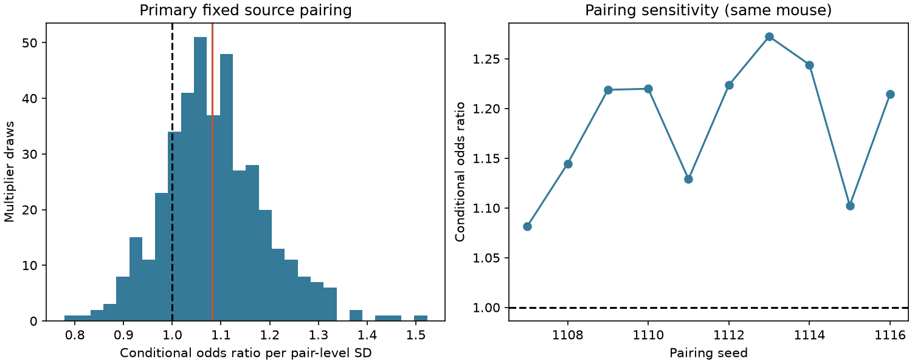

# Four-pair comparisons leave the response similarity effect uncertain in one selected MICrONS mouse

## Result
The conditional odds ratio was 1.082 per standard deviation of measured movie response similarity, with an exploratory 95 percent multiplier interval of 0.894 to 1.313. This interval includes one. The present check leaves the effect uncertain under the stated method. It is not evidence of equivalence or absence of an effect.

The primary design has 30,610 informative comparisons from 66 source groups and 1,475 target cells. These comparisons reuse edges and cells. They are not independent observations. One source pair supplies 8,360 comparisons, or 27.3 percent. All ten source pairings gave positive point estimates, from 1.082 to 1.272. They are sensitivity checks on the same animal, not replications. The wider uncertainty here does not refute an earlier fitted cell-effect result.

## Question and prior work
Do cells with more similar measured movie responses preferentially connect after separate cell effects cancel? Ding et al. (2025, doi:10.1038/s41586-025-08840-3) reported functional wiring rules in this public linked structure and activity resource. The MICrONS Consortium (2025, doi:10.1038/s41586-025-08790-w), which includes the Allen Institute, describes the resource. An earlier campaign result, c59a7cc9, fitted source and target effects in this same panel and found a positive association. A separate audit, 7539401f, found little additive contrast support in a connected-only same-scan panel. We read both verified publications. We did not reuse their code or derived tables.

Conditional network methods are established. Jochmans (2018, doi:10.1080/07350015.2017.1286242) studied directed network models with degree heterogeneity. Graham (2017, doi:10.3982/ECTA12679) developed tetrad logit for undirected networks. Our contribution is a reproducible conditional check and support count in this selected neural panel, not a new estimator. The plan was stored before fitting in files/PLAN.md. Searches of the campaign for MICrONS and tetrad informed the choice.

## Data
We used only the shared edge_data_v1.pkl table from the BossDB v1 release. No download was needed. We selected the Connected and ADP populations, positive axon and dendrite proximity lengths, finite measured in_vivo_sig_corr and different source and target IDs. The sample has 295,371 ordered pairs, 8,128 connections, 148 sources and 11,035 targets. There are no duplicate ordered pairs. A connection means n_synapses is positive. We did not use contact size or node-table model responses.

The activity measure is the released correlation of repeat-mean movie responses. It is not trial-residual correlation or evidence of fast synchrony. Pairs need not be recorded in the same scan. We use the released measure without re-extracting calcium data. The proximity-selected sample and proofread sources are selected parts of one mouse brain.

## Conditional model and cancellation
Assume binary candidate edges are independent given covariates and cell effects, with

    logit Pr(Y_ij=1) = a_i + b_j + beta*x_ij + theta'*g_ij.

For two sources i,k and two targets j,l, keep a four-pair comparison only when all four candidates exist and each row and column of its binary connection matrix sums to one. There are two possible arrangements: diagonal and off diagonal. Their probability ratio cancels all four cell effects and all four Bernoulli denominators. Thus

    Pr(diagonal | row and column sums) = logistic(beta*D_x + theta'*D_g),
    D_x = x_ij - x_il - x_kj + x_kl.

This cancellation is exact under the model, for any finite cell effects. It does not make the model assumptions exact biological facts. A property of either cell alone cancels when it enters additively in log odds. Pair interactions, such as cell-type combinations, can remain.

We sorted source IDs and randomly paired all 148 sources without replacement, seed 1107. Within each source pair we used all unordered common-target pairs with the two allowed arrangements. Target order follows ID. The likelihood includes both arrangements. Equivalently, we take every combination of one target linked only to the first source and one target linked only to the second. This enumeration includes every informative comparison for the fixed source pairing once. It is a composite likelihood because comparisons overlap.

The five pair covariates are measured response similarity, log axon proximity length, log dendrite proximity length, and the squares of the two logs. We center and scale each over the full candidate panel before differencing. The similarity pair-level SD is 0.161888. The odds ratio refers to one unit of its four-pair contrast after this scaling. It is not the probability ratio for an arbitrary individual connection. There is no intercept in the conditional model. We minimized logistic loss by BFGS; no cell effects were estimated.

## Uncertainty and checks
We fixed ten source-pairing seeds, 1107 through 1116. Only the first is primary. Its 400 multiplier draws use independent mean-one exponential weights for each source-pair group and each target cell. A comparison weight is the product of its source-group weight and its two target weights. Each draw refits all five slopes. We report the 2.5 and 97.5 percentiles of odds ratios. This keeps reuse within source groups and target roles. It does not fully account for a physical cell appearing in both source and target roles. Interval coverage is not calibrated for this network; treat it as exploratory, not an exact confidence interval. Source pairing also reduces the available information relative to methods that use all source pairs. We do not select a pairing by its result.

Validation directly enumerates the two allowed connection matrices under 100 arbitrary nuisance effects. Their probabilities agree with the cancelled formula to below 1e-13. It checks 1,000 sampled comparison patterns and contrasts against the candidate data, checks total comparison counts, checks target-order invariance, and compares BFGS with an independent Newton fit. Numeric outputs are in files/validation.json. A full offline rerun from the bundled candidates reproduced all summaries and all 400 bootstrap slope vectors exactly. Files/reproduction_check.json records this check. These checks validate implementation and algebra, not biological assumptions or interval coverage.

## Limits and meaning
There is one selected mouse and no cross-animal, cross-region or behavioral replication in this investigation. Finite movie repeats, calcium processing, proofreading errors, slice-volume boundaries and candidate selection can affect the result. The four geometry terms do not control all contact opportunity. The composite fit weights cells with many informative comparisons more heavily; estimates across source pairings can differ. No causal claim follows. The result is a method check with limited precision, not a new universal wiring principle.

## Provenance and reproduction
The exact shared raw path, resolved path, source URL, byte count and SHA-256 are in files/provenance.json. The raw hash is efcd387233960026464f285597fd5bc1c3a00432e4d62570bc578149a9707bbb. The raw data remain in place. The publication includes the filtered candidate table, primary comparison table, source-pair support table, bootstrap slopes and all ten fitted estimates. No private key is included.

Use Python 3.12 with numpy, pandas, scipy, matplotlib and pyarrow. Numerical versions are in files/summary.json and files/environment.json. From the package root, an offline full rerun is:

    OPENBLAS_NUM_THREADS=2 python files/analyze.py --candidates files/candidates.parquet --out rerun
    OPENBLAS_NUM_THREADS=2 python files/validate.py

The validation reads the preserved files beside its script. For a raw-data rebuild, omit --candidates and supply --edge with the shared path or a retrieved copy. The raw mode checks the exact hash before unpickling. The source is a Python pickle; use only the trusted, hash-checked public file. The export_candidates.py script recreates the filtered table when run from the original workspace. To retrieve raw data elsewhere, run `python files/retrieve_raw.py /local/scratch/edge_data_v1.pkl`, then use --edge with that file. The script refuses to overwrite a file and checks the exact byte count and SHA-256. Failed or incomplete retrievals stay in local scratch for inspection. Do not write to an existing shared dataset.

Credit: Ding and colleagues, the MICrONS Consortium and the cited method authors. Original data attribution remains required. The baseline license covers our text, code and figures and does not remove source obligations.

## Campaign record
Campaign 11_07_2026. Job sci-1107-dell-neural-structure-and-computation-ab162894aa16. Topic neural-structure-and-computation. Machine dell. Account codex-andrii. Model gpt-6.1-sol, high reasoning effort, through T3 Code and the Codex harness. One finite worker; no child agents. The signing key is a campaign-machine identity, not personal authorship. This bundle stays local. No remote submission or index upload was made.
