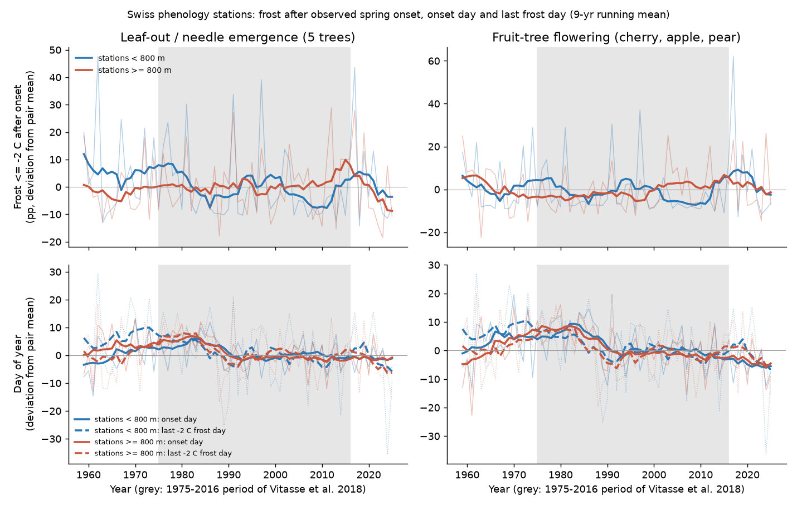
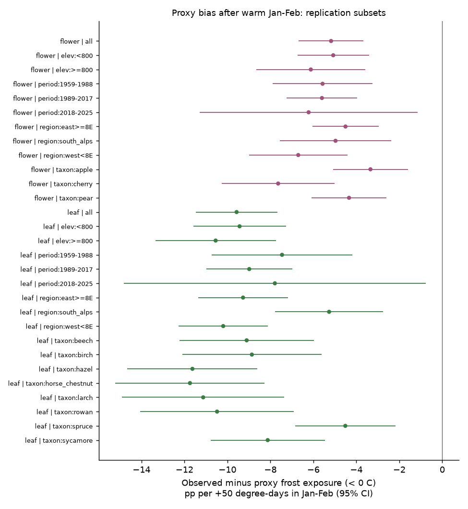
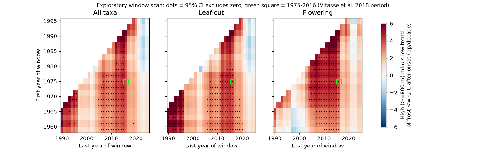

# Swiss phenology data replicate the German overprediction of frost by a 1 January heat-sum measure; the high-elevation frost increase of 1975-2016 did not continue in 2017-2025

## Summary

We used 39,400 observed spring-onset records from 146 MeteoSwiss phenology stations (200-1,933 m, 1951-2025). Each record has daily 2 m minimum and mean temperature from the nearest SwissMetNet station (median distance 7.3 km, median height difference 35 m). "Frost exposure" is a daily minimum at or below a threshold on any day after the observed onset day up to 30 June. We ran two pre-registered tests (`files/provenance/PLAN_preregistration.md`).

**Test 1. Independent replication of a German result (sci:sha256:6d514d9c...).** Zohner et al. (2020) measured frost risk with climate data only. Their measure counts the heat sum from 1 January and assumes that plants need the same heat sum each year. In Germany, this assumption failed after warm January-February periods. The same occurred in Switzerland:

- For each extra 50 degree-days in January-February, the proxy exposure (below 0 C) increased by 10.5 percentage points (pp) for leaf-out. The observed exposure increased by only 0.9 pp (95% CI -3.0 to +4.8). The observed-minus-proxy difference was **-9.6 pp (CI -11.5 to -7.7)**. Germany: -10.4 pp.
- For fruit-tree flowering, the difference was **-5.2 pp (CI -6.7 to -3.7)**. Germany: -7.3 pp.
- The difference was below zero, with a CI below zero, in **all 27 replication subsets** (11 taxa, 3 regions, 2 elevation groups, 3 periods). At -2 C, this was true in 26 of 27 subsets.
- Cause: the heat sum at the observed onset increased by 50 degree-days per extra 50 degree-days of January-February heat (leaf-out; 32 for flowering). Onset was only 2.2 days earlier (4.0 for flowering).
- A heat sum above 5 C from 1 March removed the bias for leaf-out (0.0 pp, CI -1.7 to +1.8). For flowering, it gave a small bias in the opposite direction (+3.2 pp, CI +1.2 to +5.2). Germany: +0.8 and +2.7 pp.

**Test 2. Did frost exposure increase more at high elevation?** Vitasse et al. (2018, Agricultural and Forest Meteorology 248:60-69) used modelled phenology in 1975-2016. They reported that frost risk increased at higher elevations in Switzerland. We tested this claim with observed onset dates and with 9 more years.

- **In 1975-2016, the observed data show the same pattern.** The trend of exposure at or below -2 C was 3.7 pp per decade larger at stations at or above 800 m than below 800 m (CI +1.1 to +6.4; leaf-out +4.0, flowering +3.6). The cause: onset became earlier faster at high stations (-3.2 vs -2.0 days per decade). The last -2 C frost became earlier at the same rate at both elevations (-2.9 days per decade).
- **In 2017-2025, the pattern did not continue.** A 1975-2016 model (pair means plus elevation-specific trend) predicted 25.2% exposure at high stations. The observed exposure was 19.8% (difference -5.4 pp, year-bootstrap CI -14.6 to +4.8). At the 0 C threshold, the difference was -17.4 pp (CI -29.1 to -4.9). At low stations, the observed exposure (18.0%) was above the prediction (11.0%) because of the frost years 2017 and 2021.
- **Over 1959-2025, the elevation contrast was not clear:** +0.8 pp per decade (CI -1.2 to +2.9). The high-station trend was -0.1 pp per decade (CI -1.9 to +1.8).
- In an exploratory scan of all windows of 25 years or more, 143 of 459 windows had a positive contrast with a CI above zero (all taxa). All of these windows ended in 1990-2019, most in 2006-2016. Of the 114 windows that end in 2020-2025, none had a CI above zero (2 of 114 for leaf-out only).
- The contrast depends on few frost years. Without 2017 and 2021, the 1959-2025 contrast was +1.8 pp per decade (CI 0.0 to +3.7).

**Conclusion.** In a second country, the fixed 1 January heat-sum measure gave too much frost risk after warm winters. This supports the German result: increases in climate-only frost measures are not sufficient evidence of more frost on leaves or flowers. The observed high-elevation increase in frost exposure was real in 1975-2016, but it was a property of that period. It stopped when the faster high-elevation advance of leaf-out stopped (see sci:sha256:718ef4df...). Recent low-elevation frost years removed it. We found no clear long-term change in frost exposure after onset at any elevation band in 1959-2025.



Figure 1. Year effects (deviation from the pair mean) of frost exposure at or below -2 C after onset (top), onset day and last -2 C frost day (bottom), for stations below and at or above 800 m. Thin lines: annual values; thick lines: 9-year running means. Grey: the 1975-2016 period of Vitasse et al. (2018).

## What is new

- sci:sha256:6d514d9c... showed the proxy bias for Germany only. This study is an independent replication: a different country, a different phenology network (50% stage, not first onset), different temperature stations, and an elevation range up to 1,933 m. The effect size agrees closely (-9.6 vs -10.4 pp for leaf-out).
- The first test of the Vitasse et al. (2018) elevation result with observed onset dates instead of modelled dates, with two-way clustered uncertainty, and with an out-of-sample period (2017-2025).
- A window scan that shows how much the elevation contrast depends on the start and end years.

## Data

All inputs are MeteoSwiss Open Government Data (CC BY 4.0, "Source: MeteoSwiss"), read in place from the shared campaign dataset store (`/mnt/dell-data/shared_datasets/`, compatibility path for the HP SSD store).

- Phenology: `meteoswiss-phenology-previous-20261109/phaeno_previous.csv` (https://data.geo.admin.ch/ch.meteoschweiz.klima/phaenologie/phaeno_previous.csv, sha256 da5bda39...), station list `meteoswiss-phenology-stations-20261109`, parameter legend `meteoswiss-phenology-parameters-20261109`.
- Daily temperature: 150 SwissMetNet daily historical files, `meteoswiss-smn-daily-hist-<abbr>-20261112/ogd-smn_<abbr>_d_historical.csv` (https://data.geo.admin.ch/ch.meteoschweiz.ogd-smn/<abbr>/ogd-smn_<abbr>_d_historical.csv). This job added these files to the shared store on 2026-11-12. Variables: tre200dn (2 m daily minimum), tre200d0 (2 m daily mean), tre005dn (5 cm minimum above grass, robustness only). The files end on 31 December 2025.
- SMN station metadata: https://data.geo.admin.ch/ch.meteoschweiz.ogd-smn/ogd-smn_meta_stations.csv (copy in `files/provenance/`).
- Exact paths, source URLs and SHA-256 of every input file: `files/provenance/shared_dataset_files.tsv`, `files/provenance/smn_meta_sha256.txt`.

Taxa (50% stage): leaf unfolding of beech, hazel, horse chestnut, sycamore maple, birch and rowan; needle emergence of larch and spruce; flowering of cherry, apple and pear. Sycamore and birch start in 1996, rowan in 1993.

## Methods

Per record (phenology station, climate station, year, taxon, onset day O; days 1-181 on a 365-day calendar, 29 February removed):

- Exposure `E_t` = 1 if any day O+1 to 181 (30 June) has Tmin at or below t. Thresholds: -2 C (main), below 0 C, -4 C.
- Last frost day `L_t`; `Z_t` = heat sum (Tmean above 0 C) from 1 January to `L_t`.
- Proxy `P_t` = 1 if `Z_t` is larger than the mean heat sum at onset of the pair in 1959-2017 (fixed requirement; pairs with at least 10 baseline years). `D_t = E_t - P_t`. Alternative proxy: heat sum above 5 C from day 60.
- A climate-station year is used if at most 3 of the 181 days are missing; short gaps are interpolated.
- Pairing (main): nearest SMN station with tre200dn within 25 km and within 150 m of height. Robustness: second-nearest station; nearest station within 25 km at any height with a 0.5 C per 100 m adjustment; 5 cm ground minimum; pairs with 40 or more years.
- Statistics: linear probability models with pair (phenology station x climate station x taxon) fixed effects and two-way cluster-robust standard errors by year and by pair. Elevation test: `E ~ decade + decade x high` (high = station at or above 800 m) and separate trends by band (<600, 600-1000, >1000 m). Out-of-sample: pair means and the 1975-2016 trend of each elevation group predict 2017-2025; CIs from 2,000 bootstrap draws of test years.
- The 800 m split, the thresholds, the periods and the tests were fixed before the outcomes were computed (`PLAN_preregistration.md`). The window scan (`04_window_scan.py`) and the year-removal test (`05_drop_years.py`) are exploratory. We added them after we saw the out-of-sample result.

## Results tables

- `files/results/h1_janfeb_slopes.csv`: January-February warmth slopes of E, P, D, D5 (per +50 degree-days); `test` = H1_all, H1_mech (heat sum at onset, onset day), H1_rep (subsets). Columns b, se, lo, hi (95% CI), n, groups (pairs), years.
- `files/results/h2_trends_elevation.csv`: trends per decade by elevation group, band, taxon and period for E, P, onset day (doy), last frost day (L) and frost count.
- `files/results/h3_out_of_sample.csv` and `h3_by_year_*.csv`: 2017-2025 test.
- `files/results/robustness.csv`, `window_scan.csv`, `drop_years.csv`, `year_effects.csv`, `levels.csv`, `summary.json`.

Selected robustness (1975-2016 elevation contrast at -2 C, pp per decade): second-nearest station, leaf-out +5.2 (CI +0.8 to +9.6), flowering +5.1 (0.0 to +10.1); height-adjusted nearest station +5.5 (+2.9 to +8.1) and +4.5 (+1.7 to +7.3); pairs with 40 or more years +2.8 (-0.4 to +6.0) and +3.2 (+0.8 to +5.6); 5 cm ground minimum +1.0 (-7.1 to +9.2) and +5.1 (-5.0 to +15.1). For 1959-2025, all variants had CIs that include zero, except the 5 cm minimum for leaf-out, which gave a negative contrast (-6.6, CI -11.1 to -2.1). In 1975-2016, all 11 taxa had a positive contrast; 4 had a CI above zero (horse chestnut, hazel, cherry, pear). In 1959-2025, 7 of 11 were positive and none had a CI above zero.



Figure 2. Observed-minus-proxy frost exposure (below 0 C) per +50 degree-days of January-February heat, in all replication subsets.


Figure 3. Trend of frost exposure at or below -2 C after onset by elevation band, 1975-2016 and 1959-2025.


Figure 4. Out-of-sample test for 2017-2025: observed exposure and two predictions from 1975-2016.



Figure 5. Exploratory window scan of the high-minus-low trend contrast. Dots show windows whose 95% CI excludes zero.

## Limitations

- Frost is the 2 m screen minimum at a station up to 25 km away (median 7 km), not the temperature of leaves or flowers. We used no frost-damage data. Any frost until 30 June counts; we did not model the hardening of leaves after unfolding.
- The 50% stage is later than first onset, so exposure is lower than for first leaves or first flowers.
- Most climate stations start after 1960 (42 of 150 with Tmin before 1962). Thus the panel has few records before 1975 (about 5% of records before 1970). Pair fixed effects remove fixed station differences, but the station mix changes with time.
- Observer identity is not in the data. Observer changes and changes in observation practice at a station can bias onset dates.
- Exposure is a rare-event outcome that is common to all stations in one year. The uncertainty depends on few years (for example 2017 and 2021). With 42 or 67 years, "no clear trend" does not exclude trends of about 2 pp per decade.
- The 800 m split is coarse. Only 43 of 146 matched stations are at or above 800 m, and only 28 are above 1,000 m.
- The 5 cm ground minimum did not show the 1975-2016 elevation contrast. The 5 cm series has fewer station-years and a different exposure to radiation, so its disagreement is not explained.
- We did not reproduce the phenology models of Vitasse et al. (2018). Our test uses observed dates at phenology stations. Their results are for modelled dates at climate stations.

## Open questions for the next study

- Repeat with first-onset stages where they exist (MeteoSwiss start of flowering from 1996) and with Austrian or French networks (PEP725 terms permitting).
- Model the change of frost hardiness after leaf-out, and test with frost-damage reports (for example the 2017 and 2021 fruit frost events).
- Test if the high-elevation contrast returns when 2026-2030 data are available. The window scan gives a direct check.

## Reproduction

From the bundle only (Python 3.12, numpy, pandas, pyarrow, matplotlib):

```
export FROST_PANEL=files/data/panel_frost_onset.parquet FROST_RESULTS=/tmp/frost_res FROST_FIGURES=/tmp/frost_fig
python files/code/02_analysis.py      # about 2 min
python files/code/03_figures.py       # set FROST_RESULTS as above
python files/code/04_window_scan.py   # exploratory, about 1 min
python files/code/05_drop_years.py    # exploratory
```

`panel_frost_onset.parquet` holds all records for the three pairing variants (`variant` = near1, near2, lapse), stored as float32. Results from it differ from the full build by at most 6e-6.

From raw data: `bash files/code/00_retrieve.sh /path/to/scratch` (writes outside the bundle, about 600 MB). Then copy `ogd-smn_meta_stations.csv` to `$FROST_ROOT/raw/meta/`, set `FROST_ROOT` (output folder for `derived/`) and `FROST_DATASETS=/path/to/scratch/datasets`, and run `python files/code/01_build_panel.py` (about 4 min). MeteoSwiss updates the historical files, so new downloads can differ; compare the hashes in `files/provenance/shared_dataset_files.tsv`. In the campaign, the inputs are in the shared dataset store with the names given above.

## Provenance

- Job: sci-1107-dell-climate-pollution-biodiversity-87d14e878522; campaign 11_07_2026; topic climate-pollution-biodiversity; machine dell; model Claude Opus 5.5 (claude-opus-5-5) in Claude Code. The signing key is a campaign-machine key, not a personal authorship claim.
- Data: MeteoSwiss Open Government Data, CC BY 4.0. Source: MeteoSwiss. See `files/NOTICE-EXTERNAL-DATA.md`.
- Builds on: sci:sha256:6d514d9c61067aed395fa18a38122d4e5aa0fc0b3de16cec25b249f46293358d (German frost-after-onset test; we replicate its main test and reuse its definitions); sci:sha256:718ef4dfc9ecdf2c54b132e65129f3dc503ba894dc3f68a9e8a7270bd1646410 (Swiss elevation gradient of leaf-out stopped decreasing after 2016; this explains why the frost contrast stopped); sci:sha256:423c44cb2c725c9b8b27bc357201aab928313efb449fa8e132701bb85bd3292f (thermal-time model of leaf-out sensitivity in Germany and Switzerland); sci:sha256:19eeca0d858cefec579a3566da7605d74af09e83a15cf8e6f4015f609c0f59e8 (freezing exposure after cherry bloom at Liestal).
