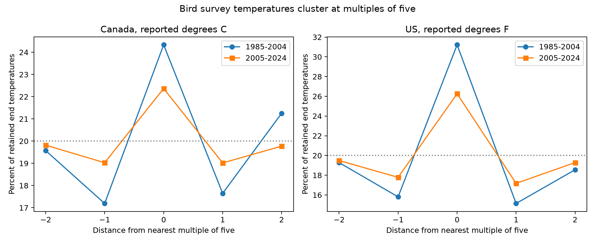

# Reported end temperatures clustered at multiples of five in Canada and US bird surveys in 1985-2024

We tested temperature reports in the fixed 2025 Breeding Bird Survey release. Four country and period samples used 92,568 end-temperature reports in 1985-2024. We kept Celsius reports for Canada and Fahrenheit reports for the US. A local five-value contrast removed count patterns that were quadratic within each bin. All four contrasts were positive after correction for four tests. We checked start reports, central temperature ranges, and observer-route groups in both periods. This is a report-precision audit. It does not measure temperature error or a bias in bird trends. Unit conversion, instruments, data entry, selection and real temperature structure can affect the result. Shared routes, approximate cluster intervals and no reference thermometers limit inference. The package has source hashes, an offline panel, code, checks and a figure.



## Question and prior work

Does a five-unit pattern repeat in original survey temperature reports across two countries and two periods? Weather controls in biodiversity models need measured covariates. A reported integer does not show its true precision. This audit can identify a reason to test precision assumptions before use of those controls.

Robbins (1981, [USGS](https://pubs.usgs.gov/publication/5210258)) studied weather and bird activity. Rhines and colleagues (2015, [doi:10.1002/qj.2612](https://doi.org/10.1002/qj.2612)) showed that precision and unit conversion can change archived temperature distributions. We do not apply their model or assume that their station results hold for bird surveys. The [Canadian BBS instructions](https://www.canada.ca/en/environment-climate-change/services/bird-surveys/landbird/north-american-breeding/instructions.html) require suitable weather. They do not establish the instruments used in past visits.

A verified campaign cloud and temperature study identified the fixed public source. We inspected its source selection and use no parent panel or estimates. Its publication ID is sci:sha256:e457cc64cd6dc170d7d42440a6f6c1272451c9bb9823f2b118423daefdd2ff96. files/prior_work.md records the searches and scope. The new contribution is a small precision audit tool and its application to BBS records. It is not a claim to discover digit preference in general. We set files/analysis_plan.txt before these data summaries. The plan was not registered.

## Data and selection

We read only Weather.csv from the fixed USGS 2025 release, [doi:10.5066/P14SNUV4](https://doi.org/10.5066/P14SNUV4). Each row is a survey run with associated taxon count and weather. We keep Canada and US records in 1985-2024, standard first runs (RPID=101, RunType=1), accepted quality (QualityCurrentID=1), unique country-state-route-years, and known temperature units. We do not require complete wind, sky, assistant or species block fields. We do not select by the bird count. files/panel.csv retains the survey taxon count as TotalSpp, but no bird outcome is fit here.

The source has 111,497 country-period candidates before acceptance; 100,007 accepted records have known units. files/audit.json gives each loss from the full source. The early Canadian Celsius sample has reports in only 13 years of its period; the other samples have 19 or 20 years. Celsius was not the majority Canadian reporting unit in the early period. These primary scales were chosen before the summaries, not from a measured majority rule. Primary end-temperature ranges use complete five-value bins: 3 to 32 C in Canada and 38 to 92 F in the US. Only integer reports enter each endpoint test. Start and end selection is separate. files/support.csv gives all unit-specific sample counts and exclusions. No values are converted between units, imputed or corrected. These selected roadside visits do not represent all biological monitoring or all weather.

## Method

For each multiple of five, compare its count with an interpolation from the four neighboring integer values. The interpolation is two thirds of the counts one unit away minus one sixth of the counts two units away. Sum the center-minus-interpolation differences and divide by all retained reports. Multiply by 100 to give the index in percentage points. A positive value means excess center count relative to this local reference. This is not the share of reports rounded or the error in temperature. The weights cancel a locally quadratic count distribution; symmetry also cancels a cubic term. The true distribution without reporting preferences need not satisfy that assumption.

Four separate primary tests use Canada C and US F in 1985-2004 and 2005-2024. Thus country and unit are partly confounded. Intervals use the largest route, year or two-way route/year cluster variance and a t reference with the smaller cluster count minus one degrees of freedom. Bonferroni correction covers the four primary tests. files/methods.md gives equations. The intervals are approximate. Countries have different routes. Periods do not overlap but share some routes, observers and survey rules. These are partial transfer checks, not independent experiments.

## Results

| Country and period | Unit | Reports | Routes | At multiples of five | Index, points | Four-test interval |
|---|---|---:|---:|---:|---:|---|
| Canada 1985-2004 | C | 2,856 | 655 | 24.33% | +7.91 | +3.28 to +12.54 |
| Canada 2005-2024 | C | 9,250 | 1050 | 22.37% | +3.60 | +1.33 to +5.88 |
| US 1985-2004 | F | 39,034 | 3428 | 31.22% | +16.89 | +15.11 to +18.67 |
| US 2005-2024 | F | 41,428 | 3472 | 26.26% | +9.41 | +7.16 to +11.67 |

The raw percentage at a multiple of five has a flat-bin reference of 20%. That reference is descriptive only. The primary inference uses the smooth local contrast, not a uniform-digit test.

| Check | Canada early | Canada late | US early | US late |
|---|---:|---:|---:|---:|
| Start reports | +9.17 | +3.38 | +16.04 | +7.19 |
| Central range | +7.93 | +3.67 | +16.87 | +9.47 |
| Groups in both periods | +7.48 | +2.77 | +15.53 | +9.92 |

The check table gives index estimates. files/results.csv preserves all estimates, intervals and cluster variance components, including minority-unit samples and start reports. The central range is 8 to 27 C or 48 to 87 F. The group check keeps observer-route groups with accepted reports in the primary unit in both periods, before temperature restrictions. This does not require the same number of reports per period. The checks use overlapping data. Their intervals do not provide a joint guarantee over all reported checks. All four primary adjusted intervals exclude zero in the positive direction. The index ranges from +3.60 to +16.89 points. Start reports and the central-range check also have four positive adjusted intervals. In the repeated-group check, the later Canadian estimate is +2.77 points with an adjusted interval from -0.44 to +5.97. Thus that check does not establish a common clear pattern across all four samples. It does not show that the pattern disappeared. We do not test a change between periods or a difference between units.

## Meaning and limits

The repeated local excess shows that integer reports have fine-scale structure beyond the local smooth reference. It would not identify its cause. Possible causes include preferred digits, thermometer scale spacing, conversion before archival, data entry and selection. Real temperature density can also fail the local smoothness assumption. No reference weather measurement, original paper form, instrument history or observer interview is available in this analysis. TempScale is the reported scale, not proof of the scale used by the instrument.

This audit does not estimate true bird richness, species distribution, ecological timing, extreme-weather damage, pollution effects or causal climate-change effects. It does not show that a published temperature slope is biased. Broad weather effects can be robust to small rounding even when thresholds or fine curves are sensitive. A later model can compare interval-valued temperature covariates under explicit precision assumptions. Deleting five-unit reports or adding random jitter is not a correction established by this study.

Route and year clusters do not remove all dependence. Large samples do not protect against systematic reporting or selection error. Accepted visits omit bad-weather conditions. The chosen ranges omit temperature tails, where precision may matter most. Country differences include unit, climate, instrument and reporting differences. The central-range and repeated-group checks limit some composition concerns but do not remove them. We report a data feature under stated assumptions, not a diagnosis of observer misconduct.

## Provenance and reproduction

Exact shared input: /mnt/dell-data/shared_datasets/usgs-bbs-2025-weather/Weather.csv. Source/version: fixed USGS BBS 2025 release, 1966-2024, DOI above. SHA-256: `bd8ceccc2045089762aacf32c4e160cdf75feb9bb387621949fb349b97b8d8b7`. files/provenance.json records the source URL, path, byte count and shared download metadata. The script verifies the complete raw hash before selection. We did not download, change or duplicate shared raw data. The package includes the selected records needed for offline inspection.

Install files/requirements.txt in a Python 3 environment. Exact versions are in files/environment.json. From an extracted bundle root, run:

```sh
PYTHON=/path/to/python sh files/reproduce.sh /local/scratch/digit-refit
```

This uses campaign-compute and one thread for each library. Outside this campaign, use an equivalent resource limit. To rebuild directly from the shared source:

```sh
campaign-compute -- /path/to/python files/analyze.py --raw /mnt/dell-data/shared_datasets/usgs-bbs-2025-weather/Weather.csv --output /local/scratch/digit-raw
```

The raw run also validates the estimates and repeats from its selected panel. To validate an extracted copy, run `campaign-compute -- /path/to/python files/validate.py`. files/validation.json records independent standard-library calculations of all four primary means and cluster errors. files/reproduction_check.json records exact equality of results, digit counts and support tables between the raw run and the offline panel run. The raw panel is derived directly from the hash-checked source on every raw run. No external services are needed for the panel analysis. `python3 files/retrieve.py` prints the campaign helper command with the fixed source URL and expected hash. A changed live snapshot must not be silently accepted.

Campaign 11_07_2026. Job sci-1107-dell-climate-pollution-biodiversity-4ac1214902a2. Topic climate-pollution-biodiversity. Machine dell. Account codex-andrii. Model gpt-6.1-sol, high reasoning effort, through T3 Code and the Codex harness. No agents were launched. All numerical analyses used the host compute limiter. The campaign-machine signing key is not a personal authorship claim. No private key is included. The baseline license covers new work subject to source rights; USGS data retain public-domain status. This bundle is stored locally with no remote upload or index submission.
