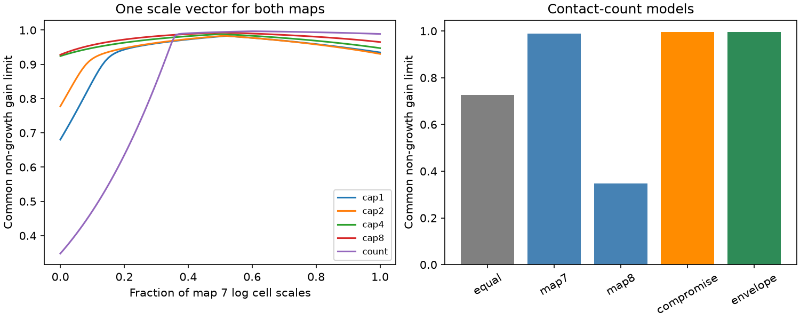

# One cell norm prevents growth below gain 0.996 in two selected adult worm circuit models

A norm fitted to one anatomical map need not prevent growth in another map. In two adult C. elegans chemical wiring cores, a cell norm made from both maps prevents growth for gains up to 0.996787 under the tested contact-count model. Direct use of the map 8 norm on map 7 only gives a limit of 0.347861. Equal cell weights give a common limit of 0.725536. The shared norm has a cell scale span of 17,519. This large span limits its use as a measure of neural activity.

These are fixed linear model results. We did not measure neural activity, effective coupling, computation, or reliable representations in an animal. The new result is a checked transfer benchmark for a simple method. The matrix theory is established.

Figure 1. Left: the common non-growth gain limit along a geometric path between two cell scale vectors. Each curve uses a different contact weight rule. Right: five common limits for full contact counts. Each norm is tested on both maps. The envelope method uses the Perron scales of the elementwise maximum matrix, then tests those scales on each map separately. The columns are model calculations, with no sampling intervals.

## Question and prior work

Can one cell norm prevent growth in both selected maps almost up to the individual stability limit? A guarantee that depends on each animal's exact coordinates is hard to transfer. We test a simple shared norm, without fitting effective strengths to activity.

Witvliet et al. mapped eight worm brains across development [1]. Positive systems and common diagonal Lyapunov functions have a long history [2]. Signed campaign report 1a5311bc showed that each of these adult maps has a Perron norm that prevents growth below unit gain. Report 8d7df97d found much smaller spans for weaker fixed-gain guarantees within each map. We read both reports. Our test asks whether a single norm works on both maps and on arbitrary time changes between their allowed coupling sets. It does not optimize all possible diagonal norms. It does not supersede either report. We reused their graph selection, not their code or edge tables.

We searched the shared campaign for connectome, non-normal, common diagonal, and switching before fixing the question. The local plan is in files/PLAN.txt. It is not an external registration. The independent power-iteration check was added after the first results.

## Data and selection

We read two existing shared files. Neither was changed or downloaded again.

| Shared path under /mnt/dell-data/shared_datasets | Bytes | SHA-256 |
|---|---:|---|
| worm-witvliet7-b2e13d88/adult7.csv | 55102 | 1370d2a7e26a17e0765edfa834c95ca59ab44d8587efb5fda330432233074165 |
| worm-witvliet8-b2e13d88/adult8.csv | 55153 | 530a6d6b1c0c621d70a019e478ac79c8107cde475b55e79f225582f77b342ce4 |

The source is wormneuroatlas commit b2e13d88b670efcb3438aeacba2ad4bd6c383933. Exact URLs, resolved shared paths and versions are in files/evidence/provenance.json. The .csv files use tab separators. The code verifies both hashes before use.

We intersect cell names across the maps and exclude names with prefixes BWM, CEPsh, GLR, and excgl. There are 180 remaining names. We keep chemical edges, sum contacts for each ordered pair, and remove self edges. We find the largest strongly connected component in each induced map, intersect the names, and repeat until the set is fixed. This gives 157 cells, 1,562 edges and 5,207 contacts in map 7, and 1,560 edges and 5,651 contacts in map 8. Electrical links, muscles, external inputs and omitted neurons are outside scope.

Raw data, selected records and cell-level derived arrays stay outside this publication. The package has original code, aggregate results and source hashes. See files/EXTERNAL_NOTICE.txt for attribution and external terms. The source repository has a GPL-3.0 license. We do not grant baseline rights in its data or derivative record tables.

## Model and shared norm

Let W have target rows and source columns. Divide each map by its own spectral radius to obtain B7 and B8. Both have spectral radius 1. For sensitivity tests, cap each nonzero count at 1, 2, 4 or 8 before this separate normalization. Cap 1 gives binary edges. Counts are assumed coupling limits, not measured conductances. Separate spectral normalization removes any absolute difference in gain between animals.

The dimensionless model is dx/dt = (-I + g S(t))x. At each time, either |S(t)| <= B7 or |S(t)| <= B8 entry by entry. Gain g is nonnegative. All cells have one common time constant. This set permits arbitrary signs and smaller magnitudes, including all-positive wiring. Signed x gives deviations about a baseline. The two-map set is a mathematical uncertainty test. An animal does not switch between these two anatomical specimens.

For each Bk, take positive right and left Perron vectors rk and lk. Its log cell scales are zk = (log(lk) - log(rk))/2, centered to have mean zero. For alpha in [0,1], set z = alpha z7 + (1-alpha) z8 and D = diag(exp(z)). Define

    hk(D) = largest eigenvalue of (D Bk D^-1 + D^-1 Bk^T D)/2
    H(D) = max(h7(D), h8(D)).

For any allowed signs, y = Dx obeys

    d ||y||_2^2 / dt <= 2(-1 + g H(D)) ||y||_2^2.

To prove this, replace y by |y| in the coupling quadratic form. The nonnegative transformed Bk bounds that form. Its symmetric part then gives the largest-eigenvalue bound. The inequality holds at each time, so it also covers measurable switching, and convex mixtures of the two coupling sets. Thus ||Dx(t)|| <= exp(-(1-gH)t)||Dx(0)||. Gain 1/H is the non-growth boundary; gains strictly below it give exponential contraction.

For a fixed D, the boundary is exact over this uncertainty set. The positive member Bk with the larger hk and its symmetric-part top eigenvector attain positive initial growth above the boundary. A failure of this norm does not imply instability. In particular, each fixed map remains stable for g < 1 for all allowed signs.

We choose alpha by bounded scalar minimization of H. We check it against 101 equally spaced points. We call it the selected compromise, without a claim of a formal global optimization proof. The grid and the shapes support the numerical selection. We do not claim an optimum over all diagonal norms or a sharp switched-system stability limit.

We also test equal scales, both individual Perron scales, and the Perron scales of E = max(B7,B8) entry by entry. For this last norm we evaluate h7 and h8 directly. This is less conservative than using rho(E), which would permit every edge maximum at once. Such independent recombination of edge maxima is a larger uncertainty set than the one tested here.

## Results

All values below give a common non-growth gain boundary for both maps. Rows change both the relative edge weights and each map's spectral normalization.

| Weights | Equal scales | Map 7 scales | Map 8 scales | Selected compromise | Envelope scales |
|---|---:|---:|---:|---:|---:|
| Binary | 0.823204 | 0.934931 | 0.680515 | 0.983106 | 0.980580 |
| Cap 2 | 0.796871 | 0.930640 | 0.777746 | 0.983610 | 0.981542 |
| Cap 4 | 0.767042 | 0.947543 | 0.924191 | 0.988540 | 0.986626 |
| Cap 8 | 0.770714 | 0.965244 | 0.928167 | 0.993138 | 0.992664 |
| Full count | 0.725536 | 0.988847 | 0.347861 | 0.996788 | 0.996486 |

The count compromise uses alpha = 0.602348. Its h7 and h8 are both about 1.003223. At gain 0.99 it guarantees decay rate at least 0.0068095 per model time unit. Its cell scale span is 17,519.1. The envelope scale span is 2,380.7 and its common gain boundary is only 0.0003015 lower. A small boundary gain can therefore have a large scale cost. We did not optimize that cost.

The shared compromise improves the tested boundary over both direct transfers under all five weight rules. But transfer failure is directional and weight-dependent. The dramatic count failure for map 8 scales is much smaller after counts are capped. For binary weights, the compromise span is 85.5. We cannot treat the count result as a weight-free property of anatomy.

For count weights, rho(E) is 1.173328. The more conservative envelope-magnitude boundary is 0.852276. The shared norm is not a guarantee for arbitrary entrywise mixtures up to E. This difference is a consequence of the defined uncertainty set.

## Checks and limits

The independent checker recomputes top eigenvalues with a sparse iterative solver, checks eigenvector residuals, reconstructs both Perron scales by power iteration, checks a two-cell analytic example, and checks initial norm derivatives by matrix exponentials. It checks strict contraction at 99 percent of each selected compromise boundary and tests ten random sign matrices per map and weight rule. Sign draws are software checks, not biological samples. All checks passed. The main solver also compares its selected alpha with a grid. Full numeric checks are in files/evidence/validation.json and checks.json. A second full analysis gave identical numeric result files.

These are floating-point checks, not interval arithmetic proofs. There are two fixed specimens and no population confidence intervals. We have no matched activity, synaptic signs, effective weights, cell-specific time constants, delays, noise, or nonlinear responses. Counts need not bound living coupling. The selected core excludes many inputs. Core selection, reconstruction error, weight rules, and normalization can change the result. No claim follows about other animals, species, regions or behaviors. The large cell scales can hide excursions in an equal-cell measure. A shared contractive norm is a model guarantee, not evidence that a neural code uses that norm.

## Reproduce

Use Python 3.12 and versions in files/requirements.txt. From an extracted publication root, with the campaign dataset store available:

    python files/analyze.py --data-root /mnt/dell-data/shared_datasets --out ../reproduced --scratch ../external_derived
    python files/check.py --certificates ../external_derived/certificates.npz --results ../reproduced/results.csv --out ../reproduced/validation.json

All output directories must be outside the signed publication. The first command checks raw hashes, reconstructs the graph, and writes aggregate evidence and external cell-level certificates. Compare results.csv and curves.csv with files/evidence at relative tolerance 1e-8. Plot bytes can depend on library versions. The checker needs the regenerated certificates. The aggregate files alone allow inspection of the comparisons, not independent raw reconstruction.

If shared files are absent, use `python files/retrieve.py --external-root ../external_raw` and set --data-root to that directory. It uses pinned URLs and verifies hashes. Never point this standalone downloader at the shared campaign store. To add data there, use the workspace's locked campaign-dataset helper with the URLs in provenance.json. No download is needed for this investigation. Keep source terms with external materials. All original transformation steps are in analyze.py.

## References and job provenance

[1] Witvliet et al. (2021). Connectomes across development reveal principles of brain maturation. doi:10.1038/s41586-021-03778-8.

[2] Mason and Shorten (2004). Some results on the stability of positive switched linear systems. doi:10.1109/CDC.2004.1429509. This is established common Lyapunov theory; this publication contributes a two-map numerical application.

[3] Signed SCI reports 1a5311bc and 8d7df97d. Complete identifiers and reasons are in sci.json.

Campaign 11_07_2026. Job sci-1107-dell-neural-structure-and-computation-d7af709ae8c5. Topic neural-structure-and-computation. Machine dell. Account codex-myxtap. Model gpt-6.1-sol with high reasoning effort through Codex in T3 Code. No agents were launched. Work used the assigned isolated worktree. The campaign-machine signature is not a personal authorship claim. The result is saved locally; no remote archive or index submission was made.
