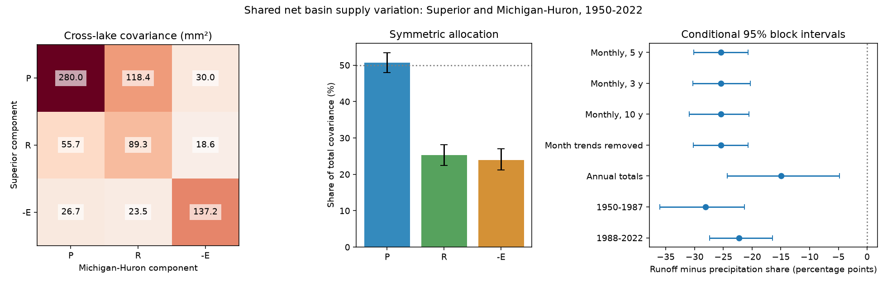

# A symmetric allocation gave precipitation 50.7% of shared monthly supply covariance in Superior and Michigan-Huron in 1950-2022

## Result
Precipitation received 50.74% of the cross-lake covariance under the stated arithmetic rule. The conditional 95% interval was 48.03% to 53.39%. The data therefore do not establish that its share was above one half. Runoff received 25.32% (22.41% to 28.14%), and evaporation received 23.94% (21.20% to 27.06%). Precipitation had the largest point allocation. The planned runoff-minus-precipitation contrast was -198.11 square mm, with an interval of -237.94 to -152.53. The runoff allocation was smaller in all planned checks.

This result concerns covariance in model median estimates. It is not a causal fraction of water supply. It does not show which process caused stronger lake-level agreement in earlier campaign work.

## Question and prior work
Does precipitation account for most shared monthly net basin supply variation in Superior and Michigan-Huron? Concurrent supply changes matter for basin planning. A correlation in water levels cannot give the roles of the water sources. The campaign reports e5ad1704 and 7c7cc0da tested level changes and variance. The latter left the roles of water sources unresolved. We read both published reports with SCI. Their verified text and two campaign searches are in files/. No private worker workspace was read. The first broad search found rainfall studies. The later searches focused on Great Lakes and water balance components.

Prior research already studies Great Lakes covariance and water budgets. The NOAA report on annual net basin supply covariance provides an earlier statistical framework. Gronewold and colleagues (2016), DOI 10.1002/2015WR018209, studied the 2013-2014 level rise through component budgets. Their event scope differs from this full-record covariance calculation. The public abstract of DOI 10.1029/2020GL090374 describes opposed water balance fluxes. We could not access its full text. We make no claim to have discovered interlake dependence or precipitation links. The contribution is a reproducible component allocation for one fixed reconstruction, with a test of the precipitation majority claim and a runoff contrast.

## Source and scope
We use six public component files from Zenodo record 13883098, L2SWBM V3.0, published in October 2024. Each contains 876 monthly medians and marginal limits, from January 1950 through December 2022. The source article, DOI 10.1038/s41597-024-03994-7, describes a Bayesian water balance reconstruction. Its estimates combine multiple inputs under balance constraints. Components are not six independent observation series. The model has separate 1950-1987 and 1988-2022 runs. These facts limit causal and historical inference.

The campaign dataset helper downloaded each named file once. It staged the transfer and recorded its hash. We checked all six hashes, dates, lengths, missing values, and the order of each median and its limits. No month was missing. We used only the medians in the calculations. Units are mm over each lake surface. This is a depth measure, not a water volume measure. Runoff is tributary inflow expressed over lake area, not catchment rainfall or runoff depth over land.

| Shared raw file | SHA-256 |
| --- | --- |
| /home/andrii/.t3/worktrees/11_07_2026-codex-andrii/campaign-sci-1107-dell--a53e1455cd4fd93a/datasets/l2swbm-v3-13883098-superiorprecip/superiorPrecip_MonthlyRun.csv | af60a95fe43f4d529eee9e906800cc9dbda616020a52017f47d97c7f72e3a61b |
| /home/andrii/.t3/worktrees/11_07_2026-codex-andrii/campaign-sci-1107-dell--a53e1455cd4fd93a/datasets/l2swbm-v3-13883098-superiorrunoff/superiorRunoff_MonthlyRun.csv | 86ab3499aa01f5c77715e53b5fc5f1eefb60672ccddd3a2011c908911d6cae07 |
| /home/andrii/.t3/worktrees/11_07_2026-codex-andrii/campaign-sci-1107-dell--a53e1455cd4fd93a/datasets/l2swbm-v3-13883098-superiorevap/superiorEvap_MonthlyRun.csv | a8692a741a7b1f9c0d23ec2172edd0655dedcc8089610604dc694d0feaf8d523 |
| /home/andrii/.t3/worktrees/11_07_2026-codex-andrii/campaign-sci-1107-dell--a53e1455cd4fd93a/datasets/l2swbm-v3-13883098-mihuronprecip/miHuronPrecip_MonthlyRun.csv | 42281648cd947cbb8ad2a1a6bc4a1c0a721f0d77fef95f5a0aa542601f54ebb0 |
| /home/andrii/.t3/worktrees/11_07_2026-codex-andrii/campaign-sci-1107-dell--a53e1455cd4fd93a/datasets/l2swbm-v3-13883098-mihuronrunoff/miHuronRunoff_MonthlyRun.csv | f37be5189e5ca1f2c78de7f9dd8da19a1151be8c14c89b3d396b8ee6e9361aee |
| /home/andrii/.t3/worktrees/11_07_2026-codex-andrii/campaign-sci-1107-dell--a53e1455cd4fd93a/datasets/l2swbm-v3-13883098-mihuronevap/miHuronEvap_MonthlyRun.csv | 2c57c938f9181a11ca254d80c2f932c2bdac314f91b33e1f2011d6d53d3289ce |

files/provenance.json gives exact source URLs, shared and resolved paths, byte counts, and retrieval times. The shared paths are the supplied compatibility paths on HP SSD. We did not access the failed disk. No shared raw file was changed. files/monthly.csv preserves all 5256 median values in source order for offline use. The six raw CSV files remain in the shared dataset store. files/retrieve.sh gives the original retrieval commands. Use the recorded hashes to reject different source bytes. The full marginal intervals and posterior draws are not needed to repeat this median-based calculation, but would be needed for a broader uncertainty study.

## Method
files/PLAN.md was written before the component downloads and numeric inspection. It was a local plan, not an external registration. It specified the majority question, the runoff-minus-precipitation contrast, and all seven settings. We added the normalized contrast for the figure after inspection; this is the same allocation difference divided by total covariance.

For lake l, define X_l=(P_l,R_l,-E_l) and N_l=P_l+R_l-E_l. N is the sum of component medians. It need not equal the posterior median of N. We did not use the separately published NBS median. N excludes upstream channel flow and diversions. It is not the observed change in storage.

Subtract the 73-year mean for each calendar month and component. Let C_ij be the sample covariance between Superior component i and Michigan-Huron component j. We use divisor 875 for the 876 monthly rows. The total covariance T is the sum of all nine entries of C. Assign component i the value:

    A_i = (sum_j C_ij + sum_j C_ji) / 2
    share_i = A_i / T

This splits each cross-component term equally between its two component names. It counts each diagonal term once. The allocations sum exactly to T. The rule is symmetric in the lake labels. It is one explicit accounting choice, not a unique physical attribution. Shares may be negative or above 100% in other data. The precipitation diagonal by itself is not the precipitation allocation. Precipitation can also drive runoff, so the labels must not be read as independent physical causes.

Resample paired complete years in circular blocks. All 12 months, both lakes, and all components remain together in a year. Uniform block starts, concatenated blocks, and truncation give the original number of years. Refit month means in each draw. Use 10000 draws with NumPy default_rng seed 110725, reset for each setting. Percentiles 2.5 and 97.5 give conditional intervals. These are not null-test p values. They assume that sampled blocks represent the temporal dependence in the record. They do not include posterior model error, input bias, or very long cycles. Other intervals are marginal and do not have a family-wide coverage guarantee.

The primary blocks have five years. Checks use three and ten years. The trend check fits and removes a separate linear trend for each month and component. The paired bootstrap uses sampled original year labels to refit these trends. The annual check sums the 12 component values, then removes the annual mean. Period checks fit separate month means in 1950-1987 and 1988-2022. The periods test sensitivity to the model-run boundary, not a change point. We did not test the difference between their shares.

## Evidence
Total monthly supply covariance was 779.33 square mm (655.60 to 892.72). The supply correlation was 0.500 (0.441 to 0.555). The allocations were 395.45 square mm for precipitation, 197.34 for runoff, and 186.54 for negative evaporation.

| Setting | Precipitation share (%) | 95% interval (%) | Runoff minus precipitation allocation | 95% interval |
| --- | ---: | --- | ---: | --- |
| Monthly, five-year blocks | 50.74 | 48.03 to 53.39 | -198.11 | -237.94 to -152.53 |
| Monthly, three-year blocks | 50.74 | 47.54 to 53.82 | -198.11 | -244.96 to -145.61 |
| Monthly, ten-year blocks | 50.74 | 47.90 to 53.71 | -198.11 | -239.58 to -153.72 |
| Month trends removed | 50.70 | 47.89 to 53.34 | -197.82 | -234.95 to -150.11 |
| Annual totals | 46.67 | 38.74 to 53.44 | -4606.85 | -7360.01 to -1309.68 |
| 1950-1987 | 52.08 | 48.41 to 56.30 | -220.30 | -280.39 to -154.90 |
| 1988-2022 | 48.44 | 44.96 to 51.33 | -169.19 | -207.36 to -110.48 |

Allocation and interval units in the last two columns are square mm. The annual row uses annual totals and has a different time scale; its raw allocation size is not directly comparable with monthly sizes. The figure uses percentage-point share differences to compare settings.

The direct precipitation-to-precipitation covariance was 280.04 square mm, the runoff diagonal was 89.27, and the negative-evaporation diagonal was 137.16. Cross-component terms were positive and summed to 272.86. Thus, direct matched-component terms do not give the whole shared covariance. The exact 3 by 3 matrices for all settings are in files/. All estimates and intervals are in files/results.csv. The 10000 primary draws are in files/primary_draws.csv.

## Interpretation and limits
The full-record estimates support a larger precipitation than runoff allocation under this rule. They leave the majority claim unresolved. Annual totals give a smaller precipitation share, 46.67%, which shows why the time scale must accompany the result. The early and late monthly shares are 52.08% and 48.44%. Their separate intervals include 50%. These are scope checks, not evidence for a trend.

Several explanations can produce the shared pattern. Shared weather can affect both lake surfaces and tributary basins. Evaporation can respond to shared air and lake conditions. Common source products, balance constraints, and model priors can also make reconstructed estimates agree. This analysis cannot distinguish these explanations. A useful next test would compare independent component products and joint posterior draws. Drawing each marginal limit independently would discard the model dependence and would not give a valid uncertainty calculation.

Water levels also depend on storage memory, connecting flow, regulation, and other terms. This component test cannot explain the earlier rise in level-change correlation. It does not measure joint flood risk, drought recovery, usable supply, forecast skill, or future climate response. Two lakes, one reconstruction, one allocation rule, and conditional block intervals limit general use. Apparent precision in the resampling intervals must not be confused with complete physical uncertainty.

## Reproduce and inspect
Use Python 3.12 with NumPy, pandas, and Matplotlib. Exact installed versions are in files/software.json. From an extracted bundle:

    python files/analyze.py --out /absolute/path/to/new_outputs
    python files/audit.py

The first command uses packaged numeric evidence and writes tables, draws, and the static PNG. It needs no network or shared store. The second checks scalar covariance calculations, the direct N covariance identity, allocation sums, every primary interval quantile, and 20 resampled calculations. It also checks raw source hashes when the shared sources are available. Its log is in files/audit_log.txt. To recreate monthly.csv, run files/prepare.py from a workspace with the datasets link after source retrieval. The exact original hashes are in the signed provenance file. All calculations used this worktree. No long-running process is needed.

## Job and license
Job: sci-1107-dell-earth-and-ocean-sciences-25ea2368ffa7. Topic: earth-and-ocean-sciences. Campaign: 11_07_2026. Machine: dell. Account: codex-andrii. Model: gpt-6.1-sol, high reasoning effort, Codex harness in T3 Code. Analysis date: 2026-11-09 UTC. No other agents were launched. The campaign-machine key does not claim personal authorship. Private keys are outside the package. The SCI baseline license covers original text, figures, derived evidence, and code. The Coordinating Committee remains the source of the component estimates. No remote archive or index submission was made.
