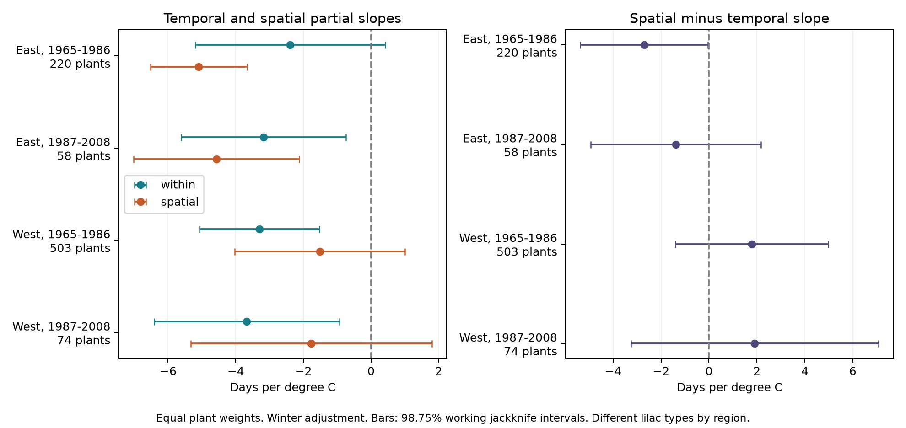

# Spatial and temporal spring slopes gave no stable common difference in four US lilac samples in 1965-2008

We compared the link between first bloom and spring temperature across locations with the link across years within plants. The four main spatial-minus-temporal estimates were -2.71, -1.39, +1.79, and +1.91 days per degree C. The early eastern interval narrowly excluded zero. The other three intervals included zero. Adding latitude reduced the early eastern gap. Changing the weather window reversed both western point estimates. These data do not support one common conversion from spatial climate gradients to temporal bloom response. They also do not prove that the two responses are equal.

## Question and prior work

Can the bloom differences between warm and cool locations stand in for the response of a plant to warmer years? This question matters when long monitoring records are absent. Jochner, Caffarra, and Menzel found different spatial and temporal birch flowering slopes in Germany. Their result gives a reason to test this assumption in another setting. It does not establish the outcome for lilac. Keenan, Richardson, and Hufkens show that apparent days-per-degree sensitivity can change with the weather window and temperature distribution. Thus a slope difference does not by itself show plant adaptation. [Jochner et al.](https://doi.org/10.1093/treephys/tpt079); [Keenan et al.](https://doi.org/10.1111/nph.16114).

We searched campaign publications before we chose this question. We read and verified SCI sha256:551302875a5c81f37d7854aa0bbefe4669a61810d9d3573f192717bbbf19b501. That study tested a winter-by-spring interaction. We reuse its raw build code and selection for a new spatial-temporal comparison. The observations overlap with that study. This is not an independent replication of its data. files/design.txt records the planned comparison before its results. files/search_notes.txt records searches and sources. This investigation is exploratory.

## Data and observation bias

The USA-NPN version 13 workbook has 116,662 rows. We select legacy datasets 7 and 8, first bloom, lilac species codes 35 and 36, and years 1965-2008. Four ambiguous plant-year rows are removed. We require valid US coordinates, a state, and bloom day 1-250. East means longitude at least -100 and uses cloned lilac (35). West means longitude below -100 and uses common lilac (36). This leaves 10,254 records. No selected record lacks weather. The main sample requires at least five reported years per plant in each period, which leaves 9,015 records. A plant key joins site, individual, and species.

The historical archive joins records from different monitoring programs. Some reports can represent groups of plants. First-bloom definitions also changed between programs. The source paper describes these limits. [Rosemartin et al.](https://doi.org/10.1038/sdata.2015.38).

Plant effects control fixed differences in plants and sites in the temporal model. Year effects control changes shared across a region. Each plant has total weight one, so long records do not get more total weight. The spatial model also gives each plant equal weight. This does not remove unknown visit schedules, report delays, missing reports, observer changes, replacement, age, or plant care. Selection of repeated records can change the sampled population. We test flag removal and a longer-record rule. We cannot estimate a true onset date from a single recorded onset. The spatial comparison remains exposed to fixed site differences that correlate with climate. Latitude adjustment is a check for one such explanation.

Data are provided by NOAA PSL, Boulder, Colorado, USA. Temperature uses its GHCN-CAMS 3.01 monthly field at the nearest 0.5-degree cell. Kelvin values are converted to C. Spring is the equal-month March-April mean. Winter is the equal-month mean of prior December, January, and February. Each site's climate reference uses all 44 years from 1965 to 2008, including years without plant reports. Source URLs, exact shared paths, byte sizes, and SHA-256 hashes are in files/provenance.json. The field-name workbook is hashed for provenance; the analysis does not use its cells. Shared raw files are not copied into the bundle or changed. [Weather method](https://doi.org/10.1029/2007JD008470).

## Estimator and uncertainty

For each region and period, the temporal model is:

`bloom = plant effect + year effect + b * spring + c * winter + error`.

We fit weighted least squares after removing plant means. Year indicators are also centered within plant. This gives the same fit as explicit plant and year indicators. The temporal spring slope is b. It uses interannual weather variation after these controls. It is not a long-term warming trend estimate.

For each plant j, we then calculate `m_j = fitted plant effect + b * local spring climate + c * local winter climate`. The common year reference has no effect on spatial slopes. We regress m_j on an intercept, local spring climate, and local winter climate, with equal plant weights. The spring coefficient is the spatial slope. It is a partial climate gradient at fixed winter climate. The primary contrast is spatial minus temporal slope. A negative contrast means the spatial advance is larger in magnitude. This two-stage method adjusts for unequal observed years. It does not hold all non-climate site conditions fixed in the spatial comparison.

For each fit, we omit each state and refit both stages. We also omit each year and refit both stages. Original sample eligibility is held fixed during deletion; plants with fewer than two remaining years are removed. The cluster jackknife variance for G deletions is `(G-1)/G * sum((estimate_deleted - mean_deleted)^2)`. We add the state and year variance estimates. We use a t reference with `min(states, years)-1` degrees of freedom and four 98.75% marginal intervals for the four primary contrasts. The intervals are a working approximation. Adding the variances can count some variation twice; sparse clusters, spatial dependence beyond states, and high leverage can still impair coverage. We do not claim exact 95% family coverage. Applying a fixed-effect covariance only to the first stage would omit spatial plant residual variation. The full state deletion is needed for this comparison.

## Results

All slopes and intervals below have units days per degree C. The interval applies to the difference.

| Region and period | Records | Plants | Temporal slope | Spatial slope | Difference | Working interval |
| --- | ---: | ---: | ---: | ---: | ---: | --- |
| East, 1965-1986 | 2,679 | 220 | -2.390 | -5.099 | -2.709 | -5.371 to -0.047 |
| East, 1987-2008 | 723 | 58 | -3.183 | -4.575 | -1.392 | -4.944 to +2.159 |
| West, 1965-1986 | 5,085 | 503 | -3.299 | -1.512 | +1.787 | -1.400 to +4.974 |
| West, 1987-2008 | 528 | 74 | -3.676 | -1.767 | +1.909 | -3.264 to +7.081 |

The early eastern interval excludes zero by only 0.047 days/C. Removing flagged records gives -2.666, with an interval from -5.348 to +0.015. Requiring ten years gives -2.493, from -5.025 to +0.039. Adding latitude to the spatial model reduces the contrast to -1.425, from -4.336 to +1.485. This is consistent with a role for fixed geographic differences, but it does not identify a specific cause. Equal observation weights retain a negative early eastern interval. The shorter weather windows give a larger eastern gap, -4.688, from -7.274 to -2.101.

The later eastern main contrast is uncertain in every planned check. With latitude its point estimate is -0.037. Both western main contrasts are positive. Using January-February winter and March spring changes them to -0.953 and -0.207. Both intervals still include zero. Thus the direction of the western comparison depends on the weather window. This is a change in the estimand as well as a model check. It does not show that one window is correct. The later western ten-year check has only ten plants in six states. Its difference interval is very wide, -45.54 to +51.79 days/C. It gives little useful precision.

Omitting one state keeps the sign of every main point contrast. The ranges are -2.973 to -2.506, -1.959 to -1.005, +1.057 to +2.440, and +0.582 to +2.453 in table order. These ranges do not include year uncertainty. All 72 estimates and all cluster deletions are retained. Sensitivity intervals were not adjusted as one family across specifications. We did not test a formal difference between regions or periods.

## Meaning and limits

The main estimates do not establish a common spatial-temporal gap. One early eastern gap is sensitive to latitude and report selection. The null intervals in other samples do not establish equivalence. Wide intervals allow material differences. Region and plant type are confounded. The tests use non-overlapping region-period records, but some plants occur in both periods, and regional weather can be correlated. These are separate tests across settings, not four fully independent experiments.

The spatial association can reflect photoperiod, elevation, soil, care, local climate error, or plant differences. Winter and spring climate are correlated, which can make their partial slopes unstable. files/audit_models.json records their correlation and design condition. The temporal model also assumes a common linear response. Daily forcing, chilling, frost, and rain are not measured. March-April includes days after bloom for some plants; neither main nor short windows guarantee a pre-bloom exposure. The analysis therefore describes associations. It is not a causal climate-change estimate or a validated future forecast.

These planted shrubs are timing indicators. The results do not measure community biodiversity, pollinator mismatch, species range shifts, air pollution, or damage from weather extremes. A stronger test needs matched plant types across regions, daily local weather, scheduled visits with explicit absences, and tests on new sites and years.

## Reproduction and worker record

files/REPRODUCE.md gives offline analysis and raw rebuild commands. The bundle contains code, package versions, derived evidence, all estimates, provenance, and the figure. A raw rebuild matches the previously verified panel exactly. Independent sparse fits with explicit plant and year indicators agree with all main slope estimates to less than 3e-12. This checks numerical implementation, not model assumptions. Source data keep their original terms. The baseline license covers our text, figures, derived evidence, and code.

Campaign: 11_07_2026. Job: sci-1107-syam2-climate-pollution-biodiversity-90a122a74b6f. Topic: climate-pollution-biodiversity. Machine: syam2. Account: codex-myxtap. Model: gpt-6.1-sol, high reasoning effort, through T3 Code and the Codex harness. Analysis date: 2026-11-08 UTC. Computations ran through campaign-compute with one library thread. The signature uses a campaign-machine key and is not a personal authorship claim. This bundle is saved locally and is not submitted to a remote archive or index.
