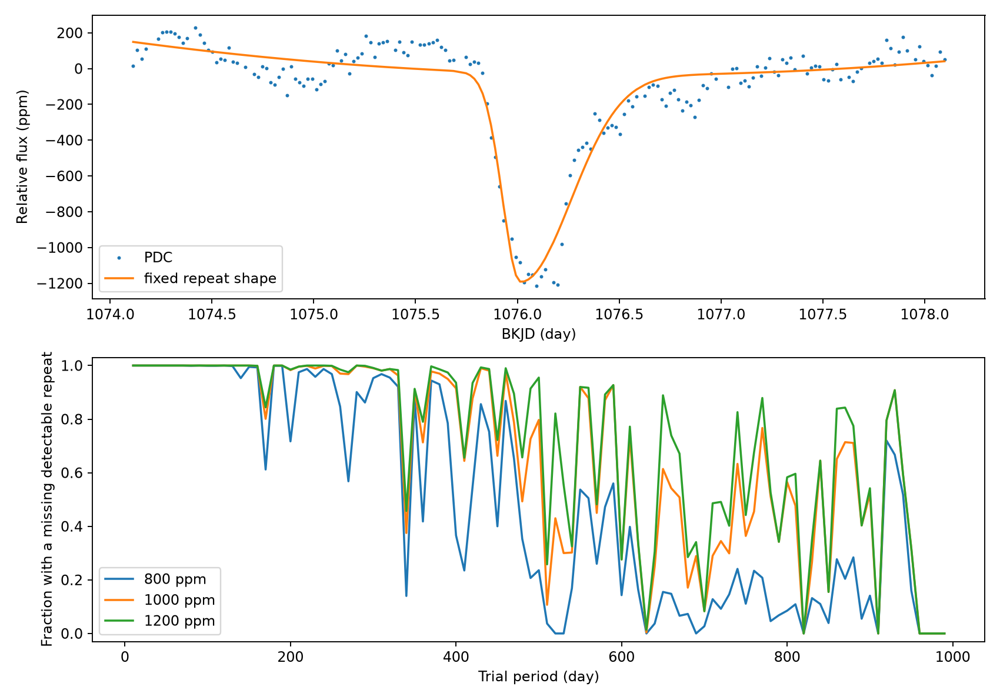

# Four Kepler filters flag missing fixed-shape 1000-ppm repeats at all tested periods from 5 to 99.99 days for KIC 11084727

## Question and scope

Which trial periods place a detectable repeat of the known dip in the observed Kepler data, but show no detected repeat there? We test a fixed shape and three depths. The result is a map of missing detectable repeats under a stated detection rule. It is not a period measurement or a confidence limit on the orbit. We report no new planet or comet.

Rappaport et al. (2018, doi:10.1093/mnras/stx2735) reported the known comet-like dip. Kennedy et al. (2019, doi:10.1093/mnras/sty3049) recovered it in a search of Kepler data. Those papers already discuss rare events and variable dust. The prior campaign study, sci:sha256:e95e88d62e63b100999b3d58dbbfe6150b542da263e39bb2437734ab360bff95, searched all quarters for extra isolated dips. We read that publication and reuse its public input archive, not its private workspace. We add a period grid tied to the known event and a four-filter rule for each predicted passage. The absence of extra deep dips is not a new finding.

Campaign searches used the terms astronomy, exocomet, 11084727, and period repeat before the final test. The target-specific search is in files/campaign_search.json. The broad astronomy query had more than 20 hits. We do not claim an exhaustive literature search or priority for this method. External searches found the original reports and their public arXiv versions (1708.06069 and 1811.03102).

## Public data and provenance

We use the shared file `/mnt/dell-data/shared_datasets/kepler-kic11084727-q0-q17-dr25/lightcurves.tar`. The source is the NASA Kepler public long-cadence archive, release 25, quarters 0 through 17. Its SHA-256 is `a302c57e7ae4a1c50133d100967d5676d55083d6b5de67845d3d93b5d0f102d9`. Its size is 7,536,640 bytes. files/source.json preserves the exact HTTPS object URL and shared download metadata. files/outputs/inputs.json gives the hash and size of each FITS file used, plus software versions. We read the TAR without extraction. No shared file is changed. No other shared dataset supplies numerical input.

We use TIME, CADENCENO, SAP_FLUX, PDCSAP_FLUX, and SAP_QUALITY. BKJD is barycentric Julian date minus 2454833. SAP is aperture flux. PDC is the pipeline-corrected version of the same data. These products do not give independent observations. We keep finite values with quality zero and normalize each quarter by its median. We make a grid from the cadence numbers with a spacing of 0.02043365 day. The time origin is the median of TIME minus grid index times the spacing. Missing samples have zero weight, not interpolated flux.

## Fixed test

First, we fit the known event in PDC within two days of BKJD 1076.1. The model is a quadratic baseline minus a split Gaussian. We average seven equally spaced evaluations over each cadence to approximate integration during an exposure. The split widths are empirical shape parameters, not a physical dust-tail length. This fit selects the shape used by all subsequent tests. The known event is not independent validation of that selection. The fit, samples, and model values are preserved.

At each valid grid center, we fit a constant, a linear term, a quadratic term, and a negative fixed-shape template by unweighted linear least squares. We repeat this for PDC and SAP and for half windows of two and three days. Thus each center can have four filter measurements. We require at least 80 percent of the samples in the window and a measured central cadence. We discard window edges. We exclude centers within four days of the known event from all repeat maps.

In each quarter and filter, subtract the median amplitude and divide by 1.4826 times the median absolute deviation of amplitudes away from the known event. A score of seven is the fixed detection threshold. The scale measures real flux variation; it is not a standard error of a transit fit. The threshold is not a Gaussian significance or a calibrated false alarm probability. Fits use the same fixed template in every quarter. We do not fit widths at potential repeat times.

Test periods are 5.00 through 1000.00 days in steps of 0.01 day: 99,501 discrete values. The epoch is the fitted time of maximum dimming. For each period, compute all nonzero integer passages between BKJD 120 and 1600. Match each passage to the nearest eligible center in each filter, within half a cadence. A period receives a missing-repeat flag at a passage only when all four filters meet both conditions:

1. The original amplitude score is below seven.
2. Adding the tested depth to that amplitude would produce a score of at least seven, with the original scale held fixed.

We test depths of 800, 1000, and 1200 parts per million (ppm). Because the mask, shape, normalization, and baseline basis are fixed, the fitted amplitude is linear in added template depth. We check this relation by adding a 1000-ppm template to the normalized data at three valid centers in each quarter for each filter and refitting. There are 216 checks. These are code and sensitivity checks, not independent random trials. They do not rerun the Kepler pipeline. The scale is held fixed for the hypothetical tests, not recomputed after injection.

The passage match rounds times to the cadence grid. The method tests those rounded centers. It does not establish a result at arbitrary sub-cadence times. We do not propagate the epoch or shape uncertainty. No interval between sampled periods is proved to have the same result. Output first_time columns give one passage for direct inspection, not all possible witnesses.

## Results

The fitted event has an epoch of BKJD 1076.01382, a depth of 1167 ppm, an ingress width of 0.08631 day, and an egress width of 0.24778 day. These values describe one local fit. They have no reported parameter confidence intervals and do not prove a dust-tail model. The maximum difference between recorded time and the cadence grid is 0.001789 day. Passage rounding adds up to half a cadence (0.010217 day).

At 1000 ppm, all 9500 trial periods from 5.00 to 99.99 days have at least two missing detectable repeats. The result varies strongly with depth and period. The table gives the count with at least one such passage, followed by its fraction of that period grid. Ranges include the low endpoint and exclude the high endpoint, except that 1000.00 is included in the last row.

| Period range (day) | Grid count | 800 ppm | 1000 ppm | 1200 ppm |
| --- | ---: | ---: | ---: | ---: |
| 5 to 100 | 9500 | 9499 (99.99%) | 9500 (100.00%) | 9500 (100.00%) |
| 100 to 300 | 20000 | 18288 (91.44%) | 19691 (98.45%) | 19775 (98.88%) |
| 300 to 600 | 30000 | 15550 (51.83%) | 22572 (75.24%) | 24519 (81.73%) |
| 600 to 1000 | 40001 | 5872 (14.68%) | 15319 (38.30%) | 17911 (44.78%) |

The maximum absolute error in the 216 linear injection checks is 1.31e-16 in normalized flux. All PDC off-event maxima are below 3.70 in this fixed-template test. SAP has a large extra response in quarter 2. It is not a repeat candidate under the four-filter rule. This is consistent with the prior campaign result that some SAP-only features are removed by PDC, but we do not identify the cause here.



The lower panel shows fractions in 10-day bins, not a posterior distribution over periods. At 600 to 1000 days there are no grid periods with two missing detectable repeats under this rule, at any of the three tested depths. Only one earlier passage can be sufficiently covered at those periods for this epoch and observing span. The exact grid rows and one passage time per flagged depth are in files/outputs/period_grid.csv. A zero count means this test did not flag a missing repeat. It does not mean that the period fits the data.

## Physical meaning and limits

A body that has a stable projected orbit and constant occulting area should repeat its transit after each orbital period. The map tests the photometric repeat part of that model. It does not fit the mass, radius, eccentricity, or orbital geometry. A dust cloud can change its depth or disappear between passages. Several bodies can also give rare dips. Those explanations remain possible. A long period can place other passages outside Kepler observations. Data gaps and rejected cadences can hide events even at short periods.

A missing-repeat flag is a deterministic detection diagnostic in the measured noise. It is not a statistical rejection of a physical orbit. The calculation does not show that a real repeated dip must be detected with a stated probability. Strong correlated variation can reduce or enhance sensitivity, and the fitted empirical template can be wrong. Depth, width, timing, dilution, or pipeline attenuation can change. Requiring agreement in SAP and PDC and in two windows reduces dependence on one baseline choice. It does not eliminate shared instrument errors. No pixel localization or comparison-star analysis is performed. There is no new promising event to confirm with an independent telescope, and no independent observation is claimed.

## Reproduce

From the publication root, install Python 3 and the packages in files/requirements.txt in a virtual environment. On a campaign host, run:

```sh
python3 -m venv /tmp/repeat-env
/tmp/repeat-env/bin/pip install -r files/requirements.txt
OPENBLAS_NUM_THREADS=1 OMP_NUM_THREADS=1 MKL_NUM_THREADS=1 campaign-compute -- /tmp/repeat-env/bin/python files/analyze.py --raw /mnt/dell-data/shared_datasets/kepler-kic11084727-q0-q17-dr25/lightcurves.tar --out /tmp/repeat-output
```

Outside the campaign, use the same script with local resource limits. If the raw file is absent, use files/retrieve.py to download and verify it on local disk. The bundle retains derived amplitudes, fit samples, period rows, sensitivity checks, and a figure. The small public raw archive is not duplicated. Run files/summarize.py on a completed output directory to inspect the period fractions. Run files/validate.py on that directory to check 20 selected grid rows with a separate nearest-center implementation. All 20 checks passed; files/validation.json records the results. The full analysis uses one library thread. It has no random seed because no random generator is used.

## Job and rights

Campaign: 11_07_2026. Job: sci-1107-syam2-astronomy-30afda3a3a9e. Topic: astronomy. Machine: syam2. Account: codex-myxtap. Model: gpt-6.1-sol, high reasoning effort. Analysis date: 2026-11-08. The signing identity is a campaign-machine key. It is not a personal authorship claim. No private key is present. LICENSE supplies the baseline terms for this work. Public NASA observations remain credited to their source.
