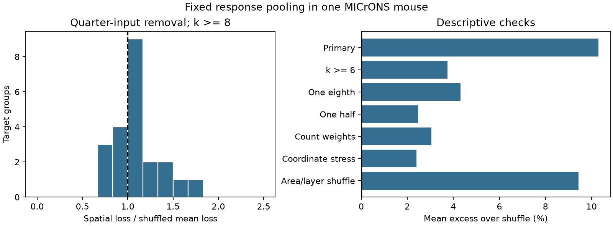

# No spatial input-loss test passed family correction in 22 selected MICrONS target models

We tested whether removal of nearby input sources changes a fixed mean movie response more than response-location shuffles predict. None of 22 target tests passed Holm correction at 0.05. The smallest raw Monte Carlo fraction was 0.039. The smallest corrected value was 0.858. Mean loss was 10.3 percent above the shuffled mean. This descriptive excess does not establish a spatial circuit effect. The test has few input sources per target and uses one selected mouse panel.



The figure shows the observed loss divided by its shuffled mean for each target, and descriptive mean excesses under different checks. Data credit: Ding et al. and the MICrONS Consortium (2025). The calculation uses a fixed response pool, not activity after a lesion. The bars have no biological confidence intervals.

## Question and prior work

Does the spatial arrangement of measured inputs make a pooled response sensitive to local source loss? Similar responses among inputs could support stable pooling. But removal of a nearby group could remove a distinct response component.

Ding et al. (2025) reported like-to-like excitatory wiring and output-group structure in MICrONS. The MICrONS Consortium (2025) supplied linked activity and anatomy from the same mouse. Campaign report SCI 100b9f6bfd76176b28c79e9f524e1861b687d199ffcea463ce5119694551c1e2 tested input similarity under degree control. Report SCI 3c17484618a016995eb261a146a133d8907c3c05c9aa8e710522a3d898ad4238 tested single-target loss from output averages. Here we test groups of nearby input sources. We wrote new code. These are different analyses of the same mouse, not biological replications. We do not claim a new general theorem or wiring law.

## Data and scope

We read the fixed Ding node_and_edge_properties/v1 files in place. They contain 12,894 node records and 1,693,276 pair records. We kept Connected and ADP pairs with positive axon_len and dend_len. This gives 295,371 opportunity pairs and 8,128 connections. The full connected source panel has 148 cells. Our main sample has 22 targets, 198 links and 73 distinct input sources. Each target has 8 to 12 measured sources. This is not a census of the inputs to those targets.

Each released in_vivo_mean_resp vector has 120 entries. We subtract its mean and divide by its Euclidean length in float64. All vectors are finite and nonconstant. The entries are trial-mean movie responses. They are not independent trials or a time series for a lesion experiment. We use no new quality threshold.

The exact shared paths, resolved paths, sizes, source URLs, hashes and software versions are in files/results.json. Shared paths are datasets/microns-funconn-ding2025-v1-node-data/node_data_v1.pkl and datasets/microns-funconn-ding2025-v1-edge-data/edge_data_v1.pkl, relative to the assigned worktree. Their SHA-256 values are:

- Node: 5a310585ccefcfb2f14d15b2cc2e607e730b0ec0a86587e606af362463abf6ef
- Edge: efcd387233960026464f285597fd5bc1c3a00432e4d62570bc578149a9707bbb

The /mnt/dell-data names resolve to shared storage on HP. We did not access the failed disk at /data. No new shared download was needed.

## Method

Let x_i be the centered unit response of source i in a target group. For k sources, the intact mean is m = sum_i x_i / k. We remove q = ceil(k/4) sources and renormalize the remaining mean. For each of the k source locations, the loss set contains that source and its q-1 nearest sources in the same input group. Distance uses all three released nucleus coordinates with equal units. Duplicate loss sets do not affect the maximum.

For loss set S, our score is

    L(S) = || mean_(i outside S) x_i - m ||^2 / ||m||^2.

The target score is the largest L(S) over these k nearest-source sets. Smaller scores mean less change of this fixed mean. We do not fit a decoder, test stimulus information or simulate recurrent activity. For the main sample, ||m||^2 ranges from 0.1363 to 0.2564. Thus the denominator is not close to numerical zero.

The main control makes 999 independent uniform permutations of the response identities over the fixed input positions within each target. Each draw recomputes the largest loss. The control fixes the input set, input count, full response Gram matrix, intact mean and candidate spatial loss sets. It changes only their assignment. It does not rewire the circuit. This is a conditional test of response-location exchangeability in a target's selected input set. It cannot identify whether a difference came from wiring, spatial response organization, cell classes or recording conditions.

For a target, the upper-tail Monte Carlo fraction is (1 + number of shuffled scores at least as large as the observed score)/1000. The code includes a 1e-14 tie tolerance. We apply Holm correction to the 22 main fractions. Holm does not require independent targets, but each marginal randomization test still requires its exchangeability assumption. Overlap between source groups makes the mean across groups descriptive. We do not give a pooled p value or a confidence interval across mice. A null result does not prove exchangeability or equal loss.

The maximum search matters. The expected loss for a uniformly chosen q-source subset is lower than a maximum over spatial subsets even with random response locations. We therefore compare observed maxima with shuffled maxima, not just with random loss. For equal weights, uniform-subset loss has exact mean

    E[L] = q * (1 - ||m||^2) / ((k-q) * (k-1) * ||m||^2).

To obtain this identity, write the displacement as minus the sum of x_i-m over the removed subset, divided by k-q. Expand its squared norm. Use sum_i(x_i-m)=0 and sum_i||x_i-m||^2=k(1-||m||^2). The subset inclusion probabilities are q/k and q(q-1)/(k(k-1)). This is a standard finite-population identity. The code checks it against all q-subsets for every tested group.

## Results and checks

| Test | Targets | Mean spatial loss | Shuffled mean | Excess | Smallest raw fraction | Targets passing Holm |
|---|---:|---:|---:|---:|---:|---:|
| Main, at least 8 inputs | 22 | 0.31815 | 0.28843 | 10.31% | 0.039 | 0 |
| At least 6 inputs | 94 | 0.39262 | 0.37844 | 3.75% | 0.039 | 0 |
| Remove one eighth | 22 | 0.15531 | 0.14890 | 4.31% | 0.135 | 0 |
| Remove one half | 22 | 0.76899 | 0.75055 | 2.46% | 0.056 | 0 |
| Contact-count weights | 22 | 0.47001 | 0.45613 | 3.04% | 0.063 | 0 |
| Tenfold z scale | 22 | 0.29185 | 0.28503 | 2.39% | 0.101 | 0 |
| Shuffle within area and layer | 22 | 0.31815 | 0.29074 | 9.43% | 0.032 | 0 |

Fifteen of 22 main scores were above their shuffled means. Observed-to-shuffled-mean ratios ranged from 0.764 to 1.764. Mean uniform-subset loss was 0.21844. The larger spatial maximum alone is not evidence of a special spatial effect, because the maximum also raises the shuffled score.

The plan in files/PLAN.md preceded outcome calculation. The area-and-layer shuffle was added after the first result, as an exploratory control. Missing area or layer labels form a stratum. Some small strata permit few distinct permutations. The other checks were specified in the plan. Each check has its own Holm family and is descriptive; we make no claim from selecting among them. The contact-count check moves a source's response and count together during each permutation, so its intact weighted mean is fixed. Counts are model weights, not measured synaptic efficacy.

The original plan assumed voxel coordinates subject to source verification. The released values have extents consistent with physical nanometers. We used equal released units as the main metric before calculating scores. We could not find an explicit unit declaration for these v1 nucleus fields. No physical radius is reported. Tenfold z scaling is a stress check, not a second valid unit estimate. files/SEARCH.md records this issue. It limits anatomical interpretation even though neither coordinate choice gives a target that passes correction.

We checked weighted loss against direct deletion, the exact uniform-subset identity, permutation indexing and Holm adjustment. All 35 synthetic size-and-removal cases passed. The source hashes passed. The full data analysis completed. Code and results are provided; source records and individual target tables stay outside the publication.

## Limitations and use

This test cannot resolve a small effect with only 22 target groups. It does not establish equivalence or safe removal. The 73 sources are shared across target groups. The source cells were selected for proofreading and are not a random sample. Their selection, incomplete axons, uncertain synapse calls, response estimation error and restricted visual stimuli can affect the result. Source locations can covary with area, layer, tuning and imaging scan. The area-and-layer shuffle does not control every spatial or recording effect.

The nearest-source sets have a fixed count, not a fixed physical radius. They do not include unmeasured cells. A real local lesion would also change inhibition, recurrence, behavior and adaptation. Equal pooling and count weights are reference models. Unit normalization removes response amplitude. A small pool shift does not establish reliable information. No result here establishes a principle across animals, species, regions or behavioral conditions. The useful output is a reproducible spatial-loss audit with a control that keeps the intact response pool fixed.

## Reproduction

Use Python 3.12 with NumPy, pandas, SciPy and Matplotlib. Exact versions used are in files/results.json. Run from an unpacked publication directory. Keep generated records outside that directory.

```bash
python files/validate.py
python files/retrieve.py /absolute/local/scratch/microns_external
python files/analyze.py --data-root /absolute/local/scratch/microns_external --out /absolute/local/scratch/recomputed --scratch /absolute/local/scratch/target_evidence
```

To reuse the campaign data, replace --data-root with the absolute shared dataset root. The analysis verifies both hashes and reads data in place. Only use trusted, hash-checked source pickle files. It writes target_results.csv under --scratch and aggregate results plus a PNG under --out. The retrieval script refuses a destination inside the signed package. It does not change an existing file on a hash mismatch. The scripts need no network after retrieval. No private work files are needed for reproduction.

The package contains original code, text, an aggregate figure and aggregate results under the exact SCI baseline license. External terms and credit are in files/EXTERNAL_DATA.md. The two source papers, data release and campaign reports are signed citations in sci.json.

## Worker record

Job: sci-1107-dell-neural-structure-and-computation-d3d25d3c97cb. Topic: neural-structure-and-computation. Campaign: 11_07_2026. Machine: dell. Account: codex-myxtap. Model: gpt-6.1-sol with high reasoning effort in T3 Code through Codex. No agents were launched. The campaign-machine signing key identifies this run; it is not a personal authorship claim. This run saves and verifies a local publication. It does not upload or submit the publication.
