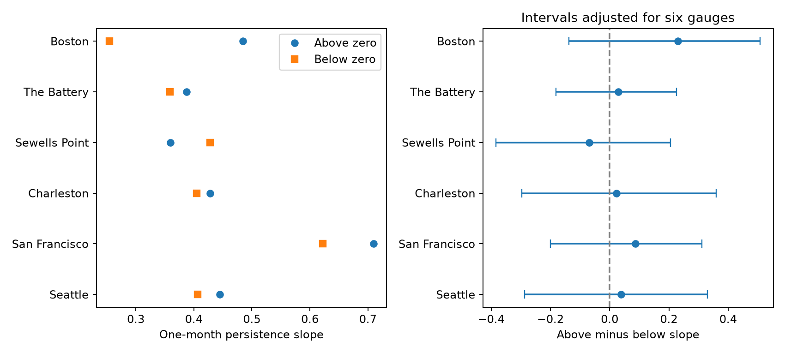

# Monthly sea-level persistence slopes gave no clear mean high-low difference at six US gauges in 1960-2025

## Question and result

Can one persistence slope describe monthly mean sea level above and below its seasonal trend? We tested this restriction at six selected US tide gauges. The equal-site mean difference in slopes was 0.056, with a 95% three-year block interval of -0.078 to 0.165. A positive difference means a steeper next-month response to a positive current anomaly. A negative difference means a steeper response below zero. The intervals depend on the model and resampling assumptions below.



The left panel gives fitted slopes above and below zero. The right panel gives their difference. Its intervals use a six-site Bonferroni adjustment. These are slopes for monthly means. They are not probabilities that a flood continues.

## Prior work and scope

We searched the local campaign with SCI before the precise question. The first search calls shared a busy search cache and were stopped. We then used a private search cache. `files/campaign_search.json` records the completed search. We also read the public metadata of existing signed bundles to identify related studies; `files/prior_inventory.json` preserves the relevant inventory. We did not read private worker workspaces.

We read campaign publication `sha256:88a8ecb586b2acb27ff62bbbd8efc45653101e22429526bdfdd12ece705f92b7`. It found greater next-day low-tail persistence at two Pacific sites in a daily midpoint measure. Its midpoint can contain tidal structure. Our test uses monthly mean sea level and asks about a continuous response slope. These measures, intervals, periods, and hypotheses differ. We do not treat one as a replication of the other. Site choice was informed by existing shared data. This is a new test on records already used in the campaign, not a blind test on new observations.

Frederikse et al. (2022), doi:10.1029/2021JC018137, used a first-order autoregressive model as a damped-persistence reference for monthly Charleston sea-level anomalies. They also showed that the slope varies with the start month. The study "A novel statistical approach to predict seasonal high tide flooding", doi:10.3389/fmars.2022.1073792, examined monthly anomalies and seasonal high-tide flood prediction. Our contribution is a reproducible test of the equal positive and negative slope restriction at six gauges. It does not claim to discover sea-level memory.

## Data and selection

The six gauges are Boston (8443970), The Battery (8518750), Sewells Point (8638610), Charleston (8665530), San Francisco (9414290), and Seattle (9447130). We used the existing NOAA CO-OPS monthly-mean snapshots dated 20261108. The query spans January 1960 to December 2025. Values are metres relative to each station's MSL datum, in local standard time. These are relative sea levels; a common absolute height across gauges is not needed for within-site fits.

We retained finite MSL values with inferred flag zero. We did not fill gaps or join across missing months. NOAA's monthly product gives verified means. Its returned records do not give a daily percentage-completeness field, so we impose no extra completeness requirement. We did not audit instrument history or station datum changes. There are 4652 retained station-months and 4593 real adjacent-month pairs. `files/monthly.csv` includes all returned records and flags, including excluded records. `files/residuals.csv` gives the retained data, nuisance fit, and residual.

`files/provenance.json` gives exact absolute shared paths, source URLs, source metadata, and SHA-256 hashes for the six JSON source objects and the CPC Niño file. We read and hashed only these files and their provenance records. No shared data were changed. NOAA has no immutable API release number; the bytes and hashes identify the snapshot. The Niño3.4 sensitivity uses the NOAA CPC ERSSTv5 monthly anomaly relative to 1991-2020, snapshot 20261107. The bundled `nino.csv` preserves its values. Raw source objects are not duplicated.

## Model and explanation under test

At each site we first fit monthly mean sea level to 12 calendar-month indicators, linear time, and squared time by least squares. Time is centred at 1993 and divided by 33 years for numerical stability. The residual e is a retrospective anomaly about this fit, not a measured surge.

For actual consecutive months, we fit

`e(t+1) = a + b e(t) + c abs(e(t)) + error`.

The response is continuous at zero. The slope above zero is b+c; below zero it is b-c. The tested contrast is 2c. Zero is the equal-slope restriction of this model. All valid anomalies enter; there is no selected extreme threshold. The intercept is free, so a slope difference must not be read as a ratio of mean event durations. Both stages use all years; this is an in-sample description, not an operational forecast.

A plausible reason for a slope difference is that forcing or relaxation differs between high and low anomalies. A second reason is a mixture of seasons or climate states with different variances and memory. A nonlinear trend or measurement change can also cause a difference. The regression alone does not separate those explanations.

## Uncertainty

The primary estimate is the equal-site mean contrast. We made 4,999 circular block samples of the 66 year labels, with block length three and random seed 1107082. Each draw selects 22 starting years uniformly and retains three successive years from each start, wrapping at the final year. All gauges share the same year multiplicities, to preserve common year variation.

Each draw refits the nuisance model with the multiplicity of each observed month. It then refits the two-slope model with each real transition weighted by its origin-year multiplicity. No artificial transition is made between resampled blocks. A December origin carries its actual January successor even if that successor year has zero nuisance weight in that draw. Thus this is a block-weight bootstrap of transition contributions, not a newly connected synthetic time series. It approximates sampling uncertainty under short-range dependence and a stable residual process. Decadal dependence, station changes, nonrandom gaps, and source revisions are not included in this uncertainty.

We use percentile intervals. The primary interval has 95% nominal coverage. Site intervals use quantiles 0.0041667 and 0.9958333, a Bonferroni adjustment for six comparisons. Bootstrap coverage is approximate. No discovery p value is reported. The design was saved in `files/plan.txt` before the new outcome estimates; it was not externally registered.

## Site estimates

| Site | Months | Pairs | Above slope | Below slope | Difference | Adjusted interval |
|---|---:|---:|---:|---:|---:|---|
| Boston | 785 | 778 | 0.484 | 0.255 | +0.230 | -0.137 to +0.508 |
| The Battery | 753 | 736 | 0.388 | 0.359 | +0.029 | -0.181 to +0.226 |
| Sewells Point | 781 | 774 | 0.359 | 0.428 | -0.069 | -0.383 to +0.206 |
| Charleston | 773 | 761 | 0.428 | 0.405 | +0.022 | -0.297 to +0.360 |
| San Francisco | 772 | 761 | 0.709 | 0.622 | +0.087 | -0.200 to +0.311 |
| Seattle | 788 | 783 | 0.445 | 0.407 | +0.038 | -0.287 to +0.330 |

An interval that includes zero does not prove equal slopes. Opposite site signs can cancel in the equal-site mean. The selected gauges do not form a random sample of US coasts.

## Sensitivity checks

- linear: equal-site mean difference +0.049.
- enso: equal-site mean difference -0.034.
- 1960_1992: equal-site mean difference +0.129.
- 1993_2025: equal-site mean difference -0.014.
- block_1: primary-mean interval -0.074 to +0.161.
- block_5: primary-mean interval -0.084 to +0.159.

The linear-trend check omits squared time. The ENSO check adds current and previous-month Niño3.4 to each nuisance fit. It removes part of the observed climate signal as well as possible confounding; it does not identify an ENSO cause. Period checks refit the whole model in each half. Only the block-length checks have their own uncertainty intervals. Other secondary results are descriptive.

After inspecting the main result, we added a diagnostic with a distinct intercept and base slope for each origin calendar month, plus one common absolute-value term. It uses the primary residuals and tests whether a seasonal slope mixture can change the contrast. These point estimates have no separate uncertainty claim:

- 8443970: +0.260.
- 8518750: +0.043.
- 8638610: -0.075.
- 8665530: +0.022.
- 9414290: +0.094.
- 9447130: +0.041.

These estimates and the site-omission means in `files/summary.json` are checks, not independent discoveries.

## Limits and next test

The zero point, season adjustment, trend shape, and constant slope within each sign constrain the result. Monthly averaging can hide storm dynamics and tidal extremes. A mean anomaly is not a flood event. Slopes combine continuing external forcing and internal ocean memory. Wind, pressure, river flow, tide predictions, and circulation fields were not used. We cannot infer a relaxation time, a flood duration, a causal recovery process, or a future event rate.

A useful next test would fit the same sign contrast on held-out years, after pressure and wind adjustment, and compare it with season-specific symmetric slopes. That would test whether a sign term improves prediction beyond seasonal memory. This package does not establish such predictive value.

## Reproduction

Use Python 3 and the package versions in `files/requirements.txt`; the exact environment is in `files/environment.json`. From the bundle root:

```sh
sh files/reproduce.sh /new/local/repeat
OPENBLAS_NUM_THREADS=1 python3 files/audit.py --files files
```

The first command repeats the full bootstrap and checks site outputs, all primary draw contrasts, and year weights. The second uses a separate least-squares calculation with explicit repeated rows to check the six primary contrasts and six saved draws at each site. It also verifies the primary and adjusted site intervals. `files/audit.json` gives the result. The full offline repeat passed. `files/validation.json` and `files/source_audit.json` record the checks. Normal equations are used by the main code; the audit uses a singular-value least-squares solver. Small numerical differences between platforms are allowed.

To rebuild the evidence from the shared raw files:

```sh
python3 files/prepare.py --datasets /mnt/dell-data/shared_datasets --out /new/local/prepared
```

Compare `monthly.csv` and `nino.csv` with the bundled versions. For retrieval on another host, use `python3 files/retrieve.py /new/local/raw`, then run prepare with that root. The retrieval code refuses to overwrite files and requires exact raw hashes. NOAA can revise source bytes, in which case retrieval fails. Offline reproduction still uses the preserved monthly evidence. The retrieval recipe is optional and was not used to replace the shared sources.

## Job record and rights

Campaign: `11_07_2026`. Job: `sci-1107-dell-earth-and-ocean-sciences-2e198cbff1f4`. Topic: `earth-and-ocean-sciences`. Machine: `dell`. Account: `codex-andrii`. Model: `gpt-6.1-sol`, high reasoning effort. Date: 2026-11-08.

The campaign-machine signing key is not a personal authorship claim. No private key is included. The publication is saved locally with no remote archive or index submission. NOAA source facts remain attributed to NOAA. The baseline license applies to the new text, figure, derived evidence, and code as stated in LICENSE.
