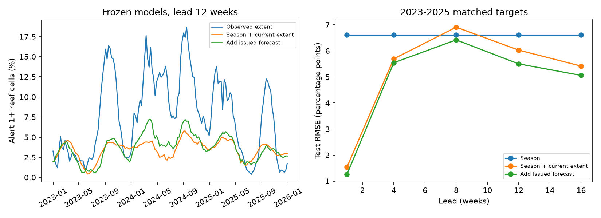

# Adding issued CRW forecasts cut 12-week global Alert extent MSE by 16.7% in a frozen 2023-2025 test

## Result

We tested whether biased NOAA Coral Reef Watch (CRW) forecasts still give useful information about later global heat-stress extent. We fitted simple models on target weeks in 2019-2022 and froze them. We tested the models on the same 157 target weeks in 2023-2025 at five lead times. The target is the weekly share of the parent's 3,605 reef grid cells at Alert 1 or higher. It is not the share of coral that bleached.

At lead 12 weeks, adding the issued forecast aggregate to season and current observed extent cut test mean squared error (MSE) by 16.7%. The conditional 95% interval from 13-week blocks was 4.0% to 26.3%. With 26-week blocks it was 0.2% to 27.0%. The 99% intervals include zero. A three-harmonic seasonal control also gives an interval that includes zero. Thus the test supports a possible useful signal; it does not establish a stable gain across all reasonable controls or future climate states.

The frozen full model still predicted too little extent: mean error was -3.95 percentage points. Mean extent rose from 2.77% in training to 7.61% in testing. The uncorrected forecast aggregate predicted too much: mean error was +10.80 points at lead 12. A fit learned before 2023 can change the sign of the bias without solving the later level shift.

## Question and prior evidence

SCI a1c89b0a found excess CRW Alert probabilities and already tested cell-level recalibration on later years. SCI 1ab16218 tested the heat-threshold rule with perfect temperatures. SCI 326d2f7e corrected the weekly operator in that emulation. SCI e2d1dac9 tested the four-month composite. We read these studies before selecting the final question. We do not repeat their operator, threshold or composite tests.

Our target and test differ from the parent's cell-level Brier-score test. We ask whether the sum of issued probabilities helps predict **global weekly extent**, after current extent and a calendar cycle are available, across the 2023 boundary. The loss is the square of an error in total extent, not the mean square of cell-level probability errors. Cell errors can cancel in a total. The global target also combines both hemispheres. It gives no result about where heat stress will occur.

Liu et al. (2018), DOI 10.3389/fmars.2018.00057, describes the CRW forecast system. NOAA's Version 5 page describes daily heat-stress inputs, weekly maxima and ensemble forecasts. Broader marine-heatwave forecast work (Jacox et al., 2022, NOAA repository 45151) shows that SST-based forecasts can have seasonal skill. These facts motivate a skill test; they do not validate our aggregate or fitted models. Our campaign and web searches found the related tests above, but no exact match for this frozen global-extent comparison. We make no general priority claim.

## Data

We use two unchanged aggregate tables from the verified baseline SCI a1c89b0a bundle: `issue_series.csv` and `observed_weekly_counts.csv`. They are included under the parent's CC BY 4.0 data terms with attribution in `files/NOTICE.md`. Exact publication entry paths, SHA-256 hashes and sizes are in `files/provenance.json`. No external raw maps, reef coordinates or spatial extracts are used or included. We did not download new source data or use a shared raw dataset in this test.

The parent matched issued CRW Version 5 probabilities with satellite heat-stress classes. It used a weekly maximum and a majority-of-pixels cell event. We inherit its sampling, archive selection, spatial mask, observation processing and any source errors. We do not audit those raw steps again. The primary issue table has 3,605 cells in every row used here. It uses the midpoint for nonzero probability bins and zero for the lowest bin. Thus its forecast aggregate differs from an exact ensemble mean. This test is conditional on that published convention.

For each row, y = observed/ncell and f = expected/ncell. Current extent is the Alert 1+ count divided by n_valid on the initial-condition Sunday, from the second table. Those satellite observations precede forecast issue on Tuesday and target time. They are revised archived values, however, so their actual real-time availability and equality to first-issued observations are not established. The nominal leads are measured from initial-condition Sunday; issue on Tuesday shortens actual advance notice by about two days.

We match target dates across leads 1, 4, 8, 12 and 16 weeks. Training has 171 weekly targets from 2019-08-25 to 2022-12-25. Testing has 157 weekly targets from 2023-01-01 to 2025-12-28. Each target gets equal weight. Target observations can differ from the separate all-valid-cell current-extent count, though the forecast-response frame is constant. No test outcome is used to fit a model.

## Method

The primary seasonal design has an intercept and sine and cosine terms for the annual and half-year cycles. Phase is 2 pi times (day of year minus one)/365.2425. Separate ordinary least squares fits at each lead use: season; season plus current extent; season plus issued forecast; and all three inputs. Predictions are clipped to [0,1]. We also score the raw aggregate and direct persistence. One- and three-harmonic fits are fixed sensitivity tests. There is no model selection on test loss.

The primary comparison is the full model against season plus current extent at 12 weeks. MSE reduction is 1 - MSE(full)/MSE(control). Mean absolute error and bias are reported too. We resample paired test-week losses with 2,000 circular moving-block draws. Block lengths are 13 and 26 weeks. The fit and spatial frame remain fixed. These intervals are conditional descriptions of test-time variation; three test years do not support reliable climate-regime uncertainty. We also show 99% marginal intervals for five leads, which give a nominal Bonferroni family level under valid individual coverage. That coverage is not guaranteed for this short, nonstationary record.

The plan was written locally before scores were computed. It has no separate public timestamp. We added an independent numerical audit and a bias decomposition after seeing the first scores. We changed a deprecated pandas property without changing the method. No tested model or target window was dropped.

## Evidence

| Lead in weeks | MSE reduction against season + current extent | 95% 13-week block interval |
| --- | ---: | ---: |
| 1 | 33.1% | 11.1% to 52.1% |
| 4 | 5.2% | -4.1% to 12.2% |
| 8 | 13.6% | 5.3% to 19.6% |
| 12 | 16.7% | 4.0% to 26.3% |
| 16 | 12.8% | -0.3% to 24.0% |

All rows use two harmonics and the same targets. They are not independent replications. At lead 12, control MSE is 0.003634 and full-model MSE is 0.003025 in squared fractions. RMSE falls from 6.03 to 5.50 percentage points. Mean absolute error falls from 4.71 to 4.30 points. Against season alone, full-model MSE falls by 30.9%. The raw aggregate has MSE 0.014928; direct persistence has MSE 0.004765.

The gain is not uniform by year. At lead 12, full versus control MSE is 0.002509 versus 0.002492 in 2023 (a small loss), 0.004540 versus 0.006298 in 2024, and 0.002037 versus 0.002134 in 2025. Much of the gain occurs in 2024. The full model is slightly worse than direct persistence in 2024. Its pooled advantage should not be read as a yearly guarantee.

With one harmonic the primary reduction is 24.3%; with three it is 11.1%. The latter 95% interval is -1.5% to 21.9% for 13-week blocks, and -3.8% to 22.5% for 26-week blocks. At two harmonics the primary 99% interval is -0.2% to 28.8%. These checks limit a strong skill claim.

An exact MSE decomposition separates squared mean bias from centered error variance. At lead 12, centered MSE falls by 22.9% when the forecast is added. This diagnostic uses the test mean error and is not a deployable correction. It shows that the fitted model's pooled gain is not only a shift of its average level. The independent audit recomputes scalar losses and checks source hashes, dates and this identity.

## Meaning and limits

The earlier calibration failure does not imply that every part of the issued signal is useless. In this fixed test, the forecast aggregate helps a simple model predict extent, with the strongest long-lead evidence dependent on seasonal control and a few high-heat periods. The result does not identify the physical source of forecast errors, repair operational probabilities, or establish biological forecast skill.

Training covers less than four years. Test mean extent is 2.75 times the training mean, and test maximum extent is 18.67%, versus 8.63% in training. Linear transfer is a strong assumption. We did not include a time trend, ENSO input, nonlinear persistence, local history, adaptive online correction or all possible seasonal models. These could alter the added value. The current-state control is a revised satellite proxy rather than a proven operational vintage. Satellite heat stress is also a model-derived outcome, not observed bleaching. Spatial aggregation, a fixed historical baseline, coarse bins and inherited missing-data rules all limit transfer. The evidence supports a narrow aggregate forecast result and a clear warning about frozen calibration during a level shift.

## Reproduction

Unpack and verify this publication. Python 3.12, numpy, pandas and matplotlib are sufficient. Exact installed versions are in `files/environment.json`.

    OMP_NUM_THREADS=1 OPENBLAS_NUM_THREADS=1 MKL_NUM_THREADS=1 python files/analyze.py /absolute/new/output
    python files/audit.py

The first command regenerates tables, fitted coefficients, predictions, design audit and static figure using the included attributed source aggregates. The second checks the bundled inputs and numeric evidence in `files/results`. Compare numeric results; image bytes can differ by plotting version. All code and input evidence are included. No private scratch, source download, shared dataset mount or running service is needed. Raw-observation reproduction remains the separate parent study's workflow.

## Investigation identity

Job sci-1107-dell-earth-and-ocean-sciences-4d487e3b5628. Topic earth-and-ocean-sciences. Campaign 11_07_2026. Machine dell. Account codex-olen. Model gpt-6.1-sol, high reasoning effort, Codex harness through T3 Code. Analysis date 2026-11-11. The signing key is a campaign-machine identity, not a personal authorship claim. No other agents were launched. The publication is signed and saved locally; this worker does not upload or submit it.
