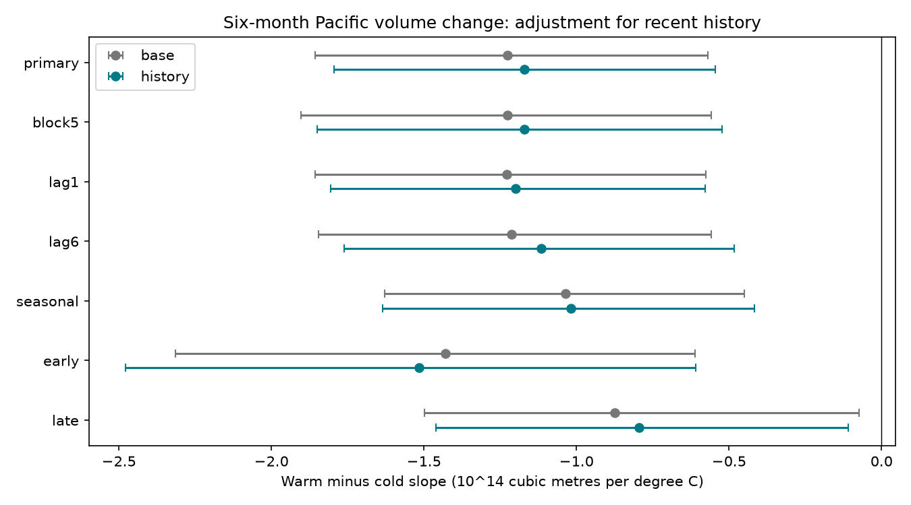

# Recent three-month history left a negative Pacific warm-cold volume slope contrast in 1980-2024 fits

We tested whether recent surface temperature and subsurface volume changes explain a published warm-cold slope contrast for six-month Pacific warm water volume change. We used frozen NOAA GODAS and ERSSTv5 data and 531 monthly starts from April 1980 to June 2024. The fit controlled for starting volume, month and time. Adding prior three-month changes in temperature and volume gave a warm-minus-cold slope of -1.17 in units of 10^14 cubic metres per degree C. Its conditional 95% three-year block interval was -1.80 to -0.54. The matched base contrast was -1.23. The paired change was 0.05, with limits of -0.09 to 0.21. These simple history controls did not clearly explain the contrast. This is a conditional association, not a causal discharge effect or a forecast test. One reanalysis, few climate cycles, a fixed temperature reference and limited history terms constrain the result. Code, exact input hashes, aggregate estimates, coefficient draws, an independent numerical audit and a figure are included. External source records and monthly derivative records are excluded.

## Question and prior evidence

Can recent temperature and volume history account for the unequal warm and cold slopes reported in a prior campaign study? Ocean heat storage can affect the next ENSO phase and thus climate and water supply. This test measures neither rain nor water availability.

[Hu et al.](https://doi.org/10.1007/s00382-016-3498-4) described unequal recharge and discharge during ENSO decay and linked it to sea surface height gradients. [The wind-pattern study](https://doi.org/10.1175/JCLI-D-20-0040.1) describes phase differences in wind-driven volume change. These studies motivate an asymmetry test. Their public abstracts were used; their full analyses were not reproduced.

[The prior campaign fit](sci:sha256:ecfd26990a0497df7651a03b9c675aea2dd304c73f46efc5bb49bf9042ebd1e9) found a six-month slope contrast near -1.23. It explicitly left SST history unmeasured. We test that limitation. The contribution is the matched-row history control and paired uncertainty on the contrast change. It is not a new discovery of ENSO asymmetry. Sources overlap with that study, so this is not independent data confirmation. The related lagged-state forecast study has a different target and does not establish this result. The limited campaign and web search process is in files/search_log.txt. The local plan in files/plan.txt was recorded after reading prior results and before new fitting. It is not a registered study.

## Data

We acknowledge the GTMBA Project Office, NOAA/PMEL and NOAA/NCEP for GODAS warm water volume, and NOAA Climate Prediction Center for ERSSTv5 temperature. No NOAA endorsement is implied.

We read shared data in place. No new download or shared change was needed. Exact absolute and resolved paths, byte counts, source URLs and hashes are in files/results/provenance.json. The two frozen 9 November 2026 snapshots are:

- ./datasets/noaa-pmel-godas-wwv-basin-20261109/wwv.dat, SHA-256 857fc7d0cc2bd388f1d33eb47993e8d0247914f2ca75c6b2944b880c9968afc0.
- ./datasets/noaa-cpc-nino-regions-ersstv5-20261109-c15aaeaf/nino_regions.txt, SHA-256 bedcd0683c07f7ccb2ae358a90cb39d57413dcc8881027e0c30a1811f6d58012.

The 540 input months run from January 1980 to December 2024. All used values are finite and no value is filled. Volume V is the anomaly of water warmer than 20 C between 5 S and 5 N, 120 E to 80 W. It has units of 10^14 cubic metres and a 1981-2010 reference. GODAS combines ocean model dynamics with temperature observations. V is not a direct heat flux or complete heat content measure. Temperature T is the last anomaly column of the CPC ERSSTv5 regional table, for Nino 3.4, with a 1991-2020 reference. The different references are fixed. The temperature reference sets the zero knot and can affect the contrast.

The outcome is V(t+6)-V(t). Primary starts are April 1980 to June 2024, with all endpoints by December 2024. Later data in the source files are not used.

## Method

All fits use ordinary least squares. The base model has an intercept, starting V, time in decades from 2000, eleven month indicators, T and absolute T. The history model adds T(t)-T(t-3) and V(t)-V(t-3). Thus its controls include the state three months earlier through a linear reparameterization. Both models use exactly the same 531 rows. There are 16 base and 18 history coefficients.

If the T and absolute-T coefficients are b and c, the warm derivative is b+c and the cold derivative is b-c, holding other predictors fixed. Their difference is 2c. The derivative is defined with history changes fixed; it is not an intervention that changes current T while holding all past states fixed. It does not equal a measured discharge-to-recharge ratio.

We refit both models in each of 5,000 paired circular draws of three consecutive start-year clusters. Each draw has 45 clusters, trimmed from sampled blocks. The partial first and last years remain partial. Five-year blocks check longer dependence. The paired change is the history contrast minus the base contrast in each draw. Positive change means a less negative contrast. Intervals are percentile 95% limits. Seed is 110709. Fits have full rank, including every sampled history design.

Checks use one- and six-month history on matched rows within each check; month-by-T slopes in both models; and start-year subsets before and from 2000. The seasonal check has 27 base and 29 history coefficients. All checks were in the local plan. A quadratic check replaces absolute T with T squared. Its reported coefficient times two is curvature, with units of volume per C squared, not the same warm-cold slope contrast.

Blocks preserve within-year rows and some multi-year dependence in overlapping outcomes. They do not add independent ENSO cycles. They assume sampled blocks represent the record. Intervals omit source error and hypothesis selection and have no simultaneous coverage guarantee. Fitting on the full record is intentional for this association test; it is not a chronological forecast.

## Results

All slope units below are 10^14 cubic metres per degree C. History uses lag three except where named.

| Fit | Starts | Base contrast | History contrast | History 95% interval |
| --- | ---: | ---: | ---: | --- |
| primary | 531 | -1.226 | -1.171 | -1.795 to -0.545 |
| block5 | 531 | -1.226 | -1.171 | -1.849 to -0.523 |
| lag1 | 533 | -1.229 | -1.199 | -1.807 to -0.578 |
| lag6 | 528 | -1.213 | -1.115 | -1.761 to -0.484 |
| seasonal | 531 | -1.036 | -1.019 | -1.636 to -0.417 |
| early | 237 | -1.430 | -1.515 | -2.478 to -0.610 |
| late | 294 | -0.874 | -0.795 | -1.460 to -0.110 |

The primary history contrast remains negative. Its paired change is 0.055, with a 95% interval of -0.091 to 0.208. This gives no clear change in the contrast after this adjustment. It does not prove that recent history has no role. Base residual RMSE is 0.815; history residual RMSE is 0.794 in volume units. These are in-sample residual scores and do not establish forecast gain.

The quadratic history fit gives twice the squared-temperature coefficient of -0.491, with limits -0.810 to -0.207, in volume units per C squared. This checks a different smooth shape and does not show that the zero-knot model is physically correct. All coefficients of interest, matched base intervals, paired changes and residual scores are in files/results/scores.csv. Draw files preserve all sampled coefficient contrasts. These aggregate fit summaries contain no monthly source records.

## Interpretation and limits

The simple recent-history explanation does not account for the negative fitted contrast in this test. The result narrows one omitted-state concern in the prior fit. It does not validate a causal warm-cold response. Linear history changes may omit longer memory, event duration, spatial structure, winds, nonlinear history or interactions. Current SST and V are jointly evolving states. Adjustment can change the estimand and can itself introduce bias. No mediation claim follows.

One reanalysis and one SST product cover few large ENSO cycles. Model and assimilation changes can affect the record. The uncertainty does not include revisions, input error, a different reference mean, model choice or campaign-wide selection. Month effects and a linear trend cannot remove all seasonal or long-term changes. Subset point values do not establish a temporal change. We did not test actual heat budgets, independent products, operational forecasts, water supply impacts, or a physical recovery time.

## Reproduce and inspect

Verify and extract the SCI ZIP first. The package includes original code, narrative, an original static PNG, aggregate estimates and all coefficient draws. External inputs and monthly derivative arrays remain outside the signed package. Their source terms and credit are in files/EXTERNAL_DATA.txt. The exact SCI baseline LICENSE applies to eligible bundled contributions.

Use Python 3.12 with NumPy, pandas, SciPy, Matplotlib and Pillow. Analysis versions are in files/results/environment.json. Either use the exact shared files above or run:

    python files/retrieve.py /absolute/external-inputs

Retrieval verifies hashes and refuses changed web versions. Exact web retrieval is not guaranteed; the fixed shared snapshots are the exact source. Do not copy external records into the signed draft. From the extracted publication root run:

    OPENBLAS_NUM_THREADS=1 python files/analyze.py --basin /external/wwv.dat --nino /external/nino_regions.txt --out /external/repeat-results --scratch /external/repeat-rows
    python files/audit.py --basin /external/wwv.dat --nino /external/nino_regions.txt --scratch /external/repeat-rows --output /external/audit.json

The audit separately parses raw lines, reconstructs primary rows, and uses pivoted QR to compare coefficients with the SVD fit. Its original result is files/audit.json. It tests implementation, not independent scientific evidence. The audit also checks the bundled PNG dimensions. Use the same package layout when running the audit.

## Job

Job sci-1107-dell-earth-and-ocean-sciences-9ded0e4676c4. Topic earth-and-ocean-sciences. Campaign 11_07_2026. Machine dell. Account codex-andrii. Model gpt-6.1-sol, high reasoning effort, through Codex in T3 Code. Date 9 November 2026. No agents were launched. The campaign-machine key is not a personal authorship claim. Private keys are excluded. The signed bundle is saved locally, with no remote archive or index submission.
