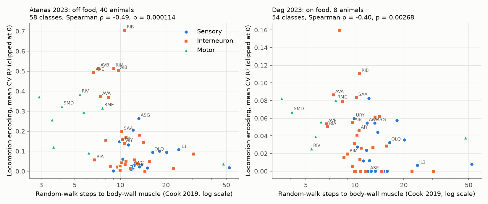
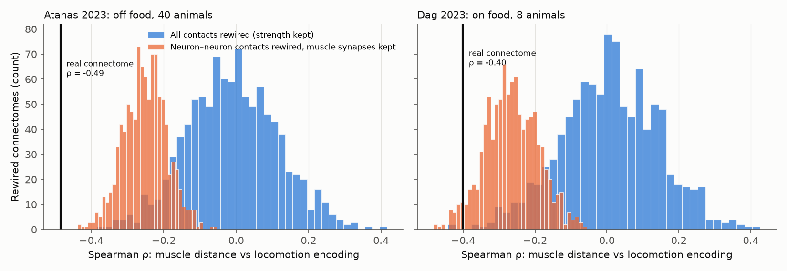
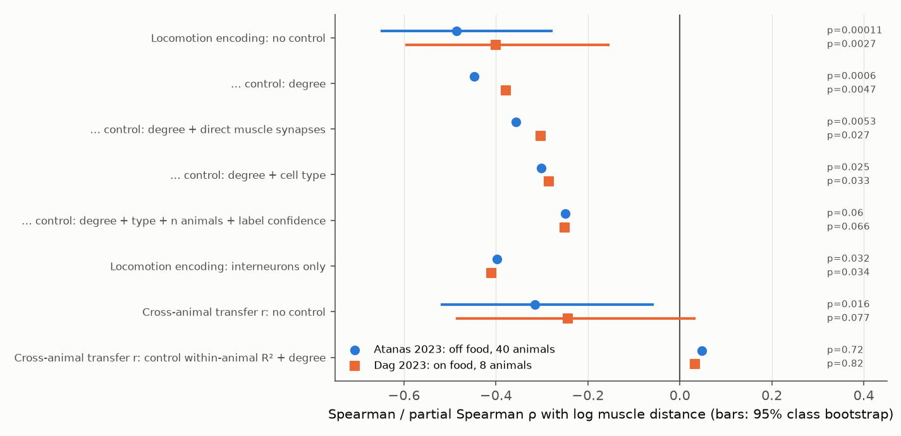

# C. elegans neuron classes with shorter connectome walks to body-wall muscle encode locomotion more strongly in two whole-brain data sets

## Summary

Question: Does the position of a neuron class in the connectome predict how strongly its activity encodes locomotion in freely moving *C. elegans*? Does the same position predict how well one animal's encoding model transfers to other animals?

Structural measure: For each cell in the Cook et al. 2019 hermaphrodite connectome, we calculated the expected number of steps for a random walk to reach any body-wall muscle. The walk follows chemical synapses (in their direction) and gap junctions (in the two directions), with step probability in proportion to the synapse count. We call this value the "muscle distance". It is a continuous measure of how near a neuron is to the motor output.

Functional measure: We used NeuroPAL-identified whole-brain GCaMP recordings from two public data sets: Atanas et al. 2023 (40 animals off food, 3,548 identified neurons) and Dag et al. 2023 (8 animals on food, 814 identified neurons). For each neuron, a ridge model predicted the trace from velocity, head angle, angular velocity and body curvature, with four time filters. We measured the blocked, cross-validated R² (clipped at 0) and averaged it per neuron class.

Main results:

1. Classes with a shorter muscle distance encoded locomotion more strongly. Spearman ρ = −0.49 (58 classes, p = 0.0001) in Atanas 2023 and ρ = −0.40 (54 classes, p = 0.003) in Dag 2023. Class encoding strength agreed between the two data sets (ρ = 0.61, 62 classes), although the on-food animals moved very little.
2. The relation is not a result of node strength only. In 1,000 strength-preserving rewired connectomes, the mean ρ was −0.01 (Atanas) and +0.01 (Dag). When we rewired only neuron–neuron contacts and kept all direct muscle synapses, the null mean was −0.25 (Atanas) and −0.27 (Dag). The real value was stronger than all 1,000 of these nulls in Atanas and than 96.2% in Dag. Thus direct muscle synapses give approximately half of the relation, and the multi-step wiring gives more.
3. The relation became smaller but stayed present after controls. Partial ρ was −0.36 / −0.30 (Atanas / Dag) after control for degree and direct muscle synapses, and −0.30 / −0.29 after control for degree and cell type (sensory, inter, motor). With further control for the number of animals and label confidence, partial ρ was −0.25 in each data set (permutation p = 0.06 and 0.07). In interneurons only, ρ = −0.40 (29 classes, p = 0.03) and −0.41 (27 classes, p = 0.03).
4. Cross-animal transfer of encoding models also decreased with muscle distance (ρ = −0.32, p = 0.016 in Atanas; ρ = −0.24, p = 0.08 in Dag). But this was fully explained by within-animal encoding strength. After control for within-animal R² and degree, partial ρ was +0.05 (p = 0.72) and +0.03 (p = 0.82). We found no evidence that classes far from muscle have less reproducible encoding per unit of encoding strength.

Main limitations: The result is an across-class correlation (54–58 classes), not a causal test. The single-animal nerve-ring connectomes of Witvliet et al. 2021 (no ventral-cord motor neurons and no muscles) gave weaker relations with the same sign (ρ = −0.22 to −0.29 in Atanas, −0.12 to −0.14 in Dag). Thus the result needs a connectome that contains the full motor output. Cell type explains part of the relation. The Dag on-food recordings have low locomotor variance, so class medians of R² were zero for all classes there; we use class means.

## Background

Whole-brain recordings show that behavior information is present in many *C. elegans* neurons, and that the connectome alone is a poor predictor of pairwise activity (Atanas et al. 2023; prior campaign results on gap junctions and co-activity). A different structure–function question is whether the global position of a neuron in the sensory-to-muscle network sets how much of its activity follows the motor state. A prior campaign result in mouse visual cortex found that response reliability decreased with connectome distance from the retina, but that distance-preserving rewired connectomes predicted this equally well. Here we test the motor side of the network in the worm, with two rewiring nulls that separate node strength, direct muscle output and multi-step wiring.

## Data

All inputs are campaign shared datasets. `files/provenance/data_sources.csv` gives the shared path, source URL, file name and SHA-256 of each archive. `files/provenance/atanas_h5_sha256.csv` and `dag_h5_sha256.csv` give the SHA-256 of each HDF5 recording in the archives.

| Input | Source | Use |
| --- | --- | --- |
| Atanas et al. 2023 processed HDF5 and NeuroPAL labels | Zenodo record 19388374 | 40 labeled animals, 1,600–1,615 frames at 0.6 s |
| Dag et al. 2023 processed HDF5 and NeuroPAL labels | Zenodo record 19414639 | 8 labeled animals, 800 frames at 0.6 s, on food |
| Cook et al. 2019 SI5 adjacency matrices (corrected July 2020) | OpenWorm ConnectomeToolbox, commit ffe5702 | Main connectome, with body-wall and pharyngeal muscles |
| Witvliet et al. 2021 adult data sets 7 and 8 | wormneuroatlas, commit b2e13d88 | Robustness check |

We added the Cook 2019 file to the shared store as `worm-cook2019-si5-adjacency-ffe5702` with the campaign dataset helper.

## Methods

### Connectome measures (`files/code/connectome.py`)

- Nodes: 302 neurons (Cook categories: pharynx, sensory, inter, motor), 95 body-wall muscle cells and 17 pharyngeal muscle cells. We removed other end organs and sex-specific cells.
- Edges: chemical synapse counts (directed) and gap junction counts (symmetric sheet, undirected).
- Muscle distance: expected hitting time of a random walk with transition matrix P = W / row sum, W = chemical + gap junction counts, to the body-wall muscle set. We use the log value and average it over the cells of a NeuroPAL class (for example, SMD = SMDDL, SMDDR, SMDVL, SMDVR).
- Other measures: minimum hop count to body-wall muscle, chemical hop depth from sensory neurons, total degree, and direct synapse count onto body-wall muscle.

### Encoding models (`files/code/encoding.py`, `run_encoding.py`)

- Features: five behaviors (velocity, head angle, angular velocity, body curvature, pumping) × four filters (raw; causal exponential filters with τ = 6 s and 30 s; anti-causal exponential filter with τ = 6 s). The locomotion model uses the 16 features without pumping. The full model uses all 20 features. Features use pooled scaling constants per data set, so units are the same for all animals in a data set.
- Within-animal score: 5-fold blocked cross-validation with a 30 s gap at each test-block edge. The ridge penalty for each neuron came from an inner 4-fold blocked cross-validation on the training part (grid 0.1 to 10⁴). We clipped R² at 0 because blocked folds can give large negative R² for slow, drifting traces.
- Cross-animal transfer: a full model fitted on all frames of one animal predicted the trace of the same class in every other animal of the same data set. The score is the Pearson r between prediction and trace. We also calculated the mean r of the same model with all other classes in the target animal and report the difference ("transfer excess"). For cross-condition transfer, Atanas models predicted Dag traces.
- Class values: mean (primary) and median of clipped R² over all identified neurons of a class; mean transfer r over all animal pairs. We kept classes seen in at least 5 animals (Atanas) or 3 animals (Dag). The main tests use non-pharyngeal classes only, because the pharynx is almost separate from the body-wall muscle network.

### Statistics (`files/code/analysis.py`)

- Spearman ρ across classes, with 95% bootstrap intervals over classes (5,000 resamples).
- Partial Spearman ρ by rank residualization, with permutation p values (10,000 permutations).
- Rewiring nulls (`files/code/rewire.py`), 1,000 networks each: (a) "all": stub matching of every chemical synapse and gap junction contact, so each node keeps its exact chemical out-, chemical in- and gap junction counts; (b) "neuron": stub matching of neuron–neuron contacts only, so each neuron also keeps every direct synapse onto muscle. We recalculated the class muscle distance on each null network and compared ρ.
- Hierarchical bootstrap over animals (1,000 resamples) for the primary test.
- Robustness: hitting time to the motor-neuron set in the Cook, Witvliet 7 and Witvliet 8 neuron-only graphs, for sensory and interneuron classes (`files/code/robustness_connectomes.py`).

## Results

### 1. Encoding strength decreases with muscle distance

The command interneurons and the head and ventral motor classes (RIB, AVB, AVE, RIM, AIB, AVA, RIV, SMD, RME) have short muscle distances and strong locomotion encoding. Most amphid sensory classes have long distances and weak encoding. There are exceptions: ASG and SAA encode locomotion at intermediate distances, and the outer-labial and IL1 classes have long distances with weak but non-zero encoding.

| Test (outcome: mean clipped locomotion R²) | Atanas 2023 | Dag 2023 |
| --- | --- | --- |
| Spearman ρ, log muscle distance [95% CI] | −0.49 [−0.65, −0.28], p = 0.0001 | −0.40 [−0.59, −0.16], p = 0.003 |
| Spearman ρ, minimum hop count to muscle | −0.22, p = 0.10 | −0.24, p = 0.08 |
| Spearman ρ, log direct muscle synapses | +0.31, p = 0.02 | +0.27, p = 0.05 |
| Spearman ρ, log degree | +0.21, p = 0.11 | +0.15, p = 0.29 |
| Partial ρ, control degree | −0.45, p = 0.001 | −0.38, p = 0.005 |
| Partial ρ, control degree + direct muscle synapses | −0.36, p = 0.005 | −0.30, p = 0.03 |
| Partial ρ, control degree + cell type | −0.30, p = 0.03 | −0.29, p = 0.03 |
| Partial ρ, control degree + type + n animals + label confidence | −0.25, p = 0.06 | −0.25, p = 0.07 |
| Interneurons only | −0.40 (29), p = 0.03 | −0.41 (27), p = 0.03 |
| Sensory neurons only | +0.05 (20), p = 0.85 | −0.19 (20), p = 0.42 |
| Animal bootstrap, median ρ [95%] | −0.47 [−0.52, −0.42] | −0.30 [−0.47, −0.03] |

With the class median instead of the mean, the Atanas result was ρ = −0.43 (p = 0.001). In Dag, the median was zero for all classes, so this variant is not defined. With the median cross-validated r as the outcome, ρ = −0.46 (Atanas) and −0.26 (Dag, p = 0.06). The full model (with pumping) gave ρ = −0.49 and −0.48.

### 2. Rewired connectomes do not reproduce the relation

| Null (1,000 networks) | Atanas: null mean [95%] | Fraction of nulls ≤ real | Dag: null mean [95%] | Fraction of nulls ≤ real |
| --- | --- | --- | --- | --- |
| All contacts rewired | −0.01 [−0.26, 0.24] | 0.000 | +0.01 [−0.27, 0.27] | 0.002 |
| Neuron–neuron contacts rewired, muscle synapses kept | −0.25 [−0.37, −0.14] | 0.000 | −0.27 [−0.41, −0.12] | 0.038 |

Node strength alone does not give the relation. Direct muscle synapses give approximately half of it. The real wiring between neurons adds the rest: in the real connectome, sensory neurons are farther from muscle and command interneurons are nearer than in the rewired networks.

### 3. Controls and transfer

Cross-animal transfer of the full model decreased with muscle distance (Atanas ρ = −0.32, p = 0.016; Dag ρ = −0.24, p = 0.08), and the real value was outside the neuron-rewiring null (fraction of nulls ≤ real: 0.000 and 0.001). But transfer r and within-animal R² were strongly related (ρ = 0.77 across Atanas classes). After control for within-animal R² and degree, muscle distance did not predict transfer (partial ρ = +0.05, p = 0.72; +0.03, p = 0.82). Transfer from off-food models to on-food recordings did not have a clear relation to muscle distance (ρ = −0.20, p = 0.15).

### 4. Agreement between data sets

Class locomotion encoding agreed between the off-food and on-food data sets (ρ = 0.61, p = 1.3 × 10⁻⁷, 62 classes including pharyngeal classes). Class transfer values did not agree (ρ = 0.05, p = 0.72). The Dag transfer values are based on 8 animals with low locomotor variance and are noisy.

### 5. Other connectomes

| Connectome (target: motor-neuron set; sensory and interneuron classes only) | Atanas ρ (n) | Dag ρ (n) |
| --- | --- | --- |
| Cook 2019, neurons only | −0.42 (49), p = 0.003 | −0.43 (47), p = 0.002 |
| Witvliet 2021 adult 7 (nerve ring) | −0.22 (49), p = 0.12 | −0.12 (47), p = 0.42 |
| Witvliet 2021 adult 8 (nerve ring) | −0.29 (48), p = 0.045 | −0.14 (46), p = 0.34 |

The log hitting times from the Witvliet graphs had a rank correlation of only 0.37 with the Cook values. The Witvliet maps contain the nerve ring only, so they do not contain the synapses from command interneurons onto ventral-cord motor neurons. The relation with these maps had the same sign but was weaker and not significant in Dag.

## Interpretation

In two data sets with different behavioral states, the fraction of neural activity that follows locomotion is graded by the position of a neuron class on the synaptic routes to body-wall muscle. The gradient is not only a result of degree or of direct muscle synapses. Random rewiring that keeps each neuron's muscle synapses makes a weaker gradient, so the specific wiring among neurons places the strong locomotion encoders near the motor output. The reproducibility of encoding across animals follows the same gradient, but only because it follows encoding strength. We did not find a separate "flexible far from output" effect after this control.

## Limitations

- Correlation across 54–58 classes. Cell type is a strong confound; after control for type, degree, number of animals and label confidence, the relation was weaker (partial ρ = −0.25) and p values were 0.06–0.07.
- The main connectome (Cook 2019) is one reference wiring diagram assembled from a small number of specimens. It does not show variation between animals. The nerve-ring-only connectomes of single animals gave weaker results.
- Calcium imaging measures slow GCaMP signals. The encoding model is linear with fixed time filters, not the CePNEM model of Atanas et al. 2023; neurons with non-linear or state-dependent encoding are under-scored.
- The hitting-time measure assumes a random walk weighted by synapse counts. It does not use synapse sign, neurotransmitter, receptor or neuropeptide information.
- NeuroPAL labels have errors; uncertain labels ("?") were kept at class level. Class values for rare classes come from few animals.
- Dag on-food animals move little, so locomotor R² values are small, and their class medians are all zero.
- We analyzed each full recording as one continuous series. We did not separate heat-stimulus or food-encounter epochs.

## Reproduction

1. Make the shared datasets in `files/provenance/data_sources.csv` available in one folder (the campaign `datasets/` link).
2. Run `DATA=<datasets folder> WORK=<scratch folder> bash files/code/run_all.sh`. Python 3.12 with numpy, scipy, pandas, h5py, openpyxl and matplotlib is necessary. The full run takes approximately 30–60 minutes on 8 cores.
3. The script extracts the archives, computes `neuron_scores.csv` and `transfer_pairs.csv.gz`, runs all tests with 1,000 nulls per mode (fixed random seed 20261108), runs the connectome robustness check and makes the figures.

`files/code/ipv4_dataset.py` is a process-local wrapper that we used to run the campaign dataset helper over IPv4 on the campaign machine. It is not necessary for the analysis.

## Files

- `files/code/`: all analysis code.
- `files/results/neuron_scores.csv`: within-animal scores for each identified neuron (dataset, animal, label, class, label confidence, CV R² and r for the full, locomotion and pumping models).
- `files/results/transfer_pairs.csv.gz`: transfer r for each pair of same-class neurons in different animals.
- `files/results/class_table_atanas.csv`, `class_table_dag.csv`: class values used in all tests.
- `files/results/class_structure.csv`: class structural measures from Cook 2019.
- `files/results/tests.csv`, `null_tests.csv`, `results.json`, `robustness_connectomes.csv`, `cross_dataset_classes.csv`: test results.
- `files/results/null_rho_*.npy`, `null_log_ht_bwm_*.csv.gz`: null distributions and null class distances.
- `files/figures/`: figures.

## Provenance

- Campaign 11_07_2026, job sci-1107-hp-neural-structure-and-computation-8d7232404d8f, topic neural-structure-and-computation, machine hp, account claude-myxtap.
- Model: Claude Opus 5.5 (claude-opus-5-5), working as an automated research agent. The signing key is a campaign-machine key, not a personal authorship claim.
- Analysis date: 2026-11-08/09.

## References

- Atanas, A. A. et al. (2023). Brain-wide representations of behavior spanning multiple timescales and states in *C. elegans*. Cell 186, 4134–4151. doi:10.1016/j.cell.2023.07.035
- Dag, U. et al. (2023). Dissecting the functional organization of the *C. elegans* serotonergic system at whole-brain scale. Cell 186, 2574–2592. doi:10.1016/j.cell.2023.04.023
- Cook, S. J. et al. (2019). Whole-animal connectomes of both *Caenorhabditis elegans* sexes. Nature 571, 63–71. doi:10.1038/s41586-019-1352-7
- Witvliet, D. et al. (2021). Connectomes across development reveal principles of brain maturation. Nature 596, 257–261. doi:10.1038/s41586-021-03778-8
- Varshney, L. R. et al. (2011). Structural properties of the *Caenorhabditis elegans* neuronal network. PLoS Comput. Biol. 7, e1001066. doi:10.1371/journal.pcbi.1001066
