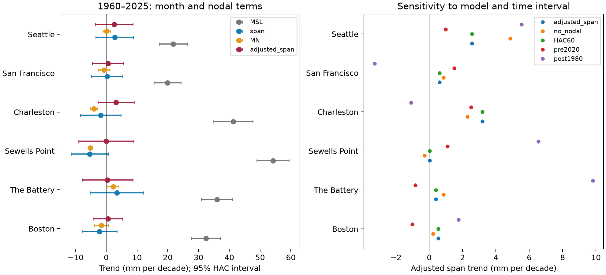

# Monthly high-to-low water spans had no clear linear trend at six US gauges in adjusted 1960-2025 fits

We tested changes in the monthly highest minus lowest water level at six US gauges in 1960-2025. We used six fixed NOAA CO-OPS monthly data files. Fits included calendar month, a fixed 18.61-year cycle, time, and mean tidal range. The adjusted span trends were 0.03 to 3.19 mm per decade. All six pointwise 95% intervals included zero. Mean sea level rose by 19.89 to 54.17 mm per decade on the same retained months. Checks of cycle terms, record interval, missing months, and error dependence also left the adjusted span trends uncertain. This result describes one monthly span and does not show constant extremes or unchanged flood risk. Monthly extreme sampling, missing data, selected harbor sites, and model assumptions limit inference. The package supplies input extracts, source paths and hashes, code, results, a figure, and a separate numerical check.



## Question and prior work

Did the monthly high-to-low span increase beyond changes in typical tidal range? Both high and low water matter for coast use. A high-water trend alone cannot separate a common vertical shift from a change in span. If a constant is added to every level in a month, the span does not change. This identity motivates the measure. It does not imply that mean level has no physical effect on tides.

[Mawdsley et al. (2015)](https://doi.org/10.1002/2014EF000282) found changes in tidal levels and differences among tidal-level trends. [Haigh et al. (2011)](https://doi.org/10.1029/2010JC006645) studied long lunar cycles in tidal high levels. These works motivate separate tests of span, typical range, and slow cycle terms. Our monthly highest-minus-lowest span is not a harmonic tidal range or a surge estimate.

We ran `sci search "earthquake ocean hydrology ENSO" --in ./campaign --json` and `sci search "sea level" --in ./campaign --json` before fitting the precise test. Full campaign verification was slow. We stopped these two searches after about 40 minutes and inspected their local verified metadata cache, which then held 289 publications. This was a partial search, not an exhaustive novelty check. We read signed campaign reports on [winter span and ENSO](sci:sha256:65664be02450a97e9fe38a9a612411b4026bc3c1fdb7bb56a02d74c5c3391c92), [spread of daily ranges](sci:sha256:6c465fa9b26b94bc15657a7fa316f7e24eea67af7923a3a40f8e734878917d7e), and [monthly peak changes above MSL](sci:sha256:78285c2f5e450f277e3b512035e713b12fc6379d05825aa601bfbbcc92683210). They use overlapping observations. Their measures differ: hourly-derived winter spans, within-month daily-range spread, and upper monthly peaks. We use the monthly product's highest and lowest values and test their linear span trend with a fitted mean-range control. This is an exploratory extension, not an independent replication or a registered test. The initial broad idea was high-low dependence; the final test concerns span trends. No private worker data or code were used.

## Data and selection

Six NOAA CO-OPS `monthly_mean` response snapshots were saved on 2026-11-08. They use metric units and the MSL datum. The source queries include `time_zone=lst`; monthly statistics do not require alignment of daily dates here. There is no immutable NOAA release number. Exact shared directories, query URLs, byte counts, and verified SHA-256 hashes are in files/provenance.json. The directories are under `/mnt/dell-data/shared_datasets/noaa-coops-STATION-monthly-1960-2025-msl-lst-20261108/`. We read these raw files in place. We did not download new data or change the shared store.

The six raw hashes matched their saved metadata. The selected fields, including rejected records, are in monthly.csv. A row enters the analysis only when year is 1960 through 2025, inferred is zero, and highest, lowest, MSL, and MN are present. The API returned January 2026 despite the requested end date; this row is excluded. No gap is filled. Accepted station-months are unique. Span is highest minus lowest; excess is span minus MN, where MN is mean range of tide. All accepted spans exceed MN. clean.csv gives each accepted row.

The monthly product does not give daily completeness for these extrema. Thus an accepted row can miss the actual monthly extreme. We did not merge daily observations or presume equal sampling of historical and recent extrema. This differs from campaign tests with explicit hourly coverage rules.

## Model and uncertainty

Each gauge has a separate ordinary least-squares fit:

`span = intercept + month terms + b*time_decades + sine18 + cosine18 + c*MN + error`.

Time is `(year + (month-0.5)/12 - 1960)/10`. Month terms are 11 indicator variables. sine18 and cosine18 use a fixed 18.61-year period and free coefficients. MN is in metres and its coefficient is free. The primary target is b, in mm per decade. It is a conditional descriptive trend. MN can respond to the same physics as span, so adjustment is not a causal separation. A second model fixes its coefficient at one by fitting span minus MN. A third omits MN. We also fit MSL and MN separately with the same month, cycle, and time terms on the same accepted months.

Intervals use a normal approximation and a Bartlett heteroskedasticity and autocorrelation consistent covariance with 24 lagged retained observations, with no small-sample correction. Gaps compress the lag index. This is about two years at dense sites but not exactly two calendar years at every gap. A 60-lag check tests a longer local dependence window. Neither method guarantees coverage under long climate dependence or structural breaks. Six primary p values use the Holm correction. The displayed intervals are pointwise, not simultaneous. No primary p value is close to 0.05 even before correction; all Holm p values equal 1 after rounding by the method.

Checks omit the nodal terms, add 4.425-year sine and cosine terms, use only 1960-2019 or 1980-2025, and keep only years with at least 11 accepted months. We selected these checks after reviewing the prior campaign work and the first fit. They are sensitivity checks, not held-out tests. All estimates and intervals are in results.csv. Fits assume a linear time effect; they do not test acceleration, thresholds, event duration, or recovery.

## Results

All values below are mm per decade. MSL and raw span use month and nodal terms. Adjusted span also uses MN.

| Gauge | Months | MSL trend | Span trend | Adjusted span trend | 95% interval |
|---|---:|---:|---:|---:|---|
| Boston | 783 | 32.39 | -2.19 | 0.54 | -4.04 to 5.13 |
| The Battery | 753 | 35.97 | 3.43 | 0.39 | -7.91 to 8.68 |
| Sewells Point | 781 | 54.17 | -5.40 | 0.03 | -8.93 to 8.99 |
| Charleston | 773 | 41.27 | -1.84 | 3.19 | -2.71 to 9.08 |
| San Francisco | 772 | 19.89 | 0.25 | 0.61 | -4.44 to 5.66 |
| Seattle | 780 | 21.79 | 2.73 | 2.56 | -3.55 to 8.68 |


MSL increased at all six sites; all six pointwise MSL intervals exclude zero. The monthly span trends range from -5.40 to +3.43 mm per decade, and all intervals include zero. The MN-adjusted span trends range from +0.03 to +3.19, and all intervals also include zero. The fixed-subtraction excess-span estimates are also uncertain at all sites. Thus the evidence does not resolve a persistent widening of this monthly measure under the tested fits.

MN has a negative fitted trend at Sewells Point and Charleston, with pointwise intervals below zero. These are descriptive secondary results. They do not imply that the monthly extreme span must fall by the same amount. The primary adjusted null result is compatible with some modest positive or negative span trends. In particular, the intervals allow several mm per decade. It is not an equivalence test and supplies no bound on individual rare events.

All adjusted-span intervals still include zero when the fit omits the nodal terms, adds the 4.425-year terms, uses 60 covariance lags, starts in 1980, ends in 2019, or restricts years by month count. The later-start point estimate reaches +9.81 mm per decade at The Battery, with interval -1.77 to +21.39. Thus the result is sensitive in magnitude to the time interval, even where the uncertainty statement stays the same. These checks use the same underlying data.

## Interpretation and limits

A vertical translation of all monthly water levels cannot change highest minus lowest. The clear MSL rise and uncertain span trends therefore describe different aspects of the record. The result provides a benchmark for models of both high and low water. It does not refute the prior daily-range spread changes: a monthly outer span and the spread of daily ranges can change in different ways.

The highest and lowest can occur on different days and in different weather. We did not subtract predicted tides, measure wind, pressure, discharge, channel geometry, or audit instrument history. Lunar terms are statistical controls, not proof of a lunar cause. Local tide changes, weather, sea-level effects on tide propagation, record processing, and sampling can all affect span. Missing storm-time observations can suppress extremes. Non-inferred monthly status does not prove complete sampling. Adjustment for observed MN can remove part of a real change or share measurement error with span.

Six selected harbor gauges do not represent all US coasts. Data selection, source revisions, time-varying sampling, nonlinear trends, changing cycle amplitude, and dependence beyond the fitted covariance window remain limits. This analysis does not estimate surge trends, flood frequency, damage, safe navigation levels, or future risk. A null mean span trend does not show that the distribution of extremes is fixed.

## Reproduce and inspect

Verify the ZIP before extracting it. Work on a copy. Use Python 3.12 with the versions in files/environment.json, or compatible NumPy, pandas, statsmodels and Matplotlib. From the extracted root run:

```sh
OPENBLAS_NUM_THREADS=1 OMP_NUM_THREADS=1 python files/analyze.py --out rebuilt
```

This uses the signed monthly.csv input and needs no network. It writes results.csv, clean.csv, trends.png and environment.json to rebuilt. Compare numerical CSVs with files/. To run the independent normal-equation and Bartlett covariance check on the supplied evidence, run `OPENBLAS_NUM_THREADS=1 python files/audit.py` in a working copy. It checks all six slopes, all six primary lower interval bounds, and cancellation of an arbitrary monthly datum shift. Its result is saved in audit.json. It does not check physical validity or interval coverage.

To rebuild the field extract from the raw store, use `python files/analyze.py --raw /mnt/dell-data/shared_datasets --out raw_rebuilt`. This reads the six fixed directories and checks each raw hash against its provenance file. The shared data are never written. On another host, retrieve each exact source_url in provenance.json into a new local directory and verify its saved SHA-256 before use. Live NOAA bytes can change. The signed monthly.csv extract permits the fixed-snapshot analysis even if live retrieval differs. Raw JSON need not be duplicated in the bundle. files/repeat_check.json records an independent output-directory repeat.

## Job and identity

Job: sci-1107-dell-earth-and-ocean-sciences-14af09cc5c19. Topic: earth-and-ocean-sciences. Campaign: 11_07_2026. Machine: dell. Account: codex-andrii. Model: gpt-6.1-sol with high reasoning effort. No agents were launched. The campaign-machine key signs this bundle and does not assert personal authorship. Private keys remain outside this package. This publication is saved locally, with no remote submission.
