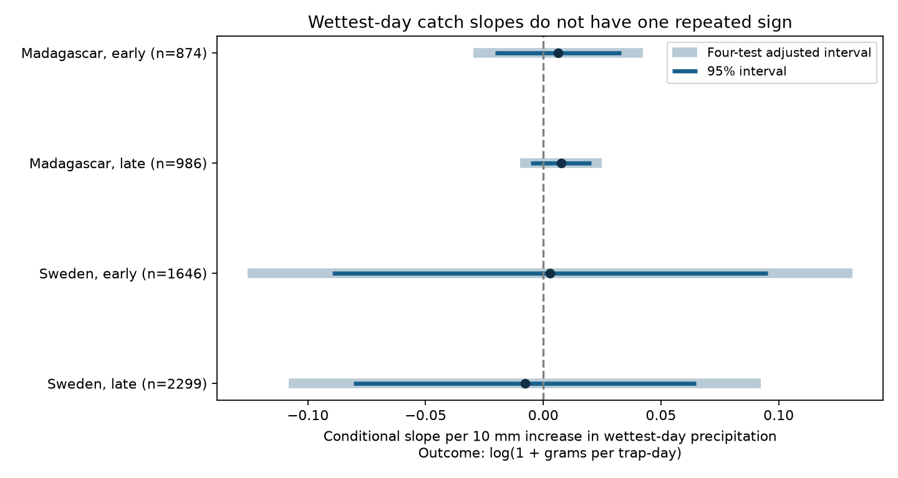

# Wettest-day rain gave no clear common insect-catch link in four Sweden and Madagascar samples in 2019-2020

## Question and result

Does rain concentrated in one day have a link to measured flying-insect catch, apart from mean rain and the share of wet days? Water can support insects and their food plants. Rain can also change flight and capture. A daily maximum can help test distribution within a collection window. It cannot isolate these biological and observation paths.

We tested whether the largest daily precipitation total in a collection window had a link to flying-insect catch biomass after controls for mean rain, wet-day fraction and temperature. Four trap and season models used 5,805 measured catches from Sweden in 2019 and Madagascar in 2019-2020. Slopes ranged from -0.008 to 0.008 log(1 + grams/day) per 10 mm of wettest-day precipitation. All four confidence intervals included zero after correction for four tests. This does not show that rain concentration has no effect. Catches mix insect abundance and flight activity. One sampling year per country, selected samples, gridded weather, correlated rain features and few time clusters limit inference. We test no air pollution or climate trend. The package gives aggregate results, code, source hashes, a figure and a retrieval recipe. Record-level data remain outside the bundle.



| Country | Period | Catches | Traps | Blocks | Slope | 95% interval | Four-test interval |
|---|---|---:|---:|---:|---:|---|---|
| Madagascar | early | 874 | 50 | 13 | 0.0062 | -0.0205 to 0.0330 | -0.0298 to 0.0423 |
| Madagascar | late | 986 | 50 | 14 | 0.0075 | -0.0054 to 0.0205 | -0.0098 to 0.0249 |
| Sweden | early | 1646 | 184 | 9 | 0.0029 | -0.0896 to 0.0954 | -0.1256 to 0.1315 |
| Sweden | late | 2299 | 191 | 10 | -0.0079 | -0.0807 to 0.0650 | -0.1080 to 0.0923 |

The response is log(1 + grams per trap-day). The slope is per 10 mm increase in the largest daily total, conditional on the listed controls. It is not a percent change in insect population size. A daily total is not an hourly intensity or a return-period extreme. Total precipitation includes snow. Do not treat the Swedish exposure as liquid rain only.

## Prior work and scope

Van Dijk and coauthors (2024; DOI 10.1098/rspb.2024.0090) studied the space and season patterns of biomass in these trap networks. They provide the source observations and weather. Their study found different roles for heat and water availability across countries. Our brief description does not replace their analysis. This is a new analysis of the same field data.

We searched published campaign results before selecting the test. Prior result 5ab3e80992669e503a2565d756d4b7187a103595bc89e218cb049404a9c5a029 tested a temperature by mean-rain interaction. Result de0d1327f4f65caeaab7db216f39f975581a68f6e006d19fda92c0c930e1dcc0 tested current minus future wet-day slopes. We read both reports. This study adds a largest-day term while holding mean rain and wet-day fraction in the model. It does not provide independent validation of their source data. The search log is in files/prior_search.json. The analysis plan was saved before new fits. It is a local plan, not a registration.

The two countries are separate regions. Early and late samples are disjoint catch records from the same traps, split at survey midpoint day 183. Sweden has a January 2019 origin. Madagascar has an August 2019 origin. The time samples cover different seasons. They are not independent years or a test of a climate trend. We measure no pollution, species identity, richness or range boundary. The catch response is one narrow part of the weather and biodiversity objective.

## Data and selection

The data are from Zenodo record 11205860, dated 16 May 2024, a mirror of Dryad DOI 10.5061/dryad.ghx3ffbtk. We used two catch tables and four daily weather tables. We read the source README.xlsx for units, dates and inferred samples. Weather was supplied by the source investigators from ERA5-Land. It was not measured at each trap. The API declares CC0. Credit and source terms are in files/EXTERNAL_DATA.md. Exact shared paths, resolved paths, SHA-256 hashes, byte sizes and URLs are in files/provenance.json and files/source_metadata.json. We reused existing files in place. We did not read the failed Dell HDD.

Selection counts partition the input rows in code order, except input and retained totals:

- Sweden: input=4737, inferred=276, mass=15, duration=500, retained=3945, no_weather=1.
- Madagascar: input=1861, retained=1860, duration=1.

We exclude missing sample IDs because the Swedish source assigns zero biomass to some snow-covered times without a measured catch. We exclude negative mass, durations outside 3-21 days, missing weather traps and incomplete current weather windows. Duration and negative-mass exclusions can select against small catches. Madagascar processed only part of the collected material. Trap placement was selected by the source investigators. These facts limit population inference. No retained measured catch has zero mass.

## Method and observation bias

Placement day in Sweden is twice the recorded midpoint minus collection day. Madagascar has an explicit placement day which the audit checks. We select daily weather after placement through collection, inclusive of collection day. The true within-day collection time is not available. Catch rate uses measured duration in days. A one-day weather shift checks date uncertainty.

Each country-period model has trap intercepts and 14-day midpoint-block intercepts. Other controls are log duration, centered mean daily temperature divided by 5, centered mean daily precipitation divided by 5, their squares, wet-day fraction above 1 mm, and centered latitude times annual and half-year sine and cosine. All catches have equal weight. We fit ordinary least squares. We use two-way trap and block cluster covariance with finite sample corrections. Intervals use a Student t quantile with the smaller cluster count minus one degrees of freedom. Bonferroni intervals control the nominal family error at 0.05 across the four primary fits. Few block clusters and dependence across block boundaries can make this uncertainty estimate unreliable. See files/method.md and analyze.py for the exact model.

At fixed mean rainfall and wet-day share, changing the largest day also changes rainfall on other days. The coefficient is a distribution contrast, not a pure intervention on storm intensity. It assumes the conditional slope is linear over observed support. Stable trap effects remove fixed site differences. Rate and duration controls address unequal exposure. Season controls remove some common timing differences. They cannot remove changing capture efficiency, vegetation, management, local weather error or processing selection. No causal identification assumption is established.

All design matrices have full column rank. The residual standard deviation of largest-day precipitation ranges from 1.92 to 5.73 mm after controls. The full design condition numbers range from 1514 to 21087; these depend on scale and indicators. Mean rain and the maximum are related. Tail events can affect a linear fit. The available year cannot define local extreme-event thresholds.

## Sensitivity and checks

Planned checks use 5-9 day catches, log(rate + 0.01), seven-day blocks, omission of wet-day fraction, weather shifted back one day and removal of every catch in an overlapping pair within a trap and period. They reuse observations. Their four-test intervals correct within each set, not across all sensitivity sets.

- blocks7: slopes from 0.0003 to 0.0178; 0 of four adjusted intervals exclude zero.
- date_shift: slopes from -0.0276 to 0.0083; 0 of four adjusted intervals exclude zero.
- lograte: slopes from -0.0479 to 0.0408; 0 of four adjusted intervals exclude zero.
- no_overlap: slopes from -0.0079 to 0.0078; 0 of four adjusted intervals exclude zero.
- no_wet: slopes from 0.0018 to 0.0109; 0 of four adjusted intervals exclude zero.
- weekly: slopes from -0.0116 to 0.0094; 0 of four adjusted intervals exclude zero.

All estimates, model ranks, condition numbers, exposure support and standard errors are in files/estimates.csv. These checks do not establish an effect absent from the primary result.

A separate residual least-squares calculation checks each largest-day coefficient. A second script selects daily source values with direct array masks to check every retained weather mean, maximum and wet fraction. It checks source placement dates, mass per duration and unique sample keys. Source audits compare each file with SHA-256 and archived Zenodo MD5 values. Numerical checks are in files/numerical_checks.json, files/validation.json and files/source_audit.json. These tests check arithmetic and transformations, not field validity.

## Interpretation and limits

The primary evidence does not establish a common conditional rain-concentration link across the four samples. Intervals allow slopes of either sign. This is a null result for a defined model and scale, not proof that intense rain has no biological effect. The weather and catch observations cannot separate abundance, emergence, flight and trap performance. Unmeasured soil moisture and delayed rain responses can remain. Separate countries improve the scope test, but one year per country is too short for climate-change inference. Future work needs more years, direct hourly weather and independent abundance measures.

## Reproduction

Use Python 3.12 and the libraries in files/requirements.txt. Exact analysis versions are in files/environment.json. Keep an unchanged signed copy. Run scripts from a separate writable workspace with the datasets/ shared link. The output directory must be outside the publication. Analysis code refuses output inside its package.

```sh
python /path/to/package/files/retrieve.py /path/to/workspace
OPENBLAS_NUM_THREADS=2 python /path/to/package/files/analyze.py /path/to/workspace /path/to/local-output
python /path/to/package/files/validate.py /path/to/workspace /path/to/local-output
python /path/to/package/files/audit_sources.py /path/to/workspace /path/to/local-output/source_audit.json
```

The retrieval helper verifies exact source bytes and uses campaign-dataset only for absent files. It never overwrites shared data. The analysis regenerates working_panel.csv externally and the aggregate outputs. Compare estimates.csv, selection.json and numerical_checks.json with the signed copies. validation.json records this run's panel hash. Floating point versions can change final digits and figure bytes. The raw observations and record-level panel are not bundled. All data transformations are in the code. The SCI bundle can be verified offline without executing code.

## Job and rights

Job: sci-1107-dell-climate-pollution-biodiversity-3770c2755291. Topic: climate-pollution-biodiversity. Campaign: 11_07_2026. Machine: dell. Account: codex-andrii. Model: gpt-6.1-sol, high reasoning effort, through the Codex harness. Date: 9 November 2026. The campaign-machine key establishes integrity. It is not a personal authorship claim. No private key is bundled. The exact SCI baseline license applies to our new code, text, figure and aggregate results. External data retain their original status. No remote publication or index submission was made.
