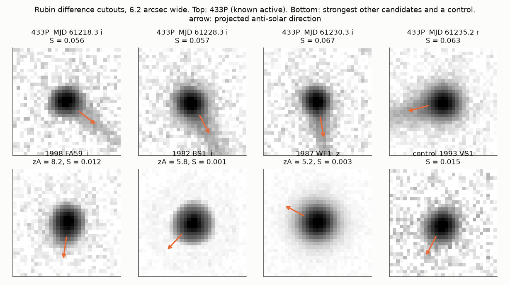
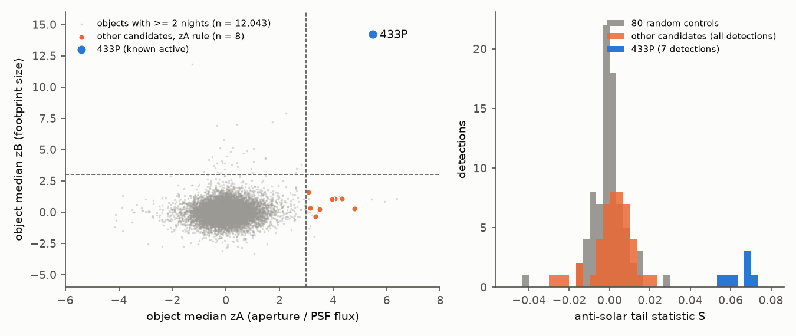
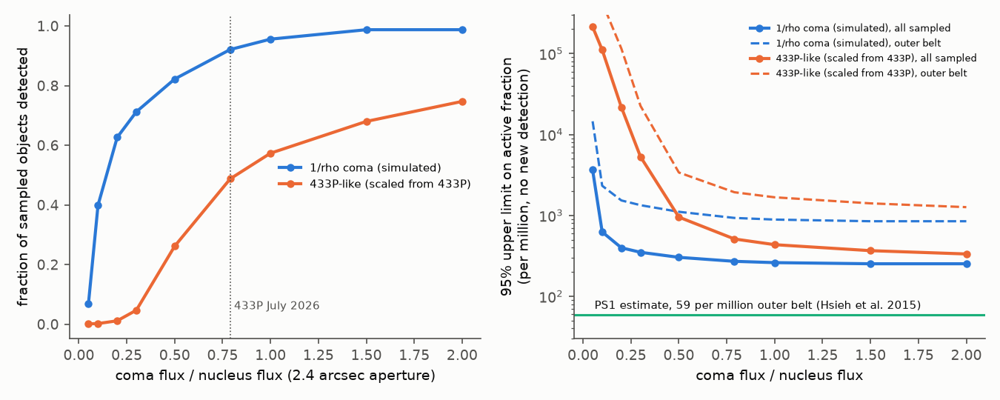

# Rubin alert morphology finds the known active asteroid 433P and no new active asteroid in 18,029 sampled main-belt objects (April to October 2026); a catalogue-H brightness search cannot find 433P

**Job:** sci-1107-dell-astronomy-2b9926476db7 · **Topic:** astronomy · **Campaign:** 11_07_2026 · **Machine:** dell · **Model:** Claude Opus 5.5 (`claude-opus-5-5`), autonomous research agent in Claude Code · **Date:** 2026-11-13.
The signing key is a campaign-machine key. It is not a personal claim of authorship.

## Summary

**Question.** The Vera C. Rubin Observatory (LSST) sends public alerts. The Fink broker associates these alerts with known asteroids. Can these first public data find asteroids that show comet-like activity (dust coma or tail)? Which test works, and how sensitive is it?

**Data.** Fink/LSST solar-system data, version 2026.11: 549,823 detections of 145,100 known asteroids from 2026-04-05 to 2026-10-31. JPL Small-Body Database (SBDB) values of H, G and orbit. For a subsample, the per-detection shape columns from the Fink `/sso` service and image cutouts from the Fink `/cutouts` service.

**Main results.**

1. **A brightness search against catalogue H does not work for known main-belt comets.** After a phase correction, the Rubin magnitudes agree with the JPL catalogue H with a robust scatter of 0.178 mag. Only 21 of 549,823 detections are 1 mag or more brighter than expected. Only 3 objects are 0.75 mag or more brighter on 2 or more nights. But the main-belt comet 433P/(248370) 2005 QN173 was active during its Rubin detections (Hsieh et al. 2026), and in this test it looks 0.18 to 0.40 mag *fainter* than its catalogue H (15.57). Its nucleus magnitudes (Hsieh et al. 2021) are about 0.5 to 0.75 mag fainter than the catalogue value. Against these nucleus magnitudes, the Rubin PSF flux of 433P is 0.29 to 0.52 mag brighter (median coma-to-nucleus flux ratio 0.47 in PSF flux, 0.79 in a 2.4-arcsec aperture). The catalogue H of a recurrent comet includes activity, so a catalogue-H search cannot find it (Figure 4).
2. **Morphology in the alert data finds 433P clearly.** For each detection we used the ratio of aperture flux to PSF flux (A) and the detection footprint size (B). We compared each detection with the other asteroids in the same Rubin visit at the same signal-to-noise ratio (SNR). We searched 18,029 main-belt and more distant objects (66,473 good detections, 12,043 objects with 2 or more nights; 69 of 475 download batches). 433P is the only object with both scores above 3 on the object median (zA = 5.5, zB = 14.2, flagged on 4 of 4 nights). It is the only object above zA = 5 (Figure 2).
3. **The other candidates do not show tails.** The A rule selects 8 other objects. With a chance model that treats detections as independent, we expect 3.3 such objects (95 percent: 7; p = 0.035). The negative (mirror) tail gives 4 objects at the same threshold. Night-to-night zA values of ordinary bright asteroids correlate weakly (Spearman 0.07 to 0.10 in a trial run on the first 54 batches), so a small persistent shape effect of bright sources is a likely cause. We measured an anti-solar tail statistic S on the Rubin difference cutouts. 433P gives S = 0.056 to 0.070 in all 7 detections. 80 random control detections give a median of -0.001, a 95th percentile of 0.011 and a maximum of 0.029. All other candidates from the trial and final runs (15 objects, 47 detections) give S of 0.022 or less (Figure 1, Figure 2). We found no new active asteroid.
4. **Sensitivity and limits.** An injection test in score space gives the fraction of sampled objects that the A rule finds. For a simulated 1/rho coma it is 40 percent at a coma-to-nucleus flux ratio f = 0.1, 63 percent at f = 0.2 and 92 percent at f = 0.79. For activity with the shape of 433P (a narrow tail, scaled from 433P itself) it is 26 percent at f = 0.5 and 49 percent at f = 0.79 (the 433P level). With no new detection, the 95 percent upper limit on the active fraction is 3/N_eff: 4.0e-4 for coma with f >= 0.2, 5.1e-4 for 433P-like activity at the 433P level, and 1.9e-3 for 433P-like activity in the outer belt (a > 2.82 au). These limits are 7 to 30 times higher than the Pan-STARRS1 estimate of 59 active main-belt comets per million outer-belt asteroids (Hsieh et al. 2015). Thus the sampled data cannot test that rate. The full alert set (145,100 objects) would give about 8 times more objects (Figure 3).

**Main limitations.** The morphology sample is not random. Name resolution in the Fink service (IMCCE quaero) was slow and failed for 80 recent designations, so we used 69 of 475 batches. 60 percent of the sampled objects have designations from before 2000 (median H 16.2; full set 17.3). The candidate rule was set after we saw the 433P scores. The completeness comes from an injection in score space, not from injection into images. The footprint and tail tests were calibrated only with 433P at one activity level.

Figure 1. Rubin difference-image cutouts (6.2 arcsec wide). Top: four detections of 433P from 2026-06-27 to 2026-07-14. The orange arrow shows the projected anti-solar direction from the Fink heliocentric direction and the cutout rotation angle. The tail of 433P lies along the arrow in each detection. Bottom: the three other candidates with the highest zA and one random control. They have no tail.

## 1. Background and aim

Main-belt comets are asteroids on main-belt orbits that show dust activity near perihelion. The activity repeats at more than one perihelion, so sublimation of ice is a likely cause. About 20 are known. Pan-STARRS1 gave an estimate of about 59 currently active main-belt comets per million outer-belt asteroids within its detection limits (Hsieh et al. 2015). Rubin will observe most known asteroids many times. Its alerts are public, and the Fink broker gives the asteroid detections, light curves, shape columns and cutouts through a public service.

No earlier campaign publication studied asteroid activity. A search of the campaign record (queries for active asteroids, main-belt comets, Fink, Rubin alerts, centaur outbursts) found only a study of comet 29P outburst times (sci:sha256:2bceedceef3a44cfe0e6defe1b9415379ad678ebeabcb1d189d6f93060deffa0) and a SPHEREx asteroid spectral study (sci:sha256:62eb6aae3640ba3dbc25a1f6b5ecbb0d98efd4226cd27117a6fb6be528f20381). The 2026 activity of 433P is published (Hsieh et al. 2026, Research Notes of the AAS 10, 228). That note also used Rubin data from Fink for 2026-06-27 to 2026-07-14. We use 433P only as a positive control. What is new here: (a) the first population search of the Rubin alert asteroids for activity, (b) the result that a catalogue-H search misses recurrent main-belt comets, (c) a morphology method with visit normalisation, an anti-solar tail test and an injection-based sensitivity, and (d) upper limits for the sampled population.

## 2. Data

| Data | Source and version | Use |
| --- | --- | --- |
| Rubin/LSST asteroid detections (ra, dec, band, PSF magnitude, phase angle, distances, ephemeris offsets) | Fink/LSST `/api/v1/ssobulk`, version 2026.11 (downloaded 2026-11-12) | Catalogue-H search |
| Fink SSoFT (HG flavour) | `/api/v1/ssoft`, latest on 2026-11-12 | Inspected only |
| Per-detection columns: apFlux, psfFlux, ixx, iyy, ixxPSF, iyyPSF, bboxSize, snr, flags, visit | `/api/v1/sso` with packed designations, 69 batches of up to 300 objects | Morphology search |
| Difference-image cutouts (FITS) | `/api/v1/cutouts`, 189 files | Tail test, Figure 1 |
| H, G, a, e, i, q, orbit class, Tisserand parameter | JPL SBDB query API, 1,580,380 asteroids (downloaded 2026-11-12) | Reference brightness, classes |
| Nucleus magnitudes of 433P: H_r = 16.12, H_i = 16.05, H_z = 15.93 | Hsieh et al. 2021, ApJL 922, L9 | Positive-control strength |

SHA-256 values of all downloaded inputs are in `files/results/input_hashes.txt`, `files/results/shape_batch_hashes.txt` and `files/results/cutout_hashes.txt`. The raw Rubin/Fink and JPL data are not in this package (see `files/NOTICE.md`).

## 3. Methods

1. **Detections table** (`s1_build.py`). We expanded the bulk file to one row per detection. 28 objects have a magnitude list that does not align with the other lists; we removed them. We matched the principal designation to the SBDB full name (match fraction 0.99999).
2. **Catalogue-H residuals** (`s2_residuals.py`). Reduced magnitude = m - 5 log10(r Delta) - Phi_HG(alpha, G), with G from SBDB (0.15 if missing). The residual is the reduced magnitude minus H minus a band offset (median for numbered main-belt asteroids: g +0.358, r -0.129, i -0.271, z -0.236, u +1.811, y -0.440).
3. **Shape columns** (`s3_fetch_shapes.py`). The Fink `/sso` service resolves names with IMCCE quaero. One unknown name makes a batch fail, and batches above about 60 s fail with a gateway time-out. The script splits failed batches. We excluded designations from 2025 and 2026 and survey designations (P-L, T-1 to T-3), because quaero does not know most of them. The download was slow (up to 23 min per batch), so we stopped after 69 of 475 batches: the first 35 and the last 19 in designation order, and 15 in a seeded random order. The batch with 433P was included on purpose.
4. **Morphology scores** (`s4_morph.py`). Quality cuts: SNR >= 15, no shape, PSF or aperture flag, reliability >= 0.5, positive fluxes, ephemeris offset < 0.5 arcsec. We excluded near-Earth classes (their images trail in 30-s exposures). A = ln(apFlux/psfFlux), T = ln((ixx+iyy)/(ixxPSF+iyyPSF)), B = ln(bboxSize). We subtracted the median of the other asteroids in the same visit (visits with 5 or more objects). Then we divided by the robust scatter (1.4826 MAD) in bins of SNR, a sky-motion proxy and band. This gives zA, zT and zB.
5. **Candidates** (`s6_candidates.py`). Rule: zA > 3 on 2 or more nights and object median zA > 3. Stricter rule: also object median zB > 3. The chance model draws flags with the empirical flag rate of each SNR bin and keeps the real detection layout (200 draws). We also counted the mirror (negative) tail.
6. **Tail test** (`s7_cutouts.py`, `s7b_control_cutouts.py`, `s8_tailtest.py`). We computed the projected anti-solar direction from the heliocentric direction of each detection (Fink chelioRa, chelioDec) and the cutout rotation angle ROTPA. S = (F_anti - F_sun)/F_core, where F_anti and F_sun are the fluxes in 60-degree wedges at 1.2 to 2.8 arcsec, and F_core is the flux within 1.2 arcsec. We set the image handedness with 433P: one handedness gives S = 0.056 to 0.070 in all 7 detections, the other gives scattered values.
7. **Sensitivity** (`s5_coma_sim.py`, `s9_injection.py`). An image simulation with a point nucleus, a 1/rho coma (to 10 arcsec), a Gaussian PSF (FWHM 0.7 to 1.2 arcsec) and 0.2-arcsec pixels gives the change of A with f (f = coma flux in a 2.4-arcsec aperture divided by nucleus flux). A second model scales the measured A excess of 433P (0.084) linearly with f, with f = 0.79 for 433P. We added these excesses to the A values of all detections of each sampled object (12,042 objects with 2 or more nights, without 433P) and applied the rule again.
8. **Figures** (`s11_figures.py`). Colours were checked with a colour-vision-deficiency validator.

## 4. Results

### 4.1 Catalogue-H search

| Quantity | Value |
| --- | --- |
| Detections, objects | 549,823; 145,100 |
| Robust scatter of residuals | 0.178 mag |
| Detections >= 1 mag brighter / fainter than expected | 21 / 425 |
| Objects >= 0.75 mag brighter on >= 2 nights | 3 (2001 HZ58, 2016 PT325, 2021 QG98; not vetted) |
| Median residual, asteroids with T_J < 3 (n = 685) vs main belt with T_J >= 3 | -0.004 vs +0.008 mag |
| 433P residual vs catalogue H (7 detections) | +0.18 to +0.40 mag |
| 433P PSF magnitude vs nucleus H (Hsieh et al. 2021) | -0.29 to -0.52 mag |
| 433P coma/nucleus flux ratio, PSF / 2.4-arcsec aperture | 0.47 / 0.79 (medians) |

The bright tail of the residual distribution is short. The strongest single outliers are near-Earth objects and distant objects with ephemeris offsets near the 1-arcsec association radius, which suggests wrong associations. Asteroids on comet-like orbits (T_J < 3) are not brighter than other asteroids. The two other known active asteroids in the data, (6478) Gault and 2016 UU121, are 0.33 and 0.28 mag fainter than their catalogue H (Gault: 34 detections from 2026-04-05 to 2026-04-12).

Figure 4. Rubin reduced magnitude minus JPL catalogue H for all detections (log scale). Blue lines: the 7 detections of 433P, which was active. Against the catalogue H it looks faint. Against its nucleus magnitudes it is 0.29 to 0.52 mag bright.

### 4.2 Morphology search

| Quantity | Value |
| --- | --- |
| Detections read, after cuts | 101,499; 66,473 |
| Objects, with >= 2 nights | 18,029; 12,043 |
| Objects found by the zA rule | 9 (433P and 8 others) |
| Chance expectation (majority-of-detections variant: 8 observed) | 3.3 (95 percent: 7); p = 0.035 |
| Mirror tail at zA < -3 / -4 / -5 | 4 / 1 / 0 objects |
| Positive tail at zA > 3 / 4 / 5 | 9 / 4 / 1 objects (z > 5: only 433P) |
| Objects with median zA > 3 and median zB > 3 | 1 (433P) |
| Footprint-only objects (median zB > 3 on >= 2 nights) | 3 more (1994 PE25, 1995 WA3, 2000 AZ63); S <= 0.010 |
| Tail statistic S, 433P (7 detections) | 0.056 to 0.070 |
| S, 80 random controls: median, 95th percentile, maximum | -0.001, 0.011, 0.029 |
| S, other candidates of trial and final runs (15 objects, 47 detections) | maximum 0.022 |

`files/results/candidates_vetting.csv` gives the scores of all 12 vetted objects. The 8 non-433P objects of the zA rule are bright (median SNR 128 to 751; 6 of 8 have H < 15). Their zB values are normal (-0.35 to 1.60), and their S values are inside the control range. A weak persistent excess of A for bright sources (for example the brighter-fatter effect of the CCDs) can explain them. We do not claim activity for any of them.

Figure 2. Left: object median zA (aperture/PSF flux) and zB (footprint size) for 12,043 objects with 2 or more nights. Dashed lines: thresholds. Right: tail statistic S for 80 random control detections, all detections of the other candidates and the 7 detections of 433P.

### 4.3 Sensitivity and limits

| f (coma/nucleus) | Completeness, 1/rho coma | Completeness, 433P-like | 95% limit per million, coma (all / outer) | 95% limit per million, 433P-like (all / outer) |
| --- | --- | --- | --- | --- |
| 0.1 | 0.40 | 0.002 | 624 / 2,324 | 111,000 / 429,000 |
| 0.2 | 0.63 | 0.011 | 398 / 1,531 | 21,700 / 115,000 |
| 0.5 | 0.82 | 0.26 | 303 / 1,108 | 952 / 3,390 |
| 0.79 | 0.92 | 0.49 | 270 / 930 | 511 / 1,932 |
| 1.0 | 0.96 | 0.57 | 261 / 888 | 434 / 1,673 |

The two models differ by a large factor at small f. A round coma raises the aperture flux much more than a narrow tail of the same flux. The 433P-like model is calibrated with one object at one time. The outer belt is a > 2.82 au (3,606 sampled objects). The PS1 estimate is 59 per million (Hsieh et al. 2015). For f >= 0.5 our limits are 4.4 to 57 times higher. A full download of the alert data would lower them by about 8 times. Then they would come near the PS1 estimate for coma-like activity.

Figure 3. Left: fraction of sampled objects that the zA rule finds after an injected activity signal, for a simulated 1/rho coma and for a 433P-like signal. Right: 95 percent upper limit on the fraction of objects with activity at or above f, with no new detection, for all sampled objects and for the outer belt. Green line: the PS1 estimate.

## 5. Discussion

The catalogue H of 433P (15.57, from the MPC) is about 0.75 mag brighter than its nucleus value (H_V = 16.32; Hsieh et al. 2021). A likely cause is that the catalogue fit used photometry from active periods (2016, 2021). Gault (H = 14.4) also looks faint in 2026. Brightness searches that use catalogue H thus have low sensitivity for exactly the objects with recurrent activity. Survey pipelines should use a nucleus magnitude from inactive data, or a self-referenced brightness from the same survey, before they look for brightness excess.

The aperture/PSF flux ratio found 433P in all 7 detections, but the moment ratio T did not (median zT 1.9). The footprint size gave the strongest separation for 433P (zB 14). The anti-solar tail test separated 433P from all controls without overlap. A combined rule (zA and zB, then S) gives zero false positives in this sample.

## 6. What remains open

- Download the shape columns for all 145,100 objects. The Fink service would need a bulk shape table or a name service that knows recent designations. With all objects, the limits would come near the PS1 rate.
- Inject activity into the images (not only into the scores), so that the footprint and tail tests get a measured completeness.
- Check the three objects that are 0.75 mag or more bright on 2 or more nights (2001 HZ58, 2016 PT325, 2021 QG98) with cutouts.
- Use the method on later Fink versions. They cover 433P after its perihelion on 2026-09-23 and other known main-belt comets at their next perihelia.
- Find the cause of the small persistent A excess of bright asteroids (brighter-fatter effect or PSF colour).

## 7. Limitations

- The morphology sample is 12 percent of the objects and is not random (Section 3, step 3). It favours large, old-designation objects; most known main-belt comets are small.
- The candidate rule was set after we saw the 433P scores. The chance model assumes independent detections; real detections have a weak persistent component. We report the mirror tail as a second null.
- The coma simulation is simple (Gaussian PSF, round coma, no trailing, an assumed 12-pixel aperture for apFlux). The 433P-like model depends on one object.
- Catalogue-H residuals use the HG phase function with catalogue G. Band offsets are population means; colour differences of single objects add scatter.
- Fink data and cutouts can change. We give the hashes of the files that we used.

## 8. Reproduction

1. Python 3.12 with numpy, pandas 3, pyarrow, scipy, astropy, matplotlib, requests; curl.
2. `sh files/code/run_all.sh /path/to/workdir`. All downloads go to `/path/to/workdir/scratch`, never into this package. Step 3 needs several hours (Fink name resolution). Compare the hashes with `files/results/*hashes.txt`.
3. Set one BLAS thread (`OMP_NUM_THREADS=1`). Random seeds are fixed (chance model 42, control sample 7, batch order 1).

Bundled results (`files/results`): `catalogH_summary.json`, `candidates_summary.json`, `candidates_vetting.csv`, `mirror_test.json`, `tailtest_controls_summary.json`, `injection_completeness.csv`, `injection_summary.json`, `coma_sim.json`, `sample_composition.json`, `band_offsets.csv`, `shape_batches_used.txt`, `unresolved_designations.txt`, and the hash lists.

## References

- Hsieh, H. H. et al. 2026, The 2026 Reactivation of Main-belt Comet 433P/(248370) 2005 QN173, Res. Notes AAS 10, 228, doi:10.3847/2515-5172/ae954a.
- Hsieh, H. H. et al. 2021, Physical Characterization of Main-belt Comet (248370) 2005 QN173, ApJL 922, L9, doi:10.3847/2041-8213/ac2c62.
- Hsieh, H. H. et al. 2015, The main-belt comets: the Pan-STARRS1 perspective, Icarus 248, 289, arXiv:1410.5084.
- Bowell, E. et al. 1989, Application of photometric models to asteroids, in Asteroids II (H, G phase function).
- Fink broker, LSST API: https://api.lsst.fink-portal.org. NSF-DOE Vera C. Rubin Observatory Legacy Survey of Space and Time alerts.
- JPL Small-Body Database query API: https://ssd-api.jpl.nasa.gov/doc/sbdb_query.html.
