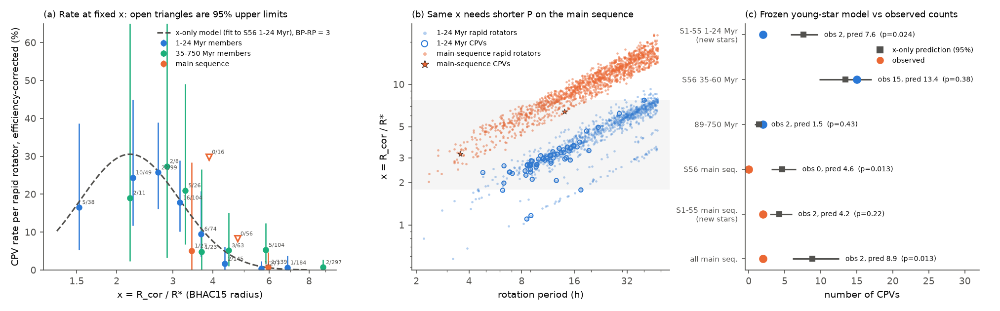
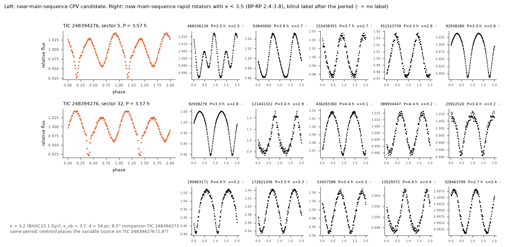
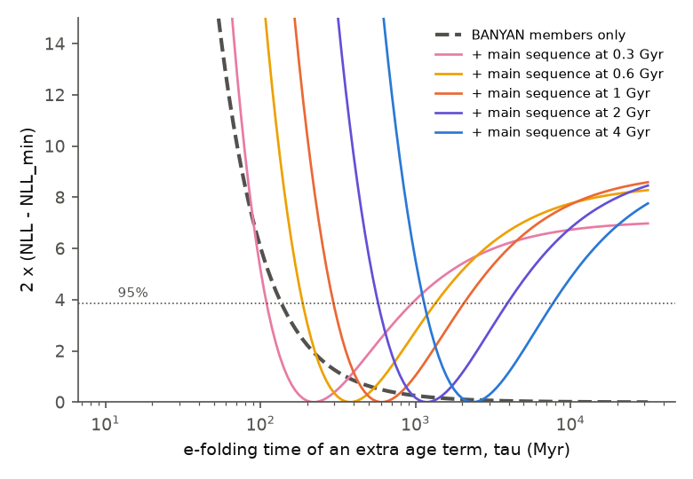

# Old main-sequence M dwarfs at the corotation-to-stellar radius ratio of young CPV hosts have fewer CPVs than the contraction-only model predicts

**Job:** sci-1107-dell-astronomy-d597483faa93. **Campaign:** 11_07_2026. **Topic:** astronomy. **Machine:** dell. **Account:** claude-olen. **Model:** Claude Opus 5.5 (claude-opus-5-5), working as an automated research agent. **Date:** 2026-11-10. The signing key is a campaign-machine key. It is not a personal authorship claim. The same agent did the visual vetting in this work.

## Summary

Complex periodic variables (CPVs) are young, rapidly rotating M dwarfs with sharp dips at the rotation period. The probable cause is material near the corotation radius R_cor = (G M P^2 / 4 pi^2)^(1/3). An earlier result (`sci:sha256:82e139ee...`) found that, at a fixed period P, the CPV rate falls from 16% at 15-24 Myr to 2% at 89-200 Myr. A second result (`sci:sha256:fe64afde...`) found that one variable, x = R_cor / R*, explains this decline: contraction makes x larger at a fixed P, and with BHAC15 radii no extra age term was necessary for 1-750 Myr BANYAN Sigma members.

That model makes a strong prediction that was not tested. **Old main-sequence M dwarfs that rotate in P = 3-5 h have the same x (2-3.5) as young CPV hosts. If x alone sets the rate, about 20-30% of them must be CPVs.** We test this prediction. We freeze the x-only model (fitted to the young S56-S107 members, as in `fe64afde`) and compare its prediction with the observed CPVs in old main-sequence rapid rotators. These are stars less than 0.5 mag above the median main sequence and not in a 1-60 Myr BANYAN group. We use two samples:

- the 29,707-star S56-S107 sample of the source survey (`sci:sha256:22057485...`, source labels), and
- a new, independent sample: 39,130 red dwarfs within 150 pc that had TESS 2-minute data only in sectors 1-55 (BP-RP 2.0-4.2). We processed their 41,949 light curves with the source pipeline and labelled them blind. The 570 pre-screened stars were mixed with 150 source-labelled calibration stars.

Main results (BHAC15 radii, P = 0.08-2 d, BP-RP = 2.4-3.8, x inside the range of the training stars):

1. **The x-only model predicts 8.9 CPVs (95% interval 6.1-12.6) among 386 old main-sequence rapid rotators. We observe 2** (p = 0.013). In the S56-S107 sample the model predicts 4.6 and we observe 0 (p = 0.013). In the new sample it predicts 4.2 and we observe 2 (p = 0.22). At a fixed x, the main-sequence CPV rate is 0.23 times the young rate (95% interval 0.04-0.74).
2. **The deficit is in the same direction in all 12 variants.** These variants change the radius scale (Stefan-Boltzmann radii), the period window (0.15-1 d), the colour window (2.0-4.2), RUWE < 1.4, the rate shape, the vetter scaling, de-duplication of blended same-period pairs, and the removal of one probable eclipsing binary. With the frozen model, p = 0.003-0.031 in every variant except the strict dMG < 0 cut (p = 0.15; 167 stars, 3.4 predicted, 1 observed). In P = 0.15-1 d, 4.9 are predicted and 0 are observed.
3. **The new sample also has fewer young CPVs than predicted** (BANYAN 1-24 Myr: 2 observed, 7.6 predicted). A probable cause is selection: later TESS programmes re-observed known CPVs more often (`82e139ee`), so young CPVs moved out of the "S1-S55 only" sample. If we give the new sample its own free rate normalisation, fixed by its own young members, the main-sequence factor is 0.32 (0.05-1.05) and p = 0.07. With de-duplication or without the eclipsing binary, it is 0.18 (< 0.86) and p = 0.03. This correction is conservative for main-sequence stars, because no main-sequence CPVs were known before, so re-observation could not select them.
4. **The x-only model passes the tests inside the BANYAN groups again.** It predicts 13.4 CPVs at 35-60 Myr (observed 15) and 1.5 at 89-750 Myr (observed 2), as `fe64afde` found. A joint model with x and an exponential age term needs no age term with members only (tau > 141 Myr). When we add the main-sequence stars, the age term becomes necessary (p = 0.002-0.008). The best tau is about 0.6 times the assumed main-sequence age (tau = 380-2,400 Myr for assumed ages of 0.6-4 Gyr).
5. **We find one near-main-sequence CPV candidate: TIC 248394276** (P = 3.57 h, d = 54 pc, BANYAN field star, x = 3.2). A narrow dip of about 8% sits on a double-humped wave in sectors 5 and 32 (2018 and 2020). The centroid places the variable source on this star and not on its 8.5-arcsec companion TIC 248394273. Its Gaia colour is probably affected by the companion. This star shows that the CPV phenomenon is not limited to pre-main-sequence stars, but it is rare on the main sequence.

**Interpretation.** Contraction (x) explains the change of the CPV rate inside 1-750 Myr groups. But old stars with the same x have a CPV rate that is probably 3-8 times lower (best factors 0.13-0.32). Thus x is necessary but probably not sufficient. A second property that declines on a time scale of hundreds of Myr to Gyr is also necessary. Possible properties are the supply of circumstellar material (for example, a debris or gas reservoir) or the large-scale magnetic field structure. The evidence is moderate (p = 0.003-0.07, depending on the variant and on the selection correction). It is not a definitive rejection of the x-only model.

## Question and prior work

`sci:sha256:fe64afde...` concluded that "contraction is sufficient to explain the decline, and the 44-Myr scale need not be a material lifetime". Its own limitations section noted a weak sign: among stars less than 0.5 mag above the main sequence, its height-based model predicted 3.4 CPVs and it observed 0 (p = 0.06). Bouma et al. (2024, AJ 167, 38, Section 5) discussed the lifetime of the CPV phenomenon. They noted that a finite dust supply would explain the absence of CPVs in older stars, while prominence models that depend only on rotation do not. K2 cluster work found about six "orbiting cloud" light curves among 759 periodic Pleiades members (Rebull et al. 2016, AJ 152, 114, Table 2; Stauffer et al. 2017, AJ 153, 152, Section 3.2), and Bouma et al. (2024) summarise the K2 statistics as about 3% at 10 Myr, about 1% at 100 Myr and 0% by the age of Praesepe. These studies compared ages at a fixed period, not at a fixed x. The campaign has about a dozen other CPV publications (search "complex periodic variables" in `./campaign`). None tested old main-sequence stars at a fixed x, and none used the S1-S55-only stars.

Our question: **at the same x = R_cor / R*, do old main-sequence M dwarfs have the CPV rate of young M dwarfs?** If yes, contraction alone sets the rate. If no, a second age-dependent property is necessary.

## Data

- **Source survey** `sci:sha256:22057485a2da3a065a5f74f1a999add62ae8add4988f98bbb1998078166493e0` (campaign path `campaign/22057485....zip`): per-star table of the 29,707 S56-S107 stars, 2-minute target table of 80,975 stars within 150 pc (Gaia DR3 photometry and height dMG above the median main sequence), list of all S1-S107 light-curve files, folded curves and visual labels of the 1,560 pre-screened stars, and the pipeline code (`cpvlib.py`, `03_run_features.py`, `score.py`).
- **Age classes and efficiency** `sci:sha256:82e139eed109fa6f6bfbff2e90503862a06d83e37ef5852e6e3c9946ef3c6394`: BANYAN Sigma classes and injection efficiencies of the 29,707 stars, the injection efficiency curve, the visual-label emulator code (we re-ran it; the probabilities agree exactly), and the Gaia error query code.
- **x model** `sci:sha256:fe64afde04cfd9533b020f3d879bc20fe49e7f4941f89e799cef78cf78ac7be1`: stellar-parameter code (we reproduced its x values exactly) and the rate model.
- **TESS light curves (new).** SPOC 2-minute PDCSAP light curves (Jenkins et al. 2016) of the 39,140 stars that have 2-minute data in sectors 1-55 but not in 56-107, and BP-RP = 2.0-4.2. We downloaded them from MAST (`https://archive.stsci.edu/missions/tess/tid/...`) on 2026-11-10. First, one sector per star (39,130 succeeded; 7 stars have no file name in the source list, and 3 others failed or had too few data). Then every other S1-S55 sector of the 2,692 stars with P < 2 d and amplitude > 10 times the noise in the first sector (2,819 more files). We did not keep the FITS files in the bundle.
- **Gaia DR3** errors and radial velocities of the 39,140 new stars, ESA Gaia TAP, 2026-11-10 (`files/code/14_gaia_errors.py`). The source script wrote the previous chunk's reply when all retries failed (HTTP 503). This made 27% of the stars lose their errors. We found this, fixed the script, and fetched the missing stars again. All 39,140 have errors. 32,283 have RVs.
- **BANYAN Sigma** (Gagne et al. 2018), MIT code at commit `6a3ddc6`, 2018 model, with the numpy-2 fix of `82e139ee`.
- **BHAC15 tracks** (Baraffe et al. 2015) and the **Mamajek dwarf table** (version 2022.04.16), as in `fe64afde` (same SHA-256).
- **Bouma et al. (2024) Table 1** from the arXiv source of 2309.06471v2 (same SHA-256 as in the source survey).
- Shared campaign dataset `datasets/cpv-bouma-2609.00136v1-html` (Bouma et al. 2026, arXiv:2609.00136): we only searched it for the TIC numbers of our candidates (not found).
- `files/provenance/input_provenance.json` gives the SHA-256 of every source ZIP and file used, of the external tables, of the BANYAN tarball, of the arXiv source and of each Gaia result chunk.

## Method

1. **Light-curve features** (`03_run_features.py`, `10_population_s1_55.py`; unchanged source code). Quality-flag removal, 5-day running-median flattening, Lomb-Scargle period with P/2P/3P choice by phase dispersion, 100-bin folded curve, binned noise, sharpness (3-harmonic minus 12-harmonic Fourier fit, over noise) and dip counts. A star is a rapid rotator if P < 2 d and the folded amplitude is more than 20 times the binned noise in one or more sectors. The source pre-screen (sharpness >= 5 or 3 or more dips) selected 570 of the 1,627 new rapid rotators.
2. **Blind visual vetting** (`16_vet_sheets.py`, `files/vetting/`). We showed the highest-S/N rapid-rotator sector of each of the 570 stars, mixed in random order with 50 source-C and 100 source-non-C calibration stars from the source survey. The sheets showed only an anonymous id, P and the dip count (no TIC, colour, height or sample). Labels: C (clear CPV shape: three or more dips, or sharp dips or shelves on a smooth wave), A (ambiguous), or none (spot wave, eclipsing binary, flare, noise). We fixed all labels before we opened the key.
3. **Vetter calibration** (`17a_vet_calibration.py`). We labelled 43 of the 50 source-C stars C (relative sensitivity 0.86, 95% interval 0.73-0.94) and all 50 C or A. We labelled 5 of the 100 source-non-C stars C (5%, 1.6-11%). We multiply the efficiency of every new-sample star by 0.86. One variant uses 1.0.
4. **Source location and duplicates** (`18_centroid_s1_55.py`, `13_combine.py`). Flux-weighted-centroid test of the source survey for all C and A stars. For two C stars within 3 arcmin with the same period (within 0.5%), only the star with the smaller centroid offset counts (source rule). Primary: every other C star counts, also when its location is unresolved. This choice can only add CPVs to the new sample, so it is conservative for a deficit test.
5. **Ages and radii** (`15_banyan_s1_55.py`, `12_stellar_params.py`). BANYAN Sigma 2018 with Gaia errors and RVs, class threshold 0.8, as in `82e139ee`. R_iso is the BHAC15 radius at the group age, or at 1 Gyr for field and unassigned stars (the same rule as `fe64afde`). R_sb is the Stefan-Boltzmann radius from Gaia photometry. x = R_cor / R*.
6. **Frozen x-only model** (`17_ms_test.py`). Star-level Poisson model of the CPV label with log(relative efficiency) as offset, a quadratic in log x and a colour term (the `fe64afde` model). We fit it only to the 1-24 Myr members of the S56-S107 sample (858 stars in the x support, 56 CPVs). We then predict the number of CPVs in each test group. The 95% intervals come from 300 bootstrap refits. The p-value is the chance of the observed count or fewer under the bootstrap predictions. "x support" means inside the 2.5-97.5% range of log x of the training stars (x = 1.8-7.7 with R_iso).
7. **Test groups.** Main sequence: dMG < 0.5 mag and BANYAN class field, uncertain, 89-200 Myr or 400-750 Myr. Controls: 35-60 Myr and 89-750 Myr members, new-sample 1-24 Myr members.
8. **Suppression factor.** A joint fit of the young training stars and the main-sequence stars, with one extra factor exp(beta) for the main-sequence stars, profiled over beta. Second form: young stars of both samples, a free intercept for the new sample, and the main-sequence factor.
9. **Age term** (`19_joint_tau.py`). The rate is f(x) exp(-t / tau) for all members (group ages) and for main-sequence stars at an assumed age of 0.3-4 Gyr. We profile tau.
10. **Variants** (`21_variants.sh`, `results/variants.csv`).

## Results

### Frozen x-only model against observed counts

| group | rapid rotators (x support) | observed CPVs | predicted (95%) | p (observed or fewer) |
|---|---|---|---|---|
| 1-24 Myr, S56 (training) | 858 | 56 | 56.8 (44.6-71.0) | 0.50 |
| 35-60 Myr, S56 | 220 | 15 | 13.4 (9.8-17.1) | 0.71 |
| 89-750 Myr, both samples | 81 | 2 | 1.5 (0.8-2.3) | 0.81 |
| 1-24 Myr, new sample | 57 | 2 | 7.6 (5.8-9.6) | 0.024 |
| main sequence, S56 | 201 | 0 | 4.6 (3.2-6.6) | 0.013 |
| main sequence, new sample | 185 | 2 | 4.2 (2.9-6.0) | 0.22 |
| **main sequence, both** | **386** | **2** | **8.9 (6.1-12.6)** | **0.013** |
| main sequence, P < 0.2 d | 53 | 1 | 5.3 (4.0-7.0) | 0.037 |
| main sequence, x < 3.5 | 39 | 1 | 4.6 (3.3-6.4) | 0.065 |
| main sequence, dMG < 0 | 167 | 1 | 3.4 (2.3-5.0) | 0.15 |
| 0.5 <= dMG < 1.0, not young | 230 | 2 | 5.2 (3.5-7.3) | 0.13 |

Most of the predicted main-sequence CPVs come from a small number of stars at P = 2.7-5 h and x = 2.5-3.5, where the young rate is 20-30%. Figure 3 shows the folded light curves of the 15 new main-sequence rapid rotators with the smallest x. All are smooth waves without sharp dips (TIC 92938280 and 92938279 are one blended pair).

### Variants

| variant | MS observed / predicted | p | factor (95% upper) | free-normalisation factor (95% upper) | p |
|---|---|---|---|---|---|
| primary (R_iso) | 2 / 8.85 | 0.013 | 0.24 (0.74) | 0.32 (1.05) | 0.073 |
| Stefan-Boltzmann radius | 2 / 7.87 | 0.031 | 0.24 (0.78) | 0.29 (1.00) | 0.057 |
| R_sb, young reference includes dMG >= 1.5 | 2 / 7.87 | 0.031 | 0.24 (0.78) | 0.37 (1.16) | 0.11 |
| P = 0.15-1 d | 0 / 4.93 | 0.013 | 0 (0.43) | 0 (0.61) | 0.015 |
| R_sb, P = 0.15-1 d | 0 / 6.73 | 0.009 | 0 (0.33) | 0 (0.45) | 0.007 |
| BP-RP = 2.0-4.2 | 5 / 15.1 | 0.009 | 0.30 (0.71) | 0.43 (1.05) | 0.066 |
| RUWE < 1.4 | 2 / 9.28 | 0.011 | 0.20 (0.67) | 0.29 (1.00) | 0.054 |
| hinge shape in log x | 2 / 8.75 | 0.014 | 0.24 (0.78) | 0.32 (1.05) | 0.075 |
| no vetter scaling | 2 / 9.54 | 0.008 | 0.22 (0.71) | 0.32 (1.05) | 0.073 |
| on-target C only | 2 / 8.85 | 0.013 | 0.24 (0.74) | 0.32 (1.05) | 0.073 |
| without the probable eclipsing binary | 1 / 8.85 | 0.003 | 0.13 (0.58) | 0.18 (0.86) | 0.030 |
| blended same-period pairs counted once | 1 / 8.56 | 0.004 | 0.14 (0.61) | 0.18 (0.86) | 0.030 |
| main sequence = dMG < 0 | 1 / 3.45 | 0.15 | 0.33 (1.57) | 0.50 (2.23) | 0.43 |

"factor" is the main-sequence rate divided by the young rate at the same x (frozen normalisation). The "free-normalisation" columns give the new sample its own intercept. The p-value of the factor is from a likelihood-ratio test against factor = 1.

### The two main-sequence C stars of the new sample

- **TIC 248394276** (counted). P = 3.57 h. Its 8.5-arcsec companion TIC 248394273 has the same parallax (18.35 mas), the same proper motion and the same period. The centroid offset is 1.8 arcsec for TIC 248394276 and 6.2 arcsec for TIC 248394273, so only TIC 248394276 counts. The dip is about 0.05 in phase wide. A grazing eclipse of two M dwarfs at this period would be wider than this, but we cannot exclude an unresolved eclipsing companion. Bouma et al. (2024) searched sectors 5 and 32 and did not list this star; two stars share its aperture (CROWDSAP 0.39-0.40).
- **TIC 35227582 / 35227580** (counted as one system in the primary analysis). P = 14.1 h. Two narrow dips sit exactly 0.5 apart in phase on a spot wave, in both sectors. The Gaia RV error of TIC 35227580 is 10 km/s (the 90th percentile at its magnitude is 4 km/s), and its RV differs from that of its companion by 39 km/s. Thus it is probably a spotted eclipsing binary, not a CPV. We labelled it C blind, and the primary analysis keeps this label. The variant without it is in the table.

### Age term

| main-sequence age assumed | tau best (Myr) | tau 95% interval (Myr) | p (age term) |
|---|---|---|---|
| members only (no main-sequence stars) | no age term | > 141 | 1.0 |
| 0.3 Gyr | 224 | 112-891 | 0.008 |
| 0.6 Gyr | 376 | 188-1,334 | 0.004 |
| 1 Gyr | 596 | 299-1,995 | 0.003 |
| 2 Gyr | 1,189 | 596-3,758 | 0.002 |
| 4 Gyr | 2,371 | 1,189-7,499 | 0.002 |

This table uses the frozen normalisation for the new sample (it does not include the selection correction of result 3). Inside 1-750 Myr, the data do not need an age term when x is used. The main-sequence deficit then fixes tau at about 0.6 times the assumed main-sequence age. Thus the data give the size of the deficit, not its time scale: a step after a few hundred Myr fits as well as a slow exponential.

## Interpretation

The contraction model of `fe64afde` correctly describes the CPV rate inside young groups. But it predicts that old fast rotators at x = 2-3.5 are CPVs at the young rate, and they probably are not. Possible causes:

- **Material supply.** If the material that makes the dips comes from a reservoir that forms at birth (for example, remnant disk dust or gas, or planetesimal debris), then old stars have lost it. This agrees with the "finite supply" argument of Bouma et al. (2024).
- **Magnetic field structure.** Old fast rotators at P = 3-5 h are fully convective main-sequence stars, and young CPV hosts at the same x have P = 6-14 h and are pre-main-sequence stars. The field strength or geometry at a given x can differ.
- **Selection of old fast rotators.** Main-sequence stars with P < 0.2 d can be tidally locked close binaries more often than young stars. RUWE < 1.4 does not change the result, but RUWE does not detect close binaries.

The data do not select one of these causes. A spectroscopic survey of the old fast rotators at x < 3.5 (for example, Halpha line profiles that show slingshot prominences, and RV checks for close companions) can test them. The 39 main-sequence rapid rotators at x < 3.5 in this work are a target list for such a test.

The two time scales of the earlier work remain. Single dip structures change over sectors (`a1cd485d`, `82e139ee`). The rate inside 1-750 Myr follows x. To this we add a third constraint: at field ages the rate at a fixed x is lower by a factor of about 3-8, with one probable exception (TIC 248394276).

## Limitations

- **Modest significance.** The combined test has p = 0.013 (frozen) and p = 0.07 (free normalisation of the new sample). Most variants give p = 0.003-0.05, but the strict dMG < 0 cut gives p = 0.15. The result depends on about 9 predicted CPVs. It is evidence against the x-only model, not a definitive rejection.
- **Selection of the new sample.** Its young stars have fewer CPVs than predicted (2 of 7.6 among BANYAN 1-24 Myr members). We think the cause is re-observation of known CPVs after sector 55, but a lower sensitivity of our vetting for these stars is also possible. The free-normalisation analysis covers both causes, but its young reference in the new sample is small (57 stars in the x support, 2 CPVs), so its factor has a wide interval.
- **Labels.** One automated agent (this job) made the new labels. The calibration measures agreement with the source vetter (another automated agent), not with the truth. The source labels of the S56-S107 sample are those of the source survey.
- **Extrapolation.** The model shape (a quadratic or hinge in log x) is fitted to young stars. Main-sequence stars inside the x support of the training sample have x = 2-3.5 at P = 2.7-5 h. The young stars at the same x have P = 6-12 h. At P < 0.15 d the detection efficiency of short, sharp dips with 2-minute cadence can be lower than the injection test assumes (that test re-noises folded curves; it does not smear dips in time).
- **Radius scale.** R_iso at 1 Gyr is a main-sequence model radius. Active M dwarfs can be 5-15% larger than models; this changes x by 5-15%. The Stefan-Boltzmann variant gives the same result.
- **Ages.** "Main sequence" is a height cut (dMG < 0.5 mag) plus BANYAN. Some of these stars can be 100-300 Myr old, and some young stars sit low because of metallicity or errors. The age term needs an assumed main-sequence age.
- **Blends.** Many targets have crowded apertures. The centroid test cannot separate sources closer than about 5 arcsec.
- We did not obtain spectra or new observations.

## Reproduction

`sh files/code/run_all.sh CAMPAIGN_DIR SCRATCH [NPROC]` repeats everything in a separate scratch folder. CAMPAIGN_DIR must contain the three source ZIPs. The script verifies them with `sci verify`, downloads the TESS light curves (about 2.5-3 h on the shared 24-core campaign host; the host load was 100-160), the Gaia errors (30-60 min with HTTP 503 retries), BHAC15, the Mamajek table, BANYAN Sigma and the Bouma et al. (2024) source, checks the SHA-256 of the external files, and runs all steps in order. It copies our blind labels (`files/vetting/labels_final.csv`), because a new vetter would give different labels. `16_vet_sheets.py` remakes the same sheets with fixed seeds. On 2026-11-10, a repeat of the analysis stages (steps 13 to 19) with the bundled code in a fresh folder, from the cached downloads, reproduced `results/primary/` byte for byte. Python 3.12.16, numpy 2.5.4, pandas 3.1.1, scipy 1.18.1, astropy 8.0.2, scikit-learn 1.9.1, matplotlib 3.11.2, pyarrow 26.0.1.

Files:

- `files/code/`: all code (MIT). `cpvlib.py`, `score.py` and `03_run_features.py` come from the source survey (one change: optional `FITSDIR`). `12_stellar_params.py` is adapted from `fe64afde`, and `14_gaia_errors.py` from `82e139ee` (with the retry fix).
- `files/results/`: `primary/` and `v_*/` (one folder per variant): `ms_test.json` (model, suppression factors), `predictions.csv` (all groups, all and x-support), `binned_x.csv`, `suppression_profile*.csv`. `primary/joint_tau.csv` and `joint_tau_profiles.csv`; `v_sb/joint_tau.csv`. `variants.csv` collects all variants.
- `files/data/`: TESS-derived tables of the new sample only. `s1_55_star_tess_flags.csv` (one row per star: best sector, P, S/N, noise, rapid flag, pre-screen flag, our label, centroid tier and offset, counted CPV flag, efficiency). `lc_features_s1_55.parquet` (features of all 41,949 light curves; file names give sector and SPOC version). `folded_100bin_s1_55_prescreened.json.gz` (folded curves of the 570 pre-screened stars, all sectors).
- `files/vetting/`: the 24 blind sheets, the anonymous key, our labels (`labels_manual.txt`, `labels_final.csv`) and `calibration.json`.
- `files/provenance/`: input hashes and printed outputs.
- `files/EXTERNAL_DATA.md`: notice for the external data and code.

We do not bundle tables with Gaia DR3 values or quantities computed from them (colours, heights, radii, x, BANYAN classes); `run_all.sh` writes them into the scratch folder.
