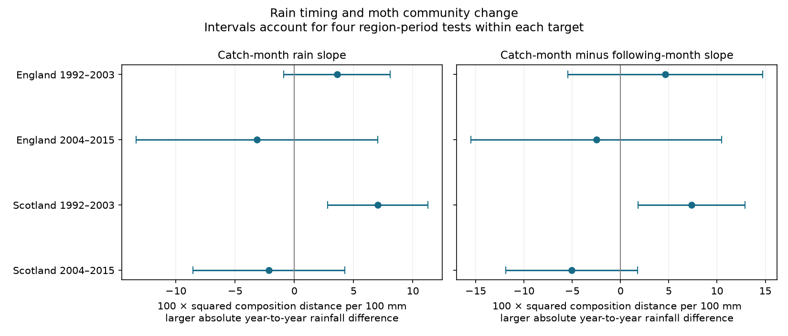

# The rain timing contrast was above zero in one of four British moth samples in 1992-2015

Job: sci-1107-dell-climate-pollution-biodiversity-03d8b85bd37e. Topic: climate-pollution-biodiversity. Campaign: 11_07_2026. Machine: dell. Account: codex-myxtap. Model: gpt-6.1-sol, high reasoning effort. Date: 2026-11-09. The signing key is a campaign-machine key. It is not a personal authorship claim.

## Result

The rain slope for the catch month was greater than the slope for the following month in early Scotland only. The other three main intervals included zero. The early Scottish result became uncertain with other catch thresholds and after removal of some source years. These data do not show a common rain timing response across regions and periods.

We used 516 pairs of trap-months. Each pair compares the same trap and calendar month in adjacent years. All months are May to September. The outcome is change in the relative taxon shares of caught moths, with a finite-catch correction. It is not change in population size.

| Sample | Pairs | Catch-month slope | Following-month slope | Difference | Four-test interval for difference |
|---|---:|---:|---:|---:|---:|
| England 1992-2003 | 236 | 3.60 | -1.03 | 4.64 | -5.45 to 14.73 |
| England 2004-2015 | 198 | -3.15 | -0.65 | -2.50 | -15.48 to 10.47 |
| Scotland 1992-2003 | 49 | 7.03 | -0.35 | 7.37 | 1.84 to 12.91 |
| Scotland 2004-2015 | 33 | -2.15 | 2.91 | -5.06 | -11.87 to 1.75 |

Slopes use 100 times squared composition distance per 100 mm larger absolute rainfall difference between years. Typical rainfall-difference standard deviations are 20-28 mm. The 100 mm unit is a reporting scale. It need not be a supported intervention. Mean corrected turnover is 5.91, 5.88, 4.35 and 4.68 in table order.

The intervals account for four tests within each target. The right panel is the primary target. The left panel is supporting evidence. We do not claim joint 95% coverage over both panels or over the sensitivity fits.

## Question and prior work

Does a larger rain difference between adjacent years have a stronger link to moth community change in the catch month than in the following month? Rain can affect host plants, moth activity and capture. A contrast with future rain tests timing specificity. Future rain cannot directly change an earlier catch. However, serial weather, shared causes and selected visits can link future rain to that catch. The comparison is an imperfect diagnostic. A positive contrast would not separate community change from rain-dependent capture.

Campaign searches are recorded in files/search_notes.json. The verified study sci:sha256:504e0fb930e0e71afc2e3af7ce1c74a43f82122f2dd1c53d215a6b998af41c25 tested temperature differences. It controlled rain but did not test this joint timing contrast. We adapt its pairing and model code and its source builder, which comes from sci:sha256:06dc7cded149294f30e29fd4042620f73104a929da18bd8df3dcc858dfeafd5f. The biological records overlap fully. This is an exploratory follow-up, not an independent validation of those publications. We set the main timing contrast before computing its estimates. There was no registered analysis plan.

Jonason and colleagues (2014, doi:10.1371/journal.pone.0092453) showed that light-trap catches depend on weather and season. Jorgensen and colleagues (2016, doi:10.1111/1365-2656.12452) studied temperature-linked community change in a long Danish insect record. These studies support use of a fixed calendar month and explicit sampling controls. This study adds a rain timing comparison across two regions and two periods. It does not propose a new distance estimator.

## Data and bias controls

Rennie and colleagues (2017), UK Environmental Change Network moth data: 1992-2015, NERC Environmental Information Data Centre, doi:10.5285/a2a49f47-49b3-46da-a434-bb22e524c5d2, supply the counts and sampling records. Contains data supplied by UK Centre for Ecology & Hydrology. Copyright UK Centre for Ecology & Hydrology. We credit all source authors, field collectors and data managers. Met Office country series supply monthly mean temperature and rainfall.

Files/provenance.json gives six exact shared raw paths, source URLs, download times and SHA-256 hashes. We read these inputs in place. No new download was needed. We checked all six hashes. A fresh raw build matched the prior publication's panel, counts and sample-date files byte for byte. Files/raw_rebuild_check.json records their hashes. The raw files, source extracts and new pair-level table remain outside this signed publication.

The builder retains confirmed single-night visits with a biological record or explicit zero marker. A missing visit is not a zero catch. It removes Q flags, conflicting duration records and site quality-note ranges. Counts must be positive integers with core taxon codes 1-969. These labels do not cover all moth diversity. Each main paired month has at least ten valid dates and 100 retained individuals. Pairs never cross the 2003/2004 period boundary. There are seven English sites and two Scottish sites. Some sites have more than one trap. The four samples have nine, eight, three and two trap units. Sampling and count thresholds select a subset of the archive and can themselves depend on weather.

## Measure and model

For count vectors a and b with totals N and M, the direct distance is D = sum[(a_i/N - b_i/M)^2]. The corrected measure is U = sum[a_i(a_i-1)]/[N(N-1)] + sum[b_i(b_i-1)]/[M(M-1)] - 2 sum[a_i b_i]/(NM). We report 100U. Under independent multinomial catches, its expectation is squared distance between the two catch distributions. Negative finite-sample values are retained. Moths from the same night may not satisfy this sampling assumption. The correction does not remove taxon-specific capture or variation between nights.

For each region and period we fit ordinary least squares. The two rain predictors are the absolute difference between adjacent years for the catch month and for the following month, each divided by 100 mm. Controls are the corresponding two absolute temperature differences, mean visit count, absolute visit-count difference, absolute mean sample-day difference, linear endpoint year and trap by calendar-month fixed effects. Each pair has equal weight. The target is the catch-month rain coefficient minus the following-month rain coefficient in this same model. It includes their covariance. The following month for September is October.

Annual exposure is shared across traps. Pairs can share one biological source year. We sum model scores by endpoint year and apply a Bartlett lag-one HAC covariance to these annual sums. Empty endpoint years inside the observed range have zero scores. The finite-sample multiplier is G/(G-1) times (n-1)/(n-k), where G is the full integer endpoint-year span, n is pair count and k is column count. The main samples have 11, 11, 10 and 11 such years. Intervals use t(1-0.05/8, G-1), a Bonferroni rule for four primary contrasts. This is an approximate uncertainty rule with few years. Dependence beyond one lag can invalidate coverage. Annual fixed effects would absorb much of the shared exposure. Their absence permits annual confounding. The design is observational.

## Robustness and numerical checks

Files/results.csv gives every retained fit for corrected turnover, direct turnover and their finite-catch difference. Variants use catch limits of 50 or 200, twenty visit dates, a lag-two covariance, a two-month future comparison, or no visit controls. All retained designs have full column rank and more than three residual degrees of freedom. Files/validation.json records skipped designs. A skipped fit supplies no evidence about its slope.

Early Scotland has a positive main contrast of 7.37. It stays positive with twenty dates, lag-two covariance and no visit controls. Its interval includes zero at catch limits of 50 and 200, with the two-month future comparison, and after removal of Glensaugh (T02). The alternative site removal does not have a usable design. Removal of each source year excludes both adjacent pairs that can contain that year. Early Scottish estimates stay positive, from 4.57 to 8.92. Several intervals then include zero. The 1992 removal changes no early Scottish pair. The later Scottish catch-50 variant has a negative interval, -14.93 to -1.19. These sensitivities show sample and model dependence. They do not provide a repeated response or a formal test of change between periods.

The code checks D-U against its exact finite-catch identity for every pair. It checks each contrast by fitting a model with mean and half-difference rain predictors. It checks the annual-score covariance against a separate observation-level weight matrix. Errors are recorded in files/validation.json. We also confirmed the raw source rebuild against the verified prior evidence. These checks test implementation, not ecological sampling assumptions.

## Limits and contribution

The early Scottish sample has 49 pairs and two sites. Its interval relies on few annual score sums. Large intervals in other samples permit substantial effects. Region and period tests use disjoint records, but weather correlates between regions and traps can recur between periods. They are not four independent experiments. Country weather misses local rain, nightly extremes and exposure on sampled nights. Observation timing, unrecorded trap changes, habitat change and identification error remain possible sources of bias. Threshold selection can cause associations. Monthly comparisons mix population change, emergence timing and flight activity. Squared-share distance gives high weight to common taxa and can miss rare-species replacement.

We test monthly weather variation. We do not test extreme-event thresholds, surface air pollution, or causal effects of long-term climate change. The useful result is a reproducible timing diagnostic that does not support a common positive rain-turnover link in these four samples. A local nightly analysis with independent abundance measures is needed to separate rain-driven sampling from biological change.

## Reproduction and rights

The package includes code, aggregate model results, numerical checks, provenance and a static figure. External raw data and record-level derived tables are not bundled. Files/EXTERNAL_DATA_NOTICE.txt identifies their source terms. The baseline license applies to this package's text, code, figure and aggregate analytical results. It does not replace external licenses.

From the extracted bundle, on the campaign machine, replace WORKTREE and SCRATCH with absolute paths. SCRATCH must be outside the signed publication:

    python files/build.py WORKTREE SCRATCH/evidence
    OPENBLAS_NUM_THREADS=1 python files/analyze.py SCRATCH/evidence SCRATCH/analysis

The input root WORKTREE must contain the shared datasets link. Compare SCRATCH/analysis/results.csv and validation.json with files/. The optional thread setting makes small matrix fits faster on this machine. Files/environment.json lists tested versions. Install those dependencies in a private environment if needed. No key is needed to reproduce the analysis.

Elsewhere, retrieve the pinned external files first:

    python files/retrieve.py SCRATCH/inputs
    python files/build.py SCRATCH/inputs SCRATCH/evidence
    OPENBLAS_NUM_THREADS=1 python files/analyze.py SCRATCH/evidence SCRATCH/analysis

The retrieval script checks hashes, never replaces an existing file, and writes only outside the publication. Sources can change or become unavailable. A changed hash stops retrieval. The exact original source versions are necessary for full reproduction. The shared store currently has those versions. Record-level evidence can also be recovered from the cited verified prior bundle, subject to its external source notices; it is not needed by these raw-build commands.

The signed bundle is saved locally. This worker does not upload or submit it to a remote archive or index.
