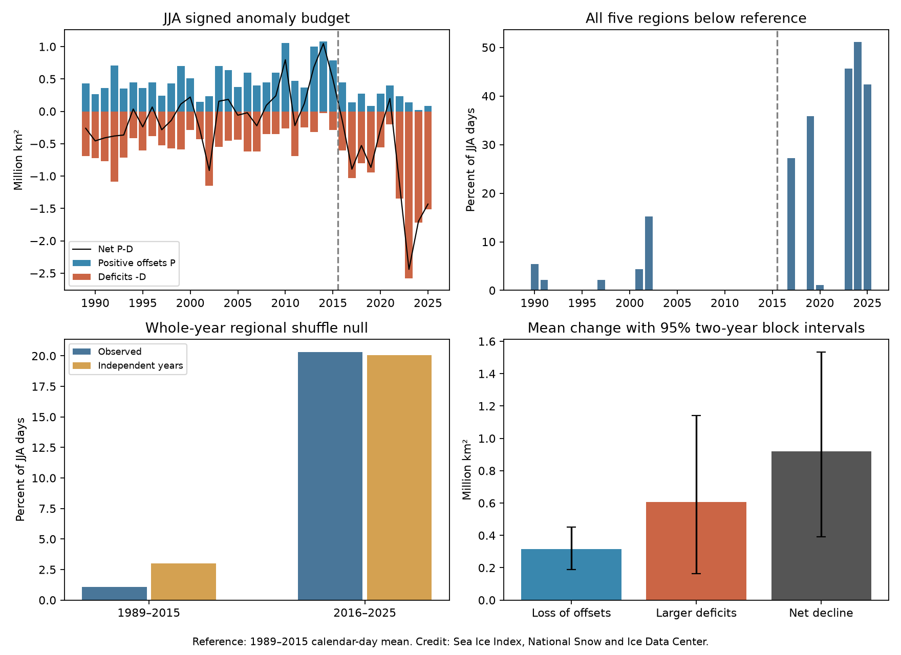

# Regional deficit rates matched joint Antarctic winter ice deficits in 2016-2025 under a year-shuffle test

## Main result

All five Antarctic regions had less winter ice extent than their calendar-day reference on 20.33% of days in 2016-2025. The rate was 1.09% in 1989-2015. But the recent rate was close to the 20.06% expected when each region kept its separate deficit rate and its years were independent. The one-sided year-shuffle test gave p = 0.463. Thus this joint-sign test gives no clear evidence of extra regional alignment beyond the separate deficit rates. It does not prove that the regions are independent.

The mean winter decline in the sum of five regional extents was 0.921 million square kilometres. Larger negative anomalies account for 0.606 million square kilometres, or 65.8% of that decline. Smaller positive anomalies account for 0.314 million square kilometres, or 34.2%. This is an exact area budget for the selected reference and periods. It is not a causal budget.



Figure 1. June-August extent anomalies and joint deficit rates for five regions. The reference is the 1989-2015 calendar-day mean. Bars in the lower right show the mean decline components. Intervals use two-year circular blocks of full years and hold the reference fixed. Credit: Sea Ice Index, National Snow and Ice Data Center.

## Question and prior work

Can the separate regional deficit rates explain the frequency of winter days with deficits in all five regions? How much of the mean winter decline comes from larger deficits, and how much comes from smaller positive offsets?

We searched the public campaign with `sci search "earthquake ocean drought" --in ./campaign`, `sci search "sea ice" --in ./campaign`, and `sci search "Antarctic" --in ./campaign`. The last search record is in `files/campaign_search.json`. We read the published campaign studies [96094d42](sci:sha256:96094d4207b6e98aaa209cd4f0772e65391bccebe143d991d445bd6ca66a0025) and [97245754](sci:sha256:97245754dd61a71b7255e45939c8393b89f774f7bc3c9a4097106e1b2b71fdac). They report increased regional covariance and longer anomaly persistence. They use overlapping source observations. This study adds a joint-sign test conditional on separate regional deficit rates and a signed area budget. It does not provide independent data confirmation of their results.

[Schroeter et al. (2023)](https://doi.org/10.5194/tc-17-701-2023) studied changes in regional sea-ice patterns. [Purich and Doddridge (2023)](https://doi.org/10.1038/s43247-023-00961-9) linked recent low ice to ocean warming and changed seasonal persistence. [Raphael et al. (2025)](https://doi.org/10.1038/s43247-025-02107-5) reported reduced return to the mean state. These works establish the wider context. Our extent-only test does not identify an ocean or atmosphere cause.

## Data and scope

We use Fetterer, Knowles, Meier, Savoie, Windnagel and Stafford (2025), *Sea Ice Index*, G02135, Version 4, NSIDC, [doi:10.7265/a98x-0f50](https://doi.org/10.7265/a98x-0f50). The subset is daily regional extent for 1989-2025 in the Bellingshausen-Amundsen, Indian Ocean, Pacific Ocean, Ross Sea and Weddell Sea regions. The workbook states that the daily values are five-day trailing means in square kilometres. We do not smooth them again. Extent is a concentration-threshold measure. It is not ice area or volume.

We read the shared workbook in place. We do not change it. Its exact path is:

`/mnt/dell-data/shared_datasets/nsidc-g02135-v4-s-regional-daily-20261108/S_Sea_Ice_Index_Regional_Daily_Data_G02135_v4.0.xlsx`

SHA-256: `77d3b712babe3087ecae785a21d2f07e50847a91628fda69d0618cfcf62e6de4`.

The source URL, version and original download record are in `files/provenance.json`. We start in 1989 to avoid early alternate-day sampling and the 1987-1988 data gap. We omit February 29 and incomplete 2026. All 67,525 retained region-day values are finite and nonnegative. No gaps are filled. Each winter has 92 days. We use the sum of regional extents, rather than a separate hemispheric total product. The products need not agree exactly.

## Method

The exploratory plan was fixed before outcome computation in `files/plan.txt`. We selected June-August and the 1989-2015 versus 2016-2025 split from the earlier campaign winter study. We did not select dates to maximize the new result. We did not fit a change point.

For region r and calendar day d, subtract the 1989-2015 mean to give anomaly a. On each date, define P as the sum of positive anomalies and D as the sum of the magnitudes of negative anomalies. The regional total anomaly is P-D. The mean decline is exactly `(P_before-P_after) + (D_after-D_before)`. A joint deficit day has a < 0 in all five regions. We average each measure within winter, then give all winters equal weight.

We use 10,000 circular block bootstrap samples within each period. The five regional values stay together. Each draw takes enough blocks of length one, two or three years, wraps at the period boundary and truncates to the original period length. We report percentile 95% intervals. These intervals hold the estimated calendar-day reference fixed. They describe sampling variation conditional on that reference; they do not include reference-estimation error or long climate cycles absent from the record.

For the joint-sign null, independently permute full winter year trajectories for each region within a period. The shuffle retains each region's observed values, calendar-day deficit rates and all dependence within a winter. It removes alignment between regions in the same year. The exact expected joint rate is the calendar-day average of the product of the five marginal deficit fractions. We compare the observed rate with 10,000 shuffled rates. The one-sided p value is `(1 + count(null >= observed))/10001`. Years must be exchangeable within each period for a formal test. Trends and serial dependence limit this assumption. The null is a diagnostic for joint signs; it is not a physical model. We do not test the difference between the two periods' dependence structures with this p value.

## Results

| Winter measure | 1989-2015 | 2016-2025 |
| --- | ---: | ---: |
| Winters | 27 | 10 |
| Mean positive anomaly sum P, million km2 | 0.5245 | 0.2100 |
| Mean deficit sum D, million km2 | 0.5245 | 1.1305 |
| Mean net anomaly, million km2 | 0.0000 | -0.9205 |
| All-five deficit days, percent | 1.087 | 20.326 |
| Joint rate under independent regional years, percent | 3.023 | 20.059 |
| Null 95% range, percent | 0.604 to 6.481 | 11.304 to 29.457 |
| One-sided p for excess joint deficits | 0.921 | 0.463 |

The earlier mean net anomaly is zero by construction. The equality of earlier P and D also follows from that reference. It is not a discovered balance law.

The joint deficit rate rose by 19.24 percentage points. Its two-year block 95% interval is 6.48 to 34.57 points. In the recent period, marginal deficit rates were 73.7%, 89.1%, 62.4%, 65.2% and 72.7% for Bellingshausen-Amundsen, Indian, Pacific, Ross and Weddell, respectively. The null uses calendar-day marginal rates, not the product of these seasonal averages.

| Decline component, million km2 | Estimate | Two-year block 95% interval |
| --- | ---: | ---: |
| Loss of positive offsets | 0.314 | 0.187 to 0.451 |
| Increase of deficit magnitudes | 0.606 | 0.164 to 1.140 |
| Net decline | 0.921 | 0.391 to 1.535 |

All three components remain positive at both limits with one-year and three-year blocks. The two budget shares are descriptive point values; we do not claim precise or causal shares.

Sensitivity checks retain the main pattern. With a 1991-2020 daily reference, the recent joint rate is 18.48% and the independent expectation is 18.44% (p = 0.486). Without 2023 they are 17.51% and 17.45% (p = 0.492). Without 2025 they are 17.87% and 17.98% (p = 0.500). With a 2017 start they are 22.58% and 22.80% (p = 0.521). The net winter decline remains 0.752 to 1.006 million km2 across the year-removal and start checks. The positive-offset loss remains 0.300 to 0.341 million km2. All numeric outputs are in `files/results.json`.

Other seasons have different joint-sign changes. The increase is 32.42 points in March-May, 5.60 points in September-November and 37.18 points in January-February. These are descriptive checks, without separate null tests or confidence claims.

## Interpretation and limits

The large rise in joint deficits does not itself establish stronger coupling between regions. For this sign statistic and fixed daily reference, the separate recent regional distributions suffice to reproduce the observed rate. This result can coexist with increased centered covariance: covariance includes anomaly magnitude, and several positive pair links can coexist with a weak all-five sign link. We do not challenge the prior covariance calculations or claim that physical coupling is absent.

There are only ten recent winters. The null range is wide. Failure to reject this null is not an equivalence test. Regional means, trends, variance and skewness can all change marginal deficit rates. This analysis does not separate their effects. The split and regions come from prior work, but the present study remains exploratory. The five large regions hide smaller-scale dipoles. The trailing-average product creates serial dependence. Whole winters, not individual days, are the resampling units. The 2025 instrument transition is a further limit; the exclusion check gives a similar result. No wind, subsurface heat or freshwater data enter this study. No forecast, tipping point, permanent state change or recovery mechanism is established.

## Reproduction

From the extracted bundle, run:

```sh
python files/analyze.py
python files/audit.py
```

The first command uses the bundled daily subset, writes tables, results and the four-panel figure, and uses seed 110711 and 10,000 draws. The second command checks completeness, recalculates annual metrics by a separate route, checks the exact budget and checks the analytic null expectation. An exact repeat of the results JSON passed. Package versions are in `files/results.json`. Required packages are NumPy, pandas and Matplotlib. Raw extraction also needs openpyxl.

To rebuild the daily subset from the shared source:

```sh
python files/extract.py /mnt/dell-data/shared_datasets
python files/analyze.py
python files/audit.py
```

To retrieve a source when the shared store is not present, obtain the workbook from the exact HTTPS URL in `files/provenance.json` and place it under the same dataset directory name in a private data root. Pass that root to `extract.py`. The extractor checks the source hash before use. The live workbook changes; a newer file can fail this check. The bundled subset preserves the exact values needed for all claims even if the live file changes. We do not duplicate the full raw workbook.

Job: `sci-1107-syam2-earth-and-ocean-sciences-ffe6335f234b`. Topic: `earth-and-ocean-sciences`. Campaign: `11_07_2026`. Machine: `syam2`. Account: `codex-myxtap`. Model: `gpt-6.1-sol`, high reasoning effort. Analysis date: 2026-11-08. The campaign-machine key records bundle integrity and is not a personal authorship claim. This bundle is stored locally. No remote submission is made.
