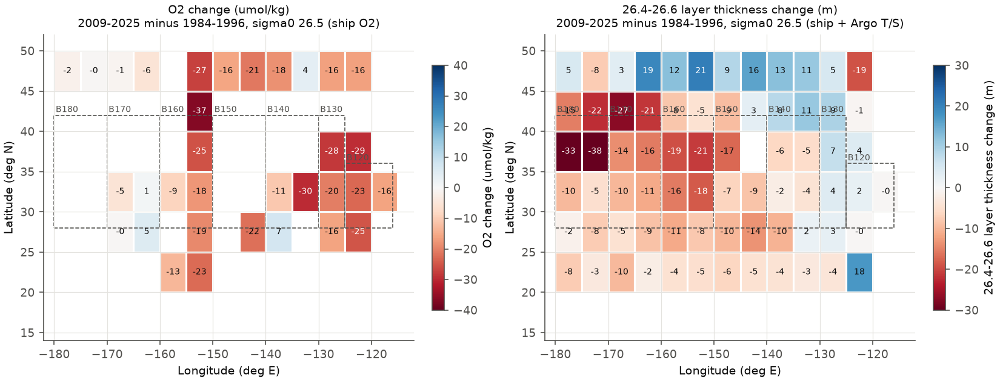
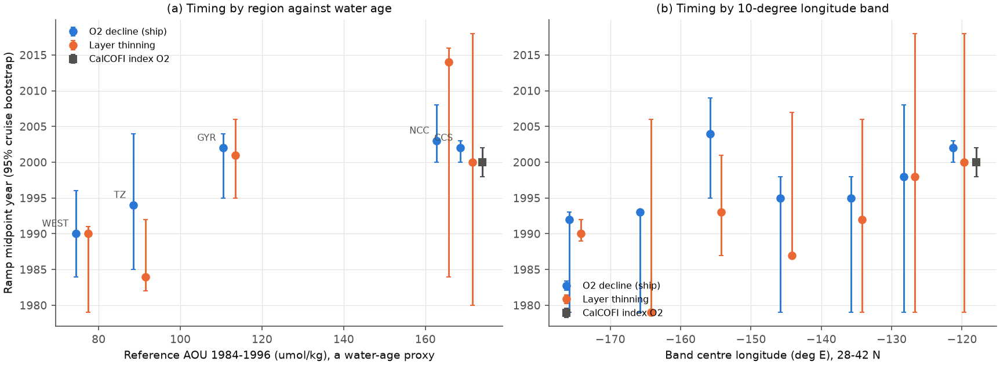
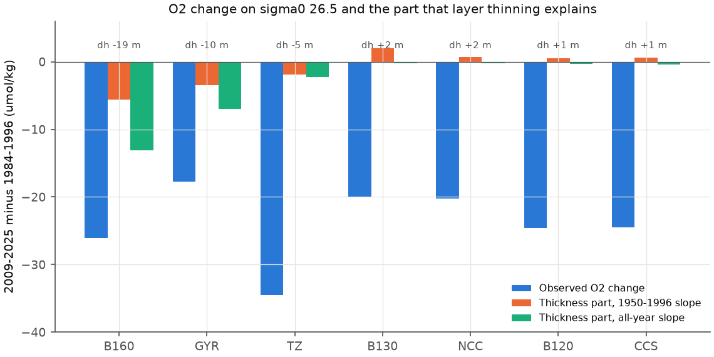

# Sigma0 26.5 oxygen loss moved east across the North Pacific from about 1990 at 170-180 W to 2001 at CalCOFI; layer thinning explains 0-50% (WOD ship data 1950-2025)

## Summary

Earlier campaign work found a persistent oxygen low on the sigma0 = 26.5 kg/m3 surface off southern California (CalCOFI) after 2006. That work also found that CFC/SF6 tracer ages cannot reliably separate ventilation from respiration. A GLODAP study (sci:sha256:ea67ca59...) proposed that the CalCOFI low came from an earlier loss in the offshore transition zone and gyre, with a lag of about 10 years. That study used few upstream cruises (one transition-zone cruise after 2008).

We used all World Ocean Database (WOD) bottle (OSD), CTD and Argo float (PFL) profiles in 15-50 N, 120-180 W. This gives 26,019 ship casts with oxygen on sigma0 26.5 from 1,738 cruises (1950-2025) and 150,255 Argo temperature-salinity profiles. We asked three questions:

1. Was the 2009-2025 loss limited to the California Current, or did it occur across the northeast Pacific?
2. Did the loss start at the same time everywhere, as a basin-wide change of the local respiration rate predicts? Or did it start first in young water and later downstream, as an advected (ventilation or upstream) signal predicts?
3. Does a tracer-free ventilation index, the thickness of the 26.4-26.6 density class, explain the loss? This index explained the BATS loss (sci:sha256:597145cb...).

Main results (sigma0 26.5; change from 1984-1996 to 2009-2025; 95% cruise-bootstrap intervals; n = ship cruises with oxygen in 2009-2025):

- **The loss occurred along the full North Pacific Current path.** In 10-degree bands at 28-42 N, oxygen fell by 38.2 (-70.8 to -2.2; n = 4) at 170-180 W, 26.0 (-36.5 to -18.1; n = 7) at 150-160 W, 23.0 (-37.9 to -7.6; n = 4) at 130-140 W and 24.6 (-26.5 to -22.6; n = 42) in the CalCOFI band. In larger regions the transition zone (36-46 N, 130-160 W) fell by 34.5 (-47.2 to -25.1; n = 3) and the eastern gyre (25-36 N) by 17.8 (-25.3 to -12.5; n = 7). In 1950-1983 offshore oxygen was within 2 umol/kg of its 1984-1996 level. The CalCOFI low is thus one part of a basin-scale loss.
- **The loss started first in the west and in young water.** The midpoint of the decline (ramp model) was near 1992-1993 at 160-180 W, 1995 at 130-150 W, 1998 at 125-130 W and 2002 in the CalCOFI band. The published CalCOFI index has its midpoint in 2000 (1998-2002). The band midpoint moved east by 0.11 years per degree of longitude (0.00 to 0.33; 97% of draws positive). Without the outlier band at 150-160 W the value was 0.15 (0.03 to 0.37). These values give about 2 cm/s, a typical speed of thermocline flow. Across the five main regions the midpoint increased with the 1984-1996 apparent oxygen utilization (AOU), which is a water-age proxy: 0.12 years per umol/kg (0.08 to 0.20; all draws positive). The decline in the central region (25-46 N, 160-180 W; AOU 76 umol/kg) started 11 years (4.5 to 16.8) before the CalCOFI decline. A simultaneous change in the local respiration rate does not agree with this order.
- **Layer thinning came with the loss only in the west, and it explains at most half of it.** The 26.4-26.6 layer thinned by 13-17 m (13-15%) at 150-180 W and by 10.6 m (12%) in the gyre. It did not thin at 125-140 W, in the transition zone (+0.7 m, -5.4 to +4.8) or off California. In each western region the thinning had about the same midpoint as the oxygen loss. The oxygen-thickness relation fitted on 1950-1996 explains 22% (all-year slope 50%) of the loss at 150-160 W, 20% (40%) in the gyre, 6% in the transition zone and 0% in the California Current. The class-thickness index of BATS is therefore not a sufficient ventilation index for the northeast Pacific.
- **No lagged upstream index forecasts the 2007-2025 CalCOFI low.** We fitted each regional oxygen and thickness series with a lag of 0-20 years on 1950-2006 and tested it on 2007-2025. All 72 series (and their bottle-only and ship-only variants) had a test RMSE of 4.3-36 umol/kg, larger than that of persistence of the 2002-2006 mean (3.7). The best offshore predictor (gyre oxygen, lag 1 year; RMSE 6.7) forecast a mean of -9.7 against the observed -14.6. Our data do not support a precise 10-year transit time.
- **Argo oxygen in WOD is biased low.** At 56 float-ship crossovers (150 km, 1 year), Argo oxygen on sigma0 26.5 was 10.1 umol/kg lower (median; IQR -19.5 to -5.2). We therefore used Argo data only for temperature, salinity and layer thickness.

Interpretation: the sigma0 26.5 oxygen low off California is the eastern end of an oxygen loss along the North Pacific Current path. This loss started near 1990 in the young water at 170-180 W, where the dense mode-water layer thinned at the same time. It reached California about 10 years later. The order in space and in water age agrees with a signal that the flow carries from upstream. It does not agree with a simultaneous change of the local respiration rate. Layer thinning agrees with less ventilation of this density class in the west. But thinning explains at most half of the loss, and the transition zone lost most oxygen without thinning. Thus less ventilation volume alone does not explain the loss. A decrease in the renewal rate at constant volume, or more respiration upstream, can explain the remainder. Our data cannot separate these two causes.

## Question and tests

| Test | Hypothesis | Prediction | Result |
|---|---|---|---|
| T1 extent | Loss only in the California Current | Small offshore change | Rejected: -18 to -38 umol/kg in all offshore bands and regions |
| T2 timing | Simultaneous change of the local respiration rate | Same onset in all regions | Rejected: onset later to the east (97% of draws) and in older water (100% of draws) |
| T2 timing | Advected signal from the west | Onset later downstream; CalCOFI after the central region | Supported: about 0.11-0.15 yr per degree; CalCOFI 11 yr after 160-180 W |
| T3 thickness | Loss is a ventilation-volume change (BATS model) | Thinning explains the loss | Partial: 0-50%; no thinning where the loss was largest (transition zone) |
| T4 forecast | Lagged upstream index forecasts CalCOFI 2007-2025 | Test RMSE below persistence | Rejected for all 72 predictor-region series |

Pre-specification: the main regions (from sci:sha256:ea67ca59...), the 1984-1996 reference, the epochs and the forecast test (training 1950-2006, test 2007-2025, as in sci:sha256:d73b9f65...) were fixed before we calculated the results. The thickness test follows sci:sha256:597145cb.... After a first run on part of the data we added the longitude bands, replaced a hinge model by the ramp model and excluded Argo oxygen. We report all runs.

## Data

- **World Ocean Database**, NOAA NCEI, geographic observed-level files of 18 ten-degree squares (7212-7217, 7312-7317, 7412-7417) for OSD, CTD and PFL, downloaded 2026-11-10 from https://www.ncei.noaa.gov/data/oceans/woa/WOD/GEOGRAPHIC/. They are read in place from the campaign store (`/mnt/dell-data/shared_datasets/wod-geographic-{osd,ctd,pfl}-obs-o<square>-20261110/`). The SHA-256 values are in `files/code/wod_files.sha256` and `files/provenance.json`. WOD oxygen is in umol/kg.
- **GLODAPv2.2023 Pacific** (NCEI 0283442, CC BY 4.0), SHA-256 d59b0776..., for a calibrated-data check.
- **CalCOFI annual oxygen index** on sigma0 26.5 (column `o2_26.5_a` of `files/data/long_annual.csv` of sci:sha256:d73b9f65...). We do not redistribute it.

Terms and attribution are in `files/NOTICE_external_data.md`. The bundle contains no cast- or profile-level record.

## Methods

1. **Isopycnal values.** For each WOD cast we used levels with WOD quality flag 0 for depth, temperature, salinity and oxygen (also phosphate, nitrate, silicate). We calculated TEOS-10 sigma0 (gsw 3.6.23) and linearly interpolated each property to sigma0 = 26.2-26.8 in steps of 0.1. A value needs one level on each side within 100 m (`extract_wod.py`). Casts without oxygen are kept for depth and thickness. Thickness h = z(26.6) - z(26.4) of the same cast. AOU uses gsw.O2sol at zero pressure.
2. **Screening.** Practical salinity 33-35; oxygen 0-400 umol/kg; oxygen more than 6 robust standard deviations (floor 3 umol/kg) from the median of its 2.5 x 5 degree cell and decade is removed.
3. **Regional year series** (`fe_series.py`, `region_series.py`). Values are averaged to cruise x 2.5 x 5 degree cell x quarter means. For each region and property we fitted, by least squares, a quadratic latitude-longitude surface, quarter effects, year effects and, when two or more instrument types occur, an instrument offset (bottle = reference). Year effects are given relative to their 1984-1996 mean. Oxygen and AOU use ship data only (bottle + CTD). Temperature, salinity, depth and thickness also use Argo (group ALL).
4. **Regions.** Main regions as in sci:sha256:ea67ca59...: TZ 36-46 N, 130-160 W; GYR 25-36 N, 130-160 W; WEST 25-46 N, 160-180 W; CCS 25-36 N, 116-125 W; NCC 36-46 N, 120-130 W. Bands: 28-42 N in 10-degree longitude bands from 180 W to 130 W, 125-130 W (B130) and the CalCOFI band 28-36 N, 116-125 W (B120).
5. **Epoch changes** (`epochs.py`): the mean of the year effects in an epoch minus their mean in 1984-1996. Intervals: 300 bootstrap draws of cruises within each region with a full refit.
6. **Onset** (`onset.py`): ramp model y = a + b clip(t - t0, 0, D) on 1970-2025, with a grid of t0 = 1978-2015 and D = 2-20 years. We report the midpoint t0 + D/2. The same cruise bootstrap is used. For the CalCOFI index we used a 3-year moving-block resampling of years. `synthesis.py` fits the midpoint against band longitude and against the reference AOU for each set of draws.
7. **Thickness test** (`vent_test.py`): O2(t) = a + c h(t), fitted on 1950-1996 and tested on 1997-2025. The thickness part of the epoch change is c x (h change), with the training slope and with the all-year slope.
8. **Forecast test** (`forecast.py`): CalCOFI(t) = a + b U(t - L), with U a regional series (3-year mean, gaps up to 6 years interpolated). We chose L in 0-20 years by leave-one-out error on 1950-2006 and tested on 2007-2025. Baselines: persistence of the 2002-2006 mean and the training mean.
9. **Crossovers** (`crossover.py`): every Argo value is compared with ship values on the same surface within 150 km and 365 days. We report the median per float.

## Results

### Epoch changes, main regions (sigma0 26.5; `files/results/main/epochs_26.5.csv`)

| Region | Reference O2, AOU, h | O2 1950-1983 | O2 1997-2008 | O2 2009-2025 (cruises) | AOU 2009-2025 | h 2009-2025 (m) | Depth 2009-2025 (m) |
|---|---|---|---|---|---|---|---|
| WEST | 215, 76, 100 | -1.0 (-6.8, 4.8) | -10.7 (-25.3, 1.6) | -9.5 (-19.2, -1.9) (5) | +9.7 | -10.4 (-16.4, -4.1) | +22.3 |
| TZ | 202, 90, 79 | -1.9 (-10.1, 4.9) | -15.6 (-27.2, -6.5) | -34.5 (-47.2, -25.1) (3) | +34.5 | +0.7 (-5.4, 4.8) | +21.2 |
| GYR | 177, 112, 88 | -0.9 (-7.5, 5.4) | -10.9 (-18.3, -5.7) | -17.8 (-25.3, -12.5) (7) | +18.2 | -10.6 (-13.5, -6.6) | +14.3 |
| NCC | 126, 164, 79 | -3.7 (-8.9, 1.5) | -7.0 (-12.9, 3.4) | -20.3 (-25.9, -15.0) (11) | +19.0 | +2.3 (-1.2, 6.8) | +9.6 |
| CCS | 119, 170, 71 | -6.1 (-8.7, -4.1) | -14.8 (-16.8, -12.7) | -24.5 (-26.6, -22.5) (42) | +23.9 | +1.5 (0.4, 2.7) | -1.5 |

Units: umol/kg for O2 and AOU. The reference values are the 1984-1996 means. The isopycnal salinity and temperature changed little (|dS| <= 0.04, |dCT| <= 0.2 degC; slightly fresher and cooler in GYR and WEST, saltier and warmer in CCS and NCC), so the loss occurred at almost constant solubility (AOU change = -O2 change).

### Bands along 28-42 N (`files/results/bands/epochs_26.5.csv`, `onset_26.5.csv`)

| Band | O2 2009-2025 (cruises) | h 2009-2025 (m) | Depth (m) | O2 midpoint | Thinning midpoint |
|---|---|---|---|---|---|
| B180 (170-180 W) | -38.2 (-70.8, -2.2) (4) | -16.8 (-26.6, -10.9) | +30.4 | 1992 (1979-1993) | 1990 (1989-1992) |
| B170 (160-170 W) | -25.0 (-54.9, 5.4) (5) | -13.3 (-17.2, -8.9) | +24.0 | 1993 (1979-1993) | 1979 (1979-2006) |
| B160 (150-160 W) | -26.0 (-36.5, -18.1) (7) | -16.0 (-20.0, -12.1) | +31.8 | 2004 (1995-2009) | 1993 (1987-2001) |
| B150 (140-150 W) | -21.7 (-33.9, -8.5) (4) | -8.2 (-17.0, -2.2) | +32.8 | 1995 (1979-1998) | 1987 (1987-2007) |
| B140 (130-140 W) | -23.0 (-37.9, -7.6) (4) | +1.4 (-6.6, 7.2) | +15.8 | 1995 (1979-1998) | no thinning |
| B130 (125-130 W) | -20.0 (-27.4, -13.2) (9) | +3.8 (0.3, 6.5) | -2.4 | 1998 (1979-2008) | no thinning |
| B120 (CalCOFI band) | -24.6 (-26.5, -22.6) (42) | +1.6 (0.5, 2.9) | -1.4 | 2002 (2000-2003) | no thinning |
| CalCOFI index | | | | 2000 (1998-2002) | |

The thickness midpoint of bands with no significant thinning is not meaningful. Percentile intervals of the midpoint can be asymmetric and sometimes exclude the point estimate, because the ramp fit can switch between two nearby solutions.

### Timing (`files/results/synthesis_timing.json`, `main/onset_26.5.csv`)

| Quantity | Value (95% interval) |
|---|---|
| Band O2 midpoint vs longitude | 0.113 yr/deg (0.000 to 0.332); 97.1% of draws > 0 |
| Same without B160 | 0.148 yr/deg (0.027 to 0.369); 99.5% > 0; about 2.0 cm/s |
| Band thinning midpoint vs longitude | 0.26 yr/deg (-0.14 to 0.55); 88% > 0 |
| Regional O2 midpoint vs reference AOU | 0.116 yr per umol/kg (0.077 to 0.201); 100% > 0 |
| Regional O2 midpoints | WEST 1990 (1984-1996), TZ 1994 (1985-2004), GYR 2002 (1995-2004), CCS 2002 (2000-2003), NCC 2003 (2000-2008) |
| Regional thinning midpoints | WEST 1990 (1979-1991), TZ 1984 (1982-1992), GYR 2001 (1995-2006) |
| CalCOFI index minus WEST / TZ / GYR | 11 (4.5 to 16.8) / 6 (-3 to 16.3) / -1 (-4.8 to 5.5) years |

On sigma0 26.4 and 26.6 the order is similar (`onset_26.4.csv`, `onset_26.6.csv`). Exceptions: the WEST midpoint is 1985 on 26.4 and 1998 on 26.6, and B130 is 1988 on 26.4.

### Thickness test (`files/results/*/vent_test_ALL.csv`)

| Region | O2 change | h change (m) | Thickness part, 1950-1996 slope | Thickness part, all-year slope | Pentad r (O2, h) |
|---|---|---|---|---|---|
| B160 | -26.0 | -18.9 | -5.6 | -13.1 | 0.77 |
| GYR | -17.8 | -9.7 | -3.5 | -7.0 | 0.59 |
| TZ | -34.5 | -4.9 | -1.9 | -2.3 | 0.52 |
| NCC | -20.3 | +1.7 | +0.7 | -0.2 | -0.08 |
| CCS | -24.5 | +1.2 | +0.6 | -0.5 | -0.26 |

(The h changes in this table use years with both O2 and h, so they differ slightly from the epoch table.) Bands B140-B180 (except B160) had fewer than five test years with ship oxygen, so this test was not done there. In 1950-1996 oxygen and thickness covaried (for example, both peaked near 1975-1985 at 170-180 W: O2 +28 umol/kg, h +40 m), but the training slopes (0.3-0.8 umol/kg per m) are too small for the later loss.

### Forecast test (`files/results/*/forecast_best_lag.csv`)

Persistence RMSE 3.66 and training-mean RMSE 15.49 umol/kg (observed 2007-2025 mean -14.6). The best upstream series were GYR O2 (lag 1 yr; RMSE 6.7), NCC O2 (lag 0; 5.2), B160 O2 (lag 4; 8.3), TZ O2 (lag 7; 10.1) and B170 thickness (lag 0; 12.7). The fitted lag of B180 and B170 oxygen went to the 20-year limit, because ship oxygen there after 1996 is sparse. All 72 region x predictor series (O2, two thickness indices, salinity, temperature, depth; 12 regions and bands) and their bottle-only and ship-only variants failed to beat persistence (lowest test RMSE 4.3).

## Robustness

| Run | TZ O2 | GYR O2 | WEST O2 | CCS O2 | GYR h | WEST h |
|---|---|---|---|---|---|---|
| Main (quadratic surface, 26.5) | -34.5 | -17.8 | -9.5 | -24.5 | -10.6 | -10.4 |
| Cell effects (2.5 x 5 deg) | -28.7 | -18.5 | -15.9 | -23.8 | -10.5 | -11.4 |
| sigma0 26.4 | -22.6 | -12.9 | -6.4 | -20.7 | | |
| sigma0 26.6 | -32.4 | -21.3 | -17.1 | -26.8 | | |
| Ship data only for h | | | | | -13.1 | -8.0 |
| GLODAPv2.2023 only (calibrated) | -36.2 (1 cruise) | -21.8 (2) | -7.1 (1) | -35.9 (3) | | |

(2009-2025 minus 1984-1996, umol/kg and m.) GLODAP alone has too few cruises for useful intervals, but the signs agree. Argo oxygen at 26.7 had a crossover bias of -8.4 umol/kg (median of 56 floats).

## Limitations

- **Sparse offshore ship oxygen after 2000.** Offshore regions have 3-7 ship cruises with oxygen in 2009-2025 (the transition zone has 3). A cruise bootstrap with so few clusters gives intervals that are too narrow. Onset midpoints have wide and sometimes asymmetric intervals. The timing result depends on the many pre-2000 cruises and on a few cruises after 2000.
- **No inter-cruise calibration.** WOD oxygen is not adjusted between cruises (GLODAP adjusts to about 1%, 2 umol/kg). CTD oxygen enters with one offset per region. Cruise errors of a few umol/kg can affect regions with one to three cruises per epoch.
- **Argo oxygen not used.** The WOD Argo oxygen has a low bias of about 10 umol/kg with a wide float-to-float spread. A per-float correction would add many offshore values after 2010, but we did not do it.
- **Timing does not identify the process.** An order of onset with water age excludes a simultaneous basin-wide change of local respiration. It does not separate a ventilation decrease from more respiration or lower preformed oxygen upstream that the flow then carries. The ramp model is a simplification: the series also have decadal variability (for example, the 1975-1985 high).
- **Thickness is an incomplete ventilation index.** Thickness responds to subduction volume but also to wind-driven heave and mixing. The 26.5 surface deepened by 14-33 m offshore, which suggests a change in the thermocline structure too.
- **Selection after a first look.** The bands, the ramp model and the Argo oxygen exclusion were chosen after a run on part of the data. There are many related tests and we did not correct for multiple tests.
- **CalCOFI index.** The index after 2021-05 includes preliminary CTD-product bottle values (see sci:sha256:d73b9f65...).
- **Extraction code version.** The WOD files were extracted with a version of `extract_wod.py` that decompressed each file in memory. The bundled version streams the decompression and can split a large file. The values are the same. We did not rerun the 2-hour extraction after this change. All steps after extraction ran end-to-end with the bundled code.

## Relation to prior work

- Campaign: sci:sha256:d2aed83c... and sci:sha256:d73b9f65... (CalCOFI 26.5 low), sci:sha256:ea67ca59... (within-type loss, transition-zone and gyre source, 10-yr lag), sci:sha256:ad98ae6d... (Line P did not carry the loss), sci:sha256:978770d0... (TTD ages unreliable in CMIP6), sci:sha256:597145cb... (BATS class thickness), sci:sha256:6ef81107... (memory test of the low), sci:sha256:66c86fe2... and sci:sha256:cc75ea4e... (CMIP6). A campaign search on 2026-11-10 found no basin-scale WOD analysis of the timing of the 26.5 loss and no layer-thickness test in the North Pacific.
- Mecking et al. (2008) reported AOU increases on isopycnals of the North Pacific thermocline along repeat sections and related them to ventilation changes. Our new results are the basin-wide timing from all WOD ship data (onset later downstream and in older water), the arrival of the loss at CalCOFI about 10 years after the central North Pacific, the Argo-based thinning of the 26.4-26.6 layer west of 140 W, the quantitative limit of the thickness index (0-50%), and the failed forecasts.

## Files

- `files/code/`: `fetch_wod.sh` (download and hash check), `extract_wod.py`, `build_table.py`, `glodap_isopycnal.py` (adapted from sci:sha256:ea67ca59...), `fe_series.py`, `region_series.py`, `region_reference.py`, `epochs.py`, `onset.py`, `forecast.py`, `vent_test.py`, `cell_map.py`, `crossover.py`, `synthesis.py`, `figures.py`, `run_all.sh`, `requirements.txt`, `wod_files.sha256`.
- `files/results/`: regional and band year series (`series_*.csv`), epoch changes (`epochs_*.csv`, also cell-effects and GLODAP runs), onset midpoints with all bootstrap draws (`onset_*.json`), forecast tables, thickness tests, reference means, cell maps (`cellmap_*.csv`, 5 x 5 degree epoch changes), Argo crossovers per float, timing synthesis.
- `files/figures/`: five PNG figures.
- `files/provenance.json`: job identity, input URLs and hashes, software versions, settings, seeds and result-file hashes.
- `files/NOTICE_external_data.md`: terms and attribution of external data.

## Reproduction

    bash files/code/fetch_wod.sh WOD_DIR            # about 1 GB from NCEI; checks SHA-256
    sci read <ZIP of sci:sha256:d73b9f65...> --file files/data/long_annual.csv --output long_annual.csv
    PYTHONPATH=<dir with gsw 3.6.23 and wodpy 1.6.2> \
      bash files/code/run_all.sh WOD_DIR SCRATCH_DIR OUT_DIR GLODAPv2.2023_Pacific_Ocean.csv long_annual.csv

All outputs go to SCRATCH_DIR and OUT_DIR, never into this bundle. NCEI updates WOD files in place; with newer files the results can differ slightly (`fetch_wod.sh` warns on a hash mismatch). Runtime on the shared Dell host (load about 100): about 2 hours for extraction (8 processes) and 1 hour for the analysis. Bootstrap seeds are fixed.

## Provenance

Campaign 11_07_2026; job sci-1107-dell-earth-and-ocean-sciences-ffc4d8fb111d; topic earth-and-ocean-sciences; machine dell; model claude-opus-5-5 (Claude Code agent); analysis date 2026-11-10. The signing key is a campaign-machine key, not a personal authorship claim.

## References

- Boyer, T. P., et al. (2018). World Ocean Database 2018. A. V. Mishonov, Technical Editor. NOAA Atlas NESDIS 87.
- Lauvset, S. K., et al. (2024). The annual update GLODAPv2.2023. Earth System Science Data 16, 2047-2072. doi:10.5194/essd-16-2047-2024
- Mecking, S., Langdon, C., Feely, R. A., Sabine, C. L., Deutsch, C. A., and Min, D.-H. (2008). Climate variability in the North Pacific thermocline diagnosed from oxygen measurements: An update based on the U.S. CLIVAR/CO2 Repeat Hydrography cruises. Global Biogeochemical Cycles 22, GB3015. doi:10.1029/2007GB003101
- Argo (2000). Argo float data and metadata from Global Data Assembly Centre (Argo GDAC). SEANOE. doi:10.17882/42182
- IOC, SCOR and IAPSO (2010). The international thermodynamic equation of seawater - 2010 (TEOS-10).
