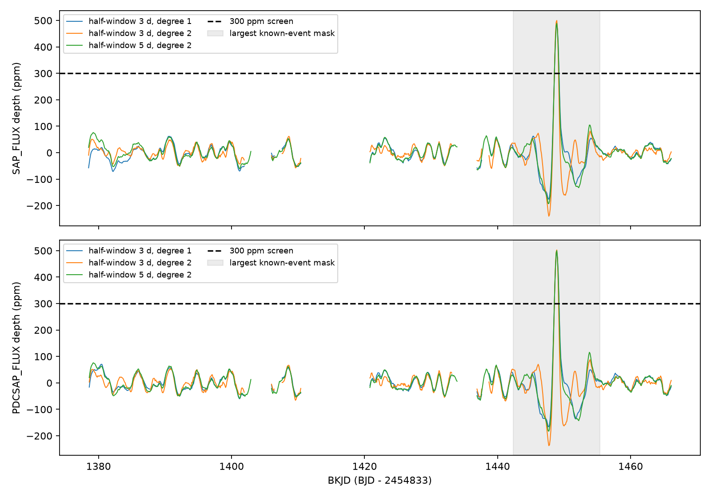

# A fixed-shape scan finds no second 300-ppm dip in tested Kepler quarter 15 intervals of KIC 8027456

We find no additional fixed-shape dip at or above 300 parts per million (ppm) in the tested intervals. The largest additional fitted depth is 88.1 ppm. This is a search limit for a specified profile and data selection. It is not a limit on all comet activity or all planets.

## Question and prior work

Does the rest of Kepler quarter 15 contain another event with the shape and approximate depth of the known KIC 8027456 dip? A second event could help test recurrence or variable dust extinction. A null result can limit a model with frequent, similar events, but cannot set a period without time coverage and orbit assumptions.

Kennedy et al. (2019), DOI 10.1093/mnras/sty3049, found the known event at about BKJD 1448.9 and discussed an exocomet explanation. We do not discover that event. We searched the campaign before this test. Published campaign work measured its unequal entry and exit widths (SCI 405430ec3f34f399d6dd8403af095144d601f286e6dc25b33c6c7f6a38c23367) and a weak pre-dip response (SCI 925bf68b588009edda48b379bc875eab357972ffad3bd53bb63b01402febbb90). We read both results. We take the fixed shape and reference time from the first result. We add a search away from the known event. Saved campaign searches document the selection. The targeted literature search is not a complete review, and we make no claim of priority for this null result.

## Input and provenance

The input is the public Kepler release 25 quarter 15 long-cadence light curve for KIC 8027456. It covers about BKJD 1373.49 to 1471.14. BKJD means BJD minus 2454833. We read the shared file in place at `/mnt/dell-data/shared_datasets/kepler-kic8027456-q15-dr25/q15.fits`. Its SHA-256 is `55f138bf46a55b07b50bfa1355dc317d86dae011ce0104902711960e2c2592e4`; its size is 506880 bytes. The source URL, resolved shared path, pipeline version and job record are in files/provenance.json. We changed no shared data. files/quarter.csv preserves the analysis columns, including quality and pointing values, for inspection. It is a derived text copy of columns, not the original FITS file.

We select finite times and flux with SAP_QUALITY equal to zero for each flux product separately. Each quarter flux is divided by its selected median and expressed in ppm. SAP_FLUX is raw aperture flux; PDCSAP_FLUX includes pipeline correction. These products share photons and are not independent observations. We do not fill gaps.

## Search method

The fixed dip is a split Gaussian. Entry and exit standard deviations are 0.1893 and 0.4371 day. We average nine samples across a 0.02043365-day exposure. The profile has unit depth before exposure averaging. The known reference time is BKJD 1448.8633. The shape is an empirical description, not a dust transport model.

At each center, we fit a free signed dip depth and a polynomial baseline by equal-weight least squares. A positive depth means less light. We test a three-day half-window with a linear baseline, a three-day half-window with a quadratic baseline, and a five-day half-window with a quadratic baseline. Each is applied to both flux products. We keep negative depths in the output as controls on the scale of local variation. No Gaussian error or independent-trial probability is assigned.

The grid spacing is 0.1 day. Centers start at the first tenth of a day at least five days after the selected data start. They end five days before the selected end. For a center to pass, its interval from -0.7 to +1.5 day must have at least 80 selected rows, must reach to at least -0.6 and +1.4 day, and must have no selected-row gap above 0.15 day. At least 35 baseline rows must lie on each side beyond 1.5 days. All constraints apply within the local fitting window. These rules reject large gaps, but do not make the data free of instrument errors.

For additional events, we exclude centers within half-window plus 1.5 days of the known event. The exclusion is thus 4.5 days for the short windows and 6.5 days for the long windows. It prevents the known event from entering a comparison baseline. It also removes real search time near the known event. The comparison has 584 to 586 accepted centers per choice; overlapping centers are not independent observations or 584 to 586 separate events. The grid starts near 1378.5 and ends near 1466.1, but many interior centers fail the sampling rules. files/scans.csv gives each accepted time and its mask status. No assertion applies between missing centers.

The screen is a fitted depth of at least 300 ppm, about 60 percent of the known event. It is a stated amplitude rule, not a survey false-alarm threshold or a formal upper confidence limit. The analysis was not registered in advance.

## Results and sensitivity

| Configuration | Other centers | Known depth, ppm | Largest other depth, ppm | Time of largest, BKJD | Added 300 ppm recovered | Added 500 ppm recovered |
|---|---:|---:|---:|---:|---:|---:|
| SAP_FLUX_h3_d1 | 586 | 485.2 | 62.1 | 1390.5 | 97/200 | 200/200 |
| SAP_FLUX_h3_d2 | 586 | 504.8 | 81.8 | 1453.9 | 108/200 | 200/200 |
| SAP_FLUX_h5_d2 | 585 | 489.7 | 76.2 | 1379.2 | 115/200 | 200/200 |
| PDCSAP_FLUX_h3_d1 | 585 | 492.2 | 70.4 | 1380.4 | 111/200 | 200/200 |
| PDCSAP_FLUX_h3_d2 | 585 | 507.5 | 88.1 | 1453.9 | 109/200 | 200/200 |
| PDCSAP_FLUX_h5_d2 | 584 | 501.0 | 76.1 | 1379.2 | 107/200 | 200/200 |

Here h is the half-window in days and d is the baseline degree. Every configuration gives zero additional centers above the screen. The largest negative control depths range from -59.7 to -71.0 ppm. Thus weak positive and negative responses both occur away from the known event. We do not call the largest weak responses detections.

Each injection is added separately to the observed normalized flux. For each configuration, 200 centers are drawn with replacement from its accepted comparison grid. Each center gets a uniform offset between -0.05 and +0.05 day. The seed is 20261108. For each center we test added depths of 300 and 500 ppm. We scan offsets -0.2 to +0.2 day in 0.05-day steps around that injected center, with the same sampling rules and baseline. Recovery means that the largest local fitted depth is at least 300 ppm. All accepted trials have a valid local fit. The listed location check is confined to this local interval by construction; it is not a separate localization success test.

All six choices recover 200/200 added 500-ppm profiles. Only 97 to 115 of 200 added 300-ppm profiles reach the 300-ppm screen. This is expected near a threshold with signed noise and baseline errors. The injections establish sensitivity in these local tests to this exact shape at about the known depth. They do not measure full survey completeness, validate the pipeline before the archived flux was produced, or exclude other widths. Trials share the observed noise and are not independent Bernoulli samples. We report no population confidence bound from them. Each trial is saved in files/*_injections.csv.

## Instrument checks and physical meaning

The additional maxima remain below 81.0 ppm after adding linear terms for POS_CORR1, POS_CORR2 and SAP_BKG to their own local fits. All these design matrices have full column rank. These fits do not prove that instrument effects are absent. Instrument predictors can also absorb source light variation. The original all-cadence data contain nonzero quality flags within 1.5 days of each leading response; those rows do not enter the fits. The largest all-cadence gap there is about 0.020433 day. Exact flag counts are in files/quality.json.

The two quadratic short-window maxima occur near BKJD 1453.9. These weak responses have no established source or physical cause. Their presence in both products supplies no independent confirmation. No feature passes the amplitude screen, so we do not select a new object for a physical orbit fit. No pixel localization, neighbor subtraction, separate telescope test or new observation was completed. We find no new planet or comet.

A repeat of the same dust occultation profile at a sampled, accepted time with depth near 500 ppm would be expected to pass this screen under the added-signal tests. The data therefore give no support for a second such event in the tested intervals. We cannot reject dust extinction for the known event, a long orbital period, variable dust production, weaker events, other shapes, or passages in gaps. We do not infer a dust lifetime, event rate, or orbital period. Stellar variation, blends, detector response and baseline model error remain possible for weak responses. The exclusion masks, quarter boundaries, fixed shape, coarse grid and shared observations limit the scope.

## Reproduce and inspect

Job: sci-1107-syam2-astronomy-6dc35e2ec884. Topic: astronomy. Campaign: 11_07_2026. Machine: syam2. Account: codex-myxtap. Model: gpt-6.1-sol, high reasoning effort. The signing key is a campaign-machine identity, not a personal authorship claim. The bundle is saved locally only. No private key is included.

Use Python 3.14. Create an environment outside the bundle with `python3 -m venv /tmp/kepler-scan-env`, then install `files/requirements.txt` with its pip. Put that environment on PATH. From a writable extracted copy, run `bash files/reproduce.sh /absolute/path/to/q15.fits`. The wrapper uses campaign-compute with one library thread. All substantial computations for this result used that limiter. On another host without this command, run the analyze.py and validate.py commands directly with the same thread settings and input/output arguments. The scripts check the exact raw hash before analysis. Regeneration overwrites derived outputs only in the chosen local output directory.

If needed, retrieve the source to a new local path with `python files/retrieve.py /new/local/path/q15.fits`. It checks the hash and refuses to replace a file. Do not download to the shared mount. After library installation and retrieval, reproduction needs no network. The input hash, scan grid, all coefficients, injection draws, flag counts and instrument fits are preserved. files/validation.json also records exact added-profile recovery errors below 1e-6 ppm and full design ranks. These checks validate the estimator, not the physical explanation. The source code, pinned libraries and retrieval recipe permit a fresh full run. The baseline license applies to our text, code and derived results; the public NASA data retain their source provenance.
