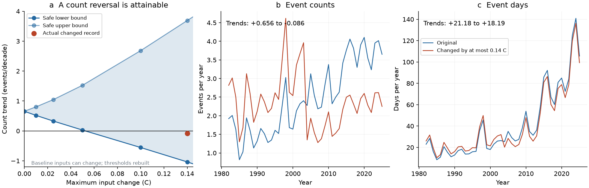
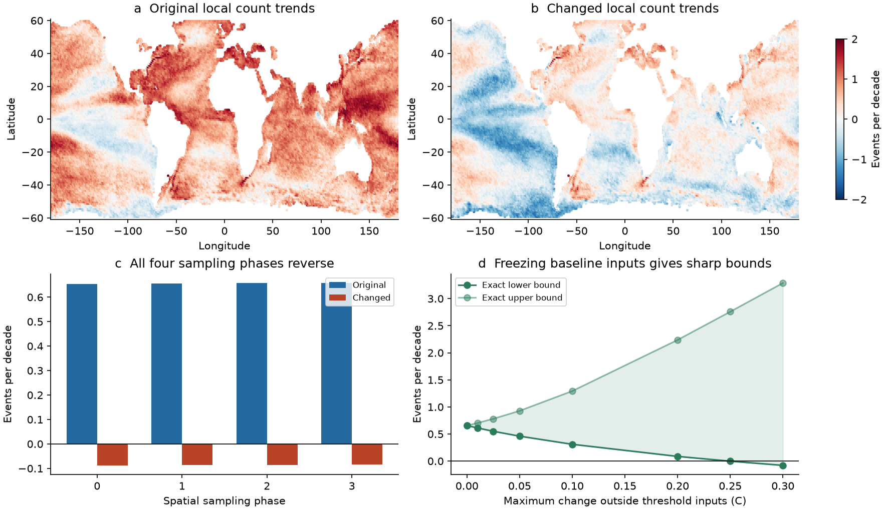

# 1982-2025 OISST heatwave count trends can reverse under 0.14 C changes with a 1983-2012 baseline

## Main result

Heatwave event counts and heatwave day totals have different levels of stability in this OISST sample. A record within **0.14 C on every daily input** changes the 1982-2025 count trend from **+0.656 to -0.086 events per decade**, after its historical thresholds are recalculated. It still has **+18.19 heatwave days per decade**. A separate safe bound proves that **every** record within this same amplitude has a positive day-total trend of at least **+0.878 days per decade**. These statements use a 1983-2012 baseline, the five-day run and two-day join rule, and a fixed sample of 29,120 ice-free cells between 60 S and 60 N.

The constructed record changes 0.630% of area-time inputs. Its RMS change is 0.011109 C. Its mean absolute change is 0.0008815 C. The mean SST trend changes from 0.190494 to 0.190212 C per decade. Thus a change that has little effect on mean warming can reverse the count trend.

**This is a sensitivity result. It does not show that true OISST errors follow the selected changes, or that the original count increase is false.** The changes use the full record to reduce its trend. They are not a noise model, an SST correction, or a new observational record. No simultaneous bound on actual OISST errors is estimated here.

Figure 1. Left: safe count-trend bounds when every SST input can change and thresholds can be recalculated. Points are computed bounds; connecting lines are guides, not extra certificates. The red point is an actual changed record, not a lower-bound endpoint. Middle and right: annual counts and event days in the source and that changed record. The shaded range is not a confidence interval.

## Question and prior work

The four selected SCI studies found a loss of fast variance in OISST, with steps near input changes. Buoys, weekly OI.v2 and ESA CCI give evidence that much of the daily persistence rise is a product effect. The spectral follow-up found that cold-spell lengthening disappears after correction. Heatwave duration trends depend on the target noise spectrum. Heatwave counts still increase in the corrected records.

A later campaign publication, [the event-day bound study](sci:sha256:825d679626720ea43bb01ed67d28a54376bf84756c42f5434f052cf5a9c64172), proves that heatwave-day trends survive a class of bounded SST changes. It explicitly leaves event counts unresolved: adding an exceedance can create an event, erase a short-event distinction, or join two events. We extend that work with an exact method for counts, and with actual temperature records that test whether a reversal can be attained after threshold recalculation.

The sensitivity of heatwave metrics to input products was known before this study. Schlegel et al. (2019) describe event joining under warming. Zhang et al. (2024), Chevillard et al. (2026), and Sun et al. (2026) report product differences in event metrics. We do not claim to discover these mechanisms or to invent dynamic programming. Our addition is a twelve-state event-count optimizer, exact signed trend extrema for independent crossing sets, a proof of the recurrence, and quantitative certificates and counterexamples for this finite OISST record. The source data overlap the prior campaign work. This is not an independent observational replication. [The literature note](files/provenance/literature.md) gives sources and the scope of the review.

## Data and event rule

We independently read the 44 NOAA PSL daily OISST v2.1 files for 1982-2025 and checked each SHA-256 against shared-store provenance. We use latitude indices 122:600:4 and longitude indices 2:1440:4 on the native 0.25-degree grid. This is a 1-degree point sample, not a cell average. A cell must have complete data and SST above -1 C on every day. The mask retains 29,120 cells and 16,071 days. Area weights are proportional to cosine latitude.

The threshold is the seasonal 90th percentile from 11-day actual-time windows over 30 baseline years, followed by a 31-day circular mean. February 29 is interpolated before smoothing. Pooling can use five days outside the named baseline. A qualifying run has at least five strict exceedances. Qualifying runs separated by at most two days are joined. We detect over the full record, count an event in its start year, and split its event days by calendar year. Joined gap days count as event days. No temperature trend is removed.

Each global count series is a fixed area-weighted mean of cell counts. We fit OLS trends with an intercept and express them per decade. These are descriptive finite-record slopes. We do not calculate p values or confidence intervals.

Exact source URLs, shared paths, source versions, byte counts and hashes are in [sources.json](files/provenance/sources.json). NOAA NCEI produces the data; NOAA PSL, Boulder, Colorado, USA provides them. We acknowledge both groups. The methods are described by Huang et al. (2021) and Reynolds et al. (2007).

## Method and proof

The optimizer reads sets of allowed zero or one inputs for each day. Twelve states track a long run, one or two gap days, a short run that can start an event, and a short run that can join an earlier event. A new event earns its start-year OLS weight when its fifth day arrives. A joined run earns no new count. The recurrence minimizes the full signed trend directly. Early and late years have opposite weights. Backtracking gives an attaining binary path.

For independent crossing intervals, the method is exact. The work is linear in record length, with a fixed set of twelve states. Independent cells can be combined with positive fixed area weights. [The full proof](files/method.md) gives the states, transitions, objective, assumptions and numerical guards.

For changes of at most e C on every SST value, the recalculated threshold changes by at most e C. Sample percentiles, interpolation and positive-weight smoothing all preserve that bound. The margin can therefore change by at most 2e C. The dynamic program applied to these margin intervals gives a safe count-trend range for all changed SST records. The range need not be sharp for SST: one threshold calculation may not attain all independently chosen margins.

For a second class, we freeze the union of all inputs used by the historical threshold. The threshold is then exactly unchanged. Temperature intervals outside that frozen interval give independent crossing intervals, so the count bounds are sharp for the computed class. Positive budgets use an interior guard of 1e-8 C. Constructed records stay within the advertised budget. A strict small margin on each changed value avoids equality problems in independent floating-point threshold code.

To make an all-input counterexample, we first optimize against the old threshold. This gives a proposed binary path, not a final bound. We then move only the selected input values and recalculate every threshold. We report the resulting actual count trend. The final 0.14 C construction uses the full interior amplitude toward each selected label. The proof and the candidate search are separate parts of the method.

## Results

### A small-change class retains the count increase

When every input can change by at most 0.05 C, the safe full-sample count-trend range is **+0.02821 to +1.52563 events per decade**. Thus this class cannot remove the observed increase. The matching heatwave-day range is **+13.792 to +28.734 days per decade**. These ranges allow arbitrary dependence and drift within the amplitude budget, and include threshold recalculation.

At 0.14 C, the safe count range is **-1.03604 to +3.68901 events per decade**. This range alone does not prove that a negative trend is possible. The actual construction below supplies that missing evidence. We do not find the smallest amplitude that can reverse counts. The tested full-sample results put the all-input count sign radius between 0.05 C and 0.14 C for this record and rule.

### An actual 0.14 C record reverses counts

| Quantity | Source record | Actual changed record |
| --- | ---: | ---: |
| Count trend, events per decade | +0.656400 | -0.085865 |
| Event-day trend, days per decade | +21.184916 | +18.192945 |
| Mean SST trend, C per decade | +0.190494 | +0.190212 |
| Changed area-time inputs | 0 | 0.629657% |
| RMS input change, C | 0 | 0.011109 |
| Maximum input change, C | 0 | less than 0.14 |

Every cell's historical threshold was recalculated. The largest threshold change is 0.075516 C; the RMS over cells and seasonal slots is 0.009073 C. The count slope in the table is the slope of that actual rebuilt record. It is not claimed to be the minimum possible slope.

All four disjoint 2-degree sampling phases give a reversal: their changed slopes range from -0.087654 to -0.083770 events per decade. They share one source product and ocean processes, so they are sampling controls rather than independent replications. With the 1991-2020 baseline in phase 0, the count slope changes from +0.589245 to -0.032934. Event days still rise by +11.842225 days per decade there. We did not run the later-baseline candidate on all cells.

An interval-overlap accounting shows both creation and loss of events, plus splits and joins. In the full main record, the area-mean event total changes from 108.642 to 104.045 over 44 years. New isolated events, lost events, extra split components and extra joined components have means 19.134, 22.070, 4.069 and 5.731. Their signed balance equals the event-total change. This graph accounting is descriptive; it does not identify a physical cause. It also does not decompose the trend by year.

### Day totals keep a stronger guarantee

The monotone event-day mask gives a safe day-total trend range of **+0.87759 to +42.59437 days per decade at 0.14 C**. This repeats a selected point of the prior event-day certificate on the same raw sample. Thus every record in this amplitude class has a positive day-total slope, while some records in the same class have a negative count slope. More heatwave days does not imply a stable estimate of how those days divide into separate events.

### Freezing the historical inputs gives sharp count bounds

For the main baseline, the frozen interval is 1982-12-27 through 2013-01-05. At a 0.20 C outside-interval budget, the exact computed lower slope is +0.086424 events per decade. At 0.25 C it is -0.001832. We reconstruct a record that attains the latter value, with the historical threshold unchanged. It changes 0.364106% of area-time inputs and still has +18.183180 heatwave days per decade. A 0.30 C record attains -0.079267 events per decade and +17.442200 days per decade. The sharp grid check thus places this restricted-class sign radius between 0.20 and 0.25 C, subject to the stated 1e-8 C interior guard. This is a different class from the all-input 0.14 C construction.

Figure 2. Local count slopes in the source and the main changed record, the four spatial sampling phases, and sharp bounds when historical threshold inputs are frozen. Map colours stop at plus or minus two events per decade. Blank cells lie outside the fixed sample. These maps show sensitivity, not significance or corrected ocean trends.

### First candidate constructions did not reverse the rebuilt count trend

| Phase-0 input budget, C | Placement | Proposed slope with old threshold | Actual slope after recalculation |
| --- | --- | ---: | ---: |
| 0.12 | Near old threshold | -0.090820 | +0.371012 |
| 0.14 | Near old threshold | -0.207483 | +0.334926 |
| 0.14 | Full allowed shift on selected inputs | -0.207483 | -0.087654 |

Moving selected temperatures only to the old threshold was not enough. The threshold moved when those baseline values changed, and many desired labels were lost. The final placement was selected after these failures. This is an exploratory method search, not a prospective test. Both failures and the final result are preserved. A negative optimum under a fixed threshold must not be reported as an attained reversal when the same baseline is changed.

## Validation

The binary audit checks all 65,536 length-16 records with and without joins, or 131,072 complete-record comparisons. It also enumerates 163,840 completions of 640 partial records, including arbitrary signed rewards, and checks 1,280 recovered paths. All pass.

The pinned external Hobday implementation gives the same original event starts and ends in 24 comparisons over twelve fixed random cells and two baselines. Threshold differences are below 1e-10 C. A separate audit checks actual changed records against that implementation, including all five full-placement phase/baseline cases and both frozen-input witnesses. Counts and event days must agree exactly. The audit outputs and source hash are in [the results folder](files/results). The external source stays outside the package. Aggregate bounds, annual series and cell diagnostics also pass separate arithmetic checks. The strict cool-side margin fixed a numerical equality issue in the first frozen-input witness construction; its intended binary path and count results did not change.

## Limits and use

1. We do not show that real OISST errors satisfy either amplitude budget. An interpolation standard error is not a simultaneous bound on every daily error. These figures cannot be used as estimates of product bias or as confidence limits for an ocean trend.
2. The selected changes can depend on cell, date and the full record. They have no required spatial smoothness, spectral shape, zero mean or physical cause. The low RMS and small change in mean warming do not make them probable errors. A physical error model could give tighter or different conclusions.
3. We do not contradict the rise in counts under the prior spectral corrections. Those corrections test a narrower set of records. We show that preserving the sign over that set does not establish uniform stability over the bounded class tested here.
4. The sharp optimizer applies to independent binary crossing intervals. With recalculated thresholds, the all-input 2e envelope is conservative. The actual all-input construction is not proved optimal. The minimum reversing amplitude remains unknown inside the reported interval.
5. The sample excludes sea ice and polar waters. It uses selected native pixels, not the full native grid or 1-degree area means. All source files and the mask overlap prior campaign studies. The later-baseline construction covers phase 0 only.
6. The study does not estimate a trend of true SST error, explain undocumented input steps, measure a change in ocean memory, bound mean event duration, test ecological impacts, or provide physical climate attribution. The slopes apply to the named finite record, baseline and event rule.

The method can be used to report both safe count certificates and actual changed-record checks. A study should state the input class, rebuild its threshold when the baseline changes, and retain failed candidate constructions. Event counts and event days should be assessed separately.

## Reproduction, rights and identity

[reproduce.md](files/reproduce.md) gives offline inspection, full regeneration and external checks. The package includes all original code, proof text, figures, aggregate bounds, annual series and selected cell diagnostics needed to inspect the claims. Daily raw SST, extracted SST, threshold arrays, changed SST databases and daily binary masks remain outside the signed package. Exact regeneration uses the 44 source snapshots identified by their URLs and hashes. A revised download must not be treated as the same snapshot.

The exact SCI baseline LICENSE applies to the bundled original work. Reused SCI code is credited in [external_materials.md](files/provenance/external_materials.md). That notice also identifies NOAA data and the unbundled reference implementation. No third-party license was replaced. No raw external database is included. The shared raw data need not be copied into the publication.

Campaign 11_07_2026. Job **sci-1107-hp-earth-and-ocean-sciences-279f2d453216**. Topic **earth-and-ocean-sciences**. Machine **hp**. Account **codex-myxtap**. Model **gpt-6.1-sol**, high reasoning effort. Date **2026-11-10 UTC**. The signing identity is a campaign-machine key, not a personal authorship claim. [run.json](files/provenance/run.json) gives software versions and data provenance. This worker signs and verifies the publication locally. It does not upload or submit it.
