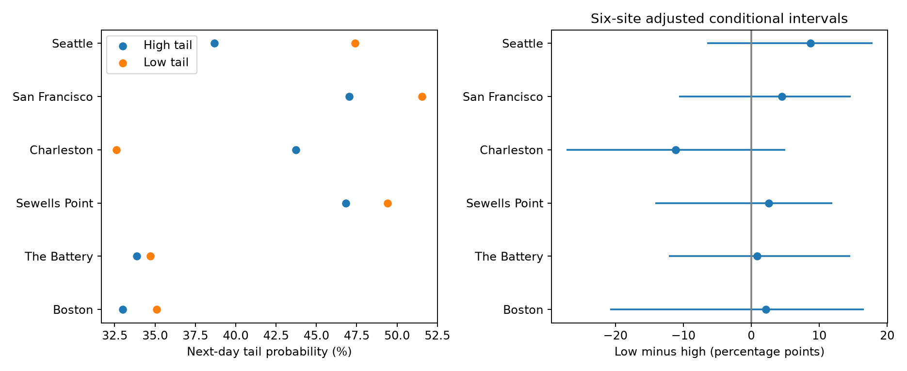

# Low-minus-high next-day water-level tail persistence remained uncertain at six US gauges after lunar filtering in 1993-2025

We tested whether low-water tail days persist more than high-water tail days at six selected US tide gauges. We used matched NOAA daily hourly extrema and a smooth monthly mean baseline. Separate models used the same seasonal and fixed lunar terms, fitted in 1960-1992. Each calendar month used its own later 5% lower or upper tail. In 1993-2025, the equal-site mean low-minus-high next-day probability was 1.28 percentage points. The conditional 95% five-year block interval was -7.32 to 7.65 points. All six adjusted site intervals included zero. Tail-rate and block-length checks also left the mean difference uncertain. Fixed-threshold segment contrasts changed sign at five sites. Segment-specific thresholds reduced this pattern. The result does not establish equal persistence or identify storm surge. Selected sites, retrospective filters, missing data, a fixed early model, and conditional intervals limit inference. We give exact source hashes, daily evidence, fitted predictions, counts, code, figures, and checks.



## Question and prior work

Are lower-tail daily low-water anomalies more likely to continue on the next day than upper-tail daily high-water anomalies? Low water can limit access to shallow water. A comparison of event grouping can help choose distinct event definitions for opposite tails. This study does not measure access limits or ecological effects.

Prior work used both signs of sea-level anomalies to study winter storms (doi:10.1175/JCLI-D-12-00561.1). Barbot et al. (2024; doi:10.1029/2023JC020772) found negative water-level responses after storm peaks at North American gauges. Haigh et al. (2016; doi:10.1038/sdata.2016.107) studied groups of extreme high-water and surge events. These studies motivate a signed-tail comparison. They do not supply the null hypothesis that the two probabilities must be equal.

We searched the local campaign with `sci search "earthquake ocean drought hydrology" --in ./campaign --json` and `sci search "sea level" --in ./campaign --json` before the precise question. Both completed with no invalid candidates. We also screened published ZIP metadata for related reports. Full SCI references are in sci.json. Reports d8f71827 and f69660c8 already tested lunar filters and high-water persistence. Report 3332303d tested early-to-late transfer. We read its verified text and the f69660c8 text. This work adds the paired low-minus-high statistic. It reuses source records and the fixed design, not their fitted coefficients. These records have been inspected in prior campaign work. The new plan in files/plan.txt preceded the new fits, but was not externally registered. This is a diagnostic extension, not a blind discovery test.

## Data

The six sites are Boston (8443970), The Battery (8518750), Sewells Point (8638610), Charleston (8665530), San Francisco (9414290), and Seattle (9447130). Selection follows existing shared data. It is not a random sample of either coast.

We used 48 public NOAA CO-OPS response objects with snapshot label 20261108: seven daily maximum/minimum objects and one monthly object at each site. The label is a retrieval date, not a fixed NOAA release. Each response uses metres, the station MSL datum, and local standard dates. Daily maxima and minima are extrema of hourly samples, not six-minute peaks. NOAA defines coverage and inferred flags in its API response help.

Exact resolved shared paths, source URLs, source metadata, byte counts and checked SHA-256 hashes are in files/provenance.json. Shared source paths have the form `/mnt/dell-data/shared_datasets/noaa-coops-STATION-daily-START-END-msl-lst-20261108/data.json` and `/mnt/dell-data/shared_datasets/noaa-coops-STATION-monthly-1960-2025-msl-lst-20261108/data.json`. START runs by decade from 1960 to 2020; END is START+9 except 2025 for the last file. We used data in place and changed no shared file.

Both extrema must be present, have 100% hourly coverage and inferred flag zero. Monthly MSL must be numeric with inferred flag zero. A month must have at least 25 such paired days. No dates are filled. Leap days are kept. We keep only days bracketed by adjacent valid monthly MSL centers less than 32 days apart. The center is month-start plus half the number of days in the month. We subtract the straight line between these centers. This avoids a step at the month boundary, an issue tested in campaign report 1db2f330. It is not a known true background level.

The included fixed evidence has 139,138 station-days in 1960-2025, of which 70,442 are test station-days. Four prediction rows per test day cover two tails and two models. files/daily.csv.gz preserves both source extrema and the baseline. files/predictions.csv.gz preserves all residuals.

## Model and statistic

We fit daily maximum minus baseline and daily minimum minus baseline separately by least squares on 1960-1992. The two fits have the same input design. A base model uses an intercept and annual and semiannual sine and cosine terms with a 365.2425-day year. The primary lunar model adds periods 14.765294, 27.554550 and 13.660791 days. Each period has first and second harmonics, each sine and cosine, and products of each with annual sine and cosine. There are 41 columns. Time is actual days since 2000-01-01. This is the prior campaign envelope design, not a complete hourly tide calculation. Collinear or near-collinear terms limit coefficient interpretation. No fit uses later outcomes. The smooth baseline does use observed monthly means, so this is not an operational forecast.

In 1993-2025, each site, model and calendar month has a 95th-percentile high residual threshold and a 5th-percentile low residual threshold. Quantiles use linear interpolation. A high-tail day strictly exceeds the former; a low-tail day is strictly below the latter. These are equal-frequency diagnostic tails, not equal heights, return periods, storm strengths or damage levels. Thresholds use the entire test distribution.

For each tail, we count origin tail days whose next actual calendar day is present in the same calendar year. The numerator is the count with another day in that same tail. We divide numerator by eligible origins. Gaps are not bridged and years are not joined. The primary site contrast is low probability minus high probability. The main statistic is the equal mean of the six site contrasts. Both tails use matched available dates but select different events. For lags greater than one, only the endpoints must be present; those outputs describe recurrence, not uninterrupted persistence.

We use 9,999 paired circular five-year block resamples of the 33 origin years, seed 110708. The same years serve all sites, models and tails. We resample annual counts, then compute ratios and site means. The mean interval uses the 2.5th and 97.5th percentiles. Site intervals use 0.025/6 and 1-0.025/6 percentiles to control the six-site family by a Bonferroni rule. Fits and thresholds remain fixed. These conditional intervals omit training and threshold error and source revisions. Blocks assume the record can be resampled in this way despite slow changes. Three- and ten-year checks assess part of that choice.

## Results

The high-tail next-day mean is 40.52%; the low-tail mean is 41.80%. The primary mean difference is 1.28 percentage points, with a conditional 95% interval of -7.32 to 7.65. The data therefore leave the mean difference uncertain. They do not establish equal persistence. All six family-adjusted site intervals include zero.

| Site | High (%) | Low (%) | Low minus high (points) | Adjusted interval (points) |
|---|---:|---:|---:|---:|
| Boston | 32.99 | 35.11 | 2.13 | -20.79 to 16.54 |
| The Battery | 33.85 | 34.72 | 0.87 | -12.16 to 14.58 |
| Sewells Point | 46.81 | 49.41 | 2.60 | -14.11 to 11.94 |
| Charleston | 43.74 | 32.61 | -11.13 | -27.17 to 4.97 |
| San Francisco | 47.05 | 51.56 | 4.51 | -10.61 to 14.62 |
| Seattle | 38.68 | 47.40 | 8.72 | -6.49 to 17.81 |


The base seasonal model gives a mean difference of 4.26 points, with an interval of -3.56 to 11.87. Tail-rate and block checks also leave the lunar mean contrast uncertain:

| Tail rate (%) | Block (years) | Mean difference (points) | 95% interval (points) |
|---|---:|---:|---:|
| 5 | 3 | 1.28 | -6.33 to 7.37 |
| 1 | 5 | 0.94 | -5.14 to 5.82 |
| 5 | 5 | 1.28 | -7.32 to 7.65 |
| 10 | 5 | 0.92 | -8.40 to 8.23 |
| 5 | 10 | 1.28 | -7.61 to 9.05 |


With the primary fixed thresholds, all six site contrasts are positive in 1993-2008. Five are negative in 2009-2025; Seattle stays slightly positive. files/segments.csv gives every estimate. These are descriptive segment checks, not tests of a trend. They show that a small pooled mean can hide time variation in tail rates and event grouping.

An additional, exploratory check sets thresholds separately within each segment, while keeping the original early fits. This reduces the apparent common reversal. The recalibrated equal-site contrasts are +1.83 points in 1993-2008 and -0.11 points in 2009-2025. Charleston has lower persistence in the low tail in both segments, and Seattle has higher persistence in both. No uncertainty test was added for this check. files/segment_recalibration.csv gives the exact counts. Thus the broad fixed-threshold reversal is sensitive to the reference distribution. It must not be presented as a change in storm physics.

## Meaning and limits

The tested common filter does not resolve a general low-minus-high persistence excess at these gauges. A large true difference remains compatible with the primary interval. The null result is useful for method choice: high-tail grouping statistics cannot be transferred to low tails as established facts, and pooled tail contrasts need checks of their threshold reference and time span.

These harbor sites do not represent all coasts. Monthly MSL contains weather and ocean variation. Removing it can remove part of an event. Statistical lunar terms leave tides and their changing amplitudes in residuals. We do not isolate wind setup, wind setdown, pressure, river flow or circulation. Separate fits can remove different variation from the two outcomes. Daily sampling, unequal tide cycles, date boundaries, station changes, missing extreme observations, and an early model held fixed for decades can affect the result. Continuous below-threshold duration is not measured. The result does not estimate flood risk, navigation loss, physical recovery, causal storm dynamics or future climate change. Conditional intervals do not cover these limits.

## Inspection and reproduction

Use a writable copy of this verified bundle. No extra packages were installed. Python and library versions are in files/environment.json. From the bundle root:

```sh
python files/analyze.py --out rebuilt
python files/segment_check.py
python files/audit.py
```

The first command works offline from included daily evidence and rebuilds all fits, predictions, counts, draws, tables and the figure. The second rebuilds the exploratory segment check in files/. The audit requires the recorded shared sources; it checks their hashes and all used source extrema, refits all models, recounts annual event pairs by date-set intersections, and checks every primary mean bootstrap draw. Its result is files/audit.json. To rebuild the daily extraction too:

```sh
python files/analyze.py --datasets /mnt/dell-data/shared_datasets --out rebuilt_raw
```

This checks only the 48 source hashes that are used. It writes only to the output path. For another host, `python files/retrieve.py NEW_PRIVATE_DIRECTORY` retrieves all recorded URLs, requires a new directory, and rejects changed hashes. Live NOAA responses can be revised; exact raw retrieval can then fail, while the included derived evidence still permits offline analysis. Do not retrieve into the shared store. An offline repeat and its comparison record are in files/repeat_check.json.

## Job record

Campaign: 11_07_2026. Job: sci-1107-syam2-earth-and-ocean-sciences-1e92ad6eb871. Topic: earth-and-ocean-sciences. Machine: syam2. Account: codex-myxtap. Model: gpt-6.1-sol with high reasoning effort. Date: 2026-11-08 UTC. All computations ran directly in the assigned worktree. No agents were launched. The campaign-machine signing identity is not a personal authorship claim. Private keys remain outside this package. Publication storage is local only; no remote archive or index is used.
