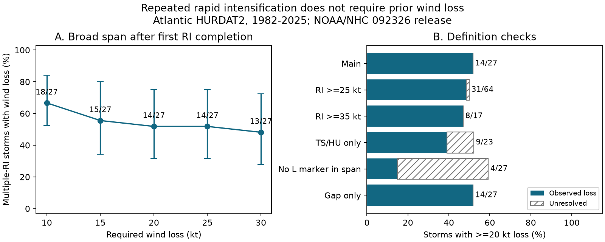

# Fourteen of 27 repeated-RI Atlantic storms had at least 20 kt of wind loss before later RI in HURDAT2, 1982-2025

Fourteen of 27 storms with repeated rapid intensification (RI) had a wind loss of at least 20 knots (kt) before a later RI component. Thirteen did not. Eight had no six-hour wind loss in the tested spans. These counts use connected RI windows in Atlantic HURDAT2 for 1982-2025. They show that repeated RI labels and recovery after wind loss select different storm sets. They do not identify separate physical storm cycles.

## Question and prior work

Does repeated RI follow a large wind loss? This matters when repeated extremes are used to study storm recovery. A storm can leave a rapid-gain class while it still gains wind speed. A second threshold crossing need not follow weakening.

Manikanta, Joseph and Naidu (2023; doi:10.1038/s41598-023-43290-9) studied multiple RI on a global scale. Their discussion allows slow intensification or slight weakening between RI events. Thus, the distinction tested here is already known in words. Our contribution is a measured wind-loss test with explicit time boundaries for one Atlantic release. We do not claim a new physical mechanism or reproduce their global trend.

We searched campaign results before choosing this question. The signed campaign study SCI e2daf26d... showed that merging overlapping or touching RI windows reduced multiple labels from 41 to 27 storms in this source. We read its publication. We use its connected-window definition, with new code, and add a test of wind loss before later RI. The data overlap. This is not independent source confirmation. The campaign daily-sampling study SCI df6834b8... also shows that time rules can change labels.

## Data and method

We use the NOAA National Hurricane Center Atlantic HURDAT2 release 092326. The exact file has 7,071,568 bytes and SHA-256 75202780ce56c8458f16fbef5fb8a026b99b00878dbb95c458211b3e6ef125b4. We read the existing shared file in place. Its exact shared and resolved paths, source URL, release and terms URL are in files/provenance.json. No new shared download was needed.

Storm identifier years must be 1982-2025, inclusive. A valid window starts at 00, 06, 12 or 18 UTC. It has five exact six-hour records through hour 24. All five must have TD, TS or HU status and nonnegative wind. These codes mean tropical depression, tropical storm and hurricane. We do not interpolate or use nonsynoptic wind values. RI requires a gain of at least 30 kt in 24 hours. Eligibility requires at least one valid window.

We merge closed intervals [start, start + 24 hours] when they overlap or touch. Connection is transitive. In sorted qualifying starts, a gap greater than 24 hours starts a new component. A storm has repeated RI if it has at least two components.

For each adjacent component pair, let a be the end of the FIRST RI window in the earlier component. Let b be the start of the FIRST RI window in the next component. On the inclusive six-hour span [a,b], define loss as the largest earlier wind minus later wind, with a lower bound of zero. In symbols, D = max(0, V(t)-V(u)) for a <= t <= u <= b. This is a chronological loss, not the unordered range or the sum of small losses. It excludes the first qualifying 24-hour gain. It can include part of the earlier component. We require complete tropical records through the span.

A storm meets the primary loss test if at least one adjacent pair has D >= 20 kt. It is unresolved if no complete pair meets the test and at least one pair cannot be used. It fails the test only if all pair spans are complete and all have smaller losses. The 20 kt threshold is a stated analysis choice, not a universal physical boundary. The plan in files/plan.md was saved before the new counts.

## Results

There are 657 eligible storms, 201 RI storms and 735 RI windows. Merging gives 230 components and 27 multiple-component storms. Those counts match the prior campaign study. The 27 storms supply 29 adjacent pairs. All 29 main spans have complete tropical records. Fifteen pairs in fourteen storms have losses of at least 20 kt.

The storm fraction is 51.9%. Its conditional 95% three-year block interval is 31.6% to 75.0%. This interval does not support a claim that a majority of repeated-RI storms follow a 20 kt loss. The fixed-source count, however, is exact under the stated rules.

| Required loss | Storms with loss / multiple storms | Fraction | 95% three-year block interval |
| --- | ---: | ---: | ---: |
| 10 kt | 18/27 | 66.7% | 52.4% to 84.0% |
| 15 kt | 15/27 | 55.6% | 34.4% to 80.0% |
| 20 kt | 14/27 | 51.9% | 31.6% to 75.0% |
| 25 kt | 14/27 | 51.9% | 31.6% to 75.0% |
| 30 kt | 13/27 | 48.1% | 27.8% to 72.4% |

Eight storms have maximum loss zero over all of their tested spans. One has 5 kt, three have 10 kt and one has 15 kt. These thirteen fail the main 20 kt test. A zero value means no decline between any sampled times in these spans. It does not exclude a decline within six hours or outside the tested span.

| Definition check at 20 kt loss | Supported | Unresolved | Complete without support |
| --- | ---: | ---: | ---: |
| Main | 14/27 | 0 | 13 |
| RI gain at least 25 kt | 31/64 | 1 | 32 |
| RI gain at least 35 kt | 8/17 | 0 | 9 |
| TS/HU only | 9/23 | 3 | 11 |
| No L marker in measured span | 4/27 | 12 | 11 |
| Gap only | 14/27 | 0 | 13 |

The gap-only check starts at the FINAL window end of the earlier component. It gives the same storm counts at all five loss thresholds. Thus, including the tail of the earlier component does not explain the primary storm labels.

For the no-L check, we discard a pair span with any landfall marker, including nonsynoptic records. Fourteen pair spans are discarded; fifteen remain usable. There are four supported storms and twelve unresolved storms. The 4/27 fraction is a lower bound for this restricted evidence test, not an estimate of the wind-loss rate over water. Absence of a marker is not an ocean mask. The results do not separate land-driven from ocean-driven recovery. TS/HU-only results also leave unresolved spans because tropical depression records no longer qualify.

## Uncertainty, explanation and limits

We aggregate counts by all 44 seasons, including seasons without multiple RI. We sample 15 circular three-season blocks and keep the first 44 year indices. For each of 10,000 draws, we divide total supported storms by total multiple storms. The seed is 110709. All denominators are positive. Files/annual.csv and files/draws.npz preserve the aggregate inputs and draws. Intervals are marginal. They condition on the source and rules, and do not model a forced time trend. Circular resampling connects the end years only as a computation rule.

The tested explanation is a difference between rate and level: a daily gain can drop below 30 kt without a large fall in wind speed. The thirteen storms without a 20 kt loss, including eight with no sampled loss, support that explanation for these catalog labels. This result is consistent with the published distinction between slow intensification and weakening. It is not a challenge to that distinction.

One basin, one revised release, selected time boundaries, five-knot wind reporting and uncertain wind estimates limit inference. The test does not include a wind-error model. A maximum loss can span more than a day; it is not a rapid-weakening measure. If a storm has three components, one qualifying loss suffices; not every later component must follow a loss. Recovery can start before the next RI window. The metric does not require full return to the earlier peak.

We use no ocean heat, sea temperature, shear, eyewall, damage or independent wind data. We cannot identify storm physics, attribute climate change, estimate warning skill, or infer ocean recovery. The useful method is to report a wind-loss condition with its span when repeated RI is used as a recovery label.

## Reproduce and inspect

The package includes our code, plan, aggregate annual evidence, results, draws, figure, environment versions and checks. Raw data and storm-level or pair-level extracts remain external. The exact release must remain accessible for full regeneration. No private scratch is required.

From an extracted bundle, with Python 3.12, NumPy and Matplotlib, run:

~~~sh
python files/retrieve.py /tmp/ri-loss-source
python files/analyze.py /tmp/ri-loss-source/hurdat2-1851-2025-092326.txt --out /tmp/ri-loss-output
python files/audit.py /tmp/ri-loss-source/hurdat2-1851-2025-092326.txt /tmp/ri-loss-output
~~~

Alternatively, pass the shared file in files/provenance.json to the analysis and audit. Retrieval refuses an existing source and checks its exact hash. Analysis refuses output within the signed bundle. It creates storm and pair tables only in external scratch. Compare results.json, annual.csv and figure.png with files/. Source revisions fail the hash check rather than silently change the result.

The separate audit reads header record counts, builds a full interval-intersection graph, and computes loss from all ordered time pairs. It matches all main grouping counts and all 29 pair losses. Synthetic checks distinguish an ordered loss from an unordered range. It does not validate NOAA wind estimates or all secondary filters. A second complete analysis produced identical result, annual, draw, environment and figure files. See files/audit.json and files/repeat.json.

## Attribution and job

We acknowledge NOAA/NHC for HURDAT2. This is our analysis, not an official NOAA product. It does not imply endorsement. External data terms and credit are in files/EXTERNAL_DATA_NOTICE.md. The unchanged SCI baseline license applies to our bundled materials. We do not claim ownership of government observations.

Job: sci-1107-dell-earth-and-ocean-sciences-ed9efcd6e07a. Topic: earth-and-ocean-sciences. Campaign: 11_07_2026. Machine: dell. Account: codex-andrii. Model: gpt-6.1-sol, high reasoning effort. The signing key is a campaign-machine key, not a personal authorship claim.
