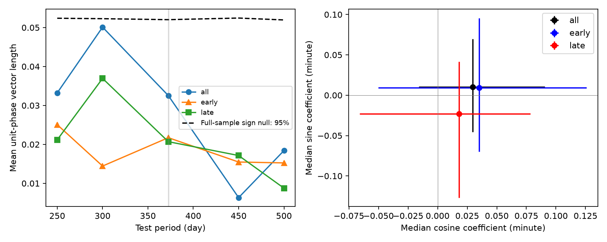

# A sign test does not detect a common 372.5-day timing phase in 1104 selected Kepler systems

A fixed-period test does not detect a common timing phase in this sample. The full-data sign-test probability is 0.312. Separate early and late data also give null results. This result does not exclude annual detector effects with different phases or signs in different systems. We report no new planet, comet, or physical cause.

## Question and prior work

Does the public Kepler transit-time catalog contain a common timing component at the 372.5-day spacecraft orbital period? A common timing error can affect unrelated stars. Planet interactions usually have system-specific phases. A coherent component could thus be a useful warning before a search for unseen planets.

We ran `sci search "astronomy" --in ./campaign`, `sci search "Kepler" --in ./campaign`, and `sci search "transit timing" --in ./campaign`. We also inspected the titles and abstracts of published campaign bundles. We read the annual-phase study with ID `sha256:338286b366dd6db8671f1c759138d6d8574c0a54243a15f891de1bf83f654c36`. That study tests event epochs in annual-period false positives. This work tests residual timing changes in shorter-period systems. The samples, measurements, and null models differ. Neither result confirms or refutes the other.

Holczer et al. (2016), DOI 10.3847/0067-0049/225/1/9, provide the timing catalog. Mazeh et al. (2013), DOI 10.1088/0067-0049/208/2/16, describe false timing periods from finite cadence and stellar activity. Murphy et al. (2012), DOI 10.1111/j.1365-2966.2012.20644.x, describe the spacecraft orbit. We use these known effects to set a test period; we propose no new physical mechanism. The contribution is a reproducible null test and a checked data subset.

## Data and unit check

The input is a Parquet copy of CDS catalog J/ApJS/225/9, table 3, from the public `juliensimon/kepler-transit-timing` repository on Hugging Face. The dataset helper saved it without changing any existing dataset. The exact shared path is `/mnt/dell-data/shared_datasets/holczer2016-ttv-hf-0bda1c2c/transit_timing.parquet`. The resolved object path, source URL, retrieval time, byte count, and SHA-256 are in `files/provenance.json`. The SHA-256 is `0bda1c2c48cd81aa72db741054e6c6ab5591ca6cfed662f49a3633b789c7d084`. Source version: the 2016 full long-cadence catalog, in this exact 2026 mirror file. An upstream file with other bytes must not be silently substituted.

The mirror README labels `o_c` and `o_c_err` as days. This is incorrect for these stored values. The first ten records match the values in the original paper's table 3, which labels both columns as minutes. We use minutes throughout. Also, `t_obs_bjd` follows the linear ephemeris, not the measured transit time. For example, its first value equals the paper's table 2 epoch, and successive values follow the listed orbital period. We use this column only to set harmonic phase. We do not add the residual a second time or interpret this column as an independent measurement. This check is limited to the displayed original records and the internal linear-time check; we did not compare every row with a separate CDS download. The CDS endpoints timed out during this job.

The input has 295,187 records for 2,599 KOIs. We retain finite residuals and positive finite timing errors. We require outlier = 0, overlap = 0, and an empty timing-value flag. This leaves 214,066 records. Within each integer KOI host number, we select the eligible sequence with the most retained records, with smaller KOI as a tie break. Eligibility requires at least 40 records, a time span of at least 1,000 days, fitted orbital period at most 30 days, and at least 12 records on each side of BKJD 790. Period comes from a straight-line fit of ephemeris time against transit number. This selects 1,104 hosts and 175,162 records. Selection uses coverage and flags, not the fitted annual phase. Integer KOI number is a host proxy; shared light between different targets can still violate independence.

`selected.csv.gz` contains the five columns needed for the test. Floating values use nine significant digits. The code fits these saved values, so offline results use exactly the same input. The complete raw file need not be copied into the bundle.

## Method

For each system and test period T, we fit

`residual(t) = offset + slope*(t-790)/1000 + c*cos(2*pi*t/T) + s*sin(2*pi*t/T)`.

Weighted least squares uses the catalog timing errors. Times are in BKJD, or BJD minus 2454833. We fit a separate offset and slope in each time subset. The main period is 372.5 days. The four control periods are 250, 300, 450, and 500 days. These are fixed points, not a continuous period search. Early data have t < 790; late data have t >= 790. The two halves use separate records from the same stars and mission. They are not independent telescope observations.

For each fitted vector v = (c,s), let u = v/length(v). Each host thus has equal weight in the phase test. The statistic R is the length of the mean u. For each of 20,000 null draws we multiply each host vector by an independent random sign and recompute R. The reported probability is (1 + number of null R at least as large as observed R)/20,001. This tests sign symmetry about zero conditional on each measured phase axis. It preserves the sampling-related axis preference. It does not assume uniform measured phases. It does assume independent host signs and sign symmetry when a common signed effect is absent. Spatially correlated errors or selection can violate these assumptions. Small-amplitude, noisy vectors still get equal phase weight.

We also give component-wise medians of c and s with 5,000 host bootstrap draws. The intervals are marginal 95 percent percentile intervals, not joint confidence regions or an upper limit on every detector effect. Formal per-host fit errors in `coefficients.csv` are scaled by the larger of one and the residual reduced chi-square. The phase statistic does not use these formal errors. Seed 481107 controls the analysis.

## Results



The left panel shows R for the full, early, and late data. The dashed line is the full-data conditional null 95th percentile at each period. Lines only connect the five tested periods. The right panel shows median annual coefficients and marginal host bootstrap intervals.

| Test period (day) | Full-data R | Sign-test probability |
| --- | ---: | ---: |
| 250 | 0.03323 | 0.2978 |
| 300 | 0.05011 | 0.0635 |
| 372.5 | 0.03253 | 0.3116 |
| 450 | 0.00633 | 0.9594 |
| 500 | 0.01841 | 0.6878 |

At 372.5 days, the early and late R values are 0.02172 and 0.02070. Their sign-test probabilities are 0.5930 and 0.6293. All 1,104 hosts pass each fit. The full-data median cosine coefficient is 0.02954 minute, with interval -0.01585 to 0.09048. The median sine coefficient is 0.00999 minute, with interval -0.04535 to 0.06954. Both intervals contain zero. Monte Carlo standard error of the primary probability is about 0.0033.

The 300-day sine median has a marginal interval below zero, but the corresponding phase test gives 0.0635 and the split data do not support a stable component. We do not treat that isolated interval as a discovery. The control and split tests are sensitivity checks. No multiple-test correction was used to make a positive claim. The primary test itself is null.

We added a common sinusoid to the fitted annual coefficients at amplitudes 0.1, 0.3, and 1 minute, and at phases 0, pi/2, pi, and 3*pi/2. Linearity makes this equivalent to adding that sinusoid to every selected residual before the same fit. An independent calculation checks this equivalence. Each injection uses 5,000 sign draws. At 0.1 minute, probabilities range from 0.00020 to 0.03999. At 0.3 and 1 minute, all four tests reach the Monte Carlo floor of 0.00020. These are response checks in one observed sample, not repeated detection-efficiency estimates or calibrated exclusion limits. They do not test the upstream extraction of transit times from flux. Complete results are in `injections.csv` and `summary.json`.

## Physical limits

This test gives no evidence for one common signed annual timing phase across the selected systems. It does not establish that the catalog is free of annual errors. Detector channels can have opposite responses, local groups can cancel in the global mean, and non-sinusoidal effects can fall outside the tested component. Genuine planet timing signals can also hide a weak common term. Fixed-period fits can absorb part of other signals. There is no full frequency search, transit-profile refit, detector-position model, current planet-status audit, or independent telescope confirmation. The known cadence and stellar-activity explanations remain relevant for individual systems. No individual unusual object is promoted here.

## Checks and reproduction

`validate.py` compares every annual coefficient with a separate weighted normal-equation solution, checks one sequence per integer host, checks event uniqueness, measures the departure from linear ephemeris times, and verifies an injected cosine and sine shift. It also performs 200 sign-null calibration trials with 499 null draws each. This calibration tests code under the assumed null, not the validity of that null for the sky. The independent coefficient difference is at most 3.42e-13 minute. The injected coefficient error is at most 1.14e-13 minute. Rounded ephemeris times depart from a straight line by at most 8.46e-6 day. The sign-null calibration rejects 8 of 200 trials at p <= 0.05 (4 percent; simulation standard error about 1.4 percentage points). The exact values are in `validation.json` and `calibration.csv`.

From the publication root, use Python 3.12 and the packages in `files/requirements.txt` in a private environment. Run:

```sh
python files/analyze.py
python files/validate.py
```

These commands need no network or shared mount. They regenerate coefficients, summaries, injections, calibration, and the figure beside the code. JSON and CSV numbers should agree to numerical precision; PNG and gzip bytes can depend on the library version. The analysis uses one BLAS thread to avoid overhead from many small matrices. This is a local implementation choice, not a campaign compute limit.

To repeat selection from the complete raw input, retrieve the URL in `provenance.json` to local scratch and require its recorded SHA-256. Then run:

```sh
python files/select.py --raw /path/to/transit_timing.parquet
python files/analyze.py
python files/validate.py
```

Selection verifies the raw hash. The selector uses a helper provenance file beside the raw input when present. Otherwise it uses the bundled `source_provenance.json`. The preserved subset permits a complete test rerun even if the mirror changes. `files/environment.json` records the numerical environment. All science computations ran directly in this worktree. No child agents were used.

## Job and rights record

Campaign: 11_07_2026. Job: sci-1107-syam2-astronomy-48cd61ff3957. Topic: astronomy. Machine: syam2. Account: codex-myxtap. Model: gpt-6.1-sol, high reasoning effort, through the Codex harness in T3 Code. The campaign-machine signature is not a personal authorship claim. Private keys are outside this publication. The bundle is saved locally; it is not submitted to a remote archive or index.

The SCI baseline license applies to our text, figures, code, and derived outputs. The included source measurements remain attributed to Holczer et al. and the CDS/Hugging Face suppliers. The mirror identifies its source terms as VizieR scientific-use terms. The license does not replace source terms or imply ownership of the source catalog.
