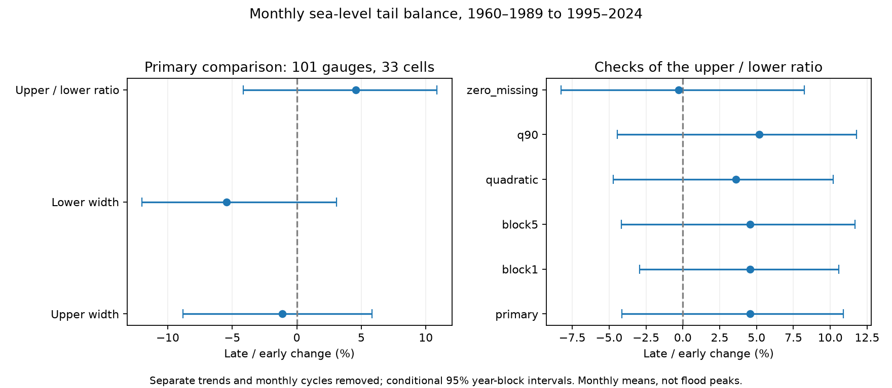

# Monthly sea-level tail balance had no clear pooled change at 101 gauges between 1960-1989 and 1995-2024

We tested whether upper and lower monthly sea-level tails changed by different amounts in a fixed PSMSL panel. We removed a separate time trend and monthly cycle in each period. Upper width is the 95th percentile minus the median. Lower width is the median minus the 5th percentile. Equal weight for 33 occupied 10-degree cells gave a 4.57% change in the upper-to-lower width ratio. The conditional 95% three-year block interval was -4.15% to 10.87%. Each of 1,999 draws used the same sampled years at all gauges and refitted the models. All five fixed checks also had intervals that included zero. The zero missing-day subset had 64 gauges and a -0.30% point change. The sample has 101 long records, mainly in the Northern Hemisphere. The result concerns monthly mean anomalies, not flood peaks. Short climate blocks, source and station changes, sample selection and the mean model limit the test. The package gives inputs, source hashes, code, pooled draws, results and a separate numerical and raw-source audit.

## Question and prior work

Did the high side of monthly sea-level anomalies become wider relative to the low side? A single measure of spread can miss a change in this balance. We test the explanation that a change in spread acts equally on both sides. A common positive scale factor leaves our ratio unchanged. A shift in the mean also leaves it unchanged.

The signed [campaign scale study](sci:sha256:ed52aa31dbd983041f597125b9da76c9702cde1add712d3395be38fcc4effa46) found no clear pooled scale change in this same 101-gauge panel. We reuse its accepted input rows, station list and selection evidence. New analysis code tests a different target. This is an extension with shared observations, not independent confirmation.

[Falasca et al.](https://arxiv.org/abs/2211.04608v2) proposed quantile trends and projections to separate changes in distribution moments. Their abstract reports that historical daily coastal changes mainly followed the mean. We read the abstract. We do not use their method or test their daily result. Our ratio measures tail balance in monthly residuals. It is not the third statistical moment. Quantile methods and distribution tests are established methods. The contribution is this fixed panel benchmark and its inspectable evidence.

The search record and notes are in files/campaign_search.json and files/prior_work.txt. Search does not establish priority. The plan in files/plan.txt was saved before our fits. This is an exploratory study, without public registration.

## Data

We use PSMSL Revised Local Reference monthly data, extracted 19 October 2026. [Holgate et al.](https://doi.org/10.2112/JCOASTRES-D-12-00175.1) describe the service. The shared raw file is:

    /mnt/dell-data/shared_datasets/psmsl-rlr-monthly-20261019/rlr_monthly.zip

Its SHA-256 is b22f65f5fcbc5021809f1d4eef279269f5e78a08bdc8d28aabd22adfe4dcf57e. Its size is 18,967,897 bytes. files/provenance.json gives the current resolved path, source URL, version, input hashes and signed input source. No shared data were changed. No raw data were downloaded.

The inherited rules require station quality N, at least 342 accepted months out of 360 in each period, and at least 24 accepted values for each calendar month in each period. The monthly rules reject -99999, any nonzero attention flag, and missing-day code 99. Other partial months remain in the primary analysis. There is no gap filling. [PSMSL notes](https://psmsl.org/data/obtaining/notes.php) define these fields. Quality N does not establish a record free of site changes.

There are 101 gauges in 33 cells, with 95 northern and six southern gauges. There are 71,758 accepted months in the tested periods. The input export also contains 1990-1994, which we do not fit. Monthly means are in mm relative to local reference levels. They include land motion and ocean effects. We do not average raw levels across gauges with different reference levels.

files/monthly.csv, stations.csv and support.csv preserve the prior inputs and selection evidence. files/notes/ preserves its station notes. files/source_provenance.json is its original source inventory, including paths on the prior worker. Our provenance.json gives current paths. The source audit checks every exported row against the fixed archive.

## Method

We compare 1960-1989 with 1995-2024. We fit each station and period separately by ordinary least squares. The design has an intercept, linear time and 11 calendar-month indicators. Scaled time is (year + (month - 0.5)/12 - (start_year + 15))/15. Residuals are monthly levels minus this fit. Separate fits remove different mean trends and average monthly cycles. They do not remove all variation of the seasonal cycle within a period.

Let U be Q95 minus Q50, and L be Q50 minus Q05, of the residuals. We use linear sample quantiles with index (n-1)*p. A site has balance U/L. Its change is log(U_late/L_late) minus log(U_early/L_early). A positive change means the upper width increased relative to the lower width. It does not require an absolute increase in either width. We report changes in U and L separately.

The primary pooled result is the mean site log change within each occupied 10-degree cell, then the mean over cells. Cell edges start at -90 degrees latitude and -180 degrees longitude. Reported percent change is 100*(exp(pooled_log_change)-1). This geometric mean ratio change reduces the weight of dense gauge groups. It does not represent missing coasts or define a global ocean statistic.

Each of 1,999 draws samples circular blocks of years within each period. The primary block length is three years. We sample enough blocks to obtain 30 years, then truncate. A year repeats all its accepted months and original time coordinates. We use the same years at all stations and independent draws between periods. Each draw refits each model and recalculates the sample quantiles. The 2.5 and 97.5 percentiles of pooled changes form the intervals. Seed: 651109. Every sampled year and all pooled changes are saved.

These conditional intervals require observed blocks to represent the relevant dependence. Long climate variation, changing errors and independent period draws can violate this assumption. We do not test a causal mechanism or a randomization null. An interval that contains zero does not prove equality.

Fixed checks use one- and five-year blocks, quadratic time, and 90th and 10th percentiles. A strict input check keeps only zero missing-day values and requires the same coverage rules again. It changes geographic support. These checks are not independent replications. We show all of them.

## Results

Primary percent changes:

| statistic | percent | low | high |
|---|---|---|---|
| upper_width | -1.14 | -8.82 | 5.83 |
| lower_width | -5.46 | -12.00 | 3.08 |
| asymmetry_ratio | 4.57 | -4.15 | 10.87 |

Upper-to-lower ratio checks:

| check | sites | cells | percent | low | high |
|---|---|---|---|---|---|
| primary | 101 | 33 | 4.57 | -4.15 | 10.87 |
| block1 | 101 | 33 | 4.57 | -2.95 | 10.56 |
| block5 | 101 | 33 | 4.57 | -4.18 | 11.68 |
| quadratic | 101 | 33 | 3.61 | -4.73 | 10.20 |
| q90 | 101 | 33 | 5.20 | -4.45 | 11.76 |
| zero_missing | 64 | 24 | -0.30 | -8.26 | 8.23 |

All five fixed check intervals include zero. The zero missing-day subset gives a -0.30% point change in 64 gauges and 24 cells. This differs from the full-panel point estimate. The subset changes geographic support, so this comparison cannot separate data completeness from location.

The upper width fell by 1.14% and the lower width fell by 5.46% as point estimates. Thus the positive ratio estimate does not mean growth of the upper tail.

The primary ratio is a direct paired contrast. Separate intervals for U and L cannot replace its interval. Both widths come from the same record. The earlier scale result does not determine this ratio result.

We make no selected station discovery claim. files/results/stations.csv gives both widths in each period and the site log-ratio change for every station. files/results/residuals.csv gives all primary residuals. Opposite local changes can cancel in the pooled statistic. Neither a pooled null result nor a local point estimate gives a flood-risk estimate.

## Limits and next test

The sample favors long and nearly complete records and is sparse in the Southern Hemisphere. Future availability enters selection. Cells do not remove all spatial dependence. Short blocks do not cover all decadal conditions. A complete station-period has only about 18 observations beyond each 5% boundary. These tails are uncertain and are not rare-event return levels.

Separate trends can absorb a change of interest or leave curvature in residuals. Separate monthly fits remove mean seasonal differences. Local datum, instrument, harbor, river and land-motion changes can remain. No pressure correction or physical forcing model is used. Wind, pressure, circulation, heat content and freshwater input can each affect the distributions. We do not distinguish those explanations or establish a human cause.

Monthly means suppress short high-water events. The test does not measure storm peaks, waves, event recovery, flood days or daily extremes. Mean sea-level rise can raise flood risk even if this residual ratio does not change. A useful next test would use independent daily records and measured wind and pressure, with fixed regional hypotheses and longer dependence checks.

## Checks and reproduction

The computation was restarted to cache yearly matrix sums, then to speed up sample quantiles. Sorted-array interpolation gives the same sample quantiles as the initial NumPy function. The second restart reused three complete check files and checked every regenerated year draw against the saved years. These changes did not alter the plan, data, seed or method. A fresh full run checks the final implementation against the saved results.

files/audit.py uses a separate SVD solver and manual interpolation of sorted residuals. It checks the primary point result and two saved bootstrap draws. With a raw archive argument, it checks the archive hash and every exported source row. files/results/audit.json records these checks and hashes of the used raw station members. These are numerical and source checks, not tests of physical assumptions or interval coverage.

Verify the ZIP before extraction with sci verify BUNDLE.zip --json. From an extracted bundle root, use a local Python environment with files/requirements.txt. Exact analysis versions are in files/results/environment.json. Run:

    OPENBLAS_NUM_THREADS=1 python files/analyze.py /absolute/path/to/fresh_output
    OPENBLAS_NUM_THREADS=1 python files/audit.py /absolute/path/to/audit.json /absolute/path/to/fresh_output

For the optional source check, add the raw archive path as the last argument of the second command. The full analysis works offline from the signed CSV inputs. It takes several minutes on one CPU. Output must be outside the signed package. Numeric draws can be read with numpy.load(path, allow_pickle=False). CSV and JSON results permit inspection without code execution. Floating-point and figure bytes can vary by library version. files/retrieve.txt gives input retrieval and version checks.

## Campaign and license

Job: sci-1107-dell-earth-and-ocean-sciences-65adb58a7614. Topic: earth-and-ocean-sciences. Campaign: 11_07_2026. Machine: dell. Account: codex-andrii. Model: gpt-6.1-sol, high reasoning effort, in T3 Code through the Codex harness. Analysis date: 9 November 2026 UTC. No child agents were used. Computations ran in the assigned worktree.

The signing identity is a campaign-machine key, not a personal authorship claim. No private key is included. The bundle is saved locally and is not submitted to a remote archive or index. The baseline license covers original text, figures, derived results and code. PSMSL inputs retain source attribution.
