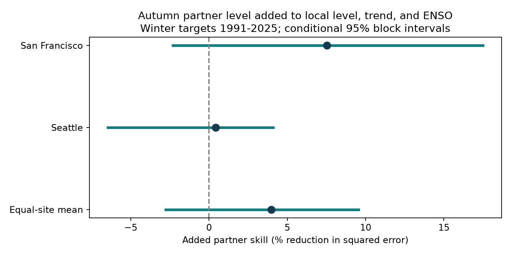
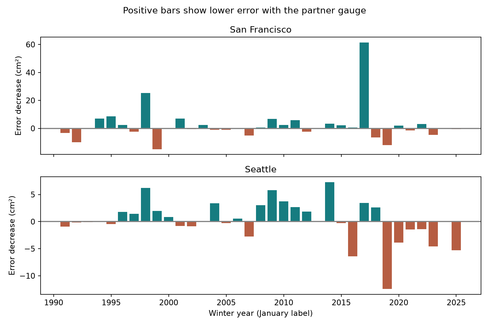

# Autumn partner sea level gave no clear winter forecast gain at San Francisco and Seattle in 1991-2025

Autumn sea level at the other gauge gave an estimated 3.97% reduction in winter mean squared forecast error after local autumn sea level, time, and ENSO were included. The conditional 95% five-year block interval was -2.77% to 9.54%. This interval leaves loss and gain possible. The primary result does not establish added forecast value.



Figure 1. Points show the reduction in mean squared error. Bars show conditional 95% intervals. Site bars are descriptive. The two gauges are dependent, and are not two independent samples of Pacific coasts.

## Question and prior work

Does autumn sea level at a second Pacific gauge add information about the coming winter mean after the local autumn level and ENSO are known? Mean level changes the base from which tides and storms act. A seasonal forecast can thus help define tests for coastal planning. This study does not estimate flood events, damage, or recovery.

[Coherent Modes of Global Coastal Sea Level Variability](https://doi.org/10.1029/2024JC021120) describes shared coastal patterns. [Hamlington et al. (2015)](https://doi.org/10.1002/2014JC010602) estimates ENSO contributions to US coastal sea level. Shared patterns can arise from ocean and atmospheric processes. They need not give extra lead information after local observations are included. [Feng et al. (2025)](https://doi.org/10.5194/os-21-1663-2025) compares seasonal forecast methods with persistence and shows why correlation and direct error scores can give different assessments. We do not compare our scores directly with those different methods and regions.

We searched published campaign results before the precise test. Search records are in `files/*search.json`. We read the signed [seasonal ENSO forecast study](sci:sha256:930a0d10f6cec93dd1d38dd77d327bff857fbdec3f10ae12d24e5acd73c429d8) and [monthly ENSO study](sci:sha256:e21b84ef73e14748707047ddaf5138f5ce291c6c15b223b5b0e1467b782302f9). They leave added ENSO skill uncertain after local observations. We also read the [daily Atlantic partner study](sci:sha256:c1307c25bf3019dd32804c881c7c620b0558d13c901afbd77f391420975e4b15). Its positive daily result does not answer this seasonal Pacific question. Our contribution is a small spatial forecast benchmark with local level and ENSO already in the reference model. New code reads shared raw data. The search does not prove novelty across all science. These source periods were used in prior campaign work; this is not an independent data replication.

## Data and support

We read three shared raw files in place. We verified their hashes against the shared metadata. We made no change to shared data and downloaded no new raw data. `files/provenance.json` gives exact absolute and resolved paths, source URLs, byte counts, retrieval times, and full hashes. The source paths below are relative to `/mnt/dell-data/shared_datasets/`:

- `noaa-coops-9414290-monthly-1960-2025-msl-lst-20261108/data.json`: San Francisco. SHA-256 `2b80efcf2d7da20a972a66275e3b46988e516b257403ba72424d7ef6b75733ba`.
- `noaa-coops-9447130-monthly-1960-2025-msl-lst-20261108/data.json`: Seattle. SHA-256 `7b9564e0e3ba6d9b651cbfbbef4d628f9398cc938975b0d5861d9abed911fecf`.
- `noaa-cpc-nino-monthly-ersstv5-9120-20261107/nino-monthly.ascii.txt`: monthly ERSSTv5 regional SST table. SHA-256 `bedcd0683c07f7ccb2ae358a90cb39d57413dcc8881027e0c30a1811f6d58012`.

The gauge API responses were retrieved on 2026-11-08; the SST table was retrieved on 2026-11-07. Gauge snapshots have no separate release number. Their hashes fix the versions. The SST source uses a 1991-2020 reference. We use whitespace column 10, the Nino 3.4 anomaly in degrees C, not absolute SST or an ENSO event label.

The bundle preserves all 1,575 monthly gauge rows in 1960-2025 with the used fields. It also preserves the small full SST source file. Extra January 2026 gauge rows returned by the API are excluded. No 2026 value enters a model or target. Monthly MSL is an observed relative level in metres above a fixed local MSL datum. It is not zero by definition. Local land motion can affect it. Intercepts absorb fixed datum offsets; no direct subtraction of levels between sites is needed.

Winter year y is December y-1 through February y. Autumn is September through November y-1. Each seasonal mean weights the three months equally. Every month must exist, be finite, and have an inferred string of zero. Gaps are not filled. The same complete years apply to both sites and all compared models. This includes complete outcomes at both gauges. It is a selected-support retrospective test, and can lose valid Seattle seasons when San Francisco data are missing.

The 65 possible winters span 1961-2025. Seven lack at least one required site-season: 1963, 1968, 1970, 1977, 1978, 2013, and 2024. Evaluation loses 2013 and 2024, leaving 33 common winters. `files/results/quality.csv` lists unavailable seasonal fields. `monthly.csv` permits inspection of the exact source flags and gaps. Missing data can bias scores if loss depends on level or weather.

## Method

The plan in `files/plan.txt` was saved before outcome fits. This is a within-session plan, not external registration. The gauge pair follows the two Pacific gauges available in the earlier campaign source set. It was not selected by the present score.

For each site and test winter from 1991 to 2025, fit ordinary least squares with earlier complete winters only. Training starts in 1961. There must be at least 20 complete training winters. Primary fits have 25 training winters at the first issue and expand thereafter. Neither the target winter nor future winters enter the fit. All predictors precede the first target month. The baseline B has an intercept, `(winter year - 1980)/10`, local autumn mean MSL, and autumn mean Nino 3.4. Model P adds the other gauge's autumn mean MSL. The partner is Seattle for San Francisco and San Francisco for Seattle. Fits are separate by target site. Model T uses only intercept and time; model L adds local autumn level to T. These simpler models provide context only.

At each site, added skill is `100 * (1 - MSE_P / MSE_B)`. Positive skill means lower mean squared error with partner data. The primary score is the equal mean of the two site skill ratios. It is not a ratio of pooled errors. All errors compare the same site-winters within each design. The package saves each forecast, training count, training year range, regression coefficient, and design condition number.

For uncertainty, take 9,999 circular moving-block samples of the 35 test calendar positions, with five-year blocks and seed 11071107. Keep each sampled year common to both sites. Missing years remain missing. Recompute both MSEs and their ratio in every draw. The 2.5th and 97.5th percentiles give the interval. Fits and observed support stay fixed. This interval describes variation among the observed error blocks. It omits training estimation error, source error, and future climate change. Circular sampling joins the test-period ends and assumes the observed blocks represent relevant dependence. It cannot resolve all long ocean cycles.

NOAA monthly verification occurs after the observation month and has no fixed release day. Thus November data might not be available at the start of December. The source data and anomaly reference also have later revisions. This is a chronological hindcast, not a real-time operational test. The October check leaves November between the latest input and the first target month, but also does not prove historical availability.

## Results

| Target | Test winters | Baseline RMSE (cm) | Partner RMSE (cm) | Added skill (%) | 95% interval (%) |
| --- | ---: | ---: | ---: | ---: | ---: |
| San Francisco | 33 | 5.51 | 5.29 | 7.53 | -2.31 to 17.48 |
| Seattle | 33 | 5.84 | 5.83 | 0.41 | -6.45 to 4.10 |

The equal-site skill is 3.97%, with an interval of -2.77% to 9.54%. Both site intervals also include zero. The larger San Francisco point estimate does not establish a difference between directions or identify wave propagation. Site errors, noise, missing processes, and model estimates can differ.

For context, trend-only RMSE is 7.24 cm at San Francisco and 7.64 cm at Seattle. Adding local autumn level gives 5.87 cm and 6.63 cm. Adding ENSO as well gives the baseline values in the table. These are descriptive nested-model scores. Their skill ratios have different denominators and cannot be subtracted as an information split.



Figure 2. Each bar gives baseline squared error minus partner squared error for one winter. Positive values indicate lower error with partner data. The saved forecasts permit direct checks of each bar. Missing winters have no bar.

All planned checks below use the same primary score definition. Refitted designs use their own matched support. The large-event deletion and period checks keep the original forecasts. The two period checks resample within their own calendar spans. Their differences are descriptive, not a test of a change in the process.

| Check | Test winters per site | Added skill (%) | Conditional 95% interval (%) |
| --- | ---: | ---: | ---: |
| One-year blocks | 33 | 3.97 | -3.32 to 11.97 |
| Ten-year blocks | 33 | 3.97 | -2.65 to 9.39 |
| Remove 1998 and 2016 from scoring | 31 | 3.06 | -4.22 to 10.95 |
| Test winters 1991-2007 | 17 | 1.93 | -3.17 to 8.36 |
| Test winters 2008-2025 | 16 | 7.02 | -9.01 to 14.50 |
| Prior 30 calendar years for training | 33 | 7.85 | -4.31 to 17.02 |
| Add quadratic time to both models | 33 | 3.70 | -3.26 to 10.19 |
| October inputs with November buffer | 34 | 7.23 | -2.10 to 13.53 |
| Add local November minus September level | 33 | 3.44 | -1.64 to 8.11 |

Every planned sensitivity interval includes zero. The October design has one more test winter and different input months. Its score is not a paired estimate of a buffer effect. The prior-30-year design requires at least 20 complete earlier winters. The local-change check adds local November minus September MSL to both B and P. `influence.csv` gives all one-test-winter deletions. No sensitivity result replaces the primary test.

## Meaning and limits

These records leave the extra value of one partner autumn mean uncertain after this local-level and ENSO baseline. This does not prove that coastal spatial information is absent or redundant. A second gauge could help with shorter lead times, different input summaries, more sites, nonlinear models, or a longer record. The present results do not validate those possibilities.

Shared winds, pressure, ocean heat, coastally trapped waves, and large-scale circulation can affect both gauges. We did not measure these processes and cannot assign a cause. A partner coefficient does not show direction of physical transport. An ENSO covariate does not remove every ENSO pathway. We make no new claim about an ENSO mechanism.

Only two selected harbor gauges and 33 test winters support the primary result. Retrospective source processing, equal month weights, linear models, common-case selection, and a short error record limit transfer. Long dependence or changing conditions can invalidate the block interval. The test predicts a seasonal mean. It does not predict tides, surge, waves, flood frequency, flood duration, water supply, or damage. No climate attribution follows.

## Reproduce and inspect

First verify the ZIP with `sci verify BUNDLE.zip --json`, then extract it. Install the packages in `files/requirements.txt` into an environment outside the bundle. The saved run used Python 3.12.15; package versions are also in `files/results/environment.json`. Keep library threads at one.

From the extracted root, choose a fresh absolute directory on local disk:

```sh
PYTHON=/absolute/path/to/python sh files/reproduce.sh /absolute/local/output
```

The script uses `campaign-compute` on campaign hosts. Elsewhere it uses the same code with one library thread; use equivalent resource limits. Allow 1 GiB RAM and one CPU. This small analysis and audit completed in seconds on hp. Compare the new CSV, JSON, and NPZ outputs with `files/results/`. The two PNG figures are also regenerated. Differences in package versions can alter numerical rounding or image bytes.

To rebuild extracts from the shared raw snapshots, use `python3 files/prepare.py /mnt/dell-data/shared_datasets /absolute/new/input`. It verifies all three raw hashes before extraction. The optional `files/retrieve.py` uses `campaign-dataset` with exact URLs and required hashes. A changed live source can prevent exact retrieval. Do not substitute a revised source silently. The saved used-field inputs permit a fully offline numerical repeat without the raw store.

The separate `audit.py` checks input hashes, rebuilds seasonal values with decimal arithmetic, and fits normal equations with a scalar elimination method. It checks all 1,328 forecasts across the primary and refitted checks, training restrictions, the primary score, and all 9,999 saved primary draws. On this host it also checked all 1,575 saved gauge rows against raw files. Maximum forecast difference was 1.28e-15 m. Maximum draw difference was 8.89e-14 percentage points. All checks passed. This is a same-worker numerical audit, not external peer review. `repeat_check.json` records byte-identical output for all 19 analysis and audit files from a second local run. Initial environment and subperiod-resampling fixes are recorded in `files/run_notes.txt`.

## Campaign record and rights

Job: `sci-1107-hp-earth-and-ocean-sciences-dd2a38ca6244`. Topic: `earth-and-ocean-sciences`. Campaign: `11_07_2026`. Machine: `hp`. Account: `codex-myxtap`. Model: `gpt-6.1-sol`, high reasoning effort, in T3 Code through the Codex harness. No agents were launched. Substantial numerical work used `campaign-compute` with library threads set to one. The package is saved to the local campaign only, with no remote upload. The campaign-machine signature is not a personal authorship claim. Private keys remain outside this package.

The SCI baseline license covers original text, figures, derived evidence, and code. NOAA sources keep their source status and attribution. Cited papers are not included or relicensed.
