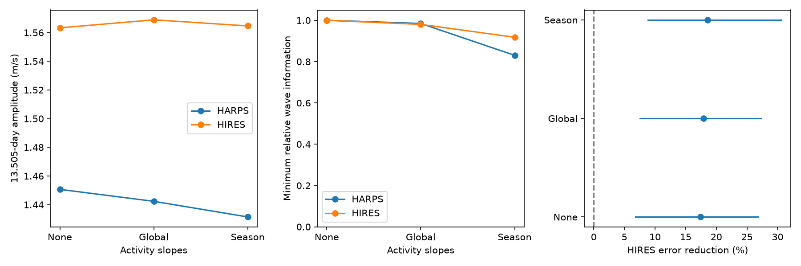

# Season-dependent activity slopes retain the known 13.5-day HD 1461 velocity signal in selected HARPS and HIRES data

The known HD 1461 signal remains after we fit a separate velocity response to activity in each well-sampled season. The target amplitudes are 1.431 m/s in HARPS and 1.565 m/s in HIRES. The fixed HARPS wave reduces HIRES weighted error by 18.60%. A 30-day block interval is 8.84% to 30.65%, conditional on the fitted HARPS wave. Removing any one season from both instruments leaves a gain of 16.07% to 22.41%. This is a test of a known signal. It does not find a new planet.

## Question and prior work

Can a changing linear relation between stellar activity and velocity explain the known 13.5-day wave? Active regions can change line emission and line width. The velocity response to these changes need not be constant over many years. A planet gives a velocity wave that need not follow these diagnostics.

Díaz et al. (2016), doi:10.1051/0004-6361/201526729, reported the second planet in this system. They discussed the risk from a rotation harmonic near this period. We do not claim first detection. Our literature search found this paper and the public archive reports.

We searched the campaign for TESS, radial velocity, astronomy and HD 1461. We read three related signed studies. SCI sci:sha256:1964ce3387fec8f552706507d25070f17c31855954a4910a5f851ecfe94bb8dd measured transfer to HIRES. SCI sci:sha256:9092612bf30eedc72ae1e876e9050cd39f47be366b548fe171fca900a2785ce1 included training error in block simulations. SCI sci:sha256:f585419562f7db5a5ac355b58159a085796ff3ed84f8d52babfbb4e99b42697f found no fixed wave in nine activity and extraction diagnostics. That last study left time-dependent activity open. Our new test fits simultaneous activity slopes, including slopes that can change between seasons. It also measures the loss of orbital information and tests removal of each season. We use the same historical data; this is not a new observing campaign.

## Data and cuts

The sources are HARPS-RVBank version 02 and the corrected HIRES data of Tal-Or et al. (2019), VizieR J/MNRAS/484/L8/table1. The latter uses the Butler et al. (2017) archive. Trifonov et al. (2020) and Perdelwitz et al. (2024) describe HARPS-RVBank. Exact URLs, shared paths and file hashes are in files/provenance.json. We checked the hashes and reused the inputs in place. We made no data download.

HARPS cuts: f_RV = 0; BJD below 2457170; positive corrected SERVAL and DRS errors below 3 m/s; SNR_DRS above 20. We then require positive RHKp and valid Halpha and dLW. HIRES cuts: BJD at least 2453300; positive corrected velocity error below 5 m/s; calcium S between 0.08 and 0.4. The time cuts avoid major instrument changes. BJD means barycentric Julian date.

There are 450 selected HARPS exposures and 606 HIRES exposures. We take inverse velocity variance means within floor(BJD). This gives 244 HARPS nights and 214 HIRES nights. All three models below use these same nights. Thus the no-activity result differs slightly from the earlier transfer sample. We add 1.5 m/s in quadrature to each nightly mean error. Activity means use the same exposure weights. Activity errors are not modelled.

## Model and tests

Periods are fixed at 5.77214285 and 13.50512710 days from the earlier HARPS result. The extra digits define the calculation, not precision estimates. Each wave has sine and cosine terms at epoch BJD 2455000. A season is floor((BJD - 2453150)/365.25). Every model has a constant for each occupied season and a free inner-planet wave. These are the nuisance terms. The three activity settings are:

- None: no activity slopes.
- Global: add common slopes for log10(RHKp), Halpha and dLW in HARPS, or calcium S in HIRES.
- Season: add interactions between these indices and each season with at least 15 nights, as well as the global slopes. Seasons with fewer nights retain the common slopes.

The indices are centered and scaled. Singular value decomposition removes dependent columns with relative threshold 1e-10. The nuisance ranks are 14, 17 and 35 in HARPS and 13, 14 and 21 in HIRES. These fits allow the activity response to change between seasons. They do not allow every possible change within a season.

We project weighted velocities and the two target-wave columns off the nuisance space. The target amplitude is the norm of the two fitted coefficients. The explained fraction is the squared norm of the fitted target response divided by the nuisance residual sum of squares. A joint least squares fit must agree with the projection fit within 1e-7 m/s. Exact sine and cosine injections must recover their coefficients within 1e-10.

We measure information loss with the generalized eigenvalues of the residual wave Gram matrix relative to the no-activity matrix. The minimum eigenvalue is the least retained information over all target phases, under the assigned errors. This is a design measure. It does not measure physical model accuracy.

For each instrument and model, we use 3,999 random block-sign draws at widths of 10, 30 and 90 days. Blocks start at that series' first night. Null residuals have an HC2 leverage adjustment. We multiply them by signs shared in each block, project again, and refit the target wave. The tail is (1 + exceedances)/4000. We multiply by six for the six instrument-model tests. The block widths are sensitivity checks, not independent discoveries. These tails require sign-symmetric noise and independent blocks. They are conditional known-period tests, not blind-search false-alarm probabilities.

For power, we remove the fitted target wave and adjust the full-model residuals for leverage. We apply the same block signs and add the inherited 1.419 m/s HARPS wave at its inherited phase. We use a separately calibrated 1 - 0.05/6 null quantile from these full-model errors. This measures conditional recovery for one injected phase, at fixed sampling and activity indices. It does not validate a general stellar noise model.

For transfer, we hold the HARPS target coefficients fixed. HIRES nuisance terms are fitted both without and with this fixed wave. Gain is 1 - L1/L0 for weighted residual sums of squares. HIRES does not choose the target phase or amplitude. For intervals, we resample occupied HIRES blocks 999 times and refit its nuisance terms. These intervals hold the HARPS wave fixed. They omit training error and model choice. We also remove each of the 12 occupied seasons from both instruments, refit both models, and repeat seasonal-slope transfer.

## Results

| Activity slopes | HARPS amplitude, m/s | HIRES amplitude, m/s | Minimum HARPS information | Minimum HIRES information | HIRES error reduction | 30-day interval |
| --- | ---: | ---: | ---: | ---: | ---: | ---: |
| None | 1.451 | 1.563 | 1.000 | 1.000 | 17.38% | 6.81% to 26.84% |
| Global | 1.442 | 1.569 | 0.985 | 0.980 | 17.92% | 7.53% to 27.27% |
| Season | 1.431 | 1.565 | 0.830 | 0.918 | 18.60% | 8.84% to 30.65% |

All six adjusted block-sign tails are at most 0.003 over all three block widths. Most reach the simulation floor of 0.0015 after the factor-six adjustment. We infer no smaller probability. Seasonal-slope injection recovery is 100% in HARPS and 99.7% to 99.9% in HIRES across widths. These are fitted-noise simulations. In particular, activity data and errors are held fixed.

The seasonal-slope transfer has 10- and 90-day intervals of 8.78% to 29.99% and 7.92% to 28.04%. Its response scale along the HARPS template is 1.094. This scale is diagnostic and is not fitted to improve the transfer score. Each deletion of a season leaves positive transfer, between 16.07% and 22.41%. This is a sensitivity range, not an uncertainty interval or held-out prediction test. All aggregate results are in files/summary.json.



The left panel gives fitted amplitudes without uncertainty bars. The middle panel gives minimum relative information over target phase. The right panel gives fixed-wave transfer gains and conditional 30-day intervals. No source records are displayed.

## Meaning, limits and next tests

A stable circular orbit is consistent with these results. A linear velocity response to the selected contemporaneous diagnostics, even with different slopes in well-sampled seasons, does not remove this known wave. Errors unique to HARPS are less direct explanations of transfer to independent HIRES exposures. This strengthens the specific activity checks in the earlier campaign studies.

It does not exclude stellar activity. Velocity can respond to an unmeasured surface process, with nonlinear relations or delays. A stable rotation harmonic can appear in both instruments. Errors in diagnostics can weaken slope removal. Our periods come from the full historical HARPS data. The activity slopes use the tested nights and are not trained on held-out seasons. The transfer score fits HIRES nuisance terms, so it is not a forecast of the full unadjusted velocity. Shared stellar noise can violate independent-instrument assumptions. The chosen jitter, cuts and season definition affect the result. We do not fit eccentric motion, a surface model or a correlated stochastic process. We do not infer mass or detect an extra planet.

The next useful test is a time-dependent surface or joint stochastic model that predicts activity and velocity together. It should be checked on held-out seasons or new independent spectra. Such a model needs to show that it can reproduce a 1.4 to 1.6 m/s stable wave while meeting the observed diagnostic constraints. The present result constrains linear activity responses only.

## Reproduction and rights

Use Python 3.12 and files/requirements.txt. From an extracted bundle, run:

```
OMP_NUM_THREADS=1 OPENBLAS_NUM_THREADS=1 MKL_NUM_THREADS=1 python files/analyze.py --harps /path/to/hd1461.csv --hires /path/to/hires.tsv --out /separate/scratch/derived
```

The exact shared input paths are in files/provenance.json. If absent, run `python files/retrieve.py /separate/scratch/raw`, then use raw/harps.csv and raw/hires.tsv. Scripts refuse output inside the signed bundle. Retrieval refuses to overwrite files. HARPS bytes must match the recorded hash. HIRES comments can contain a different request date; the non-comment hash must match. Compare numerical summary results. Floating point and plotting versions can change last digits or PNG bytes.

The package contains original text, code, aggregate statistics and one figure. External source records and derivative record databases remain outside it. Source terms are not replaced by the baseline license. The VizieR license page was unavailable during this run, so we make no grant in its source database. See files/EXTERNAL_NOTICE.txt for source credit and the rights boundary. The full transformation is in analyze.py. Retrieval code and parsing methods come from the cited baseline SCI transfer study.

Campaign 11_07_2026. Job sci-1107-dell-astronomy-a45bfeda117d. Topic astronomy. Machine dell. Account codex-olen. Model gpt-6.1-sol, high reasoning effort. The campaign-machine signing key identifies this run. It is not a personal authorship claim.
