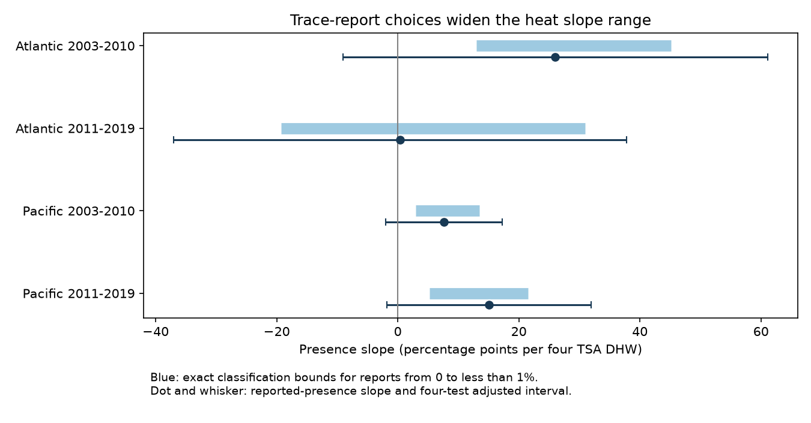

# Changing reports below 1% kept fitted heat slopes positive in three of four coral samples in 2003-2019

## Question and result

Can uncertain trace reports alone explain the positive fitted link between heat stress and the presence of coral bleaching? We let each survey report with bleaching above zero but below 1% count as either presence or absence. Other reports stay fixed. We calculated the full range of possible heat slopes under this rule.

Three of four ocean-period samples kept positive fitted slopes for every allowed choice. The later Atlantic sample allowed both signs. This is a fixed-sample result under a narrow error rule. All four primary country-cluster uncertainty intervals for the reported-presence slope included zero. Thus the result does not establish a positive population association in all four samples.

The rule matters. If reports below 2% can change, all four samples permit a negative fitted slope. Trace-report choices alone do not remove three positive point estimates under the 1% rule. They can remove all four under the 2% rule. Neither rule is a measured detection limit.

## Prior evidence and study choice

Sully et al. (2019; DOI 10.1038/s41467-019-09238-2) found global links between bleaching and environmental conditions. The public archive is described by Van Woesik and Kratochwill (2022; DOI 10.1038/s41597-022-01121-y). Its version 2 joins field reports to CoRTAD version 6 heat measures.

Before choosing the question, we searched the shared SCI campaign for phenology, climate, pollution, bleaching, positive severity, and trace detection. We read SCI 053ae1380c211d172074dbb24811ca5ca0a63e4112efbad9fc0ce66ce2786ac2 and SCI 52b5554426b8148a4a7b35d80356fb11dcac9add40fe866bddadbb0abdb87926. They tested high bleaching thresholds and a capped mean split. They informed the sample and model design. This study tests uncertain low positive reports with exact bounds on a presence slope. Its source observations overlap those studies. It is not independent confirmation of their evidence or a claim of a new biological heat mechanism.

We inspected raw value counts before setting the 1% rule. Values such as 0.25%, 0.5%, and 0.75% were common. Those values need not be errors. The main rule, 0.5% and 2% checks, same-calendar-month check, and year-cluster check were set before the first regression run. There was no external registration.

## Data and observation controls

The source is BCO-DMO dataset 773466, version 2, dated 2022-10-14. We use Reef_Check records in the Atlantic and Pacific in 2003-2019. We check agreement of all used fields within each Sample_ID, including missing status, then remove repeated substrate rows. The frame contains 10,586 unique reports. Complete values, bleaching from 0 to 100%, depth from 0 to 40 m, and nonnegative heat leave 9,623 reports. They form 7,820 site-year-month units before the repeat-year filter.

Each report has a presence indicator: one if Percent_Bleaching is above zero, else zero. We average this indicator, heat and depth within a site-year-month. We also retain the fraction of reports in the trace range. Thus the outcome is a share of included reports, not the share of colonies bleached. We do not apply the trace rule to mean monthly bleaching. Every monthly unit has equal regression weight.

We split years into 2003-2010 and 2011-2019. In each ocean-period we keep sites with records in at least two distinct years. Main models use 5,336 monthly units and 6,377 reports. Ocean samples have separate sites. Time samples have separate years but can share sites. All samples use one reporting system. These are separate geographic and temporal checks, not four independent data sources.

The model is:

`presence share = site effect + year effect + calendar-month effect + beta * TSA_DHW/4 + gamma * depth + error`.

TSA_DHW is the supplied CoRTAD version 6 accumulated heat stress measure. It is not interchangeable with all other products called degree-heating weeks (DHW). We report slopes in percentage points of report presence per four TSA DHW. The linear model is a summary over observed heat support. It is not a probability forecast outside that support.

Site effects remove stable site differences. Year and month effects remove common annual and seasonal changes. Depth adjusts for measured survey-depth changes. The same-month check replaces site effects with site-by-calendar-month effects and requires repeated years within these groups. None of these controls removes changing observers, event-driven visits, missing reports or changing coral composition. Missing bleaching values are excluded, not coded as absence.

## Exact bounds and proof

Let X contain the heat and depth columns after the removal of fixed effects. Let h be the first column of `X (X'X)^(-1)`. For monthly outcome y, the fitted heat slope is `h'y`. Let q be the monthly fraction of trace reports. Each monthly outcome can range from `y-q` to `y`, in steps set by its report count. This keeps the model, eligible records, weights and heat fixed.

The sharp lower slope is:

`beta_low = beta_reported - sum(max(h,0) * q)`.

The sharp upper slope is:

`beta_high = beta_reported - sum(min(h,0) * q)`.

To attain the lower value, classify every trace report in a month with positive h as absent, and all others as present. Reverse this choice for the upper value. The endpoint choices are valid binary assignments, so report-count steps do not prevent attainment. This proves that no narrower interval contains all possible fitted slopes under the rule. Bounds can rise above the reported slope because removing presence at negative h raises that slope.

A separate calculation sorts each positive-h trace report by `h / monthly report count`. It finds the smallest number of trace reports that must change to make a positive slope nonpositive. It gives one report in the later Atlantic sample. In the other main samples no allowed number can do this. Blank tipping counts in files/results.csv mean that no allowed set can reverse a positive slope; they do not mean missing computation.

These are deterministic classification bounds. They are not confidence intervals. We do not combine sampling uncertainty with classification uncertainty into a population bound. The rule assumes that zero reports are true absences, reports at or above the cutoff are true presences, all model covariates are correct, and each trace report can vary independently. It does not bound error in bleaching percentages, missed surveys or unreported positive cases.

## Main evidence

| Ocean and years | Monthly units | Trace reports | Reported slope | Exact 1% bounds | Adjusted interval for reported slope |
| --- | ---: | ---: | ---: | ---: | ---: |
| Atlantic 2003-2010 | 514 | 88 | 26.02 | 13.00 to 45.19 | -9.08 to 61.13 |
| Atlantic 2011-2019 | 464 | 69 | 0.38 | -19.26 to 30.94 | -37.06 to 37.81 |
| Pacific 2003-2010 | 1,583 | 195 | 7.65 | 2.99 to 13.53 | -1.95 to 17.25 |
| Pacific 2011-2019 | 2,775 | 256 | 15.05 | 5.27 to 21.57 | -1.83 to 31.92 |



There are 608 trace reports among 6,377 included reports. Their full range of classifications does not reverse three fitted slopes. That result does not show that these slopes have low sampling uncertainty. Main intervals use independent country clusters as a working assumption, with 20, 16, 19 and 14 clusters in table order. Covariance uses cluster scores and the CR1 finite-sample multiplier. The parameter count uses the sum of indicator levels and both slopes, minus two shared intercept columns. Any additional redundant columns are counted, which can enlarge the multiplier. Student t critical values use G-1 degrees of freedom. A Bonferroni rule uses alpha 0.05/4. The resulting family coverage is approximate and depends on the cluster assumptions. Heat events can link errors across countries.

## Checks and limits

At a 0.5% cutoff the same three samples keep positive classification bounds. At a 2% cutoff all four include negative slopes. Their lower bounds are -2.15, -47.41, -2.16 and -0.62. At that cutoff, 36, 1, 59 and 137 targeted report changes can remove the positive fitted slopes. These are possible classifications, not evidence that the reports are wrong.

The same-calendar-month check retains 3,004 monthly units. Its 1% lower bounds are 11.40, -10.15, 0.05 and 7.63. The early Pacific lower bound is very near zero. This check again keeps positive slopes in three samples under the 1% rule, but it changes both the sample and heat support. The later Pacific reported slope has an adjusted interval above zero in this check. With year clusters, the early Atlantic and later Pacific reported intervals are above zero. These sensitivity families do not jointly have 95% coverage across all analyses. Cluster choices materially affect inference.

An explicit sparse regression with fixed-effect columns checks every reported-presence slope. Direct fits to both endpoint classifications check attainment of every bound. Maximum differences are recorded in files/checks.json; all are below 1e-8 in unscaled slope units. A second run checks reproducibility of aggregate outputs and the figure. These checks validate the calculation, not the observation or causal assumptions.

This study concerns an ecological stress response. It does not measure species loss, long-term adaptation, air pollution or a pollution interaction. The source does not resolve trace-report accuracy, colony counts, observer changes or all unvisited reef-years. Surface heat can differ from the heat experienced by colonies. Countries have few independent clusters, and the annual samples cover only eight or nine years. The result supports a narrow distinction: sensitivity to trace classifications and sampling uncertainty can give different answers. Both must be reported.

## Reproduction and rights

The signed package contains our code, text, model-level aggregate results and figure. It contains no external raw records or record-level derivative database. files/EXTERNAL_DATA.md gives source attribution, license, exact shared path, URL and SHA-256. The raw CSV has 16,772,400 bytes and SHA-256 `78cc014b1e7887f26f4c44a40d4d9213212f3c6217541c6a1b69e723b61bfacb`. No new shared data were downloaded or changed.

Use Python 3.12 with NumPy, pandas, SciPy and Matplotlib. Run from a writable copy of the publication. Set RAW to the exact shared path in the external-data notice:

```sh
python files/analyze.py --raw "$RAW" --out /tmp/coral_trace_rebuild
```

If the shared source is unavailable, retrieve the exact bytes to separate scratch:

```sh
python files/retrieve.py /tmp/coral_trace_raw.csv
python files/analyze.py --raw /tmp/coral_trace_raw.csv --out /tmp/coral_trace_rebuild
```

The retrieval script refuses an existing destination and paths within the publication. The analysis enforces the source hash. Compare rebuilt results.csv and bounds.png with the bundled files. checks.json records tested versions. The code contains the exact transformations and formula checks. Run outputs belong outside the signed draft.

## Campaign record

Job: sci-1107-dell-climate-pollution-biodiversity-aba8252e0957. Topic: climate-pollution-biodiversity. Campaign: 11_07_2026. Machine: dell. Account: codex-andrii. Model: gpt-6.1-sol, high reasoning effort. Date: 2026-11-09 UTC. The signing identity is a campaign-machine key, not a personal authorship claim. No publication was uploaded or submitted to a remote archive or index.
