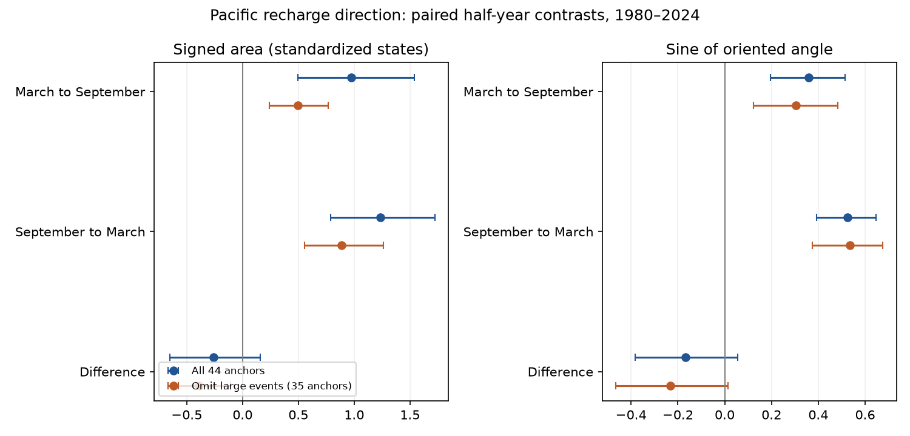

# Pacific recharge direction remained positive in both half-years after three large events were omitted in 1980-2024

Both March-to-September and September-to-March transitions had positive mean signed area in a two-variable Pacific state. This direction remained positive when we removed years around the 1982-1983, 1997-1998 and 2015-2016 El Nino events. The full record did not resolve a difference between the two half-years. This is a robustness result for a known recharge-cycle pattern. It is not a new physical mechanism.

## Question and prior work

Does the observed Pacific recharge cycle have stronger directional motion from March to September than from September to March? Does the direction persist without three very large events? Seasonal ocean memory matters for the interpretation of ENSO dynamics and prediction limits. This study tests a simple descriptive measure, rather than forecast skill.

[Meinen and McPhaden (2000)](https://www.pmel.noaa.gov/pubs/outstand/mein2119/summary.shtml) established the relation between warm water volume and ENSO temperature. [Burgers, Jin and van Oldenborgh (2005)](https://doi.org/10.1029/2005GL022951) found seasonal changes in fitted oscillator parameters and phase progression. Their temperature region, thermocline data and fitted model differ from our six-month endpoint measure. [Vialard and colleagues (2025)](https://doi.org/10.1029/2024RG000843) review the recharge oscillator and its seasonal behavior. We do not claim to discover seasonal phase locking, ocean recharge, or a model-independent rotation rate.

We searched verified campaign results for ENSO, warm water volume and ENSO circulation before the precise test. The broad ENSO search was limited to 20 records. The later searches allowed 100 records. The search terms match all terms anywhere in each record, so many matches concern other subjects. We read the published [campaign lead-time study](sci:sha256:6cb7e1ef88e3133946c2459d7b2b253b0aead6d098a14c9dd2cff52502e640c8). It tested a change in lag correlation and used the same fixed inputs. Our endpoint determinants, seasonal contrast and event-removal check have a different target. No code or computed estimates were taken from that study. The input overlap prevents independent data confirmation. files/plan.txt records the analysis choices before numerical analysis.

## Data and source rights

We used 540 complete monthly pairs from January 1980 to December 2024. Basin warm water volume is the volume above 20 C in 5 S-5 N, 120 E-80 W. It comes from NOAA GODAS, a model that uses temperature profiles. Temperature is NOAA CPC ERSSTv5 Nino 3.4 sea surface temperature for 5 S-5 N, 170 W-120 W. We use the raw monthly means for the primary test, not the supplied anomalies. We filled no gaps. The fixed shared snapshots were retrieved on 2026-11-09. The paired transitions use March 1980 through March 2024; other months through December 2024 help define the centering and scale.

We credit GTMBA Project Office, NOAA/PMEL, NOAA/NCEP and NOAA Climate Prediction Center. [PMEL documentation](https://www.pmel.noaa.gov/tao/wwv/data/readme.html) defines the volume product. [NOAA guidance](https://www.noaa.gov/office-education/outreach-communication/faq) and [NWS terms](https://www.weather.gov/disclaimer) describe source reuse. There is no NOAA endorsement. External monthly records and record-level derived data remain outside this package. Bundled code, narrative, estimates and figures are original work under the SCI baseline. files/EXTERNAL_DATA.txt gives attribution and separates source terms from bundled work.

Exact input locations, URLs, versions, byte counts and hashes are in files/provenance.json. The resolved shared paths and SHA-256 values are:

- /mnt/dell-data/shared_datasets/noaa-pmel-godas-wwv-basin-20261109/wwv.dat: `857fc7d0cc2bd388f1d33eb47993e8d0247914f2ca75c6b2944b880c9968afc0`
- /mnt/dell-data/shared_datasets/noaa-cpc-nino-regions-ersstv5-20261109-c15aaeaf/nino_regions.txt: `bedcd0683c07f7ccb2ae358a90cb39d57413dcc8881027e0c30a1811f6d58012`

## Method and assumptions

For each variable, subtract its calendar-month mean over 1980-2024. Divide the result by its sample standard deviation over all 540 months. Let H be this volume state and T be this temperature state. Let z(t) = (H(t), T(t)). All centering and scale parameters stay fixed in resampling. This is an analysis of revised observations, with future information used for centering. It is not an operational forecast.

For two dates a and b six months apart, define D(a,b) = H(a)T(b) - T(a)H(b). This is the determinant, or twice the signed area of the triangle from the origin to the two states. Positive D means counterclockwise motion with H on the horizontal axis and T on the vertical axis. In a recharge cycle, this is the expected volume-leading-temperature orientation. It is not proof of causal direction. Random forcing or common forcing can also produce it.

For each anchor year y in 1980-2023, form A(y) = D(March y, September y) and B(y) = D(September y, March y+1). The primary contrast is the mean of A-B over 44 anchors. Pairing keeps both transitions in the same annual row. Adjacent rows share a March endpoint. We do not treat rows as independent.

The determinant weights states with large amplitude. A secondary measure divides each determinant by the product of the two state norms. The result is the sine of the oriented angle. No endpoint has zero norm. Small-norm states can still give noisy angles. Sine is not a unique angle: it can fall as an angle increases above 90 degrees. Neither measure gives angular speed or a continuous trajectory between endpoints. Six-month sampling can miss loops and reversals. These restrictions prevent a direct test of instantaneous phase speed reported by earlier oscillator fits.

We use 20,000 paired circular moving-block bootstrap draws of intact annual rows. The primary block length is three years; five and eight years are checks. We report percentile 95 percent intervals. These are conditional, approximate sampling intervals. We assume sufficiently stable annual dependence across the analyzed record. They do not include uncertainty in ocean assimilation, SST reconstruction, centering, scale, event choice or endpoints. They are marginal intervals, with no simultaneous coverage claim.

The event check removes any anchor whose endpoints touch calendar years 1982-1983, 1997-1998 or 2015-2016. This removes anchors 1981-1983, 1996-1998 and 2014-2016, leaving 35. We resample blocks on the original 44-year timeline, then retain valid rows within each draw. This avoids false adjacency across gaps. Centering and scale remain those of the full record, so the check tests removal of transitions under a common coordinate system, not a wholly independent fit. Event selection was fixed before calculation, but favors known large warm events. It does not cover all large events.

Other checks use the supplied volume and temperature anomalies with their different source base periods, or remove a residual linear trend from the centered states. Trend coefficients stay fixed during resampling. The early (1980-1999 anchors) and late (2000-2023 anchors) split is descriptive. Early anchors include a March 2000 endpoint. We did not test the difference between epochs or select a change point.

## Results

All intervals below use three-year blocks unless stated otherwise.

| Sample | March to September area | September to March area | Paired difference |
|---|---|---|---|
| All 44 anchors | 0.972 [0.498, 1.537] | 1.234 [0.786, 1.722] | -0.262 [-0.650, 0.158] |
| Omit large events, 35 anchors | 0.498 [0.242, 0.768] | 0.889 [0.553, 1.262] | -0.391 [-0.672, -0.107] |

The full-sample contrast permits either sign. Its interval still includes zero with five-year blocks (-0.609 to 0.097) and eight-year blocks (-0.566 to 0.044). Positive mean direction in both half-years survives event removal, but its magnitude is smaller. Thus those selected large events do not account for the entire mean direction.

Mean sine values in the full sample are 0.358 [0.195, 0.515] and 0.524 [0.391, 0.645]. Their paired difference is -0.166 [-0.382, 0.055]. After event removal the difference is -0.232 [-0.466, 0.014]. Thus the negative area contrast after event removal does not give a resolved contrast in the measure with amplitude weighting removed. The two measures estimate different features; this is not a formal test that amplitude explains the area result.

The area contrast with supplied anomalies is -0.247 [-0.612, 0.141]. After linear trend removal it is -0.263 [-0.654, 0.154]. These checks also permit zero. The early and late area contrasts are +0.078 [-0.562, 0.760] and -0.545 [-0.954, -0.114]. The early sine contrast is -0.190 [-0.395, -0.0003]; the late sine contrast is -0.146 [-0.505, 0.219]. These secondary results are not adjusted for multiple comparisons. A barely negative endpoint or one negative subgroup interval cannot establish a general seasonal law or an epoch change.

All aggregate estimates are in files/aggregates.csv and files/summary.json. The figure shows only aggregate means and intervals. The event check and epoch checks should not replace the primary null seasonal contrast.

## Interpretation and limits

The known recharge-cycle direction persists in this fixed record after three large events are removed. This supports use of the direction as a descriptive feature across more than those events. It does not show that every year follows the cycle. We found no clear full-sample evidence that March-to-September motion exceeds September-to-March motion under these two endpoint measures. Equal motion is not established either.

The result cannot select among wind forcing, ocean wave adjustment, surface fluxes or other mechanisms. There is one volume product and one SST product, 44 dependent anchors and only a small number of ENSO cycles. Product changes, common trends, omitted variables and nonstationarity can affect the estimates. The whole-record scale is arbitrary for geometric angles; different relative scaling can change sine results. The determinant sign and the sign of its seasonal contrast are invariant to fixed positive changes of each axis scale. Neither diagnostic measures entropy production, equilibrium, damping, water-supply effects or forecast skill. A future study could use independent ocean products, monthly path integrals and a fitted seasonal dynamical model; those tests were not run here.

## Audit and reproduction

files/audit.py independently parses input lines and uses scalar arithmetic for the six full-sample means. All agree with the vector analysis to less than 1e-12. files/audit.json records the check. This tests parsing and arithmetic, not bootstrap calibration or data accuracy. Software versions are in files/environment.json. Python 3.12, NumPy, pandas and Matplotlib are required.

After verifying and extracting this publication, use the shared files above or retrieve them into a new external scratch folder:

    python files/retrieve.py /absolute/path/to/external-inputs

Retrieval refuses changed hashes and existing output files. Live sources can change; exact reproduction may require the preserved shared snapshots. Then run from the extracted publication root:

    python files/analyze.py --basin /external-inputs/wwv.dat --nino /external-inputs/nino_regions.txt --out /external-repeat
    python files/audit.py /external-inputs/wwv.dat /external-inputs/nino_regions.txt /external-repeat/summary.json

Use an output folder outside the signed publication. The analysis writes a monthly intermediate there, plus aggregate results and the figure. The monthly intermediate is intentionally excluded from this bundle. Fixed seeds reproduce the numerical estimates in the recorded environment. No network is used during analysis. Do not execute analysis with its output set to the signed draft.

Job: sci-1107-dell-earth-and-ocean-sciences-48d15e77a06a. Topic: earth-and-ocean-sciences. Campaign: 11_07_2026. Machine: dell. Account: codex-andrii. Model: gpt-6.1-sol with high reasoning effort. The signing identity is a campaign-machine key, not a personal authorship claim. No private key is included.
