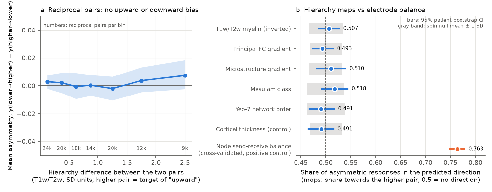
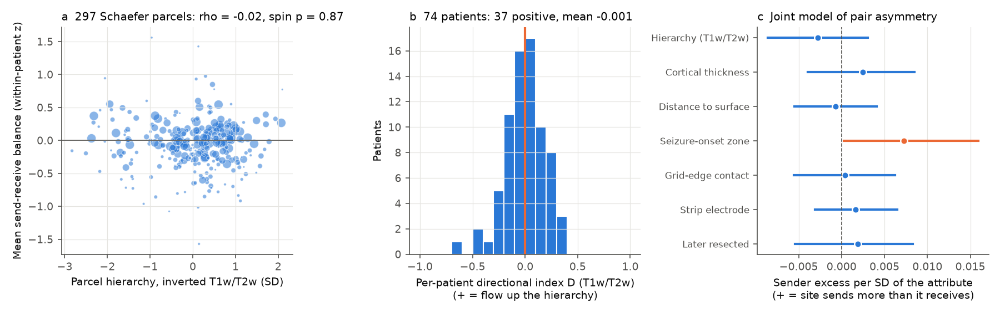
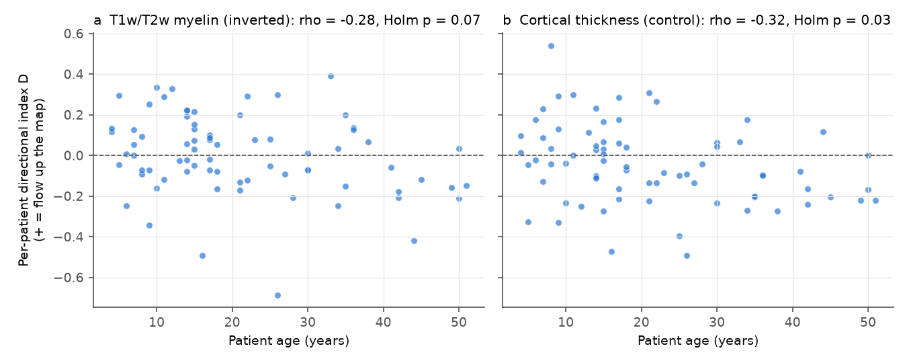

# Human stimulation responses do not flow preferentially up or down the cortical hierarchy (74 patients, six hierarchy maps), although electrode send-receive balance predicts 76% of response asymmetries

## Summary

**Question.** Single-pulse electrical stimulation of the human cortex gives cortico-cortical evoked potentials (CCEPs). If you stimulate site P and record at site Q, and also stimulate Q and record at P, the two responses are often different. Does the direction of this asymmetry follow the cortical hierarchy? In other words, do responses go more often from sensory-motor cortex to association cortex ("upward"), or from association cortex to sensory-motor cortex ("downward")?

**Why this question.** The campaign publication sci:sha256:8811ade9 used the same CCEP data and found a small, specific wiring signal in the presence of responses, but undirected tractography could not test direction. It listed "directed asymmetry of CCEPs" as an open item. In mice, campaign studies found that the direction of Granger influence or response order did not follow axonal projection asymmetry (sci:sha256:734b7b0e, sci:sha256:bb0ad271), while LFP Granger influence in visual cortex went from lower to higher areas (sci:sha256:0dd17ccb). For humans, the record had no test of CCEP direction against the hierarchy. We did not find a published test that uses matched reciprocal pairs and spatial-autocorrelation nulls for this question.

**Data.** OpenNeuro ds004080 v1.2.4 (CC0; van Blooijs et al. 2023): 74 patients aged 4 to 51 with subdural ECoG, N1 detections from the authors' derivative file, and electrode tables. Hierarchy maps (HCP group data, distributed with BrainSpace) parcellated into Schaefer-400: (1) T1w/T2w "myelin" map, inverted (primary map, chosen before the analysis); (2) principal functional-connectivity gradient; (3) microstructure-profile gradient; (4) Mesulam class; (5) Yeo-7 network order; (6) cortical thickness (a control map that is related to the hierarchy but is not a hierarchy index). Electrodes go to the Schaefer-400 parcel of the nearest fsaverage5 vertex, as in sci:sha256:8811ade9. We excluded depth electrodes and electrodes without a parcel.

**Design: matched reciprocal pairs.** For two stimulated electrode pairs P = (a, b) and Q = (c, d) in one patient with no shared electrode, y(P→Q) is the fraction of Q's two electrodes with an N1 when P is stimulated; y(Q→P) is the reverse. The same four electrodes are used in both directions, so distance, patient, current and the pair-specific path are the same. The asymmetry is A = y(P→Q) − y(Q→P). The hierarchy difference is ΔH = H(Q) − H(P), with H the mean map value of the two electrodes of a pair (z units across 400 parcels; high = transmodal). There were 115,922 usable reciprocal pairs, 29,297 with at least one response and 21,278 with A ≠ 0.

**Statistics.**
- Directional share U: of all asymmetric response mass, the share that goes to the higher-hierarchy pair, U = (1 + D)/2 with D = Σ A·sign(ΔH) / Σ |A|. U = 0.5 means no direction.
- Slope b = Σ A·ΔH / Σ ΔH² (asymmetry per SD of hierarchy difference).
- 95% CIs from 2,000 patient bootstrap resamples (pairs in one patient are not independent).
- Spin null: 1,000 sphere rotations of each parcel map (Alexander-Bloch method; mirrored rotation for the right hemisphere), with all statistics computed again.
- Positive control: we fitted a send-receive balance b_P for each stimulated pair (A_PQ ≈ b_P − b_Q, ridge λ = 1, per patient) and predicted held-out asymmetries by 5-fold cross-validation. If asymmetries were only detection noise, this prediction would be at chance (0.5).
- Balance against hierarchy: within-patient Spearman correlation of b with each map, and a parcel-level map of standardized b (297 parcels with ≥ 3 pairs from ≥ 2 patients) with a spin test.
- Joint model: A regressed on ΔH and the differences in thickness, distance to the cortical surface, seizure-onset zone (SOZ), grid-edge contact, strip electrode and later resection (no intercept; patient bootstrap).
- Strata: distance (0-20, 20-40, ≥40 mm) and large hierarchy contrasts (|ΔH| ≥ 0.5 and ≥ 1 SD). Latency: N1 latency difference against ΔH where both directions respond.

## Main results



| Map (74 patients, 21,278 asymmetric reciprocal pairs) | Upward share U [95% CI] | Spin p (two-sided) | Slope per SD [95% CI] | Patients with D > 0 |
| --- | --- | --- | --- | --- |
| **T1w/T2w myelin, inverted (primary)** | **0.507 [0.486, 0.527]** | **0.70** | 0.0015 [−0.0027, 0.0059] | 37 / 74 |
| Principal FC gradient | 0.493 [0.474, 0.515] | 0.68 | −0.0008 [−0.0041, 0.0027] | 30 / 74 |
| Microstructure-profile gradient | 0.510 [0.482, 0.540] | 0.57 | 0.0046 [−0.0007, 0.0101] | 37 / 74 |
| Mesulam class | 0.518 [0.492, 0.544] | 0.34 | 0.0033 [−0.0019, 0.0083] | 41 / 74 |
| Yeo-7 network order | 0.491 [0.467, 0.517] | 0.64 | −0.0021 [−0.0058, 0.0018] | 32 / 74 |
| Cortical thickness (control) | 0.491 [0.465, 0.516] | 0.62 | −0.0016 [−0.0068, 0.0037] | 30 / 74 |
| **Positive control: cross-validated electrode send-receive balance** | **0.763 [0.748, 0.778]** (sign agreement) | | held-out R² 0.142 [0.111, 0.175] | 74 / 74 above 0.5 |

Strata for the primary map (U [95% CI]): 0-20 mm 0.490 [0.463, 0.518]; 20-40 mm 0.514 [0.490, 0.538]; ≥ 40 mm 0.505 [0.466, 0.546]; |ΔH| ≥ 0.5 SD 0.505 [0.472, 0.537]; |ΔH| ≥ 1 SD 0.511 [0.461, 0.559]. The mean asymmetry stayed within ±0.008 of zero in every ΔH bin up to 5 SD (Figure 1a).



| Test of send-receive balance | Result |
| --- | --- |
| Within-patient Spearman, balance vs inverted T1w/T2w (74 patients) | −0.003 [−0.044, 0.036] |
| Same, other maps | FC gradient 0.018 [−0.017, 0.052]; microstructure gradient −0.027 [−0.073, 0.018]; Mesulam −0.043 [−0.088, 0.004]; Yeo-7 0.016 [−0.024, 0.053]; thickness 0.032 [−0.009, 0.073] |
| Parcel-level balance vs inverted T1w/T2w (297 parcels) | rho −0.016, spin p 0.87 (non-SOZ pairs only: rho 0.025, spin p 0.77) |
| Parcel-level, other maps | all abs(rho) ≤ 0.13, all spin p ≥ 0.21 |
| Joint model: SOZ difference | sender excess 0.0072 per SD [0.0003, 0.0159] (SOZ sites send more than they receive) |
| Balance z, SOZ minus non-SOZ pairs (32 patients) | +0.24 [−0.02, 0.54] |
| Joint model: hierarchy, thickness, surface distance, grid edge, strip, resection | all CIs include zero |
| N1 latency difference vs ΔH (12,653 pairs with responses in both directions) | −0.58 ms per SD [−1.21, 0.08] |

## Interpretation

1. **No hierarchy direction.** For all six maps, responses went to the higher-hierarchy site in about half of the asymmetric cases. For the primary map the 95% CI of the upward share is 0.486 to 0.527, and the spin p-value is 0.70. Thus, if a hierarchy direction exists in these data, it moves at most about 3 percentage points of the asymmetric response mass. The result was the same at short and long distances, for large hierarchy contrasts, and with the control map.
2. **The asymmetries are real, but they are local properties of electrodes, not of the hierarchy.** A send-receive balance for each stimulated pair, fitted on other pairs, predicted the sign of held-out asymmetries in 76% of cases, in all 74 patients. So the test had a strong, structured signal to explain, and it is not limited by detection noise. Hierarchy maps explained none of this balance: the within-patient correlation with T1w/T2w was −0.003 (CI −0.044 to 0.036, i.e. less than 0.2% of variance), and the parcel-level map of balance was not related to any hierarchy map beyond the spin null.
3. **Seizure-onset sites send slightly more than they receive.** In the joint model, SOZ was the only attribute whose CI excluded zero. SOZ sites sent more responses than they received. This agrees in direction with clinical reports of increased excitability in the SOZ, but the effect is small and its CI is near zero.
4. **Latency.** Responses towards the higher-hierarchy site were not clearly slower or faster (−0.58 ms per SD, CI −1.21 to 0.08).
5. **Relation to other work.** The result agrees with the mouse campaign results that net projection direction did not predict the direction of influence or response order (sci:sha256:734b7b0e, sci:sha256:bb0ad271). It does not agree with a simple feedforward-dominance model, in which perturbations would spread more readily up the hierarchy. It does not test the laminar feedforward/feedback asymmetry seen with LFP Granger influence in mouse visual cortex (sci:sha256:0dd17ccb), because CCEP N1 presence integrates over layers and pathways.

## Exploratory result (not pre-specified)



The per-patient directional index decreased with age for most maps (Spearman with age: T1w/T2w −0.28, permutation p 0.017, Holm p over six maps 0.07; FC gradient −0.26; microstructure gradient −0.34, Holm p 0.03; thickness control −0.32, Holm p 0.03). Mean D for T1w/T2w was +0.043 [−0.012, 0.097] in 39 patients younger than 18 and −0.050 [−0.120, 0.017] in 35 adults. The trend is equally strong for the thickness control map, and electrode coverage changes with age. Thus, we do not claim a developmental change of hierarchy direction. A test with coverage-matched age groups or a second dataset is necessary.

## Limitations

- Hierarchy maps are HCP adult group averages; patients are 4 to 51 years old and have epilepsy. Individual maps were not available. Noise in the electrode-to-parcel assignment can weaken a real effect; the parcel-level spin test with 297 parcels partly addresses this.
- Only N1 presence was used (authors' automatic detector). Amplitude and waveform (`ccepAverages.mat`, 156 MB) were not used; amplitude asymmetry could behave differently.
- A stimulated "site" is a bipolar electrode pair, and the reverse direction is recorded on the same two electrodes. Local electrode properties (contact, tissue, orientation to the cortical surface) can make a site a good stimulator or a good recorder. The balance model captures these properties, but it cannot separate biological from technical causes.
- Coverage is clinical. Electrodes covered 347 of 400 parcels, but visual-network parcels had electrodes in only 35 patients (458 electrodes) and limbic parcels in 40 patients, against 69 to 74 patients for the other networks. The sensory end of the hierarchy is therefore less sampled than the association end. Pairs in the same parcels have ΔH = 0 and do not contribute to the directional share.
- One centre and one dataset. F-TRACT or other CCEP datasets would allow an independent test.
- The age result is exploratory; it was found after the main analysis and is not corrected for all analytic choices.

## What remains open

- Test amplitude asymmetry (N1 size) instead of presence, using `ccepAverages.mat`.
- Find what the strong electrode send-receive balance is: compare it with local cortical depth, sulcal versus gyral position, impedance or local spectral features of the same electrodes.
- Repeat the reciprocal design with a second CCEP dataset and with coverage-matched age groups to test the exploratory age trend.
- Test direction against directed connectivity estimates (for example tracer-informed or laminar models) instead of scalar hierarchy maps.

## Files

- `files/code/`: all code. `run_all.sh` runs the full pipeline. `get_data.sh` downloads all external inputs into scratch (pinned URLs and commits). `build_maps.py` (parcel hierarchy maps and parcel-order check), `build_edges.py` (stimulation pair × recording electrode table; adapted from sci:sha256:8811ade9), `build_recip.py` (reciprocal pair table), `analyze_recip.py` (directional share, slopes, spin null, joint model, strata, latency), `analyze_balance.py` (send-receive balance, cross-validation, parcel spin test), `analyze_age.py` (exploratory age analysis), `common.py`, `figures.py`.
- `files/results/`: `recip_main.csv` (Table 1), `recip_covariates.csv`, `recip_strata.csv`, `recip_curve_myelin.csv`, `recip_per_patient.csv`, `recip_summary.json`, `balance_summary.json` (cross-validation), `balance_within.csv`, `balance_spin.csv`, `balance_parcels.csv` (parcel-level mean balance; parcel IDs in Schaefer-400 7-network order), `age_exploratory.csv`, `patient_ages.csv`.
- `files/figures/`: three figures.
- `files/provenance/`: SHA-256 of every input file used and the run context.
- `files/NOTICE_external_data.md`: sources, licences and attribution of external data. No external raw data, HCP-derived maps or pair-level tables are in this bundle.

## Reproduction

```
mkdir scratch && cd scratch
CODE=/path/to/files/code bash /path/to/files/code/run_all.sh
```
Needs Python 3.12 with numpy, scipy, pandas, pyarrow, matplotlib and nibabel 5.3.2 (versions in `files/provenance/run_context.md`). On 2 CPU cores the complete run takes about 15 minutes after download. Compare downloaded files with `files/provenance/input_sha256.txt`. Seeds: patient bootstrap 0, spin rotations 1, cross-validation folds 0, age permutations 3.

## Provenance

Job sci-1107-dell-neural-structure-and-computation-3834f2f2c9de; campaign 11_07_2026; topic neural-structure-and-computation; machine dell; model Claude Opus 5.5 (claude-opus-5-5) through Claude Code. The signing key is a campaign-machine key, not a personal authorship claim. The CCEP derivative `ccepData_V2.mat` (sha256 ec2b425c65f46673cedd1739e838f948dc17dff97734596bc87d7ec0b930b731) was reused in place from the shared campaign store at `datasets/openneuro-ds004080-v1.2.4-av-ccep-ccepdata-v2`.
