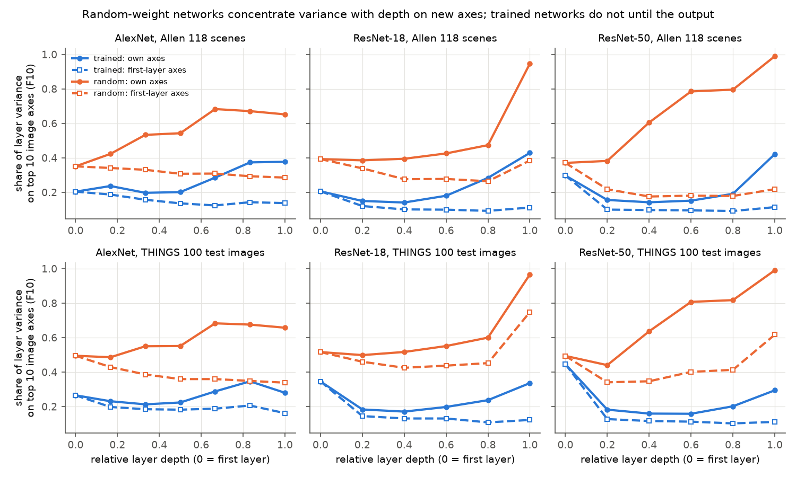
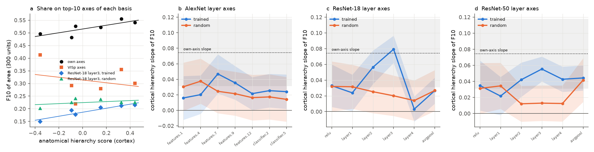
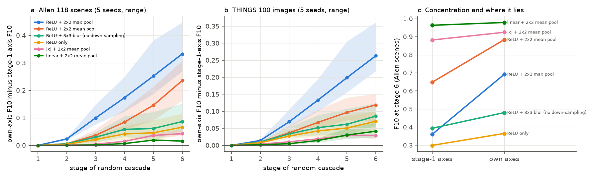

# Random rectified pooling concentrates variance on new axes, but mouse higher visual areas concentrate natural-scene variance on trained mid-level network axes; macaque IT moves to deep trained axes

## Summary

Earlier campaign work found that response spectra decay faster in higher mouse visual areas, and that
for natural scenes this compression is not on the stimulus axes of VISp
(sci:sha256:528cd305..., 2817482c...). The computation that makes it was open. We asked three
questions with one estimator (the share of reliable variance on the top 10 stimulus axes of a basis,
F10, from cross-validated repeat halves):

1. **Which network operations make variance concentrate on new axes?** In noise-free networks we
   compared the share of each layer's variance on its own top axes and on the top axes of the first
   layer.
2. **Which network axes carry the compression of mouse higher areas?** We measured the share of
   natural-scene variance of 8 mouse visual structures (11,559 units, 32 Allen Neuropixels mice) on
   the top axes of every layer of AlexNet, ResNet-18 and ResNet-50, trained on ImageNet or with random
   weights.
3. **Does the same hold in macaque?** We repeated the tests with V1, V4 and IT multi-unit activity in
   2 monkeys (TVSD, 100 THINGS images x 30 repeats).

Main results:

- **Random rectified pooling cascades make concentration on new axes; linear pooling does not.** In
  random-weight networks, the top-10 share of layer variance increased with depth (Allen scenes:
  AlexNet 0.35 to 0.65; ResNet-50 0.37 to 0.80 at layer4), while the share on first-layer axes stayed
  or fell (AlexNet 0.35 to 0.31; ResNet-50 0.37 to 0.18). This is the geometric signature of the mouse hierarchy. In
  controlled 6-stage random cascades, the "new-axis index" (own-axis F10 minus stage-1-axis F10) at
  stage 6 was 0.33 (seed range 0.27 to 0.45) with ReLU and max pooling, 0.24 (0.16 to 0.31) with ReLU
  and mean pooling, 0.07 to 0.09 with ReLU and no down-sampling, 0.04 with full-wave rectification and
  pooling, and 0.02 with linear convolutions and pooling. Linear pooling concentrated variance strongly
  (F10 0.98) but on the old axes. The index grew only after 3 or more stages. ImageNet training
  removed most of the concentration: trained layers had flatter spectra (F10 0.14 to 0.29) until the
  last stage.
- **Mouse higher areas concentrate variance on the axes of trained mid-level features.** The cortical
  hierarchy slope of F10 was 0.074 (95% mouse half-sample interval 0.031 to 0.118) on each area's own
  axes and -0.054 (-0.110 to 0.002) on VISp axes. On the top axes of trained ResNet-18 layer3 it was
  0.079 (0.062 to 0.097): equal to the own-axis slope (difference 0.005, -0.036 to 0.046) and larger
  than with random weights (difference 0.059, 0.032 to 0.086). ResNet-50 layer3 gave 0.055 (trained
  minus random 0.042, 0.019 to 0.066). AlexNet conv3 gave 0.047 (trained minus random 0.022, -0.010 to
  0.055). Random-network axes gave 0.01 to 0.04 at every depth. The share on trained layer3 axes rose
  from 0.149 in VISp to 0.215 in VISam; random layer3 axes took 0.20 to 0.25 in every structure with
  no trend. The pre-set test at the deepest convolutional stage passed for ResNet-50 only (ResNet-18
  layer4 0.003; AlexNet conv5 0.022, interval 0.000 to 0.043).
- **Macaque IT concentrates its variance on deep trained axes, but its own-axis spectrum is not
  steeper.** IT put 22-24% of its reliable variance on the top 10 V1 axes against 65-78% on its own
  axes. On deep trained network axes IT took more variance than V1 (ResNet-18 layer4: +0.10 in both
  monkeys; interval excludes 0 in monkey F only), and on random-network axes less (-0.08 to -0.27 at
  all depths, both monkeys). The own-axis decay exponent did not rise from V1 to IT (IT minus V1:
  -0.09, interval -0.26 to 0.08, and -0.08, -0.27 to 0.11), which agrees with parallel campaign
  studies (sci:sha256:5f29c35b..., e4bf8cc2...).

Conclusion: a cascade of asymmetric rectification and spatial down-sampling is sufficient to move and
concentrate variance onto new stimulus axes; a single pooling stage or linear pooling is not. This
agrees with the earlier finding that pooled VISp units do not reproduce the mouse compression. But
the axes on which mouse higher areas concentrate natural-scene variance are those of learned
mid-level features, not those that random cascades produce. In macaque, IT also moves variance onto
learned deep-feature axes, without a steeper own-axis spectrum. Thus "new dimensions" in higher areas
are learned-feature dimensions in both species; only in mouse do they also carry a steeper spectrum.
All brain tests are correlational, use 6 mouse cortical areas or 3 macaque areas, and one image set
per species.

Figure 1. Share of layer variance on the top 10 image axes of the layer itself (solid) and of the
first recorded layer (dashed), for trained (blue) and random-weight (orange) networks, on the Allen
118 scenes and the 100 THINGS test images.

Figure 3. Mouse. (a) F10 of each cortical area on its own axes, VISp axes and ResNet-18 layer3 axes
(trained, random), against the anatomical hierarchy score. (b-d) Cortical hierarchy slope of F10 on
the axes of each layer (95% mouse half-sample bands); the dotted line and grey band show the own-axis
slope.

## Question and prior work

Stringer et al. (2019) described power-law spectra in mouse V1. In this campaign, alpha (spectrum
decay exponent) rose along the anatomical hierarchy for natural scenes, gratings and movies, inside
single mice, and after RF and tuning matching (528cd305..., 62a723e5..., 27b767c0...). For natural
scenes and movies the compression was absent on VISp axes but present on the axes of other higher
areas (2817482c...). Pooling of VISp units did not reproduce it (2817482c...), linear read-outs of
VISp missed the HVA signal (831e5770...), and that signal is present from the first response
(a94a2db9...). A parallel study (e4bf8cc2...) showed that in ResNet-18 the sign of spectral steepening
depends on stage, training and spatial coverage, and that macaque IT is flatter than V4. Another
(5f29c35b...) showed with the TVSD data that IT spectra do not decay faster than V1. No study asked on
which network axes the higher-area variance lies, or which network operation makes concentration on
new axes. We wrote the plan before computing any new spectrum (`files/code/PLAN.md`) and recorded
later additions as dated amendments.

## Data

- **Mouse**: Allen Visual Coding Neuropixels, all 32 `brain_observatory_1.1` sessions. Quality units
  (ISI violations < 0.5, amplitude cutoff < 0.1, presence ratio > 0.9) in LGd (961), VISp (2,230),
  VISl (1,016), VISrl (1,563), LP (1,540), VISal (1,675), VISpm (950), VISam (1,624): 11,559 units, as
  in the source. Natural scenes: 118 images x 50 repeats, spike counts 0-250 ms after onset. We read
  only the spike-time byte ranges that cover the three natural-scene blocks of each NWB file.
  Hierarchy scores from Harris et al. (2019).
- **Macaque**: TVSD (Papale et al. 2025), normalized MUA of monkeys N and F, 1,024 electrodes each
  (Utah arrays: N 512 V1, 256 V4, 256 IT; F 512 V1, 192 V4, 320 IT, per the authors' code). 100 THINGS
  test images x 30 repeats. Electrodes with split-half reliability r >= 0.2 (main).
- **Images**: the 118 Allen natural-scene templates; the 100 THINGS test images.
- **Networks**: torchvision AlexNet, ResNet-18, ResNet-50 with ImageNet weights and with default
  random initialization (seed 0). Layers: AlexNet ReLU outputs conv1-conv4, pool5, fc6, fc7; ResNet
  stem ReLU, layer1-4, average pool. Images resized to 224 x 224, ImageNet normalization.

Exact URLs, sizes, ETags, CRCs and SHA-256 hashes are in `files/provenance/`. External data stay
outside the bundle (`files/NOTICE_EXTERNAL_DATA.md`).

## Methods

- **Units and spectra** (as in the source): each unit or electrode is scaled by its single-trial SD.
  cvPCA uses random halves of the repeats (same split for simultaneously recorded units), both
  directions, 4 splits. alpha is minus the OLS slope of log variance on log rank, ranks 2-30.
- **Share on a basis.** For fixed image axes u_k of a basis, the reliable variance of a target
  population is v_k = (1/n) sum over units of (u_k'a)(u_k'b), with a and b the means of two disjoint
  repeat halves. F10 = sum of v_1..v_10 / sum of all v_k. For a network basis, the axes are the
  eigenvectors of the centred layer Gram matrix over images (all units of the layer, noise-free).
  For a neural basis, the axes come from one third of the repeats of disjoint basis units and the
  target variance from the other two thirds (as in 2817482c...).
- **Network-internal cross-basis.** For layer L, the variance on the axes of the first layer is
  u_k' G_L u_k, where G_L is the centred Gram matrix of L.
- **Random cascades.** Six stages of 3x3 convolution (64 channels, He-normal weights, no bias, 5
  seeds) at 128 x 128 input, with one of: ReLU + 2x2 max pool; ReLU + 2x2 mean pool; ReLU + 3x3
  stride-1 mean (no down-sampling); ReLU only; |x| + 2x2 mean pool; x^2 + 2x2 mean pool; linear + 2x2
  mean pool. Each stage output was divided by its SD.
- **Mouse.** Pooled pseudo-populations of 300 units per structure (16 draws). For VISp-axis shares,
  300 VISp basis units are disjoint from the VISp targets. Intervals: 200 half-samples of 16 of 32
  mice (same mice for all areas), estimate +/- 1.96 SD. Hierarchy slope: OLS of the statistic on the
  hierarchy score over the 6 cortical areas.
- **Macaque.** Populations of 100 electrodes per area (50 draws); cross-basis with disjoint target and
  basis electrodes (n = 100 per side in monkey N and 88 in monkey F, set by the smallest area). Intervals: 200 half-samples of 50
  of 100 images, with network axes recomputed on each half (exact, from the layer Gram matrix).
  Array replicates: 30 electrodes from one 64-electrode array (31 arrays; one dead V1 array excluded),
  OLS with a monkey effect.

## Results

### 1. Networks (Figure 1, Figure 4)

| Network (Allen scenes) | first layer F10 | deepest conv stage F10, own axes | same, on first-layer axes |
| --- | --- | --- | --- |
| AlexNet random | 0.35 | 0.68 (pool5) | 0.31 |
| ResNet-18 random | 0.39 | 0.47 (layer4); 0.95 (avgpool) | 0.26; 0.39 |
| ResNet-50 random | 0.37 | 0.80 (layer4); 0.99 (avgpool) | 0.18; 0.22 |
| AlexNet trained | 0.20 | 0.29 (pool5); 0.38 (fc7) | 0.12; 0.14 |
| ResNet-18 trained | 0.21 | 0.28 (layer4); 0.43 (avgpool) | 0.09; 0.11 |
| ResNet-50 trained | 0.30 | 0.19 (layer4); 0.42 (avgpool) | 0.09; 0.11 |

THINGS images gave the same pattern (`files/results/cnn/layer_crossbasis.csv`). Layer spectra
(alpha of the full layer, ranks 2-30): random AlexNet 0.72 to 1.19, random ResNet-50 0.77 to 1.49
(layer4); trained ResNet-18 0.32, then 0.19 at layer2, then 0.49 at layer4 and 0.69 after pooling.
The layer2-to-layer4 steepening was larger in the trained ResNet-18, which agrees with e4bf8cc2....

Figure 4. Random 6-stage cascades. (a, b) New-axis index by stage (mean and range over 5 seeds). (c)
F10 at stage 6 on stage-1 axes and on own axes.

| Cascade (stage 6) | own F10 (Allen) | stage-1-axis F10 | new-axis index Allen | new-axis index THINGS |
| --- | --- | --- | --- | --- |
| ReLU + max pool | 0.69 | 0.36 | 0.33 (0.27-0.45) | 0.26 (0.22-0.36) |
| ReLU + mean pool | 0.88 | 0.65 | 0.24 (0.16-0.31) | 0.12 (0.07-0.15) |
| ReLU + blur, no down-sampling | 0.48 | 0.39 | 0.09 (0.05-0.15) | 0.09 (0.06-0.12) |
| ReLU only | 0.37 | 0.30 | 0.07 (0.04-0.12) | 0.07 (0.05-0.10) |
| abs + mean pool | 0.93 | 0.88 | 0.04 (0.03-0.06) | 0.03 (0.02-0.04) |
| linear + mean pool | 0.98 | 0.96 | 0.02 (0.02-0.02) | 0.04 (0.02-0.07) |

Squaring with pooling was degenerate (F10 = 1.00 at stage 6: one axis took all variance); we do not
interpret it. At stage 2 (one pooling step) every non-degenerate index was 0.03 or less.

### 2. Mouse (Figure 3)

The own-axis estimator reproduced the source: alpha 0.671 (LGd), 0.804 (VISp), 0.942 (VISam); cortical
slope 0.197 (0.096 to 0.299; source 0.20).

| Basis (cortical hierarchy slope of F10) | slope | 95% interval | minus random-weight same layer |
| --- | --- | --- | --- |
| own axes | 0.074 | 0.031 to 0.118 | - |
| VISp axes | -0.054 | -0.110 to 0.002 | - |
| ResNet-18 layer2, trained | 0.056 | 0.035 to 0.078 | 0.031 (-0.001 to 0.064) |
| ResNet-18 layer3, trained | 0.079 | 0.062 to 0.097 | 0.059 (0.032 to 0.086) |
| ResNet-18 layer4, trained | 0.003 | -0.013 to 0.019 | -0.011 (-0.036 to 0.014) |
| ResNet-50 layer3, trained | 0.055 | 0.040 to 0.071 | 0.042 (0.019 to 0.066) |
| ResNet-50 layer4, trained | 0.043 | 0.027 to 0.058 | 0.030 (0.003 to 0.057) |
| AlexNet conv3, trained | 0.047 | 0.022 to 0.072 | 0.022 (-0.010 to 0.055) |
| AlexNet pool5, trained | 0.022 | 0.000 to 0.043 | 0.005 (-0.026 to 0.036) |
| random networks, all layers | 0.012 to 0.042 | - | - |

Every trained-layer basis gave a larger slope than VISp axes (differences 0.058 to 0.134, all
intervals above 0). Per-area shares are in `files/results/mouse/mouse_area_F10_levels.csv`.

Pre-set Q3 rule (deepest convolutional stage: positive with interval above 0, larger than at the
first stage, larger than random): ResNet-50 passed; AlexNet failed on the first condition (lower bound
0.000); ResNet-18 failed. The middle-stage result is exploratory (plan amendment of 2026-11-12).

### 3. Macaque (Figure 2)

Figure 2. Macaque. (a) Own-axis spectra. (b) F10 of each area on own-area axes and on V1 axes. (c) IT
minus V1 F10 on the axes of each network layer (mean of 2 monkeys).

| Statistic | monkey N | monkey F |
| --- | --- | --- |
| alpha V1 / V4 / IT (100 electrodes) | 1.47 / 1.28 / 1.38 | 1.45 / 1.33 / 1.37 |
| IT minus V1 alpha (image half-sample 95%) | -0.09 (-0.26 to 0.08) | -0.08 (-0.27 to 0.11) |
| IT F10 on own axes / on V1 axes | 0.78 / 0.22 | 0.65 / 0.24 |
| IT minus V1 F10, ResNet-18 layer4 trained | +0.10 (-0.04 to 0.24) | +0.10 (0.01 to 0.19) |
| IT minus V1 F10, ResNet-50 layer3 trained | +0.07 (-0.04 to 0.17) | +0.08 (-0.01 to 0.17) |
| IT minus V1 F10, AlexNet pool5 trained | +0.07 (-0.09 to 0.23) | +0.05 (-0.05 to 0.15) |
| IT minus V1 F10, random networks (all layers) | -0.08 to -0.27 | -0.08 to -0.21 |

Array replicates (31 arrays): IT minus V1 alpha +0.09 (-0.13 to 0.31). The pre-set Q1 rule gives
"not supported" (no steeper IT spectrum) and not "contradicted". The pre-set Q2 rule needs an own-axis
rise, which was absent. The pre-set Q3 rule (IT > V1 on the deepest stage in both monkeys, larger than
at the first stage and than random) passed for ResNet-18 and AlexNet and failed for ResNet-50 layer4
(-0.00, +0.02). In the reliability-matched and all-electrode variants, V1 also had the largest alpha
(`files/results/macaque/summary_own.csv`).

## Interpretation

Three facts constrain the computation. (1) A higher area can concentrate variance on new axes only
through a non-linear transform; in random networks, asymmetric rectification followed by spatial
down-sampling, repeated over 3 or more stages, is sufficient, and linear or one-stage pooling is not.
This explains why pooled VISp units (one stage) did not reproduce the mouse compression (2817482c...).
(2) But the specific new axes of mouse higher areas are those of learned mid-level features (ResNet
layer2-3, AlexNet conv3), which in ImageNet-trained networks carry little concentration themselves. A
random cascade gives the concentration but on the wrong axes. (3) In macaque the same move onto
learned-feature axes happens at a deeper stage (IT on ResNet layer3-4 axes) and without a steeper
spectrum. A candidate account is that mouse higher areas apply a few non-linear pooling stages to
learned mid-level features, which compresses variance on these feature axes. We did not test this
account directly.

## Limitations

- All brain tests are correlational across 6 mouse cortical areas or 3 macaque areas. Network
  results show sufficient mechanisms, not the mechanism in the brain.
- F10 depends on the basis: random-network axes take a large share of every area's variance, so we
  interpret slopes across areas and paired trained-random differences, not single levels.
- The middle-stage mouse result was found after the pre-set deepest-stage test; it is exploratory. The
  pre-set test passed for 1 of 3 networks in mouse and 2 of 3 in macaque.
- One image set per species (118 scenes; 100 objects), one random seed per network, three
  architectures, images resized without RF-specific crops. Mouse acuity and visual field are not
  modelled.
- TVSD MUA comes from Utah arrays that sample a few retinotopic sites; V1 alpha depends on array
  coverage (5f29c35b...). Our macaque Q1/Q2 numbers re-analyse the same data as 5f29c35b and agree
  with it; they are not independent evidence.
- Mouse intervals come from half-samples of mice; macaque intervals from half-samples of images.

## Reproduction

`bash files/code/reproduce.sh SCRATCH OUT` downloads or streams all external inputs into SCRATCH and
writes every bundled result and figure into OUT (about 3 hours on the Dell host, mostly NWB range
reads). Scripts: `extract_ns.py` (Allen spike counts), `fetch_tvsd.py` and `rangezip.py` (TVSD members),
`fetch_things_test.py` (THINGS test images), `cnn_features.py` (network geometry), `cnn_crossbasis.py`,
`random_cascade.py`, `macaque.py`, `macaque_q3.py`, `mouse_q3.py`, `mouse_contrasts.py`, `figures.py`;
shared estimators in `speclib.py`.

## Provenance

Job sci-1107-dell-neural-structure-and-computation-9e815e4705c5, topic neural-structure-and-computation,
machine dell, campaign 11_07_2026, model claude-opus-5-5 (Claude Code). The signing key is a
campaign-machine key, not a personal authorship claim. Data identities: `files/provenance/`.

## References

- Stringer, C. et al. (2019) High-dimensional geometry of population responses in visual cortex.
  Nature 571, 361-365. doi:10.1038/s41586-019-1346-5
- Harris, J.A. et al. (2019) Nature 575, 195-202. doi:10.1038/s41586-019-1716-z
- Siegle, J.H. et al. (2021) Nature 592, 86-92. doi:10.1038/s41586-020-03171-x
- Papale, P. et al. (2025) Neuron 113, 539-553. Data doi:10.12751/g-node.hc7zlv
- Hebart, M.N. et al. (2019) PLoS ONE 14, e0223792. doi:10.1371/journal.pone.0223792
- He, K. et al. (2016) Deep residual learning for image recognition. CVPR.
- Krizhevsky, A. et al. (2012) ImageNet classification with deep convolutional neural networks. NIPS.
