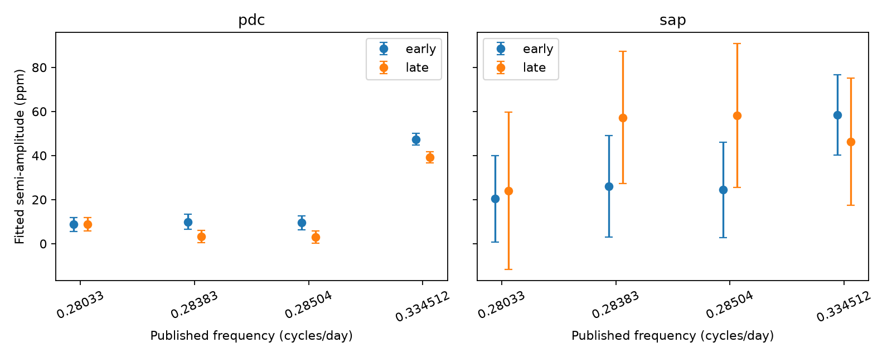

# Three published weak frequencies of KIC 8164262 remain below four block errors in each Kepler mission half

We tested the persistence of three known weak signals near 0.28 cycles per day. None reaches four estimated amplitude standard errors in either mission half with the tested noise blocks. The full corrected-flux fit reaches 4.33 errors at 0.28033 cycles per day. The test does not show that these signals are absent. It does not establish a new object.

## Question and prior work

Can separate Kepler time intervals confirm the known weak frequency group in KIC 8164262? This is a useful check before more physical interpretation of unusual signals. Hambleton et al. (2018, doi:10.1093/mnras/stx2673) report frequencies of 0.28033, 0.28383 and 0.28504 cycles per day. They discuss stellar pulsations and rotation. Saio et al. (2018, doi:10.1093/mnras/stx2962) propose Rossby modes for this group. A later study of heartbeat stars also gives that interpretation (https://academic.oup.com/mnras/article/511/1/560/6502360). We do not claim the first detection of these frequencies.

The campaign search used `sci search "astronomy" --in ./campaign --json` and `sci search "8164262" --in ./campaign --json`. The SCI commands were stopped after partial cache population because full archive verification was slow. They are not an exhaustive verified search. A separate complete scan of published bundle metadata and README text found no bundle with the target number at the time of that scan. This second scan did not verify signatures or hashes. The search record is in `files/search_record.json`. Only published bundles were searched. The search code is included. No private worker files were read.

## Data and method

We use all 18 long-cadence light-curve files in the public Kepler release 25 tar archive for KIC 8164262. The shared data alias is `/mnt/dell-data/shared_datasets/kepler-kic8164262-q0-q17-dr25/lightcurves.tar`. The resolved object path, individual FITS hashes, channel numbers, release numbers and selected counts are in `files/evidence/provenance.json`. The source URL and download record are in `files/source_provenance.json`. The tar SHA-256 is `7740320b9dd4f4e46b84561453ef94abd74dcf95495b119f3ad113245e83db10`.

We select finite SAP and PDCSAP flux with SAP_QUALITY equal to zero. Time is BJD minus 2454833, in days. We exclude times within four days of BKJD 835.829 plus any integer times 87.4549 days. This removes the sharp heartbeat signal. These times and the orbital period come from the published binary study. Each quarter has its own median flux normalization. We subtract a joint fit of a quadratic time baseline and a sinusoid at 229/87.4549 cycles per day. This removes the large known tidal oscillation. We give raw-aperture SAP and pipeline-corrected PDCSAP results separately. They use the same photons and are not independent observations.

The selected data have 51,700 exposures from BKJD 120.53904 to 1591.00140. The split is BKJD 855.77022, the midpoint of the first and last selected time, not a fitted signal parameter. The exact times and selected counts are in `files/evidence/summary.json`. We fit constant, sine and cosine terms at the three published weak frequencies and the published rotation frequency 0.334512 cycles per day, jointly, in each half and in the full time series. Frequency values stay fixed. We use ordinary least squares. We do not use the archive white-noise flux errors to assess these small signals.

For correlated errors, we sum the residual score vector in non-overlapping time blocks. If X is the design matrix, r the residual and s_b = X_b^T r_b, the covariance is (X^T X)^-1 [sum_b s_b s_b^T] (X^T X)^-1. We project this covariance onto the fitted amplitude direction. The main block length is 10 days. We also use 5 and 20 days. Blocks start at the first selected time of each fit. The four-error threshold is a descriptive confirmation rule for this analysis. It is not a calibrated false-alarm probability or a registered prior test. Amplitude errors are local approximations; small fitted amplitudes have a positive bias.

An exploratory Lomb-Scargle search covers 0.20 to 0.40 cycles per day. It selects five separated local peaks in the first half. Later fits hold those frequencies fixed. These exploratory results and background and centroid spectra are supplementary. The main conclusion uses the published frequencies, not a choice from this scan. Among the five selected peaks, only the known rotation peak exceeds four block errors in the second-half fixed-frequency PDC fit. A peak selected at 0.283425 cycles per day falls from 4.35 first-half errors to 0.07 second-half errors. Selection can raise the first-half score. The broad local-peak lookup in the supplementary table can select a different nearby signal and is not a fixed-frequency confirmation statistic. Background and centroid spectra provide diagnostic context; they do not calibrate contamination or rule out an instrument cause.

## Results

The table gives fitted PDCSAP semi-amplitudes in parts per million (ppm), with one estimated standard error from 10-day blocks.

| Frequency, cycles/day | First half, ppm | Second half, ppm | Full data, ppm |
|---|---:|---:|---:|
| 0.28033 | 8.79 +/- 3.17 | 8.82 +/- 2.92 | 9.08 +/- 2.10 |
| 0.28383 | 9.96 +/- 3.33 | 3.31 +/- 2.73 | 6.04 +/- 2.21 |
| 0.28504 | 9.47 +/- 3.20 | 2.93 +/- 2.74 | 5.70 +/- 2.10 |
| 0.334512 | 47.42 +/- 2.61 | 39.20 +/- 2.62 | 43.08 +/- 1.85 |

All three weak frequencies remain below four errors in each half for all three block lengths. The rotation frequency is clear in corrected flux in both halves. The full-data result at 0.28033 is compatible in size with the published 8.3-ppm signal. The smaller second-half amplitudes of the other two frequencies do not establish a change in amplitude: errors, frequency choice and interference between nearby signals limit that inference.

SAP errors for the three weak modes range from 18 to 42 ppm across the half-data and block choices. They exceed the published amplitudes. Thus, failure of this SAP test is not evidence that PDC created the signals. The PDC and SAP comparison does not confirm a source position or remove all instrument explanations.



The two closest weak frequencies are separated by only 0.00121 cycles per day. This is close to the frequency resolution of a mission half. Joint fitting helps but does not restore the information lost by the split. The full-data fit has more information about these small, close peaks.

We pass unit sinusoids at all four published frequencies and three phases through the same quarterly baseline and main-mode projection on the selected time grid. Recovered amplitudes range from 0.9925 to 0.9974. This tests amplitude transfer under the stated nuisance model. It is not a detection completeness test in unknown noise, and it does not test the Kepler PDC processing itself.

## Physical interpretation and limits

The weak frequencies are 0.838 to 0.852 times the published rotation frequency. They are below rotation, as expected for the proposed Rossby-mode explanation. Their orbital harmonic numbers are 24.516, 24.822 and 24.928. Thus, none is a simple exact orbital harmonic at the adopted period. This frequency check does not identify a mode. Stellar pulsation, variable spots, a blended star and instrument errors remain possible. The test has no stellar-mode spectrum calculation or source localization.

Quarterly quadratic fits do not remove all long-term SAP errors. The noise model assumes that blocks give a useful estimate of covariance; correlations longer than 20 days can remain. We do not marginalize over frequency or orbital-model uncertainty. The test is conditional on the quality rule, mask, normalization, baseline and fixed frequencies. The quarter that contains the split has a shared quarterly nuisance fit across both halves. Thus, even the time halves are not fully independent in their preprocessing. Different nuisance choices can change results. No pixel-level data or independent telescope observations were used. Split Kepler intervals test temporal persistence with one telescope; they are not independent instrument confirmation. We establish no new planet, comet, binary or oscillation mode. The useful output is a reproducible noise and persistence audit of a known unusual signal group.

## Reproduction

Use Python 3.12 with numpy, scipy, pandas, astropy and matplotlib. Exact used versions are in `files/evidence/summary.json`. From the publication root, run:

```sh
OPENBLAS_NUM_THREADS=1 OMP_NUM_THREADS=1 sh files/reproduce.sh
```

The script reads shared raw data in place and writes to `reproduced/`. A different raw tar path and output directory can be given as its first and second arguments. On another host, download the URL in `files/source_provenance.json` to local scratch, check the tar hash above, and pass that path. Do not replace shared data. No network access is needed after the archive is available. `files/evidence/residuals.csv` also permits an offline run of `python files/validate.py files/evidence` without raw data. This writes the fixed-frequency tables and figure. The bundle preserves derived samples, frequency spectra, all fit tables, injection transfer tests, code and input hashes.

## Research record

Job: sci-1107-dell-astronomy-acc29deae27c. Topic: astronomy. Campaign: 11_07_2026. Machine: dell. Account: codex-andrii. Model: gpt-6.1-sol, high reasoning effort, through T3 Code and the Codex harness. The machine campaign key signs the bundle; it is not a personal authorship claim. This investigation used no child agents. Raw data remain in the shared store. Signing and verification are local. No remote submission is authorized or used.
