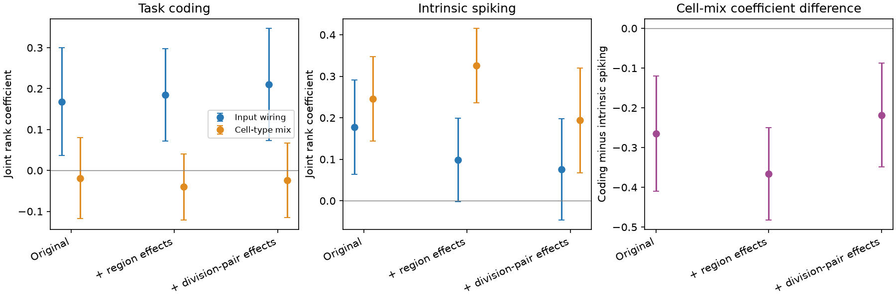
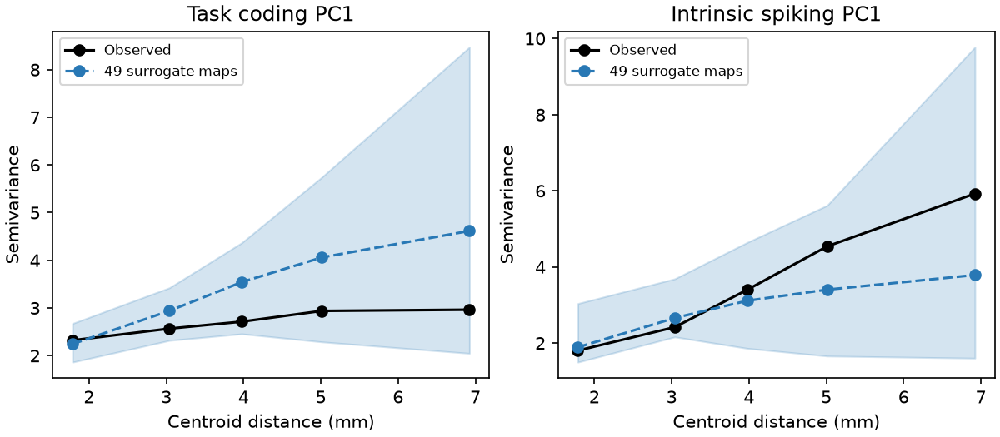

# Region and division-pair controls retained distinct structure links for task coding and spiking in 171 mouse brain regions

Job: sci-1107-dell-neural-structure-and-computation-b7e7ea9d28f9. Topic: neural-structure-and-computation. Campaign: 11_07_2026. Machine: dell. Account: codex-myxtap. Model: gpt-6.1-sol, high reasoning effort. The signing key is a campaign-machine key. It is not a personal authorship claim. No other agents were used.

## Question and result

Do the reported structure links depend on a region's general tendency to resemble other regions? We tested this question with the same 171 regions used in SCI 49479722. We added one fixed effect for each region, then one effect for each unordered pair of brain divisions. This is a controlled reanalysis of existing measurements, not an independent replication.

The split remained in the adjusted estimates. With region effects, input-wiring similarity had a task-coding coefficient of 0.185 [0.072, 0.298]. Cell-type similarity had a spiking coefficient of 0.326 [0.236, 0.416]. With both control sets, these values were 0.210 [0.074, 0.347] and 0.194 [0.068, 0.320]. Brackets give 95% delete-one-region jackknife intervals. They measure region sensitivity conditional on these data.

The task-coding cell-mix estimates were near zero. This does not prove that cell types have no role in task coding. Input wiring added 0.642% of total ranked coding similarity variance after region effects. Its contribution to spiking similarity fell from 0.721% to 0.182%, a 75% reduction. Thus the input-spiking link was more sensitive to additive regional resemblance than the input-coding link. This is a change in a conditional association, not a causal fraction.

## Prior work and scope

SCI cc71e4a4 linked axonal input to regional task coding. SCI 48d934f4 linked input and cell-type similarity to spiking. SCI 49479722 compared both phenotype families in the same regions. Its wiring-share estimate used ratios of small unique variances. We instead test the separate coefficients and variance terms after removing arbitrary additive regional resemblance. SCI f4e4c521 showed that distance-rewired connectome tests can be liberal. Our test does not reuse that null. It also does not resolve the separate thalamic burst disagreement or identify a channel mechanism from the Kv3 work.

The centering method is established U-centering, not a new mathematical result (Szekely and Rizzo 2014, https://arxiv.org/abs/1310.2926). The new evidence is the matched brain-wide comparison under region and division-pair effects. A campaign search for cell-type, wiring and IBL studies preceded the question. No matching published endpoint-effect test was found in the returned studies.

## Data and analysis

We reused the 171-region intersection of the IBL Brain-Wide Map, Knox 2019 model and Allen MERFISH mouse 638850 atlas. There were 14,535 unordered pairs and 12 brain divisions. Five coding features were stimulus, choice, feedback, wheel speed and block-prior decoding. Eight spiking features were log rate, two autocorrelogram measures, burstiness, memory, duration, log peak-to-trough ratio and narrow-spike fraction. The intrinsic summary contains 62,049 good units. These extracellular measures are not pure intrinsic membrane properties.

We rebuilt the structural predictors from four existing shared source files. Exact paths, URLs, versions, bytes and SHA-256 hashes are in files/inputs.json. All hashes matched the corresponding inputs of SCI 49479722. The ontology and pinned task-summary hashes also matched. The reused intrinsic summary is identified by its verified SCI bundle and file hash. All external record-level tables and Allen-derived databases stay outside this publication.

For each feature, use Blom rank-normal scores. Pair phenotype similarity is minus the root mean squared feature difference. Rank pair outcomes and predictors to 0--1. Regress on input and output fingerprint similarity and cell-mix similarity jointly. Original controls are a distance spline, distance-only input similarity, same division, unit and session counts, and probe co-recording. Input and output fingerprints use Spearman correlation after excluding the two paired regions. Cell-mix similarity uses the Bhattacharyya coefficient of neuronal subclass proportions.

The added region model includes a_i+a_j for pair i,j. It removes each region's overall resemblance level. The division-pair model adds separate baselines for all unordered division pairs. It retains regional effects. It does not estimate only within-division slopes. Geometry, sampling and both structural alternatives remain in each model. Full derivation, uncertainty rules and assumptions are in files/METHOD.md. The plan was written before new fits; it has no independent timestamp. A projection-formula correction and code optimizations are recorded. No region or feature was selected by the new results.

## Coefficients and unique variance

| Controls | Coding: input | Coding: cell mix | Spiking: input | Spiking: cell mix |
|---|---:|---:|---:|---:|
| Original | 0.168 [0.036, 0.300] | -0.019 [-0.118, 0.080] | 0.177 [0.063, 0.291] | 0.246 [0.144, 0.348] |
| Region effects | 0.185 [0.072, 0.298] | -0.040 [-0.121, 0.040] | 0.098 [-0.002, 0.199] | 0.326 [0.236, 0.416] |
| Region and division-pair effects | 0.210 [0.074, 0.347] | -0.024 [-0.115, 0.066] | 0.076 [-0.046, 0.197] | 0.194 [0.068, 0.320] |

All coefficients refer to the original rank scale. Intervals are normal jackknife intervals from 171 full deletion refits per model. We did not use independent-pair standard errors. The original model reproduced the published coefficients to the reported precision.

The coding-minus-spiking cell-mix coefficient difference was -0.366 [-0.482, -0.250] with region effects and -0.219 [-0.349, -0.088] with both control sets. The corresponding input coefficient differences were 0.086 [-0.043, 0.216] and 0.135 [-0.010, 0.280]. The input coefficient difference includes zero in both adjusted models. Thus we do not conclude that input wiring has a stronger coefficient for coding than for spiking. Phenotype noise can differ between families, so these differences are not causal strength comparisons. The variance attenuation across control sets is descriptive; we did not run a formal test of that change.

Unique variance below uses total original ranked outcome variance as denominator. Values are small even when coefficients are stable.

| Controls | Coding input | Coding cell mix | Spiking input | Spiking cell mix |
|---|---:|---:|---:|---:|
| Original | 0.649% | 0.013% | 0.721% | 2.199% |
| Region effects | 0.642% | 0.040% | 0.182% | 2.579% |
| Region and division-pair effects | 0.584% | 0.007% | 0.075% | 0.448% |

Output fingerprints remain in every model. Their spiking coefficient was 0.178 [0.096, 0.261] with region effects and 0.081 [-0.025, 0.187] with both control sets. Thus attenuation of the input term does not show that all wiring-related spiking structure vanished.



## Sensitivity and spatial checks

* endpoint: when one division was removed, the coding input coefficient ranged from 0.145 to 0.240. The spiking cell-mix coefficient ranged from 0.177 to 0.391. Without feedback, the coding input coefficient was 0.123 and the coding cell-mix coefficient was -0.055. These are point estimates, not separate significance tests.
* division: when one division was removed, the coding input coefficient ranged from 0.186 to 0.248. The spiking cell-mix coefficient ranged from 0.150 to 0.281. Without feedback, the coding input coefficient was 0.161 and the coding cell-mix coefficient was -0.022. These are point estimates, not separate significance tests.

The full single-feature estimates and all leave-division-out estimates are in files/results/sensitivity.csv. They are descriptive checks. They have no new feature-selection rule or multiplicity-adjusted uncertainty intervals.

We generated 499 variogram-matched surrogate maps per family by principal component, then recomputed endpoint-model coefficients. The method follows Burt et al. 2020 (doi:10.1016/j.neuroimage.2020.117038). C denotes coding and I denotes spiking. Upper-tail p values below are secondary approximate tests. A six-test Bonferroni threshold is 0.0083.

| Family | Term | Observed | Null mean | Upper-tail p |
|---|---|---:|---:|---:|
| C | Fin | 0.185 | -0.007 | 0.006 |
| C | Fout | 0.115 | 0.002 | 0.022 |
| C | T | -0.040 | 0.000 | 0.770 |
| I | Fin | 0.098 | -0.008 | 0.100 |
| I | Fout | 0.178 | 0.015 | 0.012 |
| I | T | 0.326 | 0.000 | 0.002 |

The coding input term and the spiking cell-mix term passed the six-test threshold under this approximate null. The spiking input term did not.

A separate 49-map PC1 diagnostic found imperfect long-distance matching. In the farthest quintile, coding semivariance was 2.964 observed versus 4.617 in the surrogate mean (+56%). Spiking values were 5.925 versus 3.786 (-36%). The observed values were inside the broad surrogate 95% ranges. This diagnostic is not a calibration study. We therefore do not use these p values to certify wiring specificity or a fully calibrated physiological split.



## Interpretation and limits

The measured split survives a control for every region's additive resemblance level and for coarse division-pair baselines. Broad regional resemblance alone is therefore not enough to explain these estimates. The result strengthens the pair-specific statistical evidence behind the earlier split. It does not establish that wiring sets information content or that cell types set membrane properties.

Important limits remain. The sources use different animals and one regional atlas composition. Coding scores have unknown regional reliability. Region counts and co-recording cannot remove all sampling effects. Fixed effects remove additive tendencies; nonlinear identity interactions can remain. Distance and division controls can remove real biological signal as well as confounding. The Knox matrix is a smoothed tracer model with no synaptic sign. Cell composition is from one MERFISH brain, and extracellular waveforms depend on cell and probe geometry. We did not perform animal-level resampling or use a new independent cohort. Regional jackknife intervals do not account for spatial dependence. The secondary spatial null has visible mean variogram mismatch and was not calibrated on a broad set of no-wiring generative models. Feedback dependence and division sensitivity must be considered before generalizing to all task variables.

## Reproduce and inspect

Use Python 3.12 and files/code/requirements.txt in a private environment. The tested versions are in files/environment.json. Obtain the verified SCI 49479722 ZIP from the campaign, or its preserved publication source. Then run:

```bash
export SCI_DATASETS=/absolute/path/to/shared_datasets
bash files/code/reproduce.sh /absolute/path/to/new_scratch /absolute/path/to/494797229fed4cd459ad250e9282ab97ddc8999548bddc85ff0c26e855969cff.zip
```

If SCI_DATASETS is omitted, the script retrieves inputs into separate scratch. It does not write external sources into this signed folder. Check source hashes against files/inputs.json. The baseline result tables, jackknife estimates, all 499 null statistics per family, diagnostic summaries and figures are bundled. No private scratch is required to inspect the claims. Reproduction rebuilds source-derived matrices and can take time on a shared host.

The exact endpoint projection passed an independent dummy-regression check (maximum difference 7.22e-16). The vectorized fingerprint code passed direct tied-rank Spearman checks (maximum difference 2.22e-16), and rebuilt original model coefficients. Source code, source terms and reuse attribution are in files/code and files/NOTICE.md. The SCI baseline LICENSE applies to bundled material only. No publication was uploaded by this job.
