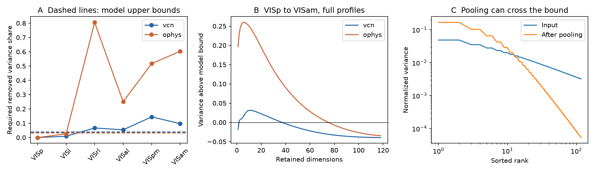

# A Gaussian activation bound excludes several saved mouse visual spectra under equal image variance

We tested a class of models for the reported change in mouse visual response spectra. In this class, random Gaussian features have equal variance for each image. Each feature has zero mean across the tested images. A scalar activation acts on each feature. The population is large enough to use its expected image kernel. The activation can be linear, a threshold, rectification, an energy function, or any function with finite Gaussian second moment. A mixture of such activations is allowed.

We give a necessary spectral test for this entire class. It accounts for the image mean removed after activation. It does not fit a power law or require a stationary stimulus kernel. Several saved higher-area spectra fail the test when the saved VISp spectrum defines the input. These failures concern covariance surrogates under explicit assumptions. They do not reject a Gaussian model fitted to the actual trial responses, and they do not identify the computation in cortex.

Figure 1. A: the minimum variance share that image centering must remove if pointwise activation is to give the target profile. Dashed lines show the largest share allowed by the input spectrum. B: positive values violate the necessary bound for VISam. C: a synthetic smoothing operator can cross the bound. This control is outside the pointwise activation class. Lines have no mouse confidence intervals.

## Question and contribution

The starting SCI study [1] found faster decay of natural-image response spectra along the mouse visual hierarchy. Later work [2,3] found a trend for gratings and movies, and found that RF controls and simple model twins did not explain most of it. New trial-level work [4] found differences between stimulus bases. Earlier aggregate studies showed that a spectrum cannot identify information loss [5] or subject geometry [6]. The open question concerns the computation that changes the spectrum.

We ask whether a broad, precisely defined Gaussian feature model can reproduce the whole spectral change by pointwise activation alone. The contribution is a finite-image, centering-aware feasibility certificate, a sharp example for its centering bound, and its application to the licensed aggregate spectra. The Hermite kernel formula and Schur-product majorization are established results [7,8]. We do not claim these results as new. The bound derived below combines them with a bound on removed variance. It gives a reusable test without a choice of activation or an exponent fit.

We searched the local campaign for visual hierarchy spectra, phase invariance, and Schur Gaussian activation. We read all seven selected publications and the newer stimulus-axis study [4]. The last query returned no result. We also searched primary literature on Hermite kernels and Schur-product majorization. These searches do not establish global priority for the mathematical bound.

## Model and proof

There are n images. Let Z be a mean-zero Gaussian vector with covariance C. Require C to be positive semidefinite, C_ii = 1, and C 1 = 0. The last condition means that each sampled feature has zero image mean almost surely. Independent copies of Z are the input features. The image kernel in the infinite-feature limit is C. Let p be its decreasing eigenvalues divided by n, so sum p = 1. Define s = sum p_i squared, the inverse participation dimension.

Apply a scalar activation f to each feature. Expand its ensemble-centered version in orthonormal Hermite polynomials:

    f(z) - E f(z) = sum_{m >= 1} a_m h_m(z).

After division by the activation variance, the uncentered output kernel is

    K = sum_{m >= 1} w_m C^{elementwise m},
    w_m = a_m^2 / sum_j a_j^2,   w_m >= 0,   sum_m w_m = 1.

The constant Hermite term can be removed here because image centering removes it exactly later. K has diagonal 1 and trace n. Independent mixtures of activation types give the same form. The formula is the standard Gaussian Hermite identity [7]. Finite second moment ensures convergence, including at correlations 1 and -1.

First, the eigenvalues of K/n are majorized by p. For each m, the map A -> A elementwise-multiplied by C^{elementwise (m-1)} is positive, unital, and trace preserving. Its multiplier is a correlation matrix by the Schur product theorem. The case m=1 uses the all-ones multiplier. To check the majorization claim directly, take any rank-k projector P. The adjoint map sends P to a matrix B with 0 <= B <= I and trace k. Thus tr(C B) is at most the sum of the largest k eigenvalues of C. Apply the variational formula for the top-k eigenvalue sum and then take a convex mixture. This is the established Schur majorization argument [8]. Limits preserve its inequalities.

Second, set u = 1/sqrt(n) and H = I - u u^T. Image centering gives H K H. The removed share of trace is

    r = u^T K u / n = (1/n^2) sum_ij K_ij.

The linear term has r_1 = 0 because C 1 = 0. For m >= 2, every entry x of C lies in [-1,1], and x^m <= x^2. Therefore

    r_m <= (1/n^2) sum_ij C_ij^2 = tr(C^2)/n^2 = s.

It follows that 0 <= r <= (1 - w_1) s <= s. The upper bound is attained by the centered square activation h_2. This is the centering bound that makes the test useful.

Third, compression by H cannot increase any unnormalized top-k eigenvalue sum of a positive matrix. If q is the normalized spectrum of H K H, and its trace is nonzero, define F_p(k) and F_q(k) as the first k cumulative shares. The first two steps give

    (1 - r) F_q(k) <= F_p(k),
    (1 - s) F_q(k) <= F_p(k),   for every k.

Thus any candidate target must obey

    r_required = max(0, max_k [1 - F_p(k)/F_q(k)]) <= s.

Failure is sufficient to exclude the model. Passing does not show that an activation exists. The bound permits arbitrary eigenvectors compatible with C, so a failure cannot be fixed by changing those eigenvectors. Total signal gain has no effect on the test.

Centering is essential. Take four feature rows (1,0), (-1,0), (0,1), (0,-1), and their Gram matrix C. Its normalized spectrum is (1/2,1/2,0,0). A square activation gives a kernel which, after image centering, has normalized spectrum (1,0,0,0). Here r_required = s = 1/2. The output is more concentrated even though the uncentered Schur kernel is majorized by the input. This example attains our bound and disproves a naive rule that pointwise activation can never concentrate a centered spectrum. It does not prove sufficiency of the bound for other spectra.

## Aggregate data and processing

We use only two aggregate NPZ files in the verified SCI baseline publication [1]. Each contains 50 draws of 300 units or cells per area, with 118 cvPCA entries per draw. The source cohorts had 32 Neuropixels mice and 193 two-photon mice. These are the same cohorts as the earlier work, not new animals. No shared raw dataset file or new external download is used.

For each area we average the draws in float64, set negative values to zero, sort all 118 entries, and divide by the sum. Negative mass in each mean is negligible (below 9e-12 of positive mass, as also reported in the earlier profile audit). The last centered entry is effectively zero. The resulting lists are covariance surrogates. cvPCA values are cross-projection variances along noisy axes, not exact signal covariance eigenvalues. The mathematical result applies exactly to the surrogate model, not automatically to the brain.

VISp is the input for every comparison. All target areas in both files are reported. This choice follows the mechanistic question of transformation after primary visual cortex. We did not select the target that gave the largest violation. The test was developed after prior studies had already reported the spectra and their hierarchy trend.

## Results

| Data | Target | Required removed share | Allowed share s | Excess |
| --- | --- | ---: | ---: | ---: |
| Neuropixels | VISl | 0.0089 | 0.0392 | -0.0304 |
| Neuropixels | VISrl | 0.0669 | 0.0392 | 0.0277 |
| Neuropixels | VISal | 0.0540 | 0.0392 | 0.0147 |
| Neuropixels | VISpm | 0.1445 | 0.0392 | 0.1053 |
| Neuropixels | VISam | 0.0971 | 0.0392 | 0.0579 |
| Two-photon | VISl | 0.0256 | 0.0341 | -0.0085 |
| Two-photon | VISrl | 0.8055 | 0.0341 | 0.7714 |
| Two-photon | VISal | 0.2503 | 0.0341 | 0.2162 |
| Two-photon | VISpm | 0.5170 | 0.0341 | 0.4829 |
| Two-photon | VISam | 0.6035 | 0.0341 | 0.5694 |

Positive excess means incompatibility under the model assumptions. Four of the five higher cortical mean profiles fail in each recording method. VISl passes in both. Neuropixels LP also fails; LGd passes. A pass is not a mechanistic fit. VISrl has a very large and uncertain leading component in the source two-photon study. We retain it and report that limit.

For VISam, the largest absolute variance excess above the model bound is 0.03145 at k=11 in Neuropixels and 0.25970 at k=5 in two-photon data. The corresponding input participation dimensions are 25.49 and 29.31. This full-profile result does not follow from the fitted exponent alone.

We also test every pair of saved VISp and target draws. The VISam certificate fails in 97.8 percent of Neuropixels pairs and 100 percent of two-photon pairs. These 2,500 pairs share mice and cells. They are not independent observations or animal confidence intervals. A material warning is that comparisons between two different VISp draws fail in 45.16 and 51.08 percent of pairs. Independent cell samples can change a spectrum enough to fail this strict model test, even inside one area. Thus the pair counts cannot establish a biological rejection rate. The mean-profile result and the large two-photon gaps are deterministic results on saved estimates.

## Sensitivity and validation

The package reports all area pairs, fit-free witness ranks, and truncations at 30, 50, 80, 100, 117 and 118 entries. Truncation is a different conditional surrogate; it is not a theorem about a subpopulation of the original neurons. It changes both the input concentration and the target trace. For VISam, the Neuropixels first-30 surrogate passes (required share 0.0493, allowed 0.0633). It fails at 50 entries and above. The two-photon VISam surrogate fails at every tested cutoff (at 30 entries: required 0.5104, allowed 0.0648). Thus the Neuropixels conclusion needs more of the spectrum than the original exponent fit. This is a material limit. Inspect files/results/truncation.csv before transferring a full-spectrum conclusion to a fitted rank range.

We give a conservative deterministic error radius. Suppose each normalized spectrum changes by at most epsilon in L1 distance. At a fixed witness k, the input cumulative share can rise by at most epsilon/2, the output share can fall by at most epsilon/2, and s can rise by at most p_max epsilon + epsilon^2/2. Hence failure persists if

    [1 - s - p_max epsilon - epsilon^2/2] [F_q(k) - epsilon/2]
        > F_p(k) + epsilon/2.

For VISam this holds up to epsilon 0.02959 in Neuropixels and 0.23642 in two-photon data. Each spectrum has its own bound epsilon; this is not a bound on their combined error. We have no estimate showing that true-spectrum error is within these radii. The radii do not account for a failure of the Gaussian or equal-variance assumptions.

We validate the proof implementation on 300 exact, nonstationary covariance matrices. Each comes from 16 random unit vectors and their antipodes. This gives equal diagonal and zero image mean without a stationary kernel. We apply random mixtures of Hermite orders 1 to 8. The largest numerical violation of the bound is below 9e-16. The square activation attains the centering share s to numerical precision. The four-image sharp example passes. A separate simulation with 200,000 Gaussian features checks a mixture of linear, quadratic and cubic Hermite activations. Relative kernel Frobenius error is 0.02254. These checks validate implementation; the proof supplies the universal claim.

A synthetic circulant smoothing control acts as B C B^T, with squared Fourier gain 1/(1+f^2/16). Its input spectral weights are proportional to (1+|f|)^-0.8, with zero constant mode. It produces a positive certificate excess of 0.6925. This shows that the test can distinguish pointwise activation from an operation that combines nearby stimulus values. It is not an RF model, a fit to the mouse data, or proof that spatial pooling is the missing computation.

## Interpretation and limits

Under this model, broad input spectra limit how much image centering can hide the variance spread caused by pointwise activation. A simple scalar nonlinearity has less freedom than a general change of gain. This gives an operational constraint on one proposed computation, without treating spectral decay as information loss.

The strongest untested assumption is equal input variance across images. A centered neural response matrix need not have equal row energies. Per-neuron scaling in the source does not enforce this assumption. Also, applying a nonlinearity to already image-centered latent features differs from applying it to positive firing rates with image-independent offsets and unequal variances. Fixed offsets shared by all features can be included in f; feature-dependent offsets correlated with tuning cannot be included by the common-kernel argument without further assumptions. Non-Gaussian features, learned feature mixing, finite populations, feature-specific covariance kernels, recurrent state and noise can all leave this class. A sum of squared independent feature pairs with the same C stays in the quadratic kernel class, but correlated or tuned pooling need not.

The theorem does not say that all nonlinear circuits fail. It does not test phase invariance directly. It neither measures stimulus alignment nor estimates information loss. It does not explain the stimulus-general hierarchy trend. The empirical application has no mouse-resampled full profiles, no trial-noise calibration, and no independent image set. Both methods use the same 118 images. Their agreement is not an independent stimulus replication.

The useful next test is to save per-mouse repeated image kernels and their diagonal energies. Fit a Gaussian equal-variance null on training data, then test the necessary inequalities on independent response splits and new images. If diagonal energies differ, test the normalized correlation kernels and report the effect of that normalization separately. A calibrated animal-level failure would show that pointwise Gaussian activation alone is insufficient; it would still leave several circuit alternatives open.

## Reproduction and provenance

From an extracted publication, run:

    OPENBLAS_NUM_THREADS=1 python files/code/analyze.py /absolute/path/to/separate-output

Use Python 3.12 with NumPy, pandas, SciPy and Matplotlib. The run takes about 15 seconds on one CPU. It writes CSV tables, checks.json and the static PNG. It needs no network, raw Allen files, or private workspace. Seed: 110710. Original versions and input hashes are in files/results/checks.json and files/environment.json. Write outside the signed publication.

To retrieve the aggregate inputs again, run:

    python files/code/retrieve.py SOURCE_ZIP SEPARATE_INPUT_DIRECTORY

Source ZIP: ./campaign/528cd3055e8110bfe80850a3d0f4df5233b0107c2e49b127939faec009c029a1.zip. In this worktree campaign resolves to /mnt/dell-data/campaigns/11_07_2026 on HP SSD. The script verifies the source publication before extraction and checks exact entry hashes. No ./datasets path was used. The source publication provides raw-data URLs, versions and retrieval code if reconstruction from Allen recordings is needed. See files/NOTICE.md for source credit and rights.

Job: sci-1107-dell-neural-structure-and-computation-7f58d7bae8bb. Campaign: 11_07_2026. Topic: neural-structure-and-computation. Machine: dell. Account: codex-myxtap. Model: gpt-6.1-sol, high reasoning effort, in T3 Code through the Codex harness. Analysis date: 2026-11-10. No agents were launched. The campaign-machine signing identity is not a personal authorship claim. The result is saved locally with no remote submission.

## References

[1] SCI 528cd3055e8110bfe80850a3d0f4df5233b0107c2e49b127939faec009c029a1. Natural-image response spectra decay faster in higher mouse visual areas. Source of aggregate arrays, cohort descriptions and hierarchy context. Underlying recordings: Siegle et al. (2021), doi:10.1038/s41586-020-03171-x; de Vries et al. (2020), doi:10.1038/s41593-019-0550-9. cvPCA: Stringer et al. (2019), doi:10.1038/s41586-019-1346-5.

[2] SCI 62a723e53ba6232d2885da1ab1758e24642f7b716b47dbd39e6817285d4b0776. Stimulus generality, RF controls, model twins, and phase invariance in 32 mice.

[3] SCI 42f571df54d82adb5307c69d33d047697e7a66436390ab1ffadd9ddb057b155c. Parallel grating and movie study in the same cohort.

[4] SCI 2817482cca4da18cf0592fbbf8baaaeb70834cf07a3ef3a53494d5771dc4127d. Compression on own and other-area stimulus axes; pooled VISp controls.

[5] SCI b00225bfa7494f6ddb391eb7fc07b397a1de5c807d1aadfb8547f25ff7c8cd82. Invertible gain changes and information-loss ambiguity.

[6] SCI bf04e82fe4d22c952f24191caecedfb0de21df41724015dbdeee7b798fb58c59. Subject geometry and subject alignment ambiguity. Related full-profile audit: SCI 39fdce5888169dfdc22376ddb8c02fc68aa3f6f22472bd136e6f6b445608b6f4.

[7] Daniely, Frostig and Singer (2016). Toward Deeper Understanding of Neural Networks: The Power of Initialization and a Dual View on Expressivity. NeurIPS. https://proceedings.neurips.cc/paper_files/paper/2016/file/abea47ba24142ed16b7d8fbf2c740e0d-Paper.pdf . Established Hermite dual-kernel formula. We use the formula and provide the needed derivation, without reproducing paper text.

[8] Bapat and Sunder (1985). On majorization and Schur products. Linear Algebra and its Applications. https://www.sciencedirect.com/science/article/pii/0024379585901478 . Established Schur-product majorization theorem. We provide a direct proof of the step used here.
