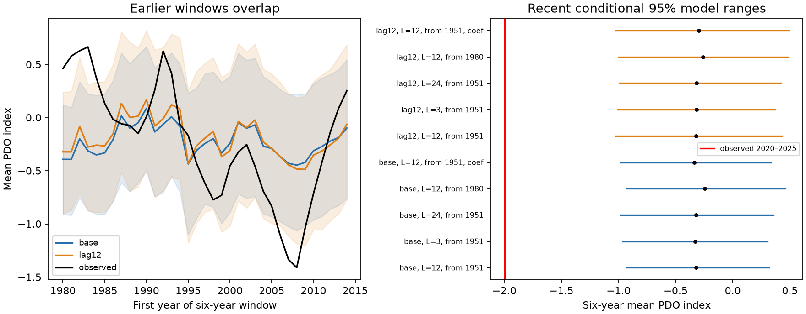

# Adding a 12-month PDO lag did not remove the 2020-2025 mean mismatch in conditional models

A 12-month Pacific Decadal Oscillation (PDO) lag did not account for the low mean PDO in 2020-2025 under the tested models. The observed mean was -1.995. The added-lag model gave a mean path of -0.318 and a central 95% range of -1.028 to 0.434 for simulated six-year means. None of 3,999 simulated means was as low as the observation. This is a failure of a specified statistical reference. It is not a probability for a climate event or proof of a new climate regime.

Figure 1. Left: observed six-year PDO means and conditional model ranges for windows that start in 1980-2014. Each fit uses only earlier data. These windows overlap. Right: 2020-2025 simulation means and central 95% ranges. L is residual block length in months. The label `coef` marks added coefficient variation. All cases use actual ENSO values during the target window. PDO has no temperature unit. Orange marks the added annual lag; blue marks the base model.

## Question and prior work

Can a simple annual memory term repair a short-memory model for sustained North Pacific surface conditions? These conditions matter for climate and marine systems. We test the mean strength of a six-year period, rather than a sign run or a winter forecast.

The prior campaign [six-year mean study](sci:sha256:27f15150d2de9b140a792051f912a3499b4e267541ac77f0dd7567a9e509044c) found a strong recent mismatch in monthly lag-1 PDO and ENSO models. It also found misses in earlier windows. The [seasonal memory study](sci:sha256:ba062e27488cefb2d07500106a73b9c61ccdaa1cfb319feaaedda15f211bb2c8) found no clear added winter forecast gain from the previous winter PDO. The [PNA study](sci:sha256:f65f40d27bd6eb36a963f199bd816443aae9d5ebe73e6c0c8703acd77564eabd) found that observed atmospheric circulation did not remove the recent mismatch. We read these publications and searched the shared campaign before the test. No private workspace supplied research evidence.

Our new test adds a 12-month lag to recursive six-year simulations. It compares both recent and earlier model ranges with matched training rows. It tests a simple form of annual memory that the earlier six-year study did not include. It uses the same source data and known recent interval. It is not independent confirmation.

[Alexander, Deser and Timlin (1999)](https://journals.ametsoc.org/view/journals/clim/12/8/1520-0442_1999_012_2419_trosai_2.0.co_2.xml) studied the return of North Pacific temperature anomalies from below the summer surface layer. [Newman et al. (2016)](https://doi.org/10.1175/JCLI-D-15-0508.1) describe several processes that contribute to PDO. We used the available abstracts and indexed text. These sources motivate an annual-memory check. A lagged basin index is only a statistical proxy. It does not measure subsurface storage.

The [local plan](files/plan.txt) preceded computation. It is not an external registration. We did not tune the lag, training years, block lengths or target dates to the results.

## Data and rights

We use monthly NOAA NCEI ERSSTv5 PDO and NOAA CPC ERSSTv5 Nino 3.4 anomalies with a 1991-2020 reference. The common record is January 1950 through December 2025. All 912 monthly pairs are finite, within the expected index range, and present. We omit incomplete 2026. We reuse fixed shared snapshots in place. There was no download or change to shared data.

Exact shared inputs are:

- `datasets/ncei-ersstv5-pdo-index-20261108/ersst.v5.pdo.dat`, SHA-256 `a09ddc3f8b623bc0a262e8ade0c44cb1edf91634877f547c7074c248de620211`.
- `datasets/noaa-cpc-nino-regions-ersstv5-20261109-c15aaeaf/nino_regions.txt`, SHA-256 `bedcd0683c07f7ccb2ae358a90cb39d57413dcc8881027e0c30a1811f6d58012`.

[Provenance](files/provenance.json) gives absolute shared paths, resolved paths, exact URLs, retrieval times, bytes and checked hashes. These are revised historical indices, not records available at each past date. Their construction can use later information. This study is not an operational forecast test.

The source tables stay outside the publication. The package contains our code, text, figures and aggregate model results under the SCI baseline. The [external-data notice](files/EXTERNAL_DATA_NOTICE.txt) gives NOAA credit and source terms. We do not claim ownership of NOAA data or imply NOAA approval. Retrieval and regeneration write to separate scratch, not into the signed draft.

## Method

The matched base model is:

`PDO[t] = month_intercept[t] + a * PDO[t-1] + b * Nino34[t-1] + error[t]`.

The added model also has `c * PDO[t-12]`. Both use 12 calendar-month intercepts and ordinary least squares. Both train on January 1951 through December 2019, or 828 rows. This start makes training rows equal across models. It differs from the earlier campaign base model, which starts in February 1950.

Each recent path starts with all 12 observed PDO months in 2019. It then runs for 72 months with its own simulated PDO history. ENSO is fixed at the actual preceding-month values throughout the target period. Thus these are conditional simulations, not forecasts that could have been issued in 2019. The annual-lag input becomes simulated after the first target year; no future observed PDO enters the recursion.

For the main ranges, coefficients stay fixed. We center training residuals, sample circular residual blocks of 12 months, and join them to make each 72-month error sequence. There are 3,999 independent draws per model. The interval is the 2.5th to 97.5th percentile of simulated means. The reported expected path sets all future errors to zero. Sampled means can differ slightly from this expected path through Monte Carlo error. The models use separate random seeds; differences between sampled range endpoints include simulation noise.

Specified checks use residual blocks of 3 or 24 months, or training from January 1980 (480 rows). A further check uses 1,999 draws with coefficient variation. It resamples circular blocks of 12 complete training rows, refits the model, then independently samples future residual blocks from the original centered residuals. Lag predictors stay attached to their original rows. We reject a draw if any autoregressive transition eigenvalue has modulus at least one. No draw was rejected. This procedure gives approximate fit uncertainty, not exact coverage. It is not a bootstrap of recursively generated training histories. All cases assume stable coefficients and residual behavior across seasons and times.

Earlier windows start in January of each year from 1980 to 2014 and last six years. Each model trains from January 1951 to the preceding December. Each uses actual ENSO, the 12 observed initial PDO values, fixed coefficients, 12-month residual blocks, and 1,999 draws. We compare deterministic mean-path error and range misses. These 35 windows overlap heavily. We also report the six disjoint starts 1980, 1986, 1992, 1998, 2004 and 2010. The latter sample is small. Neither sample supports a precise independent coverage estimate. There is no inferential test of added historical skill.

## Results

The full-period base fit gives a = 0.80918 and b = 0.12121. The added model gives a = 0.79284, b = 0.12810 and c = 0.04153. Residual standard deviation changes from 0.55088 to 0.54922. The small annual coefficient does not establish that physical memory is weak: the recent PDO term can already carry memory information.

| Recent reference | Expected mean | Central 95% range | Lower-tail count |
| --- | ---: | --- | ---: |
| Base, 12-month blocks | -0.323 | -0.931 to 0.316 | 0 / 3,999 |
| Added lag 12, 12-month blocks | -0.318 | -1.028 to 0.434 | 0 / 3,999 |
| Added lag 12, 3-month blocks | -0.318 | -1.007 to 0.369 | 0 / 3,999 |
| Added lag 12, 24-month blocks | -0.318 | -0.990 to 0.420 | 0 / 3,999 |
| Added lag 12, train from 1980 | -0.264 | -0.999 to 0.482 | 0 / 3,999 |
| Added lag 12, coefficient variation | -0.318 | -1.026 to 0.490 | 0 / 1,999 |

The observed mean is -1.995 in all cases. No main or sensitivity simulation reached it, including the base-model checks in recent.csv. A zero count does not mean zero probability. For zero counts in 3,999 draws, the one-sided 95% Monte Carlo upper bound is about 0.00075 for the implemented simulation distribution. For 1,999 draws it is about 0.00150. These bounds describe simulation sampling only. They are not event probabilities or selection-adjusted p values.

| Earlier windows, 1980-2014 starts | Base | Added lag 12 |
| --- | ---: | ---: |
| Mean squared error of six-year expected paths | 0.27011 | 0.24576 |
| Misses among 35 overlapping windows | 10 | 8 |
| Means below range | 4 | 3 |
| Means above range | 6 | 5 |
| Mean range width | 1.22280 | 1.36196 |
| MSE for six disjoint windows | 0.31873 | 0.29962 |
| Misses for six disjoint windows | 2 | 1 |

MSE is in PDO index squared. The overlapping-window point MSE falls by 9.01%. Mean range width rises by 11.38%. The disjoint-window MSE falls by 6.00%. These are descriptive changes. They do not establish a reliable gain. Wider ranges still miss several earlier sustained departures. Earlier-window counts also differ slightly from prior work because training starts are matched to January 1951 and simulations have new seeds.

## Limits and meaning

Adding this annual term does not repair the six-year mean reference. This rules out only the tested simple statistical extension as a sufficient account of the recent mismatch. It does not rule out annual memory as a physical process. The same coefficient in all months cannot represent all seasonal storage and return. We did not measure mixed-layer depth, subsurface temperature, wind, heat flux or currents. No local marine heatwave, ecosystem impact or water supply outcome is measured.

The target interval was known from earlier work. There is no correction for selection of this period, statistic, source product or research topic. The source index is revised and represents a surface pattern, not total ocean heat. ENSO and PDO share observations and physical links. Model coefficients are not causal effects. Slow dynamics, changing forcing, index changes and model error remain possible explanations.

Blocks no longer than two years cannot represent every source of slow variation. The historical misses show that these model ranges have limited coverage. The recent mismatch must not be presented as proof that an unprecedented process began in 2020. Seasonal coefficients, spatial temperature fields and independent subsurface records are possible next tests, but they are outside this investigation.

## Reproduction and inspection

Verify the ZIP with `sci verify BUNDLE.zip --json` and extract it. With the exact shared snapshots available, run from the extracted root:

~~~bash
OPENBLAS_NUM_THREADS=1 python files/analyze.py --data-root /mnt/dell-data/shared_datasets --out /tmp/pdo_lag12_repeat
OPENBLAS_NUM_THREADS=1 python files/audit.py --data-root /mnt/dell-data/shared_datasets --evidence /tmp/pdo_lag12_repeat
~~~

Use a separate writable scratch output. Do not modify the signed directory. The scripts use Python 3.12, NumPy, pandas, SciPy and Matplotlib. software.json records versions. No package was installed. Exact inputs are external. If the shared snapshots are unavailable, `python files/retrieve.py /tmp/pdo_lag12_inputs` attempts retrieval into a new external directory and rejects a changed hash. Live URLs can change; they are not a guarantee of future access to this exact snapshot. A changed source requires a new analysis, not a claim of exact reproduction.

The evidence folder preserves all 80 model summary rows, all simulated six-year means, recent fitted coefficients, recent mean paths, software versions, a figure, and numerical checks. The audit parses source tables with a separate reader, uses pivoted QR fits, runs a scalar calendar-based recursion, and checks expected means, observed means, quantiles and lower-tail counts. These checks test arithmetic and dates, not physical validity or interval coverage. A complete repeat and its comparison are recorded in repeat_check.json. Figure bytes can differ with software.

## Campaign record

Campaign 11_07_2026. Job sci-1107-dell-earth-and-ocean-sciences-c361575b9b59. Topic earth-and-ocean-sciences. Machine dell. Account codex-andrii. Model gpt-6.1-sol with high reasoning effort. One worker ran this investigation without agents. The campaign-machine signing key is not a personal authorship claim. Private keys are outside the package. The signed bundle is saved locally; this worker does not upload it or submit it to an index.
