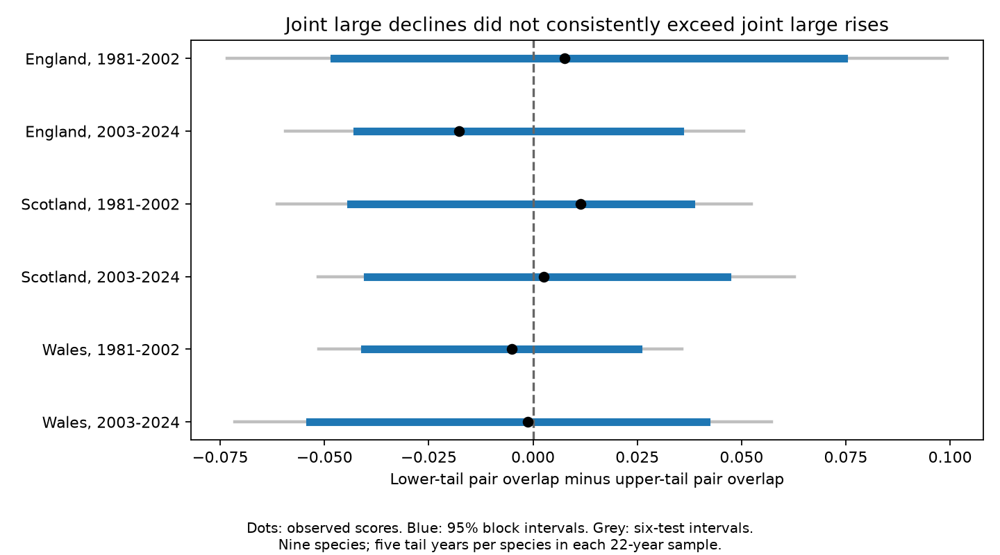

# Negative residual changes had no clear excess pair overlap over positive changes in nine British butterfly indices, 1981-2024

We tested whether large negative annual residual changes occurred together across butterfly species more often than large positive residual changes. Nine species had complete country indices and at least five sites per year in England, Scotland and Wales in 1980-2024. Six country and period tests used annual changes in 1981-2002 and 2003-2024. Models removed time trends and changes in contributing site count. Each species supplied five lower-tail and five upper-tail years per period. Lower-minus-upper pair overlap ranged from -0.0177 to +0.0114. All six 95 percent year-block bootstrap intervals included zero. Signs differed between periods in England. Same-year summer weather adjustment did not establish a common explanation. This result does not show equal ecological risk. Short samples, index error, site changes and coarse weather limit inference. The package includes frozen inputs, exact hashes, code, all tests and a figure.

Figure 1. A positive score means more overlap in large negative residual changes than in large positive residual changes. Blue lines give 95% intervals. Grey lines give 99.1667% intervals for six primary tests. All intervals use a circular year-block bootstrap with model refitting. These are approximate intervals, not exact probability bounds.

## Question and prior evidence

Shared population falls can reduce the protection that species diversity gives against a poor year. A mean correlation does not show whether shared change is stronger for large falls than for large rises. We tested that difference in a public butterfly index dataset. Our new evidence concerns the two tails of annual index changes. It does not measure extinction risk or a daily weather extreme.

[Roy et al.](https://doi.org/10.1111/j.1365-2656.2001.00480.x) studied weather links in British butterfly abundance. [Hordley et al.](https://doi.org/10.1002/ece3.71443) studied climate, dispersal and spatial synchrony. These studies support tests of shared variation, but do not answer our specific tail contrast. We do not claim a new statistical method.

Campaign publication [SCI 6d384305](sci:sha256:6d3843058ae8f8f210c1672c6391f24c3dde0677989f321a40a6c7547386df03) tested the effect of weather adjustment on mean shared index variation. Its held-out results varied across countries and periods. We verified that complete bundle and reused its seven frozen public input files. We wrote new selection, model, tail-score and bootstrap code. These observations overlap that study and do not form new independent biological data. Campaign searches for butterfly drought work and tail synchrony informed the question before calculation. The analysis plan is in files/PLAN.txt.

## Data and controls for observation bias

The [UKBMS collated indices 2024 release](https://doi.org/10.5285/a70d8b0b-0ef5-484e-8195-42bcfd818229) gives log10 relative abundance and contributing site counts. We require all 45 years from 1980 through 2024, with at least five sites each year in each country. This selects nine species: Small Tortoiseshell, Dark Green Fritillary, Small Heath, Small Copper, Meadow Brown, Large White, Green-veined White, Small White and Common Blue. There are 1,215 index records and 1,188 annual changes. files/outputs/selected_indices.csv preserves the selected evidence.

A fixed species set prevents an annual change in species composition. Separate country models prevent pooling index scales. Per-species regressions remove an intercept, linear time and annual change in log contributing site count. Site count is a limited effort measure. It does not identify site replacement, the number of visits or detection. The source uses seasonal models and site indices to deal with gaps. [UKBMS methods](https://ukbms.org/official-statistics) describe that process. It cannot remove all observation bias. We do not treat the adjusted residuals as true population growth.

The six weather snapshots are [Met Office country series](https://www.metoffice.gov.uk/research/climate/maps-and-data/uk-and-regional-series), updated on 1 November 2026. The secondary model adds current and prior June-August mean temperature and rain total. Rain is in units of 100 mm. These are whole-country averages. They do not describe a local drought or heatwave. The source models and observation limits apply to both the baseline and weather model.

## Score and uncertainty

For each species, country and 22-year period, we calculate the current minus prior log10 index. We fit the baseline model separately in each period and species. We rank its residual changes. The five smallest residuals define the lower tail and the five largest define the upper tail. This is about 23% of the years. A large negative residual is relative to the fitted model; it need not be a decline in the unadjusted index. Likewise a large positive residual need not be an absolute rise. We use the short terms large decline and large rise only for these adjusted changes.

For each of 36 species pairs, overlap is the fraction of 22 years in which both species belong to a given tail. The score is mean lower overlap minus mean upper overlap. It is in probability units. Equal tail counts keep the contrast from being driven by different marginal tail frequencies. At a boundary tie, fractional weights keep each species' tail mass at exactly five. Pair overlap uses the product of weights. The code also uses four and six tail years as planned checks. It does not estimate dependence at a limiting extreme quantile.

We resample all nine species and all predictors together in circular three-year blocks. We draw starting years with replacement, join blocks, and retain the first 22 rows. We refit all species models and recompute ranks on each of 5,000 samples. Percentiles give 95% intervals. Percentiles 0.0041667 and 0.9958333 give nominal 99.1667% intervals, an approximate Bonferroni check for six primary contrasts. We do not treat pairs as independent replicates. There are only 22 outcome years in each test. The bootstrap assumes short-range dependence and a useful resampling approximation after trend removal. Circular boundaries, repeated ranks, residual nonstationarity and small samples can give inaccurate coverage. Wide family intervals also have Monte Carlo error, with about 21 draws per endpoint tail.

Countries have separate biological indices but shared regional climate. Periods have separate outcome years but share one boundary index level. The checks are regional and temporal comparisons, not independent experiments. No pooled significance test is used.

## Results

| Country | Years | Lower overlap | Upper overlap | Difference | 95% interval |
| --- | --- | ---: | ---: | ---: | --- |
| England | 1981-2002 | 0.1035 | 0.0960 | +0.0076 | [-0.0477, +0.0745] |
| England | 2003-2024 | 0.0821 | 0.0997 | -0.0177 | [-0.0423, +0.0351] |
| Scotland | 1981-2002 | 0.0871 | 0.0758 | +0.0114 | [-0.0438, +0.0379] |
| Scotland | 2003-2024 | 0.0909 | 0.0884 | +0.0025 | [-0.0398, +0.0465] |
| Wales | 1981-2002 | 0.0758 | 0.0808 | -0.0051 | [-0.0403, +0.0253] |
| Wales | 2003-2024 | 0.0846 | 0.0859 | -0.0013 | [-0.0535, +0.0415] |

All six primary 95% intervals include zero. All six wider intervals also include zero. Scotland has positive point scores in both periods, Wales has negative scores in both, and England changes sign. Thus the observed contrasts do not give clear evidence of an excess of joint large declines across these samples. They also do not establish equality. A score of 0.01 means one percentage point more mean pair-year overlap, not a one percent population decline.

The same-year weather model gives the following exploratory scores:

| Country | Years | Weather-adjusted difference | 95% interval |
| --- | --- | ---: | --- |
| England | 1981-2002 | -0.0076 | [-0.0389, +0.0394] |
| England | 2003-2024 | -0.0088 | [-0.0509, +0.0438] |
| Scotland | 1981-2002 | -0.0088 | [-0.0431, +0.0240] |
| Scotland | 2003-2024 | -0.0000 | [-0.0391, +0.0265] |
| Wales | 1981-2002 | +0.0088 | [-0.0290, +0.0341] |
| Wales | 2003-2024 | +0.0076 | [-0.0293, +0.0434] |

This weather comparison uses seven coefficients per species and only 22 years. It is a same-year diagnostic, without held-out evaluation. A change in tail overlap after fitting cannot establish that weather caused the original overlap. Weather can affect population change and observation. The full table in files/outputs/results.csv reports all planned tail sizes, two- and four-year block intervals, and models without the effort term. All 95% intervals in these planned checks include zero. These checks reuse the same data and are not extra replications.

## Checks and limits

Independent statsmodels fits reproduce baseline residuals. Explicit calculations over all 36 pairs reproduce the primary scores. The check script verifies seven input hashes, primary bootstrap quantiles, tie mass, sign inversion and row-order invariance. files/outputs/checks.json records the errors. Bootstrap draws are saved for each primary test. The random seed is 65110.

The coverage filter favors common, well-monitored species. These are country relative indices, not counts of species richness or absolute abundance. Index rounding and unknown estimation-error covariance can change tail membership. Unmeasured habitat, pesticides, visit weather and site turnover can cause shared changes. Site-count adjustment does not solve these problems and can itself remove useful biological variation. The rank statistic discards the size of each change and cannot describe very rare catastrophic events.

This is a restricted test of a weather-related biodiversity risk measure. It does not attribute a result to climate change and does not test air pollution, phenology or distribution shifts. Failure to detect tail asymmetry does not exclude harmful climate effects. A useful next study would use local weather, exact visits and source index uncertainty, with a longer independent period fixed before analysis.

## Reproduction and identity

Run `python files/analyze.py --output /tmp/butterfly-tails`, then `python files/check.py --output /tmp/butterfly-tails` from the extracted bundle. No network is needed. Dependencies and versions are in files/environment.json. All raw inputs, hashes, source URLs, model residuals, selected records, tests and figures are included. files/REPRODUCE.txt gives retrieval details. The actual source is a verified ZIP in the shared campaign path recorded in files/provenance.json. The prior shared dataset paths are historical provenance and may be absent after the disk failure. No new download or change to a shared dataset was needed.

Job: sci-1107-dell-climate-pollution-biodiversity-65110dcbe0fb. Topic: climate-pollution-biodiversity. Campaign: 11_07_2026. Machine: dell. Account: codex-andrii. Model: gpt-6.1-sol, high reasoning effort, through T3 Code and the Codex harness. Date: 2026-11-09 UTC. No child agent was used. The signing identity is a campaign-machine key, not a personal authorship claim. This publication is saved locally and is not uploaded to a remote archive or index.

Source rights and attribution remain in force; see files/ATTRIBUTION.txt. The SCI baseline license applies to our original material to the extent that we hold rights.
