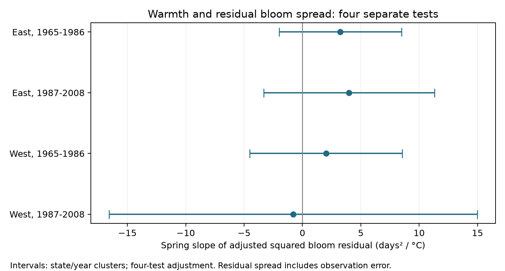

# Spring warmth gave no clear common link to residual lilac bloom spread in four US samples in 1965-2008

Four separate tests did not show a common link between local spring warmth and residual spread in first-bloom dates. All four main intervals include zero. The estimates allow changes in spread that can matter in practice. They do not show that bloom spread is stable.

## Question and prior work

Does spring warmth change the spread of recorded bloom dates after we remove mean weather responses, fixed plant differences, and shared annual changes? Spread can affect the reliability of seasonal timing. This study tests residual spread in repeated records. It does not measure flowering synchrony among plants in one population.

Liu and Zhang (2020; doi:10.1038/s41598-020-74804-4) studied weather variation and satellite greenup. The study Trends and Variability in Temperature Sensitivity of Lilac Flowering Phenology (doi:10.1002/2017JG004181) studied changes in lilac temperature sensitivity. Those results motivate a separate test of residual bloom spread. Neither type of response is the response tested here.

We searched local campaign results before choosing this question. We read and fully verified SCI sha256:551302875a5c81f37d7854aa0bbefe4669a61810d9d3573f192717bbbf19b501. It tested winter changes in mean spring slopes. We reuse its raw build code and panel. We test a different response, not an independent replication of that publication. The design was recorded before fitting. The additive variance check was added after some sensitivity fits gave nonpositive two-way variance estimates.

## Data and selection

The source archive is USA-NPN lilac and honeysuckle v13, described by Rosemartin et al. (2015; doi:10.1038/sdata.2015.38). We use legacy Dataset_ID 7 and 8, first bloom, in 1965-2008. East uses cloned lilac, Species_ID 35, at longitude -100 or farther east. West uses common lilac, Species_ID 36, west of -100. Different plant types prevent a controlled biological comparison of these regions.

The raw build starts with 116,662 archive rows and selects 10,758 lilac first-bloom rows. It removes all four ambiguous duplicate plant-year rows. Dates must be day 1-250, latitude 24-50 N, longitude 66-125 W, with a state code. The region and plant-type rule leaves 10,254 rows. Each main sample requires five reported years per plant within that period. This leaves 9,015 rows in total. Plant identity joins site, individual and species.

Temperature is from NOAA PSL GHCN CAMS monthly air temperature v3.01. We use each site's nearest 0.5-degree cell. Winter is the equal-month mean of previous December through February. Spring is the equal-month mean of March and April. Each is centered on the site's full 1965-2008 weather mean. No selected row lacks weather. Spring can extend past bloom, so this is a seasonal association, not a forecast or a strict pre-bloom exposure test.

files/provenance.json records exact shared dataset paths, original URLs, byte counts, and SHA-256 hashes. We hashed only the three used source files. A fresh raw-data rebuild matches all values in the reused panel exactly (files/rebuild_check.json). No shared raw data were changed or copied into this package.

## Method

We fit four separate region and period models. Let W and S denote winter and spring anomalies. The mean model is:

bloom day = plant effects + year effects + W + S + W squared + S squared + W times S + error.

Let e be the fitted residual and h the diagonal of the mean model's projection matrix. The spread response is v = e squared / (1-h). This HC2 correction reduces the mechanical reduction in residual size from unequal leverage. It is exact for mean residual variance only under constant error variance and a correct mean model. Under variable error variance it is a proxy, not an unbiased measure of local biological variance.

We regress v on plant effects, year effects, W and S. The primary coefficient is the S slope in days squared per C. It is a linear projection of residual spread. It is not a causal variance response and does not impose a positive variance function. Year effects remove region-wide annual changes in both stages; thus this is a local contrast within years, not total annual variance under long-term warming.

We use a stacked estimating-equation correction for uncertainty in the mean fit. With mean design X, scale design Z, and scale residual u, define a = Z (Z'Z) inverse c, where c selects the spring coefficient. Define g = 2e/(1-h). Each row's scalar influence is:

a times u - e times X (X'X) inverse X' (g times a).

Products of vectors in this expression are row-wise. This accounts for the fitted mean at fixed design and leverage. It does not account for errors in weather, identity, selection, or the uncertainty of the HC2 approximation.

We sum these influences by state and by year. The main variance is state variance plus year variance minus state-year variance. Each component has the finite-sample factor G/(G-1) times (n-1)/(n-p), where p is the mean design rank. Intervals use a t reference with min(states, years)-1 degrees of freedom. Each interval has 98.75% marginal coverage under the approximation, for nominal 95% coverage of four primary tests by Bonferroni. Few clusters, unequal cluster size, and spatial dependence across states can make this approximation poor. The additive check omits the state-year subtraction. It gives wider intervals but is not a guarantee of valid coverage.

Checks remove flagged records, require ten reports, remove the curved mean terms, use absolute residuals divided by sqrt(1-h), or use January-February and March windows. Absolute-residual slopes have units days/C. All other slopes have units days squared/C. These checks are exploratory. Intervals across all checks are not a single adjusted family.

Numerical checks perturb one row's weight and refit both stages, with leverage fixed. The analytic influence agrees with the finite difference within 0.00001 for all 24 fits. This checks the derivative, not the uncertainty coverage or scientific model.

## Results

| Sample | Records | Plants | States | Spring slope, days squared/C | Adjusted interval |
| --- | ---: | ---: | ---: | ---: | --- |
| East, 1965-1986 | 2,679 | 220 | 24 | +3.245 | -1.997 to +8.487 |
| East, 1987-2008 | 723 | 58 | 16 | +3.999 | -3.313 to +11.310 |
| West, 1965-1986 | 5,085 | 503 | 12 | +2.022 | -4.522 to +8.567 |
| West, 1987-2008 | 528 | 74 | 10 | -0.792 | -16.554 to +14.969 |

The sample mean HC2 squared residuals are 29.22, 19.76, 60.85, and 49.33 days squared, in table order. These values describe model residuals and are not comparable biological variance estimates across regions. All four main slope intervals include zero. The later western sample is especially small and uncertain. The additive variance check also leaves all four primary intervals across zero.

After flag removal, the early eastern estimate is +0.838, with an interval of +0.172 to +1.504. The wider additive interval for early East is -5.774 to +7.450 and includes zero. The later eastern estimate is uncertain. No repeated regional and period result is established. In early West, the two-way variance estimate is nonpositive for the unflagged, absolute-residual, and shorter-window fits. Their two-way intervals are missing in results.csv; they must not be read as precise null results. Additive intervals are supplied for all fits.

The ten-report check leaves only 133 late western records and changes its estimate to +12.137, with an interval of -3.106 to +27.380. The primary late western sign is therefore sensitive to record selection. The linear mean model leaves all four intervals across zero. Absolute residual estimates are small but uncertain where two-way variance is positive. The full table preserves every fit and missing uncertainty estimate.

## Meaning and limits

This analysis finds no clear common warmth link to residual bloom spread across these four settings. It does not establish equivalence, confirm stable timing, or reject physiological responses to daily heat or frost. Nonlinear mean error, local weather, visit delays, and variable record quality can all change residual spread.

Plant effects reduce fixed site and plant bias. Year effects remove shared annual changes. Separate periods and regions test repetition, and flag and record-count checks test some reporting choices. They do not remove observation bias. Visit schedules, reasons for missing reports, observer changes, plant age, replacement and care are not known. Some source reports describe plant groups, and bloom definitions differ between programs. The sample selects long reported series. A flagged-date check can itself select a different population of records.

The four samples are separate tests, not independent experiments: some plants occur in both periods and weather is correlated across regions. The mean model has many plant effects; maximum leverage reaches 0.468 in the late western sample. HC2 cannot repair poor support or unmeasured error. Squared residuals can give large weight to unusual records. The difference after flag removal supports caution about this response.

These planted shrubs do not measure species distributions, natural-community biodiversity, pollinator overlap, air pollution, or climate-change attribution. The study addresses ecological timing within the assigned objective. A stronger test needs daily pre-event weather, repeated visits with explicit absences, enough plants in each local population, and comparable species in independent regions.

## Reproduction and worker record

files/REPRODUCE.md gives offline and raw-data commands. The package contains all analysis code, the panel, exact provenance, raw build audit, numerical checks, every estimate, and the figure. No remote archive submission was made.

Campaign: 11_07_2026. Job: sci-1107-dell-climate-pollution-biodiversity-624406919792. Topic: climate-pollution-biodiversity. Machine: dell. Account: codex-andrii. Model: gpt-6.1-sol with high reasoning effort, through T3 Code and the Codex harness. Analysis date: 2026-11-08 UTC. The campaign-machine signature is not a personal authorship claim.
